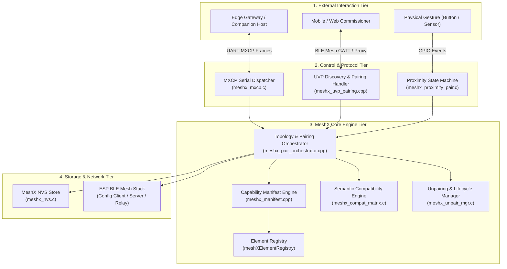

# Technical Reference Manual: Autonomous & Intent-Driven Element Pairing

**Document:** `design.md` (Master TRM Index)  
**Spec Identifier:** `autonomous-element-pairing`  
**Target:** MeshX BLE Mesh Runtime Engine, Element Registry & UVP Subsystem  
**Interactive Architecture Models:**  
- [protocol-architecture.html](./protocol-architecture.html) (Protocol & Subsystem Stack)  
- [topology-orchestration.html](./topology-orchestration.html) (Topology Orchestration & Anchor Node Logic)  

---

## 1. Executive Summary & Problem Statement

Traditional Bluetooth Mesh commissioning and device pairing is rigid, slow, and heavily tied to manual, low-level protocol operations:
- Querying raw Composition Data Page 0 binary blobs lacking semantic context.
- Manually calculating element offsets (`0`, `1`, `2`...) and matching raw Model IDs.
- Manually allocating Application Keys (`AppKeyAdd`) and binding them to models (`ModelAppBind`).
- Manually calculating group addresses and writing publication and subscription lists for each model.

The **MeshX Autonomous & Intent-Driven Element Pairing Subsystem** decouples **Semantic Intent** from **Mesh Transport Plumbing**:
1. **Self-Describing Manifest ("Nodes Tell"):** Nodes self-reflect their active baked elements, logical models, roles (`PRODUCER`, `CONSUMER`), and supported `func_id` list without requiring external cloud lookup tables.
2. **Semantic Compatibility Engine:** Enforces a type-safe binding contract, validating producer-consumer traits and rejecting invalid links prior to network execution.
3. **Automated Topology Planner ("Plumbing"):** Automatically calculates whether a link requires 1:1 unicast publication or 1:N group address allocation (`0xC000`–`0xC3FF`), configures stack tables, and commits bindings to NVS.
4. **Autonomous Dual-Mode Pairing:** Enables devices to pair in the field without any smartphone or gateway via (a) 1-hop RSSI proximity filtering ($\ge -50\text{ dBm}$), or (b) multi-hop relayed mesh pairing across distant hopping nodes.
5. **Dangling Peer Prevention & Graceful Teardown:** Mandates a pre-reset dismantle handshake before factory reset key erasure, ensuring peers clear publication targets and subscriptions before the node reboots.
6. **Decoupled Provisioner Synchronization:** Employs a monotonic 16-bit `link_epoch` to reconcile offline autonomous field pairings lazily when the commissioner reconnects.
7. **Dynamic Personality Conflict Resolution:** A 4-tier defense architecture protecting against runtime element removals, mutations, shifts, or expansions.

---

## 2. Interactive Architecture Diagrams (Archify)

Two explorable, validated standalone interactive architecture models have been compiled using `archify`:

> [!TIP]
> - **Protocol & Subsystem Stack:** Open [protocol-architecture.html](file:///d:/MeshX/.specs/autonomous-element-pairing/protocol-architecture.html) to inspect the 4-tier protocol hierarchy, UVP message formats, and data paths.
> - **Topology Orchestration & Anchor Node Logic:** Open [topology-orchestration.html](file:///d:/MeshX/.specs/autonomous-element-pairing/topology-orchestration.html) to inspect the Anchor Node Classifier, Dynamic Promotion engine (1:1 $\to$ Group), deterministic hash allocation, and group reference counting.

---

## 3. Multipage Technical Reference Manual (TRM) Index

The complete technical implementation specification is partitioned into eight modular reference sheets:

| Sheet | Module Title | Primary Focus & Deliverables | Addressed Requirements |
| :---: | :--- | :--- | :--- |
| **01** | [Capability Introspection](./design/01_capability_introspection.md) | `meshXElementRegistry` reflection, `meshx_capability_manifest_t`, role and trait extraction, BLE ADV unprovisioned service data flags. | [REQ-001, REQ-003](../requirements.md) |
| **02** | [UVP Discovery Protocol](./design/02_uvp_discovery_protocol.md) | In-Mesh UVP management opcodes (`0xFFFE`, `0xFFFF`), query/report wire frames, MXCP serial framing, $\le 375$-byte access payload budgeting. | [REQ-002, REQ-009](../requirements.md) |
| **03** | [Semantic Compatibility Engine](./design/03_semantic_compatibility_engine.md) | Client-Server trait compatibility matrix, `func_id` matching rules, validation pipeline, and structured error handling. | [REQ-004](../requirements.md) |
| **04** | [Topology Orchestration](./design/04_topology_orchestration.md) | Intent resolution, Clean 2-Tier Group Management, Anchor Node Rule (`0xC000 + Anchor_Unicast`), 1:1 to group promotion, and dynamic group reclamation. | [REQ-005](../requirements.md) |
| **05** | [Autonomous Pairing Modes](./design/05_autonomous_pairing_modes.md) | Mode A (1-Hop RSSI Proximity, $\ge -50\text{ dBm}$) and Mode B (Multi-Hop Relayed Mesh across hopping nodes), hop distance math, and flood suppression. | [REQ-007](../requirements.md) |
| **06** | [Lifecycle Unpairing & Teardown](./design/06_lifecycle_unpairing_teardown.md) | Granular unpairing, Graceful Pre-Reset Dismantle Handshake (500 ms drain delay to prevent dangling peers), and 3-timeout offline peer self-healing. | [REQ-008](../requirements.md) |
| **07** | [Dynamic Personality Conflicts](./design/07_dynamic_personality_conflict_resolution.md) | 4 conflict scenarios (shrink, mutate, shift, expand), 4-tier defense strategy (Pre-reboot diff, boot-time `meshx_link_reconcile()`, runtime error status `0x02`, address expansion policy). | [REQ-011](../requirements.md) |
| **08** | [Provisioner Sync & Persistence](./design/08_provisioner_sync_and_persistence.md) | Separation of network vs application provisioning, monotonic `link_epoch` lazy cache synchronization, NVS schema, and CRC-16 integrity. | [REQ-006, REQ-010](../requirements.md) |

---

## 4. Core System Invariants & Architectural Constraints

1. **Pre-Reset Teardown Invariant:**  
   Under no circumstances shall a node erase network keys or reset NVS without first attempting a pre-reset unpair notification to all active peers recorded in `meshx_nvs_link_table_t`, followed by a 500 ms network drain window.
2. **Multi-Hop Mesh Parity:**  
   All autonomous pairing transactions (`0xFFFF`) must operate identically over direct 1-hop RF or across multi-hop intermediate mesh relay nodes via standard `NetKey` network forwarding and end-to-end `AppKey` access encryption.
3. **Monotonic Epoch Ordering:**  
   Every state change that modifies publication destinations, group subscriptions, or element composition *must* increment `link_epoch` and write through to NVS. Provisioners synchronize solely via epoch deltas.
4. **Dynamic Address Immutability:**  
   A node whose element count expands beyond its provisioned unicast block *must not* attempt in-place address expansion; it must initiate a local reset and flag re-provisioning to avoid mesh address collisions.
5. **C/C++ Header Inclusion Boundary:**  
   All C++ implementations (`.cpp`, `.hpp`) must never include raw C `.h` headers directly. All C includes must be routed through `meshx_c_header.h` via `meshx_base_model_class.hpp` to prevent symbol collisions and maintain compilation cleanliness.
6. **Root Element Exclusivity & OEM Company-Wide Virtual ID (`prod_profile.yml` / MXC):**  
   All network-wide management notifications (`0xFFFE`, `0xFFFF`), pre-reset teardown announcements, and discovery beacons must be routed exclusively via the **Company Management Virtual Address (`MESHX_ADDR_VIRTUAL_MGMT`, 0x8000–0xBFFF)**. Rather than a static hardcoded UUID, the 128-bit Label UUID is defined at the **Company Profile (`prod`) level** in `prod_profile.yml` (falling back to a deterministic `cid`-derived hash) so all products within the OEM ecosystem (switches, panels, lamps, sensors) share the identical Virtual Address for autonomous pairing. Open management frames to `0xFFFF` are strictly dropped at the UVP vendor dispatcher layer (guaranteeing 0 impact on PB-ADV provisioning and Config Server). Furthermore, this Virtual Address subscription is registered **exclusively on Element 0 (the Primary/Root Element)**; secondary elements never process management frames.
