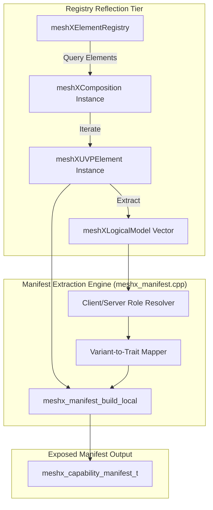

# Technical Reference Sheet 01: Capability Introspection & Self-Reflection

**Document:** `design/01_capability_introspection.md`  
**Parent TRM:** [Master Design Index](../design.md)  
**Requirements Addressed:** [REQ-001, REQ-003](../requirements.md)  

---

## 1. Overview & Architectural Motivation

In standard Bluetooth Mesh, nodes publish their composition via raw Composition Data Page 0 binary blobs. These blobs enumerate Company IDs, Product IDs, Version numbers, Elements, and 16-bit SIG or 32-bit Vendor Model IDs. However, Composition Data Page 0 lacks **semantic meaning**:
- It does not tell a commissioner what a model *does* in plain English or functional terms.
- It does not declare whether an element acts as a command emitter (**Producer / Client**) or an actuator (**Consumer / Server**).
- It does not declare which vendor functions (`func_id`) are actively wired to physical peripherals (e.g., Relay GPIO, PWM Dimmer channel, Sensor I2C bus).

The **MeshX Capability Introspection Subsystem** solves this by providing a runtime reflection layer on top of [`meshXElementRegistry`](file:///d:/MeshX/main/component/meshx/ble_mesh/elements/inc/meshx_composition.hpp) and [`meshXLogicalModel`](file:///d:/MeshX/main/component/meshx/ble_mesh/model/inc/meshx_uvp_logical_model.hpp). It allows any node to self-reflect and output a compact, structured **Capability Manifest** without requiring off-board cloud lookup tables.

---

## 2. Manifest Data Structures & Types (`meshx_manifest.h`)

All manifest structures are packed to ensure zero padding overhead across serial (MXCP) and over-the-air (UVP) transport boundaries:

```c
#ifndef MESHX_MANIFEST_H
#define MESHX_MANIFEST_H

#include <stdint.h>

#define MESHX_MAX_MANIFEST_ELEMENTS   8
#define MESHX_MAX_FUNC_IDS_PER_ELEM   4
#define MESHX_LABEL_MAX_LEN           16

/**
 * @brief Element operational role in the pairing graph
 */
typedef enum {
    MESHX_ROLE_UNKNOWN       = 0x00,
    MESHX_ROLE_CONSUMER      = 0x01, /* Server / Actuator / Sink (receives commands) */
    MESHX_ROLE_PRODUCER      = 0x02, /* Client / Sensor / Source (issues commands/telemetry) */
    MESHX_ROLE_BIDIRECTIONAL = 0x03, /* Peer / Controller-Actuator hybrid */
} meshx_element_role_t;

/**
 * @brief High-level semantic traits recognized by the compatibility engine
 */
typedef enum {
    MESHX_TRAIT_UNKNOWN      = 0x00,
    MESHX_TRAIT_RELAY_POWER  = 0x01, /* On/Off Power switching (func_id 0x00) */
    MESHX_TRAIT_LIGHT_CWWW   = 0x02, /* On/Off + Color Temperature CTL (func_id 0x00, 0x01) */
    MESHX_TRAIT_LIGHT_HSL    = 0x03, /* On/Off + Hue-Saturation-Lightness (func_id 0x00, 0x01) */
    MESHX_TRAIT_SENSOR_DATA  = 0x04, /* Environmental telemetry streams (func_id 0x00) */
} meshx_trait_type_t;

/**
 * @brief Descriptor for a single baked element on the node
 */
typedef struct {
    uint8_t             element_idx;
    uint8_t             role;        /* meshx_element_role_t */
    uint16_t            variant;     /* meshx_element_type_t */
    uint16_t            trait;       /* meshx_trait_type_t */
    uint8_t             func_count;
    uint16_t            func_ids[MESHX_MAX_FUNC_IDS_PER_ELEM];
    char                label[MESHX_LABEL_MAX_LEN]; /* E.g., "Switch 1", "Lamp Main" */
} __attribute__((packed)) meshx_element_descriptor_t;

/**
 * @brief Full device capability manifest
 */
typedef struct {
    uint16_t                     unicast_addr;
    uint16_t                     company_id;
    uint16_t                     product_id;
    uint16_t                     link_epoch;  /* Generation counter for link changes */
    uint8_t                      element_count;
    meshx_element_descriptor_t   elements[MESHX_MAX_MANIFEST_ELEMENTS];
} __attribute__((packed)) meshx_capability_manifest_t;

#endif /* MESHX_MANIFEST_H */
```

---

## 3. Runtime Introspection Architecture

The introspection engine inspects the C++ composition layer at runtime without modifying the underlying model states:



### 3.1 Introspection Routine Implementation

```cpp
meshx_err_t meshx_manifest_build_local(meshx_capability_manifest_t *out_manifest)
{
    if (!out_manifest) return MESHX_INVALID_ARG;
    memset(out_manifest, 0, sizeof(*out_manifest));

    out_manifest->unicast_addr = meshx_get_node_addr();
    out_manifest->company_id   = meshx_get_cid();
    out_manifest->product_id   = meshx_get_pid();
    out_manifest->link_epoch   = meshx_nvs_get_link_epoch();

    uint8_t total_elements = meshx_comp_get_element_count();
    if (total_elements > MESHX_MAX_MANIFEST_ELEMENTS) {
        total_elements = MESHX_MAX_MANIFEST_ELEMENTS;
    }
    out_manifest->element_count = total_elements;

    for (uint8_t i = 0; i < total_elements; ++i) {
        meshx_element_descriptor_t* desc = &out_manifest->elements[i];

        desc->element_idx = i;
        desc->variant     = meshx_comp_get_element_variant(i);

        // Resolve role and trait from variant using static LUT (see §3.2 and TRM Sheet 03)
        meshx_manifest_resolve_role_trait(desc->variant, &desc->role, &desc->trait);

        // Populate supported func_ids from active logical models via C bridge
        desc->func_count = meshx_comp_get_element_func_ids(i, desc->func_ids, MESHX_MAX_FUNC_IDS_PER_ELEM);

        // Copy human-readable element name
        snprintf(desc->label, sizeof(desc->label), "%s %u", 
                 (desc->role == MESHX_ROLE_PRODUCER) ? "Switch" : "Actuator", i + 1);
    }

    return MESHX_SUCCESS;
}
```

### 3.2 Role and Trait Resolution (`meshx_manifest_resolve_role_trait`)

To map baked element variants (`meshx_element_type_t`) to their pairing role and semantic trait, the manifest engine employs a static Look-Up Table (LUT) aligned with the Compatibility Matrix ([TRM Sheet 03](./03_semantic_compatibility_engine.md)):

```c
typedef struct {
    uint16_t variant;
    uint8_t  role;
    uint16_t trait;
} meshx_variant_lut_entry_t;

static const meshx_variant_lut_entry_t s_variant_lut[] = {
    { MESHX_ELEMENT_TYPE_RELAY_SERVER,      MESHX_ROLE_CONSUMER, MESHX_TRAIT_RELAY_POWER },
    { MESHX_ELEMENT_TYPE_RELAY_CLIENT,      MESHX_ROLE_PRODUCER, MESHX_TRAIT_RELAY_POWER },
    { MESHX_ELEMENT_TYPE_LIGHT_CWWW_SERVER, MESHX_ROLE_CONSUMER, MESHX_TRAIT_LIGHT_CWWW },
    { MESHX_ELEMENT_TYPE_LIGHT_CWWW_CLIENT, MESHX_ROLE_PRODUCER, MESHX_TRAIT_LIGHT_CWWW },
    { MESHX_ELEMENT_TYPE_LIGHT_HSL_SERVER,  MESHX_ROLE_CONSUMER, MESHX_TRAIT_LIGHT_HSL },
    { MESHX_ELEMENT_TYPE_LIGHT_HSL_CLIENT,  MESHX_ROLE_PRODUCER, MESHX_TRAIT_LIGHT_HSL },
    { MESHX_ELEMENT_TYPE_SENSOR_SERVER,     MESHX_ROLE_CONSUMER, MESHX_TRAIT_SENSOR_DATA },
    { MESHX_ELEMENT_TYPE_SENSOR_CLIENT,     MESHX_ROLE_PRODUCER, MESHX_TRAIT_SENSOR_DATA },
};

void meshx_manifest_resolve_role_trait(uint16_t variant, uint8_t *out_role, uint16_t *out_trait)
{
    if (!out_role || !out_trait) return;

    *out_role  = MESHX_ROLE_UNKNOWN;
    *out_trait = MESHX_TRAIT_UNKNOWN;

    for (size_t i = 0; i < (sizeof(s_variant_lut) / sizeof(s_variant_lut[0])); ++i) {
        if (s_variant_lut[i].variant == variant) {
            *out_role  = s_variant_lut[i].role;
            *out_trait = s_variant_lut[i].trait;
            return;
        }
    }
}
```

---

## 4. Pre-Provisioning Capability Advertising (Service Data)

Before a device is provisioned into a Bluetooth Mesh network, smartphones and field tools need to identify whether an unprovisioned beacon is a switch, a tunable white fixture, or an environmental sensor.

### 4.1 Beacon Payload Layout (BLE ADV Service Data)

When advertising unprovisioned device beacons (`0x2B` Mesh Provisioning Service), MeshX injects a custom 4-byte Capability Hint within the 16-byte Device UUID:

```
+---------------+-----------------------------+--------------------+-------------------+
| Bytes 0..7    | Bytes 8..9                  | Bytes 10..11       | Bytes 12..15      |
| MAC / Entropy | Company ID (OEM CID e.g. 0x02E5)| Product Trait Mask | Serial / Version  |
+---------------+-----------------------------+--------------------+-------------------+
```

> [!NOTE]
> The Company ID field (Bytes 8..9) is OEM-configurable per enterprise profile (Bluetooth SIG-assigned 16-bit CID or internal company identifier). It is populated at provisioning/manufacturing time per company need and is not hardcoded to any single vendor.

#### Trait Mask Bitfields:
- `Bit 0`: Relay Actuator (Consumer)
- `Bit 1`: Relay Switch (Producer)
- `Bit 2`: Tunable White / HSL Light (Consumer)
- `Bit 3`: Light Controller (Producer)
- `Bit 4`: Environmental Sensor (Producer)
- `Bit 5`: Multi-Gang / Multi-Element Indicator
- `Bits 6..15`: Reserved for Future Hardware Variants

This enables instantaneous categorization in the commissioner UI before unprovisioned devices are even tapped for onboarding.
