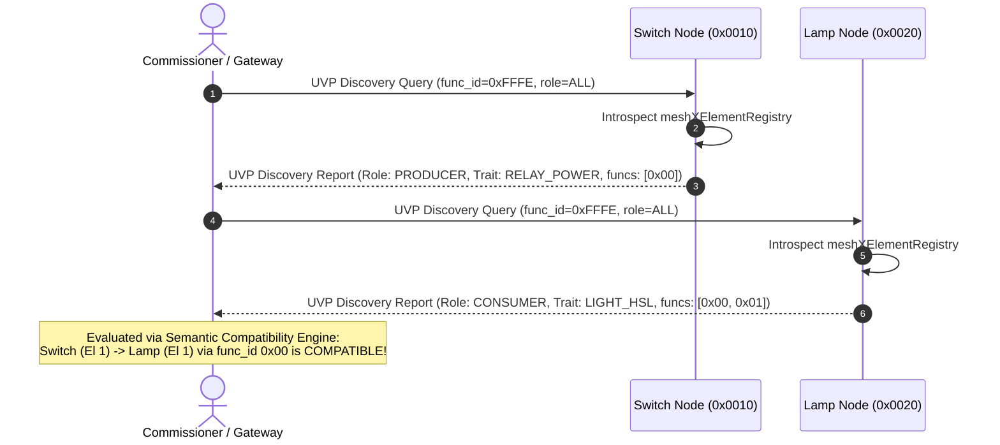

# Technical Reference Sheet 02: In-Mesh UVP Discovery & Host Protocol

**Document:** `design/02_uvp_discovery_protocol.md`  
**Parent TRM:** [Master Design Index](../design.md)  
**Requirements Addressed:** [REQ-002, REQ-009](../requirements.md)  

---

## 1. Overview & Protocol Framing

The MeshX **Unified Vendor Protocol (UVP)** carries all vendor-specific interactions inside standard Bluetooth Mesh Vendor Models (`0x0001:0x02E5`). To support autonomous discovery and host-driven capability queries without interfering with runtime control messages, UVP allocates dedicated system management function IDs:

| System Function ID | Symbolic Constant | Description |
| :--- | :--- | :--- |
| `0xFFFE` | `MESHX_FUNC_ID_SYS_DISCOVERY` | Capability manifest queries, element enumeration, and epoch beacons |
| `0xFFFF` | `MESHX_FUNC_ID_SYS_PAIRING` | Over-the-air pairing requests, link establishment, and unpairing teardown |

### 1.1 Secure Management Addressing & OEM Product Profile Virtual ID Binding

1. **Security Policy: Application-Layer Blocking of `0xFFFF` (All-Nodes Address):**
   - In open commercial or multi-tenant deployments, broadcasting system management frames to `0xFFFF` presents security and stability risks (unauthorized snooping, broadcast storms, and race conditions across models).
   - **Stack Layer Boundary & Non-Impact on Core Features:**
     - **Provisioning (PB-ADV & PB-GATT): ZERO IMPACT.** Provisioning operates over Generic Provisioning PDUs (AD Type `0x29`) or GATT Service `0x1827` prior to network admission and has no concept of network destination addresses or `0xFFFF`.
     - **Configuration Server (SIG Model 0x0000): ZERO IMPACT.** Standard Config Clients (phone apps and provisioners) always configure nodes using **Unicast Addressing** to the primary element to receive reliable request-response status frames.
     - **Compliance Guardrail:** The `0xFFFF` drop is **never** applied at the Bluetooth Mesh Network/Transport layer (which would violate Bluetooth Mesh Profile §3.4.2.4). Instead, it is enforced **strictly inside the UVP Vendor Model Dispatcher** (`Company ID 0x7908`, `Model ID 0x0001`):
       ```c
       /* In meshx_uvp_model.cpp: UVP System Message Dispatcher */
       if ((func_id == MESHX_FUNC_ID_SYS_DISCOVERY || func_id == MESHX_FUNC_ID_SYS_PAIRING) &&
           ctx->recv_dst == 0xFFFF) {
           MESHX_LOGW(TAG, "Security violation: Dropping 0xFFFF broadcast on UVP System Opcode");
           return ESP_ERR_MESHX_BLOCKED_ADDR;
       }
       ```

2. **OEM Company-Wide Virtual ID Generation Pipeline (`prod_profile.yml` & MXC):**
   - **Company-Global Scope Mandate:** The 128-bit Management Label UUID must be defined **globally at the Company Profile (`prod`) level**, NOT per-product (`pid`). If UUIDs were product-specific, a switch (`pid 0x0006`) could never discover or autonomously pair with a ceiling light (`pid 0x0001`) because their Element 0 subscription lists would hold mismatched Virtual Addresses!
   - **Company Profile Definition (`port/bsp/<BSP>/prod_profile.yml`):**
     ```yaml
     prod:
         cid: 0x7908                   # OEM Company ID (shared across all products)
         mgmt_uuid: "79080000-A1B2-4C3D-8E9F-MESHXMGMT001" # Company-wide Management UUID
         products:
             - name: 4_relay_panel
               pid: 0x0001
             - name: 4_relay_sw
               pid: 0x0006
     ```
   - **Deterministic Company Fallback Derivation:** If `mgmt_uuid` is omitted, `code_gen.py` synthesizes a deterministic 16-byte UUID strictly from the Company ID (`cid`) and the MeshX management namespace, ensuring **all products of the company automatically share the identical Virtual Address**:
     $$\text{UUID} = \text{cid (2B)} \;\|\; \text{0x5953 ("YS")} \;\|\; \text{"MeshX-MGMT-V1"} \;\|\; \text{0x00...}$$
     *(Note: `pid` is strictly excluded from the derivation so every product under `cid 0x7908` generates the identical Virtual Address).*
   - **Build-Time Compilation (`meshx_config.h`):**
     `code_gen.py` computes the company-wide 16-bit Virtual Address (`0x8000`–`0xBFFF`) via AES-CMAC (Bluetooth Mesh Profile §3.8.4) and emits:
     ```c
     /* Auto-generated by code_gen.py from prod_profile.yml (Company-Global) */
     #define MESHX_MGMT_LABEL_UUID       { 0x79, 0x08, 0x59, 0x53, 0xA1, 0xB2, 0x4C, 0x3D, \
                                           0x8E, 0x9F, 0x4D, 0x47, 0x4D, 0x54, 0x30, 0x31 }
     #define MESHX_MGMT_VIRTUAL_ADDR     0x8F42  /* Pre-computed Company Virtual Address */
     ```
   - **Binary Container Storage (`meshx_cfg.mxc`):**
     The company-wide 16-byte UUID is encoded into `ProductInfo.uuid` in the binary configuration container (`magic = 'MXC\0'`) and flashed to the `meshx_cfg` partition, loaded at boot by [`meshx_ro_cfg.c`](file:///d:/MeshX/main/component/meshx/src/meshx_ro_cfg.c).

3. **Inter-Product Harmony vs. Cross-OEM Cryptographic Isolation:**
   - **Inter-Product Discovery (Same Company):** Every device produced by Company X (Wall Switch, Relay Panel, Dimmer, Sensor) subscribes its Element 0 to Company X's Management Virtual Address. Switches and lamps communicate seamlessly during discovery, pairing, and pre-reset teardown.
   - **Cross-OEM Radio Rejection (Different Companies):** When Company A (`cid 0x7908`) and Company B (`cid 0x02E5`) devices coexist in the same facility, each operates on a distinct company-wide Virtual Address. Lower Transport MIC validation drops foreign frames at the radio layer without CPU wakeups or false pairings.
   - **Root Element (Element 0) Exclusive Reception:**
     - The OEM Virtual Address subscription is held **exclusively by Element 0 (Primary Element)**.
     - Secondary elements (Elements 1..N) host purely application models (OnOff, CTL, etc.) and never ingest management frames.
     - Multi-element nodes reply to discovery queries with exactly **one consolidated capability manifest** originating from Element 0.

---

## 2. Over-The-Air Wire Format & MTU Budgeting

Standard Bluetooth Mesh Lower Transport Layer frames can carry up to 380 bytes when segmented across multiple 11-byte or 15-byte radio packets. UVP enforces a maximum access payload budget of **375 bytes** to prevent stack overflow and minimize fragmentation delays.

### 2.1 Packet Layout

```
+-------------------------------------------------------------------------------+
| UVP Transport Header (6 Bytes)                                                |
|  - Opcode (1B)  | Sub-Opcode (1B) | Transaction ID (2B) | Func ID (2B: 0xFFFE)|
+-------------------------------------------------------------------------------+
| System Management Payload                                                     |
|  - Message Type (1B) | Payload Data (Variable, <= 368 Bytes)                  |
+-------------------------------------------------------------------------------+
```

### 2.2 Wire Message Definitions (`meshx_uvp_sys.h`)

```c
#ifndef MESHX_UVP_SYS_H
#define MESHX_UVP_SYS_H

#include <stdint.h>
#include "meshx_manifest.h"

#define MESHX_FUNC_ID_SYS_DISCOVERY    0xFFFE
#define MESHX_FUNC_ID_SYS_PAIRING      0xFFFF

typedef enum {
    MESHX_SYS_CMD_DISCOVERY_QUERY  = 0x01,
    MESHX_SYS_RSP_DISCOVERY_REPORT = 0x02,
    MESHX_SYS_CMD_PAIR_REQUEST     = 0x03,
    MESHX_SYS_RSP_PAIR_RESPONSE    = 0x04,
    MESHX_SYS_CMD_UNPAIR_REQUEST   = 0x05,
    MESHX_SYS_RSP_UNPAIR_RESPONSE  = 0x06,
    MESHX_SYS_CMD_EPOCH_PING       = 0x07,
    MESHX_SYS_RSP_EPOCH_PONG       = 0x08,
    MESHX_SYS_NOTIFY_NODE_RESET    = 0x09, /* Pre-reset teardown broadcast */
    MESHX_SYS_NOTIFY_COMP_CHANGE   = 0x0A, /* Dynamic composition change notice */
} meshx_sys_msg_type_t;

typedef enum {
    MESHX_SYS_STATUS_SUCCESS              = 0x00,
    MESHX_SYS_STATUS_ERR_INCOMPATIBLE     = 0x01,
    MESHX_SYS_STATUS_ERR_PERSONALITY_DIFF = 0x02,
    MESHX_SYS_STATUS_ERR_ELEMENT_MISSING  = 0x03,
    MESHX_SYS_STATUS_ERR_TABLE_FULL       = 0x04,
    MESHX_SYS_STATUS_ERR_TIMEOUT          = 0x05,
} meshx_sys_status_t;

/**
 * @brief Wire format for discovery query (Client -> Target Node)
 */
typedef struct {
    uint8_t  msg_type;      /* MESHX_SYS_CMD_DISCOVERY_QUERY */
    uint8_t  filter_role;   /* 0x00=All, 0x01=Consumers Only, 0x02=Producers Only */
} __attribute__((packed)) meshx_uvp_discovery_query_t;

/**
 * @brief Wire format for discovery response (Target Node -> Client)
 */
typedef struct {
    uint8_t                     msg_type;  /* MESHX_SYS_RSP_DISCOVERY_REPORT */
    meshx_capability_manifest_t manifest;
} __attribute__((packed)) meshx_uvp_discovery_report_t;

#endif /* MESHX_UVP_SYS_H */
```

### 2.3 Payload Sizing Verification
- `meshx_element_descriptor_t`: $1 + 1 + 2 + 2 + 1 + (4 \times 2) + 16 = 31\text{ bytes}$
- 8 elements max: $8 \times 31 = 248\text{ bytes}$
- Manifest header: $2 + 2 + 2 + 2 + 1 = 9\text{ bytes}$
- Total Manifest wire footprint: $248 + 9 + 1 = 258\text{ bytes}$
- **Conclusion:** $258\text{ bytes} \le 375\text{ bytes}$ maximum budget. Fits comfortably inside a single segmented BLE Mesh vendor message.

---

## 3. Discovery Protocol Flow



---

## 4. Host Serial Protocol (MXCP Commands)

For host MCUs (e.g., Linux edge gateways or companion microcontrollers) communicating over physical UART, MXCP provides structured commands matching the over-the-air protocol:

| Command ID | Opcode Name | Parameters | Expected Response |
| :--- | :--- | :--- | :--- |
| `0x70` | `MXCP_CMD_DISCOVER_CAPABILITIES` | `target_unicast_addr` (2B), `filter_role` (1B) | `MXCP_RSP_DISCOVERY_REPORT` containing packed manifest |
| `0x71` | `MXCP_CMD_BIND_ELEMENTS` | `src_addr` (2B), `src_elem` (1B), `dst_addr` (2B), `dst_elem` (1B), `func_id` (2B) | `MXCP_RSP_STATUS` (`0x00` = Success) |
| `0x72` | `MXCP_CMD_UNBIND_ELEMENTS` | `src_addr` (2B), `src_elem` (1B), `dst_addr` (2B), `dst_elem` (1B), `func_id` (2B) | `MXCP_RSP_STATUS` (`0x00` = Success) |
| `0x73` | `MXCP_CMD_GET_LINK_TABLE` | `None` | `MXCP_RSP_LINK_TABLE` returning all active persisted links |
| `0x74` | `MXCP_CMD_GET_LINK_EPOCH` | `None` | `uint16_t link_epoch` |

All MXCP commands follow the standard frame framing: `[0xFE, LEN, CMD, PAYLOAD..., CRC16_L, CRC16_H]`.
