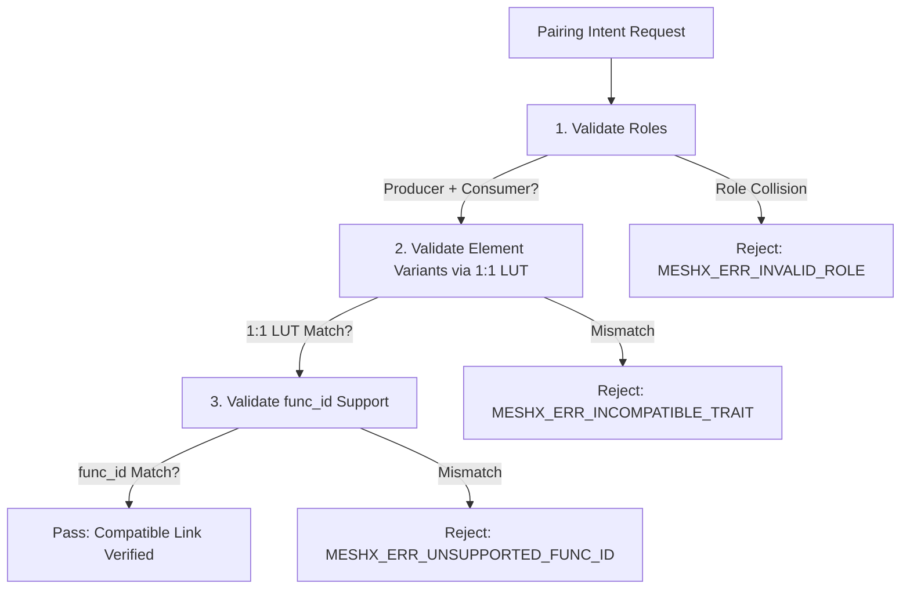

# Technical Reference Sheet 03: Semantic Compatibility Engine

**Document:** `design/03_semantic_compatibility_engine.md`  
**Parent TRM:** [Master Design Index](../design.md)  
**Requirements Addressed:** [REQ-004](../requirements.md)  

---

## 1. Overview & Architectural Motivation

In standard Bluetooth Mesh, the protocol allows binding any arbitrary Application Key to any model and setting any publication destination. There is no protocol-level guarantee that an OnOff Client is communicating with a model capable of interpreting OnOff commands. Incompatible bindings lead to silent packet drops, cryptic runtime timeouts, and poor user experiences.

The **Semantic Compatibility Engine** introduces a type-safe validation barrier. It operates before any mesh configuration changes (e.g. `Config Model Pub Set`) or NVS writes occur. It enforces that:
1. The source element role is a valid emitter (`MESHX_ROLE_PRODUCER` or `MESHX_ROLE_BIDIRECTIONAL`).
2. The destination element role is a valid receptor (`MESHX_ROLE_CONSUMER` or `MESHX_ROLE_BIDIRECTIONAL`).
3. The functional ID (`func_id`) is supported by both endpoints.
4. The semantic trait models map to a valid operational contract.

---

## 2. Compatibility Matrix

The table below defines the formal rules for semantic compatibility between client (source) and server (sink) element variants:

| Source Element Variant (`meshx_element_type_t`) | Allowed Sink Element Variants | Supported `func_id` | Operation / Semantic Intent |
| :--- | :--- | :--- | :--- |
| `MESHX_ELEMENT_TYPE_RELAY_CLIENT` | `RELAY_SERVER` | `0x00` | Basic On/Off power switching & toggle |
| `MESHX_ELEMENT_TYPE_LIGHT_CWWW_CLIENT` | `LIGHT_CWWW_SERVER` | `0x00`<br/>`0x01` | Power On/Off (`0x00`) + Correlated Color Temp (`0x01`) |
| `MESHX_ELEMENT_TYPE_LIGHT_HSL_CLIENT` | `LIGHT_HSL_SERVER` | `0x00`<br/>`0x01` | Power On/Off (`0x00`) + Hue-Saturation-Lightness (`0x01`) |
| `MESHX_ELEMENT_TYPE_SENSOR_CLIENT` | `SENSOR_SERVER` | `0x00` | Periodic and event-driven environmental telemetry ingest |

### Incompatible Pairings (Must Be Rejected):
- **Cross-Domain Trait Mismatch:** E.g., attempting to pair `MESHX_ELEMENT_TYPE_SENSOR_CLIENT` to `MESHX_ELEMENT_TYPE_RELAY_SERVER`, or cross-pairing across distinct traits.
- **Role Collision:** E.g., attempting to pair two `PRODUCER` elements (Switch to Switch) or two `CONSUMER` elements (Relay to Relay).
- **Unsupported Function ID:** E.g., requesting `func_id = 0x01` (Color CTL) on a basic `RELAY_SERVER` sink.

---

## 3. Compatibility Engine Architecture & API

The engine is encapsulated in `meshx_compat_matrix.c` (C runtime) and callable by C++ orchestrator classes:



### 3.1 Verification Routine (`meshx_compat_matrix.c`)

```c
#include "meshx_compat_matrix.h"

typedef struct {
    uint16_t src_variant;
    uint16_t dst_variant;
} meshx_variant_compat_entry_t;

static const meshx_variant_compat_entry_t s_variant_compat_lut[] = {
    { MESHX_ELEMENT_TYPE_RELAY_CLIENT,      MESHX_ELEMENT_TYPE_RELAY_SERVER },
    { MESHX_ELEMENT_TYPE_LIGHT_CWWW_CLIENT, MESHX_ELEMENT_TYPE_LIGHT_CWWW_SERVER },
    { MESHX_ELEMENT_TYPE_LIGHT_HSL_CLIENT,  MESHX_ELEMENT_TYPE_LIGHT_HSL_SERVER },
    { MESHX_ELEMENT_TYPE_SENSOR_CLIENT,     MESHX_ELEMENT_TYPE_SENSOR_SERVER },
};

meshx_err_t meshx_compat_validate(const meshx_element_descriptor_t *src_desc,
                                  const meshx_element_descriptor_t *dst_desc,
                                  uint16_t func_id)
{
    if (!src_desc || !dst_desc) {
        return MESHX_INVALID_ARG;
    }

    /* 1. Check Roles: Must have a producer and a consumer */
    bool src_can_produce = (src_desc->role == MESHX_ROLE_PRODUCER || 
                            src_desc->role == MESHX_ROLE_BIDIRECTIONAL);
    bool dst_can_consume = (dst_desc->role == MESHX_ROLE_CONSUMER || 
                            dst_desc->role == MESHX_ROLE_BIDIRECTIONAL);

    if (!src_can_produce || !dst_can_consume) {
        MESHX_LOGE(MODULE_ID_COMMON, "Role collision: src_role=%u, dst_role=%u", src_desc->role, dst_desc->role);
        return MESHX_ERR_ROLE_COLLISION;
    }

    /* 2. Check func_id availability on both endpoints */
    bool src_has_func = false;
    for (uint8_t i = 0; i < src_desc->func_count; ++i) {
        if (src_desc->func_ids[i] == func_id) { src_has_func = true; break; }
    }
    bool dst_has_func = false;
    for (uint8_t i = 0; i < dst_desc->func_count; ++i) {
        if (dst_desc->func_ids[i] == func_id) { dst_has_func = true; break; }
    }

    if (!src_has_func || !dst_has_func) {
        MESHX_LOGE(MODULE_ID_COMMON, "func_id 0x%04X not mutually supported (src:%d, dst:%d)", 
                   func_id, src_has_func, dst_has_func);
        return MESHX_ERR_UNSUPPORTED_FUNC_ID;
    }

    /* 3. Check Variant Compatibility LUT (1:1 strict mapping) */
    for (size_t i = 0; i < (sizeof(s_variant_compat_lut) / sizeof(s_variant_compat_lut[0])); ++i) {
        if (s_variant_compat_lut[i].src_variant == src_desc->variant &&
            s_variant_compat_lut[i].dst_variant == dst_desc->variant) {
            return MESHX_SUCCESS;
        }
    }

    MESHX_LOGE(MODULE_ID_COMMON, "Variant mismatch: src_variant=0x%04X, dst_variant=0x%04X",
               src_desc->variant, dst_desc->variant);
    return MESHX_ERR_INCOMPATIBLE_TRAIT;
}
```

---

## 4. Error Codes & Recovery

When a pairing attempt fails validation, the orchestrator returns structured error codes over both MXCP and UVP:

| Error Code | Constant | Meaning & Recommended Action |
| :--- | :--- | :--- |
| `0x81` | `MESHX_ERR_ROLE_COLLISION` | Attempted to link two emitters or two sinks. Prompt user to select an actuator. |
| `0x82` | `MESHX_ERR_INCOMPATIBLE_TRAIT` | Client cannot command the selected server type. Filter candidate list in UI. |
| `0x83` | `MESHX_ERR_UNSUPPORTED_FUNC_ID` | Function ID not present on target element. Verify target firmware capabilities. |
