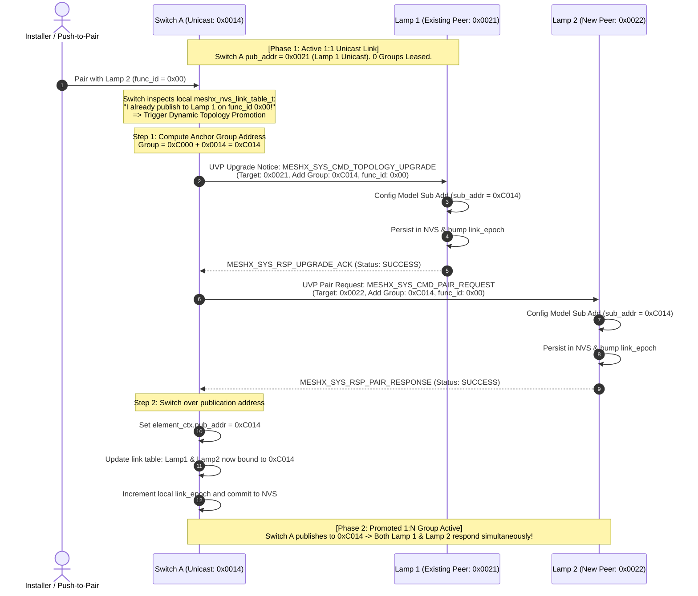
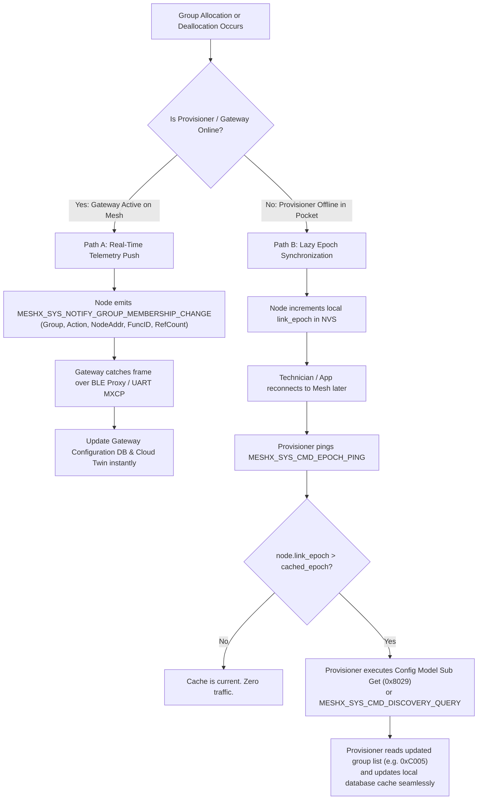

# Technical Reference Sheet 04: Topology Orchestration & Distributed Group Management

**Document:** `design/04_topology_orchestration.md`
**Parent TRM:** [Master Design Index](../design.md)
**Requirements Addressed:** [REQ-005, REQ-007, REQ-010](../requirements.md)

> [!TIP]
> **Interactive Architecture Diagram Available:**
> Open [topology-orchestration.html](../topology-orchestration.html) in your browser to interactively inspect the Topology Orchestration Engine, Anchor Node resolution flows, and Dynamic Promotion pathways.

---

## 1. Overview & Architectural Motivation

In Bluetooth Mesh, nodes communicate using one of two addressing topologies:
1. **Unicast Addressing:** The client publishes directly to the element's unicast address (e.g., `0x0021`). Ideal for dedicated 1-to-1 links (e.g., single switch button controlling one lamp). Pure 1:1 links **never consume group addresses**.
2. **Group Addressing:** The client publishes to a group address (e.g., `0xC001`), and one or more servers subscribe to that group address. Essential for:
   - **1:N Broadcast Source:** One master switch or sensor controlling a cluster of lamps simultaneously (e.g., room lighting).
   - **N:1 Shared Sink:** Multiple switches controlling the same light fixture (e.g., 3-way or multi-way staircase switching).
   - **M:N Multi-Controller Zone:** Multiple switches controlling multiple shared fixtures (e.g., open office or conference room).

---

## 2. Dynamic Group Address Space & Boundaries

MeshX reserves a contiguous block of Bluetooth Mesh group addresses dedicated to dynamic allocation:
- **Pool Start:** `0xC000`
- **Pool End:** `0xC3FF`
- **Total Capacity:** 1,024 dynamic group addresses

Addresses `0xC400`–`0xFEFF` are reserved for static site zones and building levels. Address `0xFFFF` is strictly blocked for system management due to security policies; network management broadcasts exclusively utilize the **Management Virtual Address (`MESHX_ADDR_VIRTUAL_MGMT`)** derived from the 128-bit `MESHX_MGMT_LABEL_UUID` (`0x8000`–`0xBFFF`).

---

## 3. The Clean 2-Tier Group Architecture

To eliminate distributed collision arbitration, radio broadcast storms, and contention timers, MeshX strictly decouples group management into **two distinct operational tiers**:

```
+----------------------------------------------------------------------------------------------------+
|                                    CLEAN 2-TIER LEASING ARCHITECTURE                               |
+----------------------------------------------------------------------------------------------------+
| Tier 1: Centralized Mode (When Smartphone App / Edge Gateway is Present)                           |
|   - Master Authority: The App / Gateway database acts as the single source of truth.               |
|   - Method: Sequential allocation from the master pool (0xC001, 0xC002...).                        |
|   - Use Case: User creates named rooms ("Conference Room", "Zone A") and wires them in the UI.     |
|   - Collision Risk: 0% (Single central coordinator).                                               |
+----------------------------------------------------------------------------------------------------+
| Tier 2: Autonomous Mode (When in the Field / Push-to-Pair / Zero-Gateway)                          |
|   - Master Authority: The ANCHOR NODE (the hub of the pairing relationship).                       |
|   - Method: ANCHOR FORMULA: Group Addr = 0xC000 + (Anchor_Element_Unicast & 0x03FF).               |
|   - Use Case: Push-to-pair in dark basements, electrical closets, or retail kit unboxing.         |
|   - Collision Risk: 0% (Mathematically guaranteed by unicast address uniqueness).                  |
|   - Radio Overhead: 0 broadcast probes. 0 arbitration delays. Instant 1-round-trip pairing!        |
+----------------------------------------------------------------------------------------------------+
```

---

## 4. The Anchor Node Rule & Group Address Derivation

In Autonomous Mode, how do multiple nodes agree on the exact same group address without colliding with other rooms?

> [!IMPORTANT]
> **The Anchor Node Rule:**
> In any multi-node group, the group address is calculated **only once by the Anchor Node (the hub of the relationship)** using its own unique unicast address.
> The Anchor Node distributes that single authoritative group address to peer members over the UVP pairing frame. **Member nodes never calculate their own group address—they simply adopt the address given to them by the Anchor.**

```
+-------------------------------------------------------------------------------------------------------------+
|                                    ANCHOR NODE DETERMINATION LOGIC                                          |
+-------------------------------------------------------------------------------------------------------------+
| 1. Pure 1:1 Direct Link (1 Switch -> 1 Lamp):                                                               |
|    - Anchor: None.                                                                                          |
|    - Group Address: 0x0000 (No group address leased!).                                                      |
|    - Publish Target: Direct Unicast Address of the Lamp (e.g., 0x0021).                                     |
|    - Subscriptions: None.                                                                                   |
+-------------------------------------------------------------------------------------------------------------+
| 2. 1:N Broadcast Cluster (1 Switch -> N Lamps - e.g. Room Control):                                         |
|    - Single Common Hub: The PRODUCER (Switch).                                                              |
|    - Anchor Node: The SWITCH is the Anchor.                                                                 |
|    - Group Address Formula: Group Addr = 0xC000 + (Switch_Element_Unicast & 0x03FF).                        |
|    - Publication Target: Switch sets pub_addr = Group Addr.                                                |
|    - Subscription Action: Switch commands all N Lamps: "Subscribe to MY group address!"                    |
+-------------------------------------------------------------------------------------------------------------+
| 3. N:1 Shared Sink (N Switches -> 1 Lamp - e.g. 3-Way Staircase):                                           |
|    - Single Common Hub: The CONSUMER (Lamp / Actuator).                                                     |
|    - Anchor Node: The LAMP is the Anchor.                                                                   |
|    - Group Address Formula: Group Addr = 0xC000 + (Lamp_Element_Unicast & 0x03FF).                          |
|    - Subscription Action: Lamp subscribes to Group Addr.                                                    |
|    - Publication Action: Lamp instructs all N Switches: "Publish to MY incoming group address!"             |
+-------------------------------------------------------------------------------------------------------------+
| 4. M:N Multi-Controller Zone (M Switches -> N Lamps - e.g. Conference Room):                               |
|    - Initial Anchor: The First Switch or Lamp to form the cluster.                                         |
|    - Subsequent Nodes: Inherit the established group address from the existing peers' link tables.          |
|    - Centralized Mode: The Commissioner App / Gateway directly assigns a zone group from its master pool.   |
+-------------------------------------------------------------------------------------------------------------+
```

### 4.1 Topology Archetype Summary Table

| Topology | Hub / Anchor Node | Group Address Calculation | Publisher Configuration | Subscriber Configuration |
| :--- | :--- | :--- | :--- | :--- |
| **1:1 Direct** | *None* | `0x0000` (Unicast `0x0021`) | Switch $\to$ Lamp Unicast | None |
| **1:N Broadcast** | **The Switch** | `0xC000 + Switch_Unicast` | Switch $\to$ Group | All N Lamps subscribe |
| **N:1 Shared Sink** | **The Lamp** | `0xC000 + Lamp_Unicast` | All N Switches $\to$ Group | Lamp subscribes |
| **M:N Zone** | **Initial Anchor or App** | Inherited from Anchor or App | All M Switches $\to$ Group | All N Lamps subscribe |

---

## 5. Dynamic Topology Promotion (Upgrading 1:1 Unicast to Group)

A frequent real-world lifecycle progression occurs when an installer pairs a switch with one lamp first, and later decides to add a second lamp to the same switch:

```
[Initial State: 1:1 Unicast]                                 [Promoted State: 1:N Group]
+--------------------------+                                 +--------------------------+
|  Switch A (0x0014)       |                                 |  Switch A (0x0014)       |
|  pub_addr = 0x0021       |                                 |  pub_addr = 0xC014       |
+------------+-------------+                                 +------------+-------------+
             |                                                            |
             v                                            +---------------+---------------+
+--------------------------+                              v                               v
|  Lamp 1 (Unicast 0x0021) |               +--------------------------+     +--------------------------+
|  sub_addr = None         |               |  Lamp 1 (Unicast 0x0021) |     |  Lamp 2 (Unicast 0x0022) |
+--------------------------+               |  sub_addr += 0xC014      |     |  sub_addr += 0xC014      |
                                           +--------------------------+     +--------------------------+
```

Because a Bluetooth Mesh model can only publish to **one destination address** at a time, Switch A cannot publish to both `0x0021` and `0x0022` simultaneously. It **must promote** the link from Unicast to Group:



---

## 6. Group Reference Counting & Dynamic Reclamation

To prevent orphaned group subscriptions from consuming slot capacity on actuator models, nodes derive group binding reference counts directly from the persistent NVS Link Table (`meshx_nvs_link_table_t`):

```c
uint16_t meshx_group_get_ref_count(uint16_t group_addr);
```

### Reclamation Flow:
1. **Binding Creation:** When a link is added and persisted in NVS, the group address reference is recorded in `table.links[slot].group_addr`.
2. **Granular Unpairing:** When an element unbinds:
   - The link entry is cleared in NVS (`active = false`).
   - The node checks `meshx_group_get_ref_count(group_addr)`.
3. **Zero-Reference Cleanup:**
   - When $\text{ref\_count} == 0$:
     - If local element is subscribed, the subscription is deleted from the BLE Mesh stack via `Config Model Sub Del`.
     - `link_epoch` is incremented and saved to NVS.

---

## 7. Provisioner & Gateway Synchronization

How does the Provisioner (smartphone app, commissioner tool, or cloud edge gateway) stay in sync with dynamic group address allocations and deallocations made autonomously in the field?



### 7.1 Path A: Real-Time Event Push (When Gateway / App is Online)
- Edge gateways and commissioner apps register as listeners for system frames on vendor model opcode `0x0001:0x02E5`.
- Whenever a group lease is claimed, joined, or deallocated, the node emits an unacknowledged broadcast frame:
  `MESHX_SYS_NOTIFY_GROUP_MEMBERSHIP_CHANGE(group, node_addr, action [JOIN/LEAVE], ref_count)`
- The gateway immediately ingests the change, updates its local SQLite/JSON mesh topology graph, and pushes WebSocket events to Web Consoles and mobile apps.

### 7.2 Path B: Lazy Epoch Synchronization (When Provisioner was Offline)
- When technicians configure rooms autonomously using physical pushbuttons, no phone or gateway is present.
- Every group operation increments the node's persistent `link_epoch`.
- When the mobile app connects to the mesh at a later time via Bluetooth Mesh GATT Proxy:
  1. The app queries `link_epoch` via `MESHX_SYS_CMD_EPOCH_PING` (`0x07`).
  2. If `node.link_epoch > provisioner.cached_epoch`:
     - The app sends a standard Bluetooth SIG `Config Model Sub Get` (`0x8029`) or UVP `MESHX_SYS_CMD_DISCOVERY_QUERY`.
     - The node returns its active subscription list: `[0xC005]`.
     - The app updates its internal Configuration Database (CDb) cache.
- **Result:** Zero packet overhead during normal operation, full eventual consistency upon reconnect, and zero risk of the provisioner overwriting field groups.
