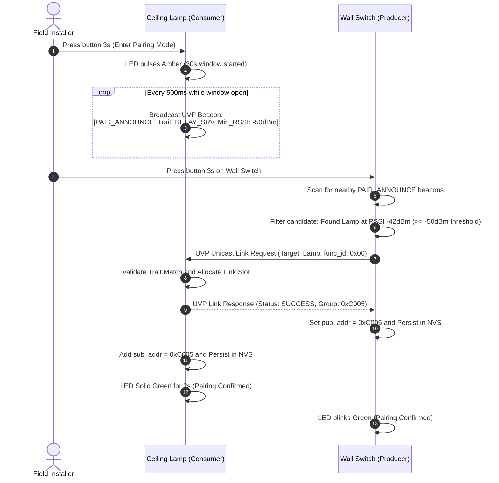
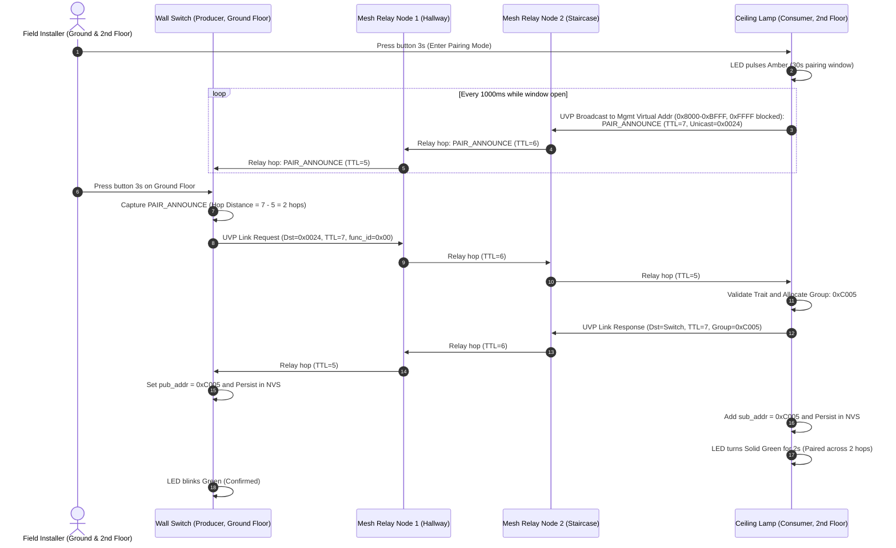

# Technical Reference Sheet 05: Autonomous Pairing Modes (Proximity & Multi-Hop)

**Document:** `design/05_autonomous_pairing_modes.md`
**Parent TRM:** [Master Design Index](../design.md)
**Requirements Addressed:** [REQ-007](../requirements.md)

---

## 1. Overview & Operational Modes

MeshX supports two distinct physical operating modes for field installation without requiring a smartphone, commissioner app, or cloud gateway:
1. **Mode A: 1-Hop Proximity Pairing (Push-to-Pair):** Suitable for devices in line-of-sight or immediate physical proximity. Utilizes RSSI threshold filtering ($\ge -50\text{ dBm}$) to prevent cross-pairing with units in adjacent rooms.
2. **Mode B: Multi-Hop Relayed Autonomous Pairing:** Essential for real-world deployments where devices are separated by distance, thick concrete walls, or multiple floors (e.g., ground-floor entryway switch controlling a 2nd-floor chandelier). Operates over intermediate mesh relay nodes using end-to-end `AppKey` encryption.

---

## 2. Mode A: 1-Hop RSSI Proximity Pairing

### Proximity Filtering Criteria:
- **RSSI Threshold:** Received beacon RSSI must be $\ge -50\text{ dBm}$ (configurable via NVS).
- **Temporal Alignment:** Both devices must be activated into pairing mode within an overlapping 30-second window.
- **Strongest-Candidate Selection:** If multiple beacons meet the threshold, the switch selects the candidate with the highest average RSSI over 3 successive frames.

---

## 3. Mode B: Multi-Hop Relayed Autonomous Pairing

When two devices are separated by multiple concrete slabs or dozens of meters, direct line-of-sight RF is impossible ($RSSI = 0$). However, because both devices are provisioned on the same mesh network and share the same `NetKey` and `AppKey`, they communicate across **intermediate mesh relay nodes**:

### 3.1 Architectural Principles of Relayed Pairing

1. **Network vs. Transport Layer Decoupling:**
   - Intermediate hopping nodes only evaluate the outer **Mesh Network PDU** (decrementing the TTL and validating the Network MIC using `NetKey`).
   - The inner **Access Payload** (the UVP pairing request, capability trait, and target addresses) is encrypted with the **`AppKey`**. Intermediate relay nodes forward the packets purely at the network layer without inspecting application payloads.

2. **Hop Distance Calculation & Selection:**
   - When the Switch receives a relayed announcement, it computes:
     $$\text{Hop Distance} = \text{Initial TTL (7)} - \text{Received TTL} = 7 - 5 = 2\text{ hops}$$
   - If multiple candidates are announcing simultaneously across the building, the switch prioritizes the candidate with the lowest hop distance.

3. **Flood Control & Anti-Thrashing:**
   - Multi-hop announcements are throttled to **1 packet every 1000 ms** (compared to fast 500 ms proximity beacons).
   - Standard BLE Mesh **Network Message Caching (Sequence Number filtering)** guarantees that each intermediate relay retransmits the frame exactly once per announcement, eliminating looping and broadcast storms.

4. **Runtime Transparency:**
   - Once paired, all future runtime control packets (e.g. toggling the light) traverse `Relay1` $\to$ `Relay2` $\to$ `Lamp` using standard mesh managed flooding, guaranteeing reliable long-range operation.

5. **Management Virtual Addressing & `0xFFFF` Security Blocking:**
   - Multi-hop broadcast announcements (`PAIR_ANNOUNCE`, topology notifications, and teardown broadcasts) strictly target the **Management Virtual Address (`MESHX_ADDR_VIRTUAL_MGMT`, 0x8000–0xBFFF)** backed by `MESHX_MGMT_LABEL_UUID`.
   - Open broadcasts to `0xFFFF` (All-Nodes) are strictly rejected and dropped by the UVP dispatcher, preventing unauthorized broadcast storms or rogue snooping. Only Element 0 (the Root Element) subscribes to and processes this Virtual Address.

---

## 4. Prerequisites & Scope Boundary (Out-of-the-Box Provisioning Deferred)

> [!NOTE]
> **Out-of-the-Box Zero-Gateway Provisioning Deferred (Out of Scope):**  
> Onboarding brand-new, uncommissioned devices in consumer retail kits without any commissioner app or gateway (e.g., embedded root provisioners onboarding switches via PB-ADV or factory pre-provisioned multipacks) is explicitly **OUT OF SCOPE** for this specification and deferred to future planning.  
> 
> **Prerequisite for Autonomous Pairing:**  
> All devices participating in autonomous element pairing (Mode A Proximity or Mode B Relayed) are assumed to be **already provisioned** into the Bluetooth Mesh network. That is, they have already received their Network Key (`NetKey`), Application Key (`AppKey`), and unique primary unicast addresses via standard provisioning. Autonomous pairing operates strictly at the **Application Layer**, dynamically negotiating and binding Model Publication and Subscription links without requiring an active commissioner during field pairing.
