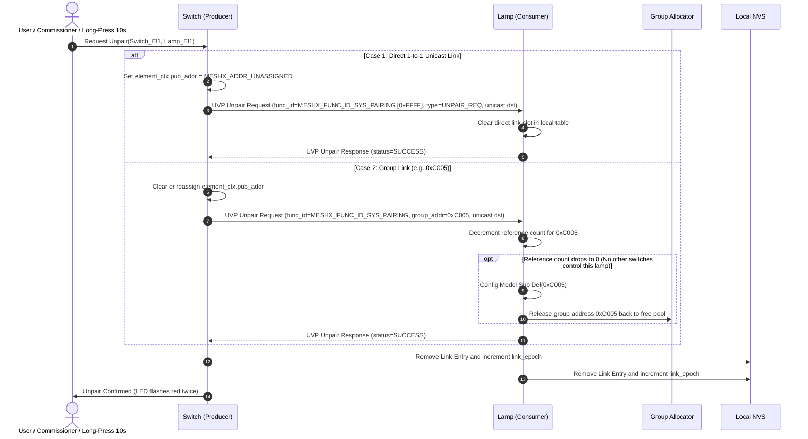
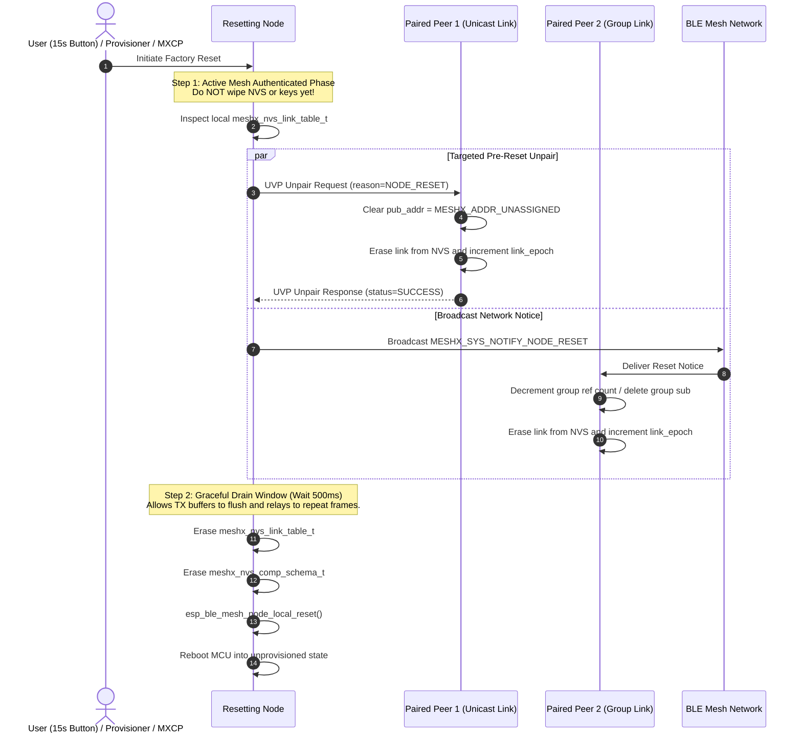
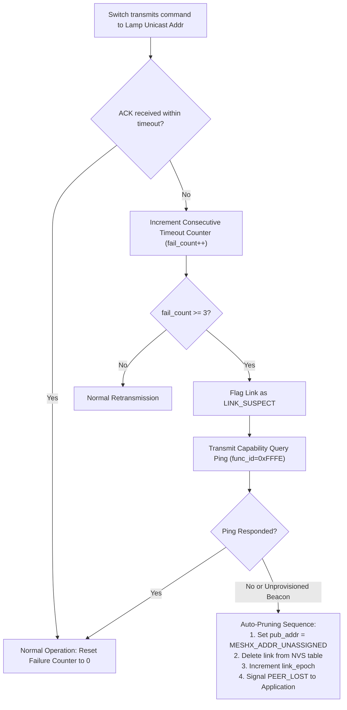

# Technical Reference Sheet 06: Lifecycle Unpairing & Teardown Handshake

**Document:** `design/06_lifecycle_unpairing_teardown.md`
**Parent TRM:** [Master Design Index](../design.md)
**Requirements Addressed:** [REQ-008](../requirements.md)

---

## 1. Overview & Problem Definition

In distributed Bluetooth Mesh systems, unpairing and device decommissioning present significant failure modes:
1. **Dangling Peers (Orphans):** If Node A executes a local factory reset by simply erasing its local NVS and rebooting, all paired peer nodes (Node B, Node C) are left pointing at dead unicast or group addresses.
   - Switches continue transmitting commands, hitting transaction timeouts (`MESHX_CLIENT_ERR_TIMEOUT`), flooding the network with retries, and lagging the UI.
   - Actuators hold stale subscriptions and waste slot capacity in NVS tables.
2. **Address Collisions:** When the reset node is subsequently re-provisioned into the mesh, it receives a new unicast address. All existing peers remain permanently linked to the decommissioned address.

To solve this, MeshX mandates a **Two-Tier Teardown Architecture**:
- **Granular Intent Unpairing:** Disassociating individual elements or functional links during normal operation.
- **Graceful Pre-Reset Dismantle Handshake:** A mandatory pre-reset protocol that dismantles all peer links *before* scrubbing cryptographic keys and rebooting.

---

## 2. Granular Unpairing Workflow

---

## 3. Factory Reset Teardown & Dangling Peer Prevention Handshake

When a factory reset is initiated (via 15s button press, serial MXCP command, or Provisioner Node Reset frame), the node **must not wipe keys immediately**. It executes a structured 4-stage graceful teardown:

### 3.1 Teardown Stages Detailed

1. **Stage 1: Active In-Mesh Notification (Keys Retained):**
   - The resetting node inspects its active [`meshx_nvs_link_table_t`](file:///d:/MeshX/main/component/meshx/inc/meshx_nvs.h).
   - For all direct unicast links, it transmits a targeted `MESHX_SYS_CMD_UNPAIR_REQUEST` with `reason = MESHX_UNPAIR_REASON_FACTORY_RESET`.
   - It simultaneously transmits `MESHX_SYS_NOTIFY_NODE_RESET` to the **Management Virtual Address (`MESHX_ADDR_VIRTUAL_MGMT`)**, cryptographically isolating management traffic from general nodes and strictly bypassing blocked `0xFFFF`.
2. **Stage 2: Peer Local Cleansing:**
   - Any peer node with publication targets (`pub_addr`) pointing to the resetting node immediately sets `pub_addr = MESHX_ADDR_UNASSIGNED`, sets client state to `MESHX_CLIENT_ERR_UNCONFIGURED`, removes the link entry from its NVS table, and increments its local `link_epoch`.
   - Any peer node with subscriptions tied to the resetting node decrements the group reference count. If zero, it executes `Config Model Sub Del` and releases the group address.
3. **Stage 3: 500 ms Graceful Drain Window:**
   - The resetting node suspends reset execution for 500 ms using a software timer. This allows network queues, radio TX buffers, and intermediate relay nodes to propagate frames without interruption.
4. **Stage 4: Local Teardown & Reset Execution:**
   - Erases `meshx_nvs_link_table_t` and `meshx_nvs_comp_schema_t`.
   - Calls `esp_ble_mesh_node_local_reset()` to scrub Network and AppKeys.
   - Restarts the MCU into a pristine, unprovisioned factory state.

---

## 4. Dangling Link Detection & Self-Healing (Offline Peer Fallback)

If a paired peer device was powered down or out-of-range when the reset broadcast occurred, MeshX provides a runtime self-healing mechanism:

### Self-Healing Rule:
- After **3 consecutive unacknowledged timeouts** (`fail_count >= 3`), a client marks the link as suspect and sends an active discovery ping.
- If the ping fails or an unprovisioned advertisement with the same MAC address is detected by the scanner, the node automatically prunes the orphan record from its NVS table and increments its `link_epoch`.
