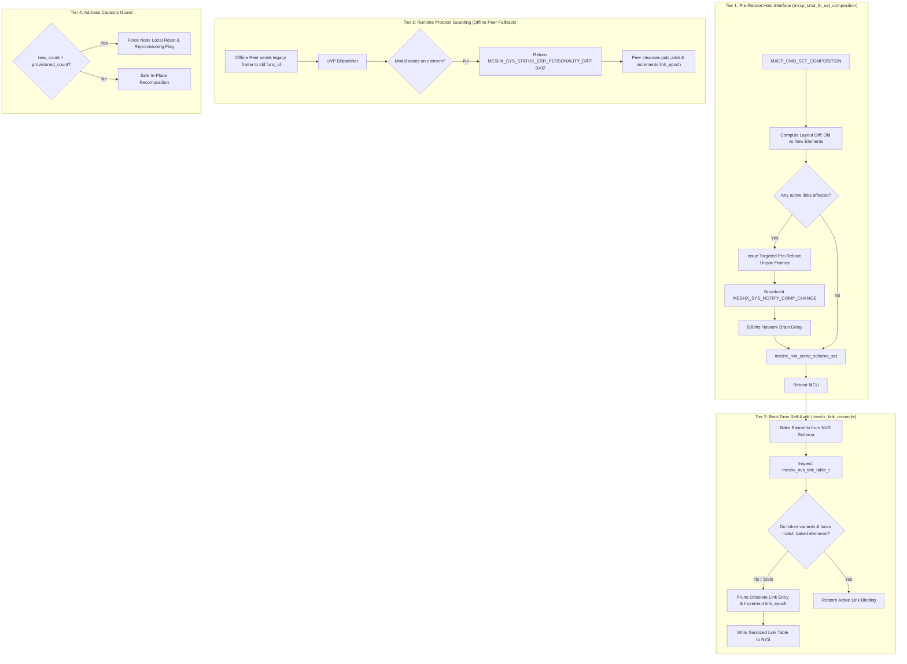
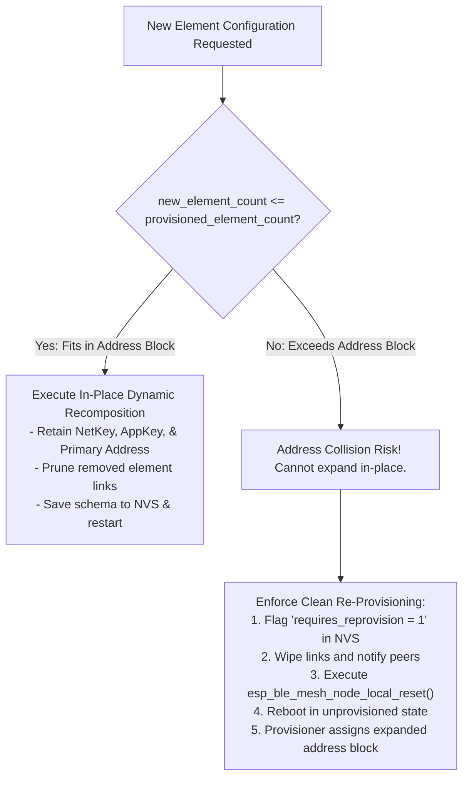

# Technical Reference Sheet 07: Dynamic Personality Conflict Resolution

**Document:** `design/07_dynamic_personality_conflict_resolution.md`  
**Parent TRM:** [Master Design Index](../design.md)  
**Requirements Addressed:** [REQ-011](../requirements.md)  

---

## 1. Overview & Conflict Scenarios

In MeshX, a node's composition (its element count, variants, and logical models) can be dynamically reconfigured at runtime by an external host MCU via the serial MXCP command `MXCP_CMD_SET_COMPOSITION`.

A **Dynamic Personality Conflict** occurs when an external host alters a node's element structure *after* active links have already been formed with peer devices across the mesh network.

```
+---------------------------------------------------------------------------------------+
|                               FOUR CONFLICT SCENARIOS                                 |
+---------------------------------------------------------------------------------------+
| 1. Element Removal (Shrink):                                                          |
|    - Node A had 3 elements; Element 2 (HSL Light) is removed.                         |
|    - Peer Switch targeting address 0x0022 now hits a non-existent element.            |
|                                                                                       |
| 2. Variant Mutation:                                                                  |
|    - Node A replaces Element 2 (LIGHT_HSL_SERVER) with SENSOR_SERVER.                 |
|    - Peer Switch sends HSL color frames to an environmental sensor.                   |
|                                                                                       |
| 3. Element Shift (Insertion):                                                         |
|    - A new Relay element is inserted at index 1; old El 1 moves to index 2.          |
|    - Peer Switch targeting old index 1 now commands the wrong physical hardware.      |
|                                                                                       |
| 4. Element Count Expansion:                                                           |
|    - Element count increases from 2 to 4 beyond provisioned unicast address block.    |
|    - Direct expansion would cause address collision with neighbor network devices.    |
+---------------------------------------------------------------------------------------+
```

---

## 2. The Four-Tier Defense Architecture

To guarantee total network integrity and eliminate silent command misfires, MeshX implements a strict **Four-Tier Defense Architecture**:



---

## 3. Tier 1: Pre-Reboot Diff & Peer Notification

When `mxcp_cmd_fn_set_composition()` receives a new element configuration:
1. It compares each proposed element against the currently active element layout in memory.
2. For any element index that is removed, whose variant type is changed, or whose supported `func_id` list is modified:
   - It searches `meshx_nvs_link_table_t` for all active links bound to that element index.
   - For every affected peer, it transmits a targeted `MESHX_SYS_CMD_UNPAIR_REQUEST` with `reason = MESHX_UNPAIR_REASON_PERSONALITY_CHANGE`.
   - It transmits `MESHX_SYS_NOTIFY_COMP_CHANGE` (`0x0A`) to the **Management Virtual Address (`MESHX_ADDR_VIRTUAL_MGMT`)**, bypassing blocked `0xFFFF`.
3. It initiates a **500 ms drain timer** before committing the new schema and rebooting the MCU.

---

## 4. Tier 2: Boot-Time Self-Audit (`meshx_link_reconcile()`)

Even if power is lost immediately after a composition update or the host bypasses Tier 1, the device performs an autonomous self-audit during cold boot:

```c
esp_err_t meshx_link_reconcile(void)
{
    meshx_nvs_link_table_t table;
    if (meshx_nvs_get_link_table(&table) != ESP_OK) return ESP_FAIL;

    meshXComposition* comp = meshXElementRegistry::get_instance().get_composition();
    if (!comp) return ESP_ERR_INVALID_STATE;

    const auto& elements = comp->get_elements();
    bool table_modified = false;

    for (uint8_t i = 0; i < MESHX_MAX_PERSISTED_LINKS; ++i) {
        meshx_nvs_link_entry_t* link = &table.links[i];
        if (!link->active) continue;

        bool link_valid = false;
        if (link->local_element_idx < elements.size()) {
            const auto& el = elements[link->local_element_idx];
            if (el->get_element_variant() == link->bound_variant) {
                // Verify func_id support
                for (const auto& m : el->get_logical_models()) {
                    if (m->get_func_id() == link->func_id) {
                        link_valid = true;
                        break;
                    }
                }
            }
        }

        if (!link_valid) {
            ESP_LOGW("MESHX_RECONCILE", "Pruning stale link slot %u (el=%u, variant=0x%04X, func=0x%04X)",
                     i, link->local_element_idx, link->bound_variant, link->func_id);
            memset(link, 0, sizeof(*link));
            table.link_count--;
            table_modified = true;
        }
    }

    if (table_modified) {
        table.link_epoch++;
        meshx_nvs_set_link_table(&table);
        ESP_LOGI("MESHX_RECONCILE", "Link table sanitized. New epoch: %u", table.link_epoch);
    }

    return ESP_OK;
}
```

---

## 5. Tier 3: Runtime Protocol Guarding & Auto-Pruning

If a peer device was powered down during Tier 1 and missed the pre-reboot notifications, it will eventually attempt to transmit a legacy command:
1. When the packet arrives at the mutated element, the UVP dispatcher inspects its local logical models.
2. Finding no model matching `func_id`, and observing `ctx->ack_req == 1`, the element returns:
   ```c
   meshx_sys_status_t status = MESHX_SYS_STATUS_ERR_PERSONALITY_DIFF; /* 0x02 */
   ```
3. Upon receiving this status, the transmitting switch client:
   - Clears `element_ctx.pub_addr = MESHX_ADDR_UNASSIGNED`.
   - Prunes the link entry from its NVS table.
   - Increments its local `link_epoch`.
   - Fires an application event: `MESHX_EVENT_PEER_PERSONALITY_CHANGED`.

---

## 6. Tier 4: Mesh Address Capacity vs. Mandatory Re-provisioning

In the Bluetooth Mesh Profile Specification, a node's unicast address block is assigned once during initial provisioning:
$$\text{Assigned Unicast Block} = [\text{Primary Address}, \text{Primary Address} + \text{Element Count} - 1]$$

Adjacent unicast addresses in the network may already be assigned to other physical devices.



### Policy Rule:
- **Shrinking or Mutating Elements:** Always handled safely in-place without re-provisioning.
- **Expanding Element Count Beyond Initial Capacity:** Automatically triggers a clean local reset and alerts the Provisioner that the device must be re-commissioned with an expanded address allocation.
