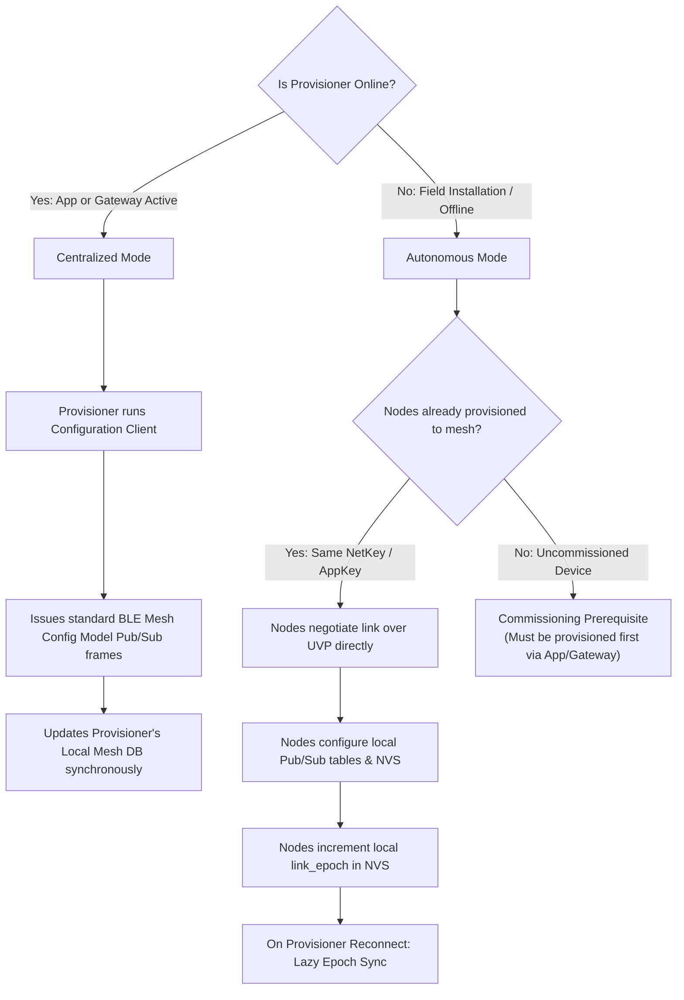
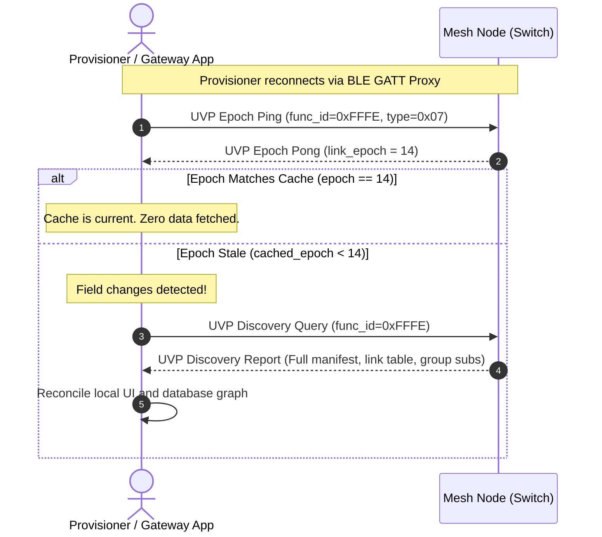

# Technical Reference Sheet 08: Provisioner Synchronization & NVS Persistence

**Document:** `design/08_provisioner_sync_and_persistence.md`  
**Parent TRM:** [Master Design Index](../design.md)  
**Requirements Addressed:** [REQ-006, REQ-010](../requirements.md)  

---

## 1. Overview & Separation of Concerns

A foundational design principle in Bluetooth Mesh is the decoupling of network admission from application control:

| Layer | Responsibility | Actor & Timing |
| :--- | :--- | :--- |
| **Network Layer (Provisioning)** | Assigns primary unicast address, distributes `NetKey`, sets IV Index. | Provisioner (once during device onboarding). |
| **Application Layer (Configuration / Pairing)** | Distributes `AppKey`, configures Model Publication (`pub_addr`), and manages Model Subscriptions (`sub_addr`). | Pairing Orchestrator / Autonomous Nodes / Provisioner. |
| **Runtime Control** | Peer-to-peer event routing (e.g., button press to relay toggle). | Autonomous Mesh Nodes (Direct or Relayed; Provisioner is completely out of the datapath). |

---

## 2. Provisioner Behavior Across Network States



---

## 3. Monotonic Link Epoch & Lazy Cache Reconciliation

When nodes pair autonomously while the provisioner/gateway is offline, the provisioner's database cache becomes stale. Rather than continuously polling every node, MeshX employs **Lazy Epoch Synchronization**:

### 3.1 Link Epoch Mechanics
1. Each node maintains an internal 16-bit monotonic counter, `link_epoch`, persisted in NVS.
2. Every link addition, link removal, group subscription modification, or dynamic re-composition increments `link_epoch`:
   $$\text{link\_epoch}_{\text{new}} = \text{link\_epoch}_{\text{prev}} + 1$$
3. When the Provisioner / Smartphone App re-connects (e.g. via BLE Mesh GATT Proxy):
   - It queries `link_epoch` via `MESHX_SYS_CMD_EPOCH_PING` (`0x07`) or reads the epoch field returned in discovery reports.
   - If `node.link_epoch == cached_epoch`, the provisioner's database is up-to-date; no network overhead is incurred.
   - If `node.link_epoch > cached_epoch`, the provisioner issues a single `MESHX_SYS_CMD_DISCOVERY_QUERY` (`0x01`) to fetch the updated manifest and link table, refreshing its database cache instantly without altering physical node configuration.



### 3.2 Group Address Synchronization Mechanics
1. **Real-Time Telemetry (When Provisioner / Gateway is Online):**
   - Nodes emit `MESHX_SYS_NOTIFY_GROUP_MEMBERSHIP_CHANGE` to the **Management Virtual Address (`MESHX_ADDR_VIRTUAL_MGMT`, 0x8000–0xBFFF)** when joining or leaving a group (`0xC000`–`0xC3FF`), strictly bypassing blocked `0xFFFF`.
   - Active gateways intercept this on opcode `0x0001:0x02E5` and update the host database instantly.
2. **Lazy Epoch Reconciliation (When Provisioner Was Offline):**
   - Every group address allocation, subscription addition (`Config Model Sub Add`), or subscription release decrements/increments the node's `link_epoch`.
   - On reconnect, the provisioner observes `node.link_epoch > cached_epoch` and issues standard SIG `Config Model Sub Get` (`0x8029`) or UVP `MESHX_SYS_CMD_DISCOVERY_QUERY`.
   - The provisioner reads the updated subscription list (`[0xC005]`) and synchronizes its Configuration Database (CDb) without altering physical node state.

---

## 4. NVS Link Storage Schema & Integrity (`meshx_nvs.h`)

All link relationships and the generation epoch are committed to Non-Volatile Storage (NVS) in the `MESHX_LINKS` namespace:

```c
#ifndef MESHX_NVS_LINKS_H
#define MESHX_NVS_LINKS_H

#include <stdint.h>

#define MESHX_NVS_NAMESPACE_LINKS   "MESHX_LINKS"
#define MESHX_NVS_KEY_LINK_TABLE    "link_table"
#define MESHX_MAX_PERSISTED_LINKS   16

/**
 * @brief Individual link entry in NVS
 */
typedef struct {
    uint8_t  local_element_idx;
    uint16_t bound_variant;       /* Element variant type at time of pairing */
    uint16_t target_unicast_addr; /* Unicast address of peer (if 1:1 link) */
    uint16_t target_group_addr;   /* Group address (0x0000 if 1:1 unicast) */
    uint16_t func_id;             /* Function ID bound to this link */
    uint8_t  active;              /* 1 = active, 0 = free slot */
} __attribute__((packed)) meshx_nvs_link_entry_t;

/**
 * @brief Persistent link table header & records
 */
typedef struct {
    uint16_t              link_epoch;  /* Monotonic counter incremented on every pair/unpair */
    uint8_t               link_count;  /* Number of active links */
    uint8_t               reserved;
    meshx_nvs_link_entry_t links[MESHX_MAX_PERSISTED_LINKS];
    uint16_t              crc16;       /* CRC-16-CCITT across table bytes */
} __attribute__((packed)) meshx_nvs_link_table_t;

#endif /* MESHX_NVS_LINKS_H */
```

### 4.1 Storage Corruption & CRC Protection
All reads and writes verify integrity using CRC-16-CCITT across `offsetof(meshx_nvs_link_table_t, crc16)`. If a CRC mismatch occurs (e.g., due to sudden brownout during flash write), the table safely rolls back to an unlinked default state, preventing hard faults.
