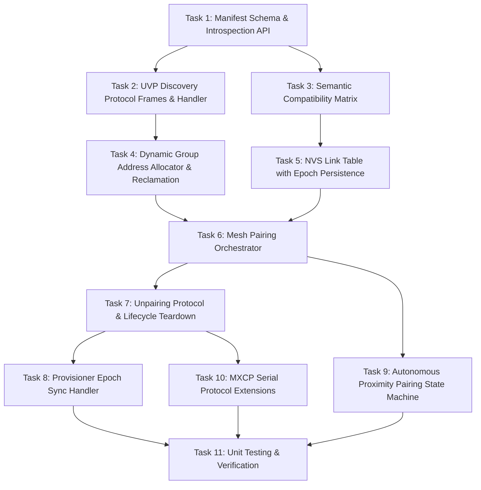

# Tasks: Autonomous & Intent-Driven Element Pairing

Implementation tasks for the `autonomous-element-pairing` specification.  
Reference Specification: [Master Design Index (TRM)](./design.md) | [Interactive Protocol Architecture](./protocol-architecture.html)  

---

## Task Dependency Graph

---

## Detailed Task Breakdown

### Phase 1: Capability Declaration & Introspection (Nodes Tell)
- [ ] **Task 1: Implement Capability Manifest & Introspection Engine**
  - Define `meshx_element_descriptor_t` and `meshx_capability_manifest_t` in `meshx_manifest.h`.
  - Add reflection method to `meshXElementRegistry` / `meshXElementIF` to iterate over registered [`meshXLogicalModel`](file:///d:/MeshX/main/component/meshx/ble_mesh/model/inc/meshx_uvp_logical_model.hpp) instances.
  - Extract roles (`PRODUCER` vs `CONSUMER`), element variants, and registered `func_id` values dynamically.
- [ ] **Task 2: Implement In-Mesh UVP Discovery Protocol & OEM Secure Addressing**
  - Add `MESHX_FUNC_ID_SYS_DISCOVERY` (`0xFFFE`) and system opcodes (`0x01` Query, `0x02` Report) to [`meshx_uvp.h`](file:///d:/MeshX/main/component/meshx/inc/meshx_uvp.h).
  - Implement discovery request listener in the UVP dispatcher with application-layer `0xFFFF` destination blocking (`ESP_ERR_MESHX_BLOCKED_ADDR`), leaving provisioning and Config Server unimpeded.
  - Extend `code_gen.py` to compile Company-wide Label UUID and pre-computed Virtual Address from `prod_profile.yml` (at `prod` level, derived from `cid`) into `meshx_config.h` and the binary configuration container `meshx_cfg.mxc`.
  - Route all management broadcast frames via the Company Management Virtual Address (`MESHX_ADDR_VIRTUAL_MGMT`, `0x8000`–`0xBFFF`) registered exclusively on Element 0 across all products of the company.
  - Serialize the active capability manifest into a single packed UVP response payload ($\le 375$ bytes).

### Phase 2: Compatibility & Topology Planning (User Intent Resolution)
- [ ] **Task 3: Implement Semantic Compatibility Matrix**
  - Create `meshx_compat_matrix.c` / `.h` defining compatibility rules between client variants and server variants.
  - Implement `meshx_err_t meshx_verify_trait_compatibility(source_trait, sink_trait, func_id)`.
  - Add rejection error codes (`MESHX_ERR_INCOMPATIBLE_TRAIT`, `MESHX_ERR_UNSUPPORTED_FUNC_ID`).
- [ ] **Task 4: Implement Anchor Formula Engine, Dynamic Promotion & Group Reclamation**
  - Define dynamic group address range (`0xC000` to `0xC3FF`) and Anchor Formula resolver in `meshx_group_allocator.c`.
  - Implement mathematical group address derivation: `Group = 0xC000 + (Anchor_Unicast & 0x03FF)`.
  - Implement 1:1 direct unicast publication mode (0 group leases).
  - Implement Dynamic Topology Promotion (`MESHX_SYS_CMD_TOPOLOGY_UPGRADE`): seamlessly upgrade existing 1:1 unicast links to groups when additional peers pair.
  - Implement group reference counting on actuator elements and dynamic zero-reference cleanup on unpair.

### Phase 3: Link Persistence & Mesh Plumbing
- [ ] **Task 5: Implement NVS Link Table with Epoch Persistence & Self-Audit**
  - Define `meshx_nvs_link_table_t` with `bound_variant`, 16-bit `link_epoch`, and CRC-16 validation in `meshx_nvs.h`.
  - Implement `meshx_nvs_link_table_set()`, `meshx_nvs_link_table_get()`, and `meshx_nvs_link_table_erase()` in [`meshx_nvs.c`](file:///d:/MeshX/main/component/meshx/src/meshx_nvs.c).
  - Implement `meshx_link_reconcile()`: on boot after `meshx_element_init()`, audit link table against baked elements, prune entries whose variant/trait mutated, and bump `link_epoch`.
- [ ] **Task 6: Implement Pairing Orchestration Engine**
  - Create `meshx_pair_orchestrator.cpp` to execute end-to-end pairing transactions.
  - Handle 1:1 direct unicast publication configuration and 1:N group publication/subscription.
  - Implement verification test ping with timeout and retry logic.
  - Update NVS link records and increment `link_epoch`.

### Phase 4: Lifecycle Management, Unpairing & Conflict Resolution
- [ ] **Task 7: Implement Unpairing Protocol & Pre-Teardown Handshakes**
  - Define `MESHX_SYS_CMD_UNPAIR_REQUEST` (`0x05`), `MESHX_SYS_RSP_UNPAIR_RESPONSE` (`0x06`), `MESHX_SYS_NOTIFY_NODE_RESET` (`0x09`), and `MESHX_SYS_NOTIFY_COMPOSITION_CHANGE` (`0x0A`) in `meshx_uvp.h`.
  - Implement `meshx_unpair_mgr.c` handling 1:1 unicast unpublish and group subscription removal.
  - Decrement reference counts in the dynamic group allocator and reclaim unused group addresses.
  - Intercept factory reset in `meshx_handle_node_reset()`: pre-reset broadcast, 500ms drain delay, NVS wipe.
  - Intercept composition change in `mxcp_cmd_fn_set_composition()`:
    - Compute layout diff, unpair peers of mutated/removed elements proactively during 500ms reboot window.
    - If `new_element_count > provisioned_count`, trigger safe re-provisioning wipe.
  - Implement runtime safety: return `MESHX_SYS_STATUS_ERR_PERSONALITY_DIFF` on mismatched runtime frames, causing peer to auto-prune stale links.
- [ ] **Task 8: Implement Provisioner Epoch Synchronization Handler**
  - Add `MESHX_SYS_CMD_EPOCH_PING` (`0x07`) and `MESHX_SYS_RSP_EPOCH_PONG` (`0x08`) to `meshx_uvp.h`.
  - Allow re-connecting provisioners/gateways to quickly check `link_epoch` across all nodes.
  - Provide fast bulk dump of active links upon epoch mismatch to reconcile provisioner local caches lazily.

### Phase 5: Autonomous Proximity Pairing & Host Integration
- [ ] **Task 9: Implement Autonomous 1-Hop Proximity & Multi-Hop Mesh Pairing Engine**
  - Create `meshx_proximity_pair.c` implementing the 30-second pairing window state machine.
  - Implement 1-hop mode: consumer advertising beacons with RSSI threshold filtering ($\ge -50\text{ dBm}$).
  - Implement multi-hop mesh mode: broadcast `PAIR_ANNOUNCE` with TTL=7 across intermediate relay nodes, hop calculation (`Hops = Initial_TTL - RX_TTL`), and duplicate sequence filtering.
  - Implement push-button trigger integration in GPIO task (3s hold = pair, 10s hold = unpair).
  - Add visual LED feedback patterns (amber pulse during pairing, solid green on success, red on timeout/unpair).
- [ ] **Task 10: Extend MXCP Protocol for External Commissioners**
  - Add `MXCP_CMD_DISCOVER_CAPABILITIES`, `MXCP_CMD_BIND_ELEMENTS`, and `MXCP_CMD_UNBIND_ELEMENTS` to `meshx_mxcp.h`.
  - Implement dispatch handlers in `meshx_mxcp.c` forwarding commands to the pairing/unpairing orchestrators.
  - Add response events `MXCP_EVT_CAPABILITY_REPORT`, `MXCP_EVT_BIND_STATUS`, and `MXCP_EVT_UNBIND_STATUS`.

### Phase 6: Verification & Quality Assurance
- [ ] **Task 11: Unit Testing & Integration Verification**
  - Write unit tests for the compatibility matrix, group address allocator, and reclamation logic.
  - Test UVP discovery and unpair frame serialization within packet budget constraints.
  - Validate boot-time link recovery, `link_epoch` tracking, and CRC mismatch fallback.
  - Verify multi-node pairing, unpairing, and provisioner reconnection cache synchronization.
