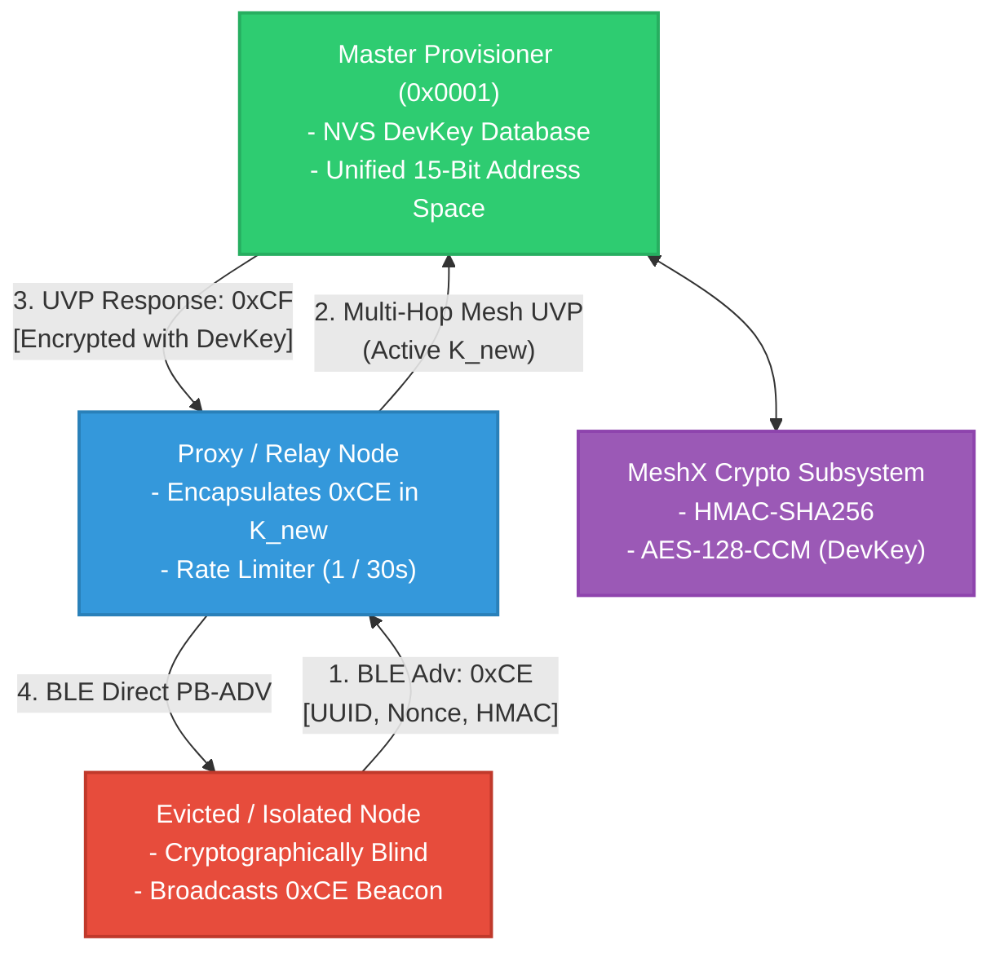
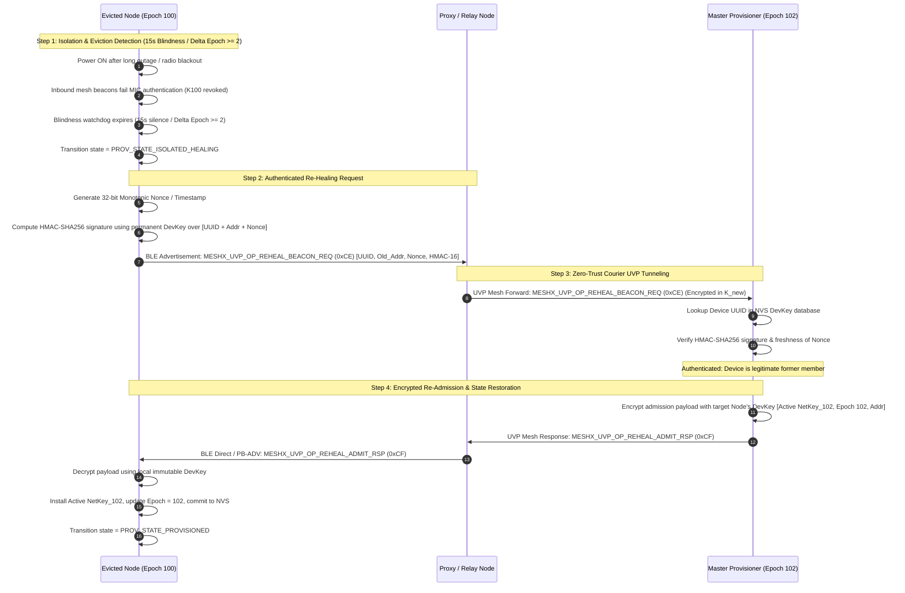
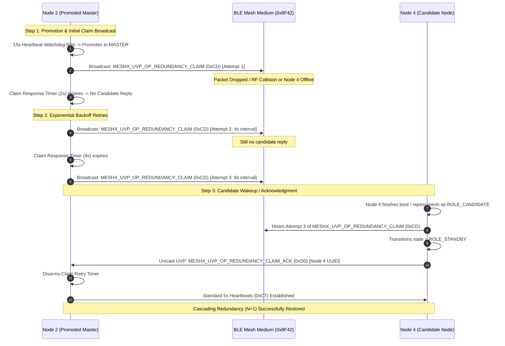

# Design Specification: Autonomous Re-Healing & Cascading Redundancy (N+1)

**Feature:** Autonomous DevKey Re-Healing & N+1 Cascading Provisioner Redundancy
**Subsystems:** `meshx_uvp_dispatcher`, `meshx_mxcp`, `meshx_crypto`, `meshx_nvs`, `meshx_group_allocator`
**Status:** Approved
**Related Requirements:** [requirements.md](./requirements.md)

---

## 1. System Architecture & Component Interaction



---

## 2. Wire Protocol Definitions

### 2.1 UVP Opcode Extensions

| Opcode | Identifier | Direction | Purpose |
|---|---|---|---|
| `0xCD` | `MESHX_UVP_OP_REDUNDANCY_CLAIM` | Master $\rightarrow$ Broadcast | Invite candidate nodes to take over Standby role ($N+1$). |
| `0xCE` | `MESHX_UVP_OP_REHEAL_BEACON_REQ` | Evicted Node $\rightarrow$ BLE Adv | Plaintext beacon with HMAC-SHA256 signature for re-admission. |
| `0xCF` | `MESHX_UVP_OP_REHEAL_ADMIT_RSP` | Master $\rightarrow$ Evicted Node | DevKey-encrypted response payload with active NetKey & Epoch. |
| `0xD0` | `MESHX_UVP_OP_REDUNDANCY_CLAIM_ACK` | Candidate $\rightarrow$ Master | Candidate acknowledges standby claim and activates watchdog. |

### 2.2 Wire Struct Layouts

```c
#pragma pack(push, 1)

/**
 * @brief Payload for MESHX_UVP_OP_REHEAL_BEACON_REQ (0xCE)
 * Total length: 38 bytes
 */
typedef struct {
    uint8_t  target_uuid[16];   /* 16-byte Device UUID */
    uint16_t previous_addr;     /* Last known 16-bit unicast address */
    uint32_t timestamp_nonce;   /* Monotonic counter / timestamp preventing replay */
    uint8_t  hmac_signature[16];/* HMAC-SHA256 truncated to 16 bytes over [UUID || Addr || Nonce] */
} meshx_uvp_reheal_req_t;

/**
 * @brief Plaintext payload before DevKey encryption for MESHX_UVP_OP_REHEAL_ADMIT_RSP (0xCF)
 * Total length: 22 bytes + 4 bytes MIC
 */
typedef struct {
    uint8_t  active_netkey[16]; /* Current active Network Key */
    uint32_t active_epoch;      /* Current key rotation epoch */
    uint16_t assigned_addr;     /* Assigned or restored unicast address */
} meshx_uvp_reheal_rsp_plain_t;

/**
 * @brief Payload for MESHX_UVP_OP_REDUNDANCY_CLAIM (0xCD)
 */
typedef struct {
    uint32_t claim_epoch;       /* Master claim epoch */
    uint16_t master_addr;       /* Master unicast address */
    uint16_t next_free_addr;    /* Monotonic allocation high-water mark */
    uint16_t reserved;          /* Reserved alignment padding */
} meshx_uvp_redundancy_claim_t;

/**
 * @brief Payload for MESHX_UVP_OP_REDUNDANCY_CLAIM_ACK (0xD0)
 */
typedef struct {
    uint8_t  candidate_uuid[16];/* Candidate node UUID accepting Standby */
    uint16_t candidate_addr;    /* Candidate unicast address */
} meshx_uvp_redundancy_claim_ack_t;

#pragma pack(pop)
```

---

## 3. Sequence & Interaction Diagrams

### 3.1 Autonomous DevKey Re-Healing Sequence



### 3.2 Cascading Standby Claim ($N+1$) Sequence


