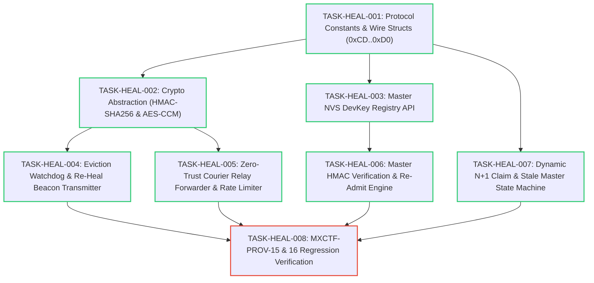

# Implementation Tasks: Autonomous Re-Healing & Cascading Redundancy (N+1)

**Feature:** Autonomous DevKey Re-Healing & N+1 Cascading Provisioner Redundancy
**Status:** In Progress
**Parent Requirements:** [requirements.md](./requirements.md)
**Parent Design:** [design.md](./design.md)

---

## 1. Task Dependency Graph

---

## 2. Task Summary Table

| Task ID | Phase | Description | Files Affected | Complexity | Status |
|---|---|---|---|---|---|
| **TASK-HEAL-001** | Phase 1: Protocol | Define opcodes `0xCD..0xD0`, sizing macros, and packed wire structs. | `meshx_uvp.h`, `meshx_config_internal.h` | Low | **DONE** |
| **TASK-HEAL-002** | Phase 2: Crypto | Implement lightweight HMAC-SHA256 and AES-128-CCM hardware/mbedtls wrappers. | `interface/crypto/meshx_crypto.h`, `port/platform/...` | Medium | **DONE** |
| **TASK-HEAL-003** | Phase 3: DevKey NVS | Implement Master NVS persistent key registry `[UUID -> DevKey]` with getter/setter APIs. | `meshx_nvs.h`, `meshx_nvs.c` | Medium | **DONE** |
| **TASK-HEAL-004** | Phase 4: Beacon Tx | Implement 15s blindness detection timer, HMAC beacon generation, and periodic advertising. | `meshx_uvp_dispatcher.cpp`, `meshx_prov_srv.cpp` | High | **DONE** |
| **TASK-HEAL-005** | Phase 5: Courier | Implement neighbor blind courier relay forwarder with 30s token bucket rate limiter. | `meshx_uvp_dispatcher.cpp` | Medium | **DONE** |
| **TASK-HEAL-006** | Phase 6: Master Verify | Implement Master HMAC signature check, nonce freshness verification, and `0xCF` encrypted response. | `meshx_uvp_dispatcher.cpp` | High | **DONE** |
| **TASK-HEAL-007** | Phase 7: Cascading | Implement `0xCD` claim retries, `ROLE_CANDIDATE` promotion, and `ROLE_STALE` reboot guard. | `meshx_uvp_dispatcher.cpp`, `meshx_mxcp.c` | Medium | **DONE** |
| **TASK-HEAL-008** | Phase 8: Testing | Validate on physical bench with MXCTF test cases `MXCTF-PROV-15` and `MXCTF-PROV-16`. | `tests.md`, `test_prov_srv_mxcp.py` | Medium | **TODO** |

---

## 3. Detailed Task Specifications

### TASK-HEAL-001: Protocol Constants & Wire Structs [STATUS: DONE]
- **Objective**: Establish all opcode constants and packed C payload structures for re-healing and $N+1$ standby claim.
- **Subtasks**:
  - [x] Add `MESHX_UVP_OP_REDUNDANCY_CLAIM = 0xCD` in `meshx_uvp.h`.
  - [x] Add `MESHX_UVP_OP_REHEAL_BEACON_REQ = 0xCE` in `meshx_uvp.h`.
  - [x] Add `MESHX_UVP_OP_REHEAL_ADMIT_RSP = 0xCF` in `meshx_uvp.h`.
  - [x] Add `MESHX_UVP_OP_REDUNDANCY_CLAIM_ACK = 0xD0` in `meshx_uvp.h`.
  - [x] Define packed structs `meshx_uvp_reheal_req_t`, `meshx_uvp_reheal_rsp_plain_t`, `meshx_uvp_redundancy_claim_t`, `meshx_uvp_redundancy_claim_ack_t`.
  - [x] Define timing macros (`MESHX_REHEAL_BLINDNESS_TIMEOUT_MS = 15000`, `MESHX_REHEAL_COURIER_RATE_LIMIT_MS = 30000`) in `meshx_config_internal.h`.

### TASK-HEAL-002: Crypto Abstraction (HMAC-SHA256 & AES-CCM) [STATUS: DONE]
- **Objective**: Provide portable crypto interfaces for HMAC-SHA256 and AES-128-CCM without adding binary bloat.
- **Subtasks**:
  - [x] Define `meshx_crypto_hmac_sha256(key, key_len, data, data_len, out_mac)` interface.
  - [x] Define `meshx_crypto_aes_ccm_encrypt(key, nonce, nonce_len, plain, len, cipher, tag)` interface.
  - [x] Define `meshx_crypto_aes_ccm_decrypt(key, nonce, nonce_len, cipher, len, tag, plain)` interface.
  - [x] Implement ESP-IDF mbedTLS / hardware accelerator bindings (`port/platform/esp/esp_idf/utils/meshx_crypto_esp.c`).

### TASK-HEAL-003: Master NVS DevKey Registry API [STATUS: DONE]
- **Objective**: Maintain persistent mapping between Device UUID and immutable DevKey on the Master Provisioner.
- **Subtasks**:
  - [x] Add `meshx_nvs_set_device_key(const uint8_t *uuid, const uint8_t *dev_key)` API.
  - [x] Add `meshx_nvs_get_device_key(const uint8_t *uuid, uint8_t *dev_key_out)` API.
  - [x] Hook into virgin provisioning completion callback to automatically persist newly onboarded node's DevKey into NVS.
