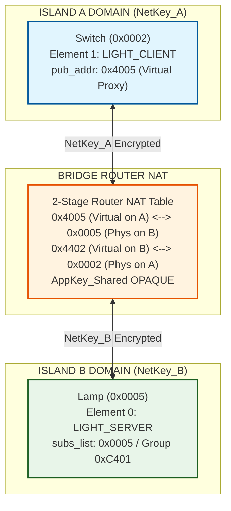

# Design Overview: Island Subnet Coexistence, Bridging & Routing

**Feature:** Island Subnet Coexistence, Non-Destructive Bridging, Redundancy, Multi-Island, KR Orchestration, MitM Defense, 2-Stage Store-and-Forward Routing & Subnet Prefix NAT (Case 4)  
**Issue Link:** https://github.com/pranjalchanda08/MeshX/issues/162  
**Branch:** `fr/162-fr-island-subnet`  
**Subsystems:** `meshx_zgb`, `meshx_platform`, `meshx_uvp_dispatcher`, `meshx_mxcp`, `meshx_crypto`, `meshx_virtual_topo`, `meshx_pair_orchestrator`  
**Status:** In Progress / Remediated (Round 2)  
**Parent Requirements:** [requirements.md](requirements.md)  
**Implementation Tasks:** [tasks.md](tasks.md)  
**Review Cross-Ref:** Remediates all findings in [REVIEW_ROUND2_FINDINGS.md](REVIEW_ROUND2_FINDINGS.md)  

---

## Technical Reference Documents (TRD Index)

```
.specs/island-subnet-coexistence/
├── requirements.md                     # Complete Requirements Matrix (REQ-F01..REQ-F08, REQ-NF01..NF02)
├── design.md                           # Master Design Index & Executive Summary
├── tasks.md                            # Implementation & Verification Tasks
└── trd/
    ├── README.md                       # TRD Index & Sitemap
    ├── page1_overview_topologies.md    # Multi-Island Topologies & Platform HAL
    ├── page2_addressing_nat.md         # Global Subnet ID & Subnet Prefix NAT (Tier 1 & Tier 2)
    ├── page3_group_addressing.md       # Group Addressing & 14-Band Subnet Prefixing
    ├── page4_store_forward_router.md   # 2-Stage Store-and-Forward Router & 0xD7 NACK Feedback
    ├── page5_discovery_pairing.md      # Cross-Island Discovery, Pairing & Manifests
    ├── page6_key_rotation.md           # Multi-Subnet Key Rotation & Single-Epoch Quarantine
    ├── page7_redundancy_failover.md    # Authenticated Fencing, 4s/12s Failover & 16-bit Loop Prevention
    ├── page8_mitm_security.md          # Replay-Protected K_bridge & Multihop Transit Whitelist
    ├── page9_latency_memory.md         # Latency Performance Bounds & Memory Budgets (3.5 KB / < 1.0 KB)
    ├── page10_multihop_transit.md      # Multi-Hop Transit NAT & Inter-Bridge Route Adv (0xD6)
    └── page11_slot_assignment.md       # Local Slot Scoping, Bounded Registry & Dynamic Tier-2 Overflow
```

---

## 1. High-Level System Architecture



---

## 2. Core Architectural Guarantees (Round 2 Remediations)

1. **Non-Overlapping Virtual NAT ([TRD Page 2](trd/page2_addressing_nat.md))**:
   - `0x0001..0x3FFF`: Local physical space (16,383 addresses).
   - `0x4000..0x77FF`: Tier-1 Static Subnet Proxy Slots (14 slots $\times$ 1,024 elements).
   - `0x7800..0x7FFF`: Tier-2 Dynamic Flow Aliases (2,048 addresses). Zero overlap between static and dynamic ranges.
2. **Safe 14-Band Multicast Grouping ([TRD Page 3](trd/page3_group_addressing.md))**:
   - Group band formula: $\text{band}(n) = 0\text{xC000} + ((n + 1) \ll 10)$ for $n \in [0..13]$. Bounded strictly below `0xFC00`, preserving BLE Mesh unallocated (`0xFC00..0xFEFF`) and fixed (`0xFF00..0xFFFF`) address ranges.
3. **2-Stage Store-and-Forward with Hop Flow Control ([TRD Page 4](trd/page4_store_forward_router.md))**:
   - Stage 1 ACK serves strictly as hop-by-hop transport flow control.
   - Stage 2 failures trigger reliable authenticated `MESHX_UVP_OP_ROUTER_NACK` (`0xD7`).
   - Upper Transport TransMIC is preserved byte-for-byte end-to-end. Single-epoch reassembly context prevents key rotation corruption.
4. **Active-Standby Redundancy & Fencing Epochs ([TRD Page 7](trd/page7_redundancy_failover.md))**:
   - 4.0s heartbeat (`0xD1`), 12.0s failover watchdog (`0xD2`), total failover in $12.0\text{s} \dots 12.5\text{s}$ ($\le 15.5\text{s}$).
   - Monotonic `active_term` fencing token enforced on transit frames; immediate demotion on split-brain score tie-break.
   - 16-bit `visited_subnets_mask` (`uint16_t`) and $5.0\text{s}$ sliding TTL Echo Filter prevent loops without bit-overflow.
5. **Replay-Protected Security Plane ([TRD Page 8](trd/page8_mitm_security.md))**:
   - $K_{\text{bridge}}$ HMAC covers monotonic nonces/timestamps, preventing control frame replay.
   - Multihop ingress whitelist mathematically verifies transit proxy sources against active visited subnet bits.
   - Decommissioned bridges execute secure hardware erase of `NVS_KEY_BRIDGE_CLUSTER`.
6. **Strict Resource Alignment ([TRD Page 9](trd/page9_latency_memory.md))**:
   - Persistent static BSS RAM strictly budgeted at **$2,570\text{ B}$ ($\le 3.0\text{ KB}$)**, with peak operational RAM (including 4 dynamically allocated in-flight queue entries, dynamic 14-node slot linked list, and heap block headers) at **$3,536\text{ B}$ ($\le 3.5\text{ KB}$)**.
   - NVS flash storage strictly budgeted at **$796\text{ B}$ ($< 1.0\text{ KB}$)**.
