# Remediation Tasks: Island Subnet Coexistence (`fix_tasks.md`)

**Feature:** Island Subnet Coexistence, Non-Destructive Bridging, Redundancy, Multi-Island, KR Orchestration, MitM Defense, 2-Stage Store-and-Forward Routing & Subnet Prefix NAT (Case 4)
**Issue Link:** https://github.com/pranjalchanda08/MeshX/issues/162
**Branch:** `fr/162-fr-island-subnet`
**Reviewed Baseline Commit:** `dd33b3d85` (plus triage of 7 uncommitted working-tree files)
**Related Specs:** [requirements.md](requirements.md) | [design.md](design.md) | [tasks.md](tasks.md) | [TRD Index](trd/README.md)

---

## Dependency & Execution Task Graph

```mermaid
flowchart TD
    classDef crit fill:#ffebee,stroke:#c62828,stroke-width:2px;
    classDef high fill:#fff3e0,stroke:#e65100,stroke-width:2px;
    classDef med fill:#e3f2fd,stroke:#1565c0,stroke-width:1.5px;
    classDef ver fill:#e8f5e9,stroke:#2e7d32,stroke-width:2px;

    subgraph S1["Step 1: UVP RX Auth & Anti-Replay"]
        FIX01["FIX-01: Stop +1 strip & 0xFFFF exempt"]:::crit
        FIX02["FIX-02: Reject short & unauth cluster RX"]:::crit
        FIX03["FIX-03: Edge-node NetKey auth & replay"]:::crit
        FIX19["FIX-19: 32-bit replay & sliding RPL"]:::high
        FIX01 --> FIX02 --> FIX03
        FIX02 --> FIX19
    end

    subgraph S2["Step 2-3: Per-Subnet Transport & Data Plane"]
        FIX04["FIX-04: Per-subnet net_idx in UVP RX/TX"]:::crit
        FIX24["FIX-24: Global IDs, egress net_idx & orig_iv_index"]:::high
        FIX05["FIX-05: Wire tx_cb, Stage 1/2 & fix peek_tx"]:::crit
        FIX23["FIX-23: 0xD7 RX, 0xD9 TX & NACK rate limit"]:::high
        FIX06["FIX-06: Platform HAL & vendor stack hooks"]:::crit
        FIX04 --> FIX24 --> FIX05
        FIX05 --> FIX23
        FIX05 --> FIX06
    end

    subgraph S4["Step 4-5: Redundancy FSM & Bridge Lifecycle"]
        FIX07["FIX-07: Real monotonic now_ms everywhere"]:::crit
        FIX08["FIX-08: Multi-boundary tick, payload & net_idx"]:::crit
        FIX09["FIX-09: Demote target, matching score & tie-break"]:::crit
        FIX10["FIX-10: Per-boundary active_term scoping"]:::crit
        FIX27["FIX-27: Decouple standby_rank from slot_n"]:::med
        FIX11["FIX-11: bridge_remove_boundary & add rollback"]:::crit
        FIX12["FIX-12: Fix bridge_list IDs, addr & role"]:::crit
        FIX04 --> FIX08
        FIX07 --> FIX08 --> FIX09 --> FIX10
        FIX08 --> FIX27
        FIX11 --> FIX12
    end

    subgraph S6["Step 6-7: Transit, Routing, NAT & NVS"]
        FIX13["FIX-13: Transit hop<=1, origin check & keyed echo"]:::med
        FIX14["FIX-14: Periodic 0xD6 route_export TX"]:::med
        FIX15["FIX-15: 4-tuple Tier-2 NAT & reverse key"]:::med
        FIX16["FIX-16: Non-aliased group mask & forwarding"]:::med
        FIX25["FIX-25: Wire NAT/pair NVS save & sl_nat sync"]:::high
        FIX05 --> FIX13 --> FIX14
        FIX05 --> FIX16
        FIX15 --> FIX25
    end

    subgraph S8["Step 8-9: K_bridge Lifecycle & Discovery"]
        FIX17["FIX-17: 0xD4/0xDA DevKey invite handshake"]:::high
        FIX18["FIX-18: Revocation flag, NVS erase & rekey"]:::high
        FIX20["FIX-20: Advance nonce ckpt after NVS commit"]:::med
        FIX21["FIX-21: 0xDC relay, 0xDD rewrite & 0xDE dir"]:::high
        FIX22["FIX-22: Pre-NAT correlation & beacon filter"]:::high
        FIX02 --> FIX17 --> FIX18
        FIX19 --> FIX20
        FIX04 --> FIX21
        FIX15 --> FIX21
        FIX21 --> FIX22 --> FIX25
    end

    subgraph S10["Step 10: MXCP, Buffers & Verification"]
        FIX26["FIX-26: MXCP errors & primary NetKey guard"]:::high
        FIX28["FIX-28: Widen MESHX_SUBNET_FRAME_TX_BUF_LEN"]:::med
        FIX29["FIX-29: Stop-on-assert, portable runner, E2E & RAM tests"]:::ver
        FIX12 --> FIX26
        FIX18 --> FIX26
        FIX17 --> FIX28
        FIX03 --> FIX29
        FIX06 --> FIX29
        FIX10 --> FIX29
        FIX14 --> FIX29
        FIX16 --> FIX29
        FIX20 --> FIX29
        FIX22 --> FIX29
        FIX23 --> FIX29
        FIX25 --> FIX29
        FIX26 --> FIX29
        FIX27 --> FIX29
        FIX28 --> FIX29
    end
```

---

## 1. Master Remediation Backlog (Ordered by Fix Sequence 1–10)

All audit findings (`C1`–`C4`, `H1`–`H8`, `Medium/Low`), dirty-working-tree regressions, and spec/ABI conflicts are tracked below in execution order.

| Task ID | Fix Step | Finding Ref | Severity | Req IDs | File(s) & Symbol(s) | Defect Summary & Required Fix Action | Dirty-Tree Status | Verification Target |
|---|---|---|---|---|---|---|---|---|
| **FIX-01** | Step 1 | C1 | Critical | REQ-F05.1, REQ-F07 | `meshx_uvp_island_handlers.cpp:87-107` (`uvp_handle_island_coex`), `meshx_uvp_dispatcher.cpp:173-185` (`uvp_unified_dispatcher_cb`) | Stop stripping `payload[0]` (`payload + 1`) before passing to `meshx_subnet_coex_handle_uvp()`; pass exact wire frame `(payload, payload_len)` and preserve `0xFFFF` exemption for `0xD1..0xDE` on `MESHX_FUNC_ID_SYS_PAIRING`. | **DONE** | Signed control-frame RX unit test from dispatcher/wrapper through facade |
| **FIX-02** | Step 1 | C1 | Critical | REQ-F05.1, REQ-F07 | `meshx_island_subnet_coex.c:564-587` (`meshx_subnet_coex_handle_uvp`) | Reject `payload_len < MESHX_CLUSTER_AUTH_OVERHEAD` (27 B) whenever `k_bridge_valid` is true; also reject cluster-authenticated opcodes (`0xD1..0xD3`, `0xD5..0xD6`, `0xDA..0xDB`) when `k_bridge_valid` is false instead of falling through unauthenticated. | **DONE** | Short/unauthenticated `0xD1`/`0xD2`/`0xDB` injection returns `MESHX_SUBNET_ERR_AUTH` |
| **FIX-03** | Step 1 | C1 | Critical | REQ-F05.1, REQ-F07.3 | `meshx_island_subnet_coex.c:546-697`, `meshx_uvp_island_handlers.cpp:87-107`, `meshx_subnet_security.c:596-647` | Authenticate and replay-check edge-node frames (`0xD7`, `0xD8`, `0xD9`, `0xDC`, `0xDD`, `0xDE`) received from non-bridge nodes lacking `K_bridge` via subnet `NetKey`/`AppKey_Shared` origin validation + RPL. | **DONE** | Edge-frame accept/replay rejection tests in host harness |
| **FIX-04** | Step 2 | C2 | Critical | REQ-F01.2, REQ-F04.1, REQ-F04.3, REQ-F05.1 | `meshx_control_task.h:188-193` (`control_task_uvp_meta_t`), `meshx_plat_ven_srv.c:60-65,180-185`, `esp_ven_srv_model.c:80-84,219-229`, `meshx_composition_builder.cpp:688-740` (`meshx_comp_send_uvp`), `meshx_uvp_island_handlers.cpp:38-60,99` (`island_uvp_tx`) | Add `net_idx` to `control_task_uvp_meta_t` and `meshx_uvp_ctx_t`; populate from Zephyr `ctx->net_idx` / ESP `ctx->net_idx` at UVP RX; add subnet-scoped UVP TX (`net_idx`-aware `meshx_comp_send_uvp_on_subnet` / `meshx_uvp_send_on_subnet`) replacing `BT_MESH_KEY_ANY`, `meshx_get_net_key_id()`, and hardcoded element `0`. | **DONE** | Multi-subnet UVP RX/TX dispatch test verifying distinct `net_idx` per egress |
| **FIX-05** | Step 3 | C2, M/L | Critical | REQ-F04.1, REQ-F04.2, REQ-F04.3, REQ-F04.4 | `meshx_island_subnet_coex.c:213` (`meshx_island_subnet_coex_init`), `meshx_router_core.c:65-68,165-292`, `meshx_router_queue.c:203-233` (`meshx_router_queue_peek_tx`) | Register a real non-NULL `tx_cb` in `meshx_router_core_init()` (fail if NULL instead of silently staying `TX_IN_FLIGHT`); wire production callers for `meshx_router_reasm_segment()`, `meshx_router_stage1_ingress()`, and `meshx_router_stage2_on_tx_complete()`; fix dirty `meshx_router_queue_peek_tx()` bug with `meshx_router_queue_peek_inflight()`. | **DONE** | Host end-to-end Stage 1 -> Queue -> Stage 2 TX/retry/ACK/NACK test |
| **FIX-06** | Step 3 | C2, H6 | Critical | REQ-F04.1, REQ-F04.3 | `port/platform/zephyr/ble_mesh/src/meshx_plat_ble_mesh.c:806-820`, `port/platform/esp/esp_idf/ble_mesh/common/src/esp_platform_ble_mesh.c:468-482`, `meshx_island_subnet_coex.c` (`0xDF` tunnel) | Validate platform subnets exist in Zephyr/ESP PAL; implement **Option B** UVP data-plane tunnel (`0xDF` `MESHX_UVP_OP_SUBNET_DATA_TUNNEL`) inside `D:/MeshX` without patching external Zephyr/ESP-IDF SDKs. | **DONE (Option B)** | Host `0xDF` tunnel E2E test + ESP32-C3 firmware build |
| **FIX-07** | Step 4 | C3, M/L | Critical | REQ-F05.1, REQ-F05.2 | `meshx_island_subnet_coex.c:513,604,623,644,896`, `meshx_uvp_island_handlers.cpp:67-72` (`island_tick_timer_cb`), `port/os/*/meshx_utils.c` (`meshx_rtos_get_sys_time`) | Pass real monotonic `now_ms` in all inbound control handlers and `meshx_subnet_coex_bridge_add()`; replace `s_island_now_ms += 250` drift in `island_tick_timer_cb()` with `meshx_rtos_get_sys_time()`. | **DONE** | Watchdog reset & 12.0s–12.5s failover test under timer jitter |
| **FIX-08** | Step 4 | C3 | Critical | REQ-F05.1, REQ-F05.2, REQ-F08.2 | `meshx_subnet_bridge.c:198-262` (`meshx_subnet_bridge_tick_all`), `meshx_island_subnet_coex.c:420-470` (`meshx_subnet_coex_tick`) | Replace single `out_hb_boundary_id` / `out_claim_boundary_id` outputs with `meshx_subnet_bridge_tick_all()` bitmasks; populate `hb.score`, `hb.key_epoch`, `hb.kr_phase`, `tk.score`, `tk.rank`, `tk.prev_active_addr`; transmit heartbeats/claims on each boundary's constituent `net_idx`. | **DONE** | Multi-boundary (2–4 boundaries) tick test verifying zero starvation and non-zero `kr_phase`/`key_epoch`/`score` |
| **FIX-09** | Step 4 | C3 | Critical | REQ-F05.3 | `meshx_island_subnet_coex.c:521-530,593-608`, `meshx_subnet_bridge.c:45-65,108-124,366-385` | Fix `handle_uvp_heartbeat()` to use the matching `boundary_id` entry's `local_score`; emit `0xDB` (`MESHX_UVP_OP_SUBNET_DEMOTE`) when `send_demote` is set in `TAKEOVER_CLAIM`; replace `dummy_target` in `meshx_subnet_bridge_on_takeover_claim()` with `out_demote_target`; fix `on_demote()` tie-break. | **DONE** | Split-brain heartbeat & takeover-claim arbitration tests on boundary index > 0 |
| **FIX-10** | Step 4 | C3, H1 | Critical / High | REQ-F05.3, REQ-F07.3 | `meshx_subnet_security.h:70`, `meshx_subnet_security.c:365-396`, `meshx_island_subnet_coex.c:449-458,527,559` | Scope `active_term` per `boundary_id` via `meshx_subnet_sec_verify_frame_scoped()`; avoid mutating global `s_coex.sec.active_term` from orthogonal boundaries. | **DONE** | Multi-boundary isolation test: higher term on boundary A does not alter boundary B |
| **FIX-11** | Step 5 | C4 | Critical | REQ-F05.1 | `meshx_subnet_bridge.h`, `meshx_subnet_bridge.c`, `meshx_island_subnet_coex.c:860-936` (`bridge_add`, `bridge_del`) | Add `meshx_subnet_bridge_remove_boundary()` API and call it from `meshx_subnet_coex_bridge_del()`; roll back `meshx_nat_slot_release()` and `meshx_subnet_kr_slot_unbind()` if `meshx_subnet_bridge_add_boundary()` fails in `meshx_subnet_coex_bridge_add()`. | **DONE** | Full 4-slot `bridge_add` failure leaves NAT/KR counts unchanged; deleted subnet stops heartbeating |
| **FIX-12** | Step 5 | C4, M/L | Critical / Med | REQ-F05.1 | `meshx_island_subnet_coex.c:791-848` (`meshx_subnet_coex_bridge_list`) | Look up `meshx_boundary_redundancy_t` by `global_subnet_id` (not array index `idx - 1`); populate `info->boundary_id` and `info->active_bridge_addr`; report `MESHX_BRIDGE_ROLE_IDLE` when no boundary entry exists. | **DONE** | `bridge_list` after add/delete/re-add in non-contiguous slot order returns exact roles, IDs, and active addrs |
| **FIX-13** | Step 6 | M/L | Medium | REQ-F06.1, REQ-F06.2, REQ-F06.3 | `meshx_subnet_types.h:307-319`, `meshx_subnet_bridge.h:41-46`, `meshx_subnet_bridge.c:625-673` (`meshx_subnet_bridge_transit_check_and_mark_ex`) | Drop transit frames when `hop_limit <= 1` or `egress_global_subnet == orig_subnet_id`; mark both ingress and egress bits; compute `K_bridge`-keyed echo digest; wire transit ingress into `meshx_subnet_coex_on_pdu_rx()`. | **DONE** | Multihop A->B->C transit, hop exhaustion (`hop_limit == 1`), origin re-entry, and keyed echo filter tests |
| **FIX-14** | Step 6 | M/L | Medium | REQ-F06.2 | `meshx_island_subnet_coex.c:405-482` (`meshx_subnet_coex_tick`), `meshx_subnet_bridge.c:581-613` (`meshx_subnet_bridge_route_export`) | Call `meshx_subnet_bridge_route_export()` periodically (`30.0s` cadence) in `meshx_subnet_coex_tick()` and transmit authenticated `0xD6` (`MESHX_UVP_OP_SUBNET_ROUTE_ADV`) across attached subnets. | **DONE** | Multi-hop route advertisement RX/TX expiration & split-horizon test |
| **FIX-15** | Step 7 | M/L | Medium | REQ-F03.2 | `meshx_subnet_types.h:284-291` (`meshx_nat_entry_t`), `meshx_nat_mgr.c:483-611,707-783` (`tier2_alloc_flow`, `tier2_reverse_by_net`, `tier2_apply_sync`) | Expand Tier-2 NAT key to full bidirectional 4-tuple `(global_subnet_src, orig_addr, global_subnet_dst, dst_addr)` plus `(egress_net_idx, virtual_addr)` reverse lookup; align `meshx_nat_tier2_apply_sync()` fallback with hash/probe. | **DONE** | Concurrent many-to-one flows across same `(src_subnet, src_addr)` to distinct `(dst_subnet, dst_addr)` without collision |
| **FIX-16** | Step 7 | M/L | Medium | REQ-F02.1, REQ-F02.2, REQ-F02.3 | `meshx_nat_mgr.h:26`, `meshx_nat_mgr.c:793-869`, `meshx_router_core.c` | Replace aliased 32-bit `group_forward_bitmap` with 1024-bit `group_forward_bits[32]`; wire `meshx_nat_is_group_forward_allowed()` and `meshx_nat_prefix_group_addr()` into `meshx_subnet_coex_on_pdu_rx()`. | **DONE** | Group offset `0x0001` vs `0x0021` policy independence + cross-subnet `0xC001 <-> 0xC401` forwarding test |
| **FIX-17** | Step 8 | H2 | High | REQ-F07.1 | `meshx_island_subnet_coex.c:564-697`, `meshx_subnet_security.c:406-511` | Implement `MESHX_UVP_OP_SUBNET_BRIDGE_INVITE` (`0xD4`) RX decryption (`meshx_subnet_sec_open_devkey()`), commit-before-activate NVS save, and `MESHX_UVP_OP_SUBNET_INVITE_ACK` (`0xDA`) TX/RX commissioning handshake. | **DONE** | DevKey-encrypted `0xD4` invite -> NVS persist -> `0xDA` ACK round-trip host test |
| **FIX-18** | Step 8 | H2 | High | REQ-F07.1 | `meshx_mxcp.h:694-698`, `meshx_mxcp.c:2381-2401`, `meshx_subnet_nvs.c/.h`, `meshx_island_subnet_coex.c:977-1006` | Add `revoke` flag to `mxcp_cmd_cluster_key_update_t`; add `meshx_subnet_nvs_erase_kbridge()`; wire `meshx_subnet_sec_clear_k_bridge()` on local revocation via `meshx_subnet_coex_cluster_key_update_ex()`. | **DONE** | MXCP revoke wipes `K_bridge` from RAM + NVS and locks out old key |
| **FIX-19** | Step 1 / 8 | H1 | High | REQ-F07.3 | `meshx_subnet_security.h:20-25` (`meshx_replay_sender_t`), `meshx_subnet_security.c:261-329,596-707` | Widen `seen_bitmap` from `uint16_t` to `uint32_t` (32-bit sliding window) and key anti-replay cache by `(sender_addr, boundary_id)`; upgrade `meshx_subnet_sec_rpl_check_update()` to a 32-bit sliding window `(net_idx, src_addr, key_epoch)` and wire into `on_pdu_rx()`. | **DONE** | Out-of-order nonce/seq delivery across 32-packet window + 33rd-packet rejection tests |
| **FIX-20** | Step 8 | M/L | Medium | REQ-F07.3 | `meshx_subnet_security.c:236-247` (`meshx_subnet_sec_sign_frame`) | Advance `ctx->last_saved_nonce_ckpt` only AFTER `ctx->ckpt_cb(...)` returns `MESHX_SUCCESS`. | **DONE** | Simulated `ckpt_cb` failure test leaves `last_saved_nonce_ckpt` unchanged and retries next frame |
| **FIX-21** | Step 9 | H3 | High | REQ-F01.2, REQ-F01.3 | `meshx_island_subnet_coex.c:679-693`, `meshx_subnet_types.h:451-467` | Replace dirty `DISCOVER_REQ` self-reply with cross-subnet `0x8000` relay + `record_req()`; rewrite `virtual_nat_addr` & relay `DISCOVER_RSP` (`0xDD`); define `meshx_subnet_directory_t` and synthesize `QUERY_SUBNET_DIRECTORY` (`0xDE`). | **DONE** | `0xDC -> 0xDD` cross-subnet relay, source rewrite, and `0xDE` directory query tests |
| **FIX-22** | Step 9 | H3 | High | REQ-F01.2 | `meshx_subnet_discovery.c:100-197` (`eval_candidate`, `handle_rsp`, `commit_pair`), `meshx_island_subnet_coex.c:733-778` (`on_beacon_rx`) | Validate correlation against pending `DISCOVER_REQ` entries BEFORE allocating Tier-2 NAT in `meshx_subnet_disc_handle_rsp()`; filter `meshx_subnet_coex_on_beacon_rx()` by MeshX `company_id` + payload and debounce; wire `meshx_subnet_coex_commit_pair()`. | **DONE** | Unsolicited `DISCOVER_RSP` rejected without Tier-2 allocation; repeated beacons do not flood `0xD3` |
| **FIX-23** | Step 3 | H4 | High | REQ-F04.3, REQ-F04.4 | `meshx_island_subnet_coex.c:589-696`, `meshx_router_core.c:275-290,375-404` | Add `MESHX_UVP_OP_SUBNET_ROUTER_NACK` (`0xD7`) RX handler emitting `0xD9` `MESHX_UVP_OP_SUBNET_NACK_ACK`, and add 1000 ms per-sender rate limiting on `0xD7` emergency NACKs. | **DONE** | End-to-end Stage 2 failure -> `0xD7` RX -> `0xD9` TX -> NACK retransmit stop + rate-limit test |
| **FIX-24** | Step 3 | H5 | High | REQ-F04.2, REQ-F04.3 | `meshx_router_queue.h:20-85`, `meshx_router_queue.c:154-170`, `meshx_router_core.c:45-58,247-267` | Fix `meshx_router_stage1_ingress()` to store Global Subnet ID in `ingress_boundary_id`, resolve egress `tx_net_idx`, store `orig_iv_index` in `meshx_router_queue_entry_t`, and pass `entry->orig_iv_index` in `dispatch_entry_stage2()`. | **DONE** | Non-zero `iv_index` canonical nonce + distinct ingress/egress `net_idx` + boundary purge test |
| **FIX-25** | Step 7 / 10 | H7 | High | REQ-F01, REQ-F03 | `meshx_subnet_nvs.c:175-254`, `meshx_subnet_nvs.h:17-55`, `meshx_nat_mgr.c`, `meshx_subnet_discovery.c` | Wire `meshx_subnet_nvs_save_nat_table()` on Tier-2 GC/`0xD5`/discovery/`commit_pair` and `meshx_subnet_nvs_save_pair_records()` on `commit_pair()`; reconcile `"sl_nat0"`/`"sl_nat1"` chunking with `meshx_subnet_nvs.h`. | **DONE** | Reboot-recovery test: allocate Tier-2 + commit pair -> `deinit`/`init` -> entries restored |
| **FIX-26** | Step 10 | H6 | High | REQ-F05, REQ-F07 | `meshx_mxcp.c:2284-2401`, `port/zephyr/.../meshx_plat_ble_mesh.c:782-804`, `port/esp/.../esp_platform_ble_mesh.c:450-466` | Check & propagate errors from `meshx_plat_subnet_add()`, `del()`, `bridge_rule_add()`, and `bridge_set()` with rollback; guard `meshx_plat_subnet_del()` / MXCP del against deleting primary NetKey `0`. | **DONE** | MXCP error injection & primary-subnet delete protection tests |
| **FIX-27** | Step 4 / 10 | M/L | Medium | REQ-F05.2, REQ-NF02.3 | `meshx_island_subnet_coex.c:894` (`meshx_subnet_coex_bridge_add`), `meshx_subnet_bridge.c:241` | Decouple `standby_rank` from `slot_n` (use `0`/`1`) so high slot indices do not delay takeover past `12.5s`. | **DONE** | High slot index (`slot_n = 13`) standby takeover completes in `12.0s..12.5s` |
| **FIX-28** | Step 10 | M/L | Low | REQ-F04.1, REQ-F06.1 | `meshx_subnet_types.h:188`, `meshx_island_subnet_coex.c:108` (`send_authenticated_uvp`) | Increase `MESHX_SUBNET_FRAME_TX_BUF_LEN` from `128` to `192` B to fit max authenticated payloads without `MESHX_NO_MEM`. | **DONE** | Sign & transmit max-size `0xD4`/`0xD6`/control frames without `MESHX_NO_MEM` |
| **FIX-29** | Step 10 | H8 | High | REQ-NF01.1, All | `tools/tests/island_subnet_coex/host_libc/host_libc.c:289-294`, `tools/tests/island_subnet_coex/run_tests.py:11-14`, `test_phase2_5_6_sec_bridge.c` | Stop execution immediately on `host_assert_fail()` via `__builtin_longjmp`; use `PATH`/env-var lookup in `run_tests.py`; add live-path tests (`test_live_path_fixes()`) and measure 32-bit RISC-V BSS (`3568 B <= 3584 B` peak ceiling). | **DONE** | `python tools/tests/island_subnet_coex/run_tests.py` exits `0` (`phase3`, `phase4_5`, `phase2_5_6` PASS) |

---

## 2. Uncommitted Working-Tree Triage (36 Modified Files vs. `dd33b3d85`)

All changes below are verified against `dd33b3d85` HEAD. Host unit tests pass: `phase3` PASS, `phase4_5` PASS, `phase2_5_6` PASS, `run_tests.py` exit `0`.

| Area | Files | Status | Assessment |
|---|---|---|---|
| **UVP RX auth & framing (C1)** | `meshx_uvp_island_handlers.cpp`, `meshx_uvp_dispatcher.cpp`, `meshx_mxcp.h`, `meshx_control_task.h` | FIXED | Opcode strip removed; full `(payload, payload_len)` forwarded; `net_idx` added to `control_task_uvp_meta_t` and populated from platform RX (`ctx->net_idx`); `0xD1..0xDE` exempted from `0xFFFF` block only on `SYS_PAIRING`; short/unauth cluster frames rejected when `k_bridge_valid`. |
| **UVP RX handle_uvp (C1, H1, H3, H4)** | `meshx_island_subnet_coex.c` | FIXED | `is_cluster_only_opcode()` splits cluster vs edge frames; cluster frames require `k_bridge_valid` + `>= 27 B` + `verify_frame_scoped()`; edge frames (`0xD7`..`0xDE`) validated via `src_addr`/`net_idx`/slot membership; `DISCOVER_REQ` relays to remote subnets; `DISCOVER_RSP` correlation-checked before NAT alloc; `0xD7`→`0xD9` handshake; `0xDE` directory synthesized; `0xD4`/`0xDA` DevKey handshake; `0xDF` data tunnel RX/TX. |
| **Router data plane (C2, H5)** | `meshx_router_core.c`, `meshx_router_queue.c`, `meshx_router_core.h`, `meshx_router_queue.h` | FIXED | `tx_cb` non-NULL (`coex_router_tx_cb`); `orig_iv_index` stored & used in canonical nonce (not `0U`); `ingress_boundary_id` uses Global Subnet ID; egress `tx_net_idx` resolved; `peek_tx()` + new `peek_inflight()`; per-sender NACK rate limit (1000 ms); `last_nack_src`/`last_nack_ms` in ctx. |
| **Redundancy FSM (C3)** | `meshx_subnet_bridge.c`, `meshx_subnet_bridge.h` | FIXED | Tie-break fixed (`sender_addr < local_addr`); `tick_all()` bitmasks (no boundary starvation); `remove_boundary()` added; `on_takeover_claim()` emits `0xDB` via `out_demote_target`; `on_demote()` uses `peer_wins_arbitration()`; `transit_check_and_mark_ex()` checks `hop_limit <= 1`, egress vs orig, dual-bit marking, keyed echo digest. |
| **NAT 4-tuple (H7, REQ-F03.2)** | `meshx_nat_mgr.c`, `meshx_nat_mgr.h`, `meshx_subnet_types.h` | FIXED | `tier2_alloc_flow()` keyed by `(global_subnet_src, orig_addr, global_subnet_dst, dst_addr)`; `egress_net_idx` field; `tier2_reverse_by_net()`; CRC16 hash+probe allocation; `group_forward_bits[32]` non-aliasing mask. NAT entry now 27 B. |
| **Security replay (H1)** | `meshx_subnet_security.c`, `meshx_subnet_security.h` | FIXED | 32-bit sliding window (`seen_bitmap` → `uint32_t`, `seq_window` added); `boundary_id` in replay sender; `verify_frame_scoped()` for boundary-scoped term; nonce checkpoint advanced only after `ckpt_cb()` success. |
| **Discovery (H3)** | `meshx_subnet_discovery.c`, `meshx_subnet_discovery.h` | FIXED | `record_req()` pre-allocates correlation; `handle_rsp()` requires matching pending request before NAT allocation; `eval_candidate()` checks `witness_eligible`; `mic_fail_count` gating. |
| **NVS persistence (H7)** | `meshx_subnet_nvs.c`, `meshx_subnet_nvs.h` | FIXED | `erase_kbridge()` added; NAT saved as `sl_nat0`/`sl_nat1` chunks (2×8×27 B); runtime save callers wired (0xD5 sync, `commit_pair`); `_Static_assert` updated to 27 B; budget 624 B < 1024 B. |
| **Facade lifecycle (C4)** | `meshx_island_subnet_coex.c`, `meshx_island_subnet_coex.h` | FIXED | `data_tx_cb`/`data_rx_cb` registered; `coex_router_tx_cb` real (non-NULL); `bridge_add` rolls back NAT/KR on boundary add failure; `bridge_del` guards primary NetKey, calls `remove_boundary()`; `bridge_list` looks up by `global_subnet_id` (not index), populates `boundary_id`/`active_bridge_addr`/real role; `cluster_key_update_ex()` with `revoke` flag; `set_dev_key()`, `commit_pair()` wired; `send_data()` / `on_pdu_rx()` / `on_seg_rx()` / `on_stage2_tx_complete()` APIs. |
| **Platform HAL (C2)** | `meshx_plat_ble_mesh.c` (Zephyr), `esp_platform_ble_mesh.c` (ESP), `meshx_plat_ven_srv.c`, `esp_ven_srv_model.c` | FIXED | `net_idx` populated in `control_task_uvp_meta_t` from `ctx->net_idx`; `meshx_uvp_send_on_subnet()` added using real `net_idx` (not `BT_MESH_KEY_ANY` / `meshx_get_net_key_id()`); `bridge_set`/`bridge_rule_add` validate subnets exist; `subnet_del` rejects `net_idx == 0` (primary guard). |
| **MXCP error handling (H6)** | `meshx_mxcp.c` | FIXED | `bridge_add` checks platform result + rollback on facade failure; `bridge_del` guards primary, checks platform result; `rule_set` propagates platform errors; `cluster_key_update` passes `revoke` flag; event send errors now propagated. |
| **UVP model / composition** | `meshx_builder_api.h`, `meshx_composition_builder.cpp`, `meshx_uvp_model.hpp/.cpp` | FIXED | `meshx_comp_send_uvp_on_subnet()` added; `send_with_func_id_on_subnet()` added calling `meshx_uvp_send_on_subnet()`. |
| **Types / wire** | `meshx_subnet_types.h` | FIXED | `FRAME_TX_BUF_LEN` 128→192 B; `meshx_uvp_data_tunnel_hdr_t` (27 B); `meshx_subnet_directory_t` (8 entries); `_Static_assert` updated for 27 B NAT entry. |
| **Tests** | `host_libc.c`, `run_tests.py`, `test_phase2_5_6_sec_bridge.c` | FIXED | Stop-on-assert via `__builtin_longjmp`; portable toolchain lookup via env vars; `test_live_path_fixes()` + `test_remaining_fixes_coverage()` added covering C1-C4, H1-H7, FIX-01..FIX-29. |

---

## 3. Spec & Wire-ABI Reconciliation Items

| Topic | Spec Requirement | Current Codebase State | Decision Needed Before Coding | Governing Task |
|---|---|---|---|---|
| **Failover Score Width & Formula** | [requirements.md](file:///d:/MeshX/.specs/island-subnet-coexistence/requirements.md#L103) & [page7_redundancy_failover.md](file:///d:/MeshX/.specs/island-subnet-coexistence/trd/page7_redundancy_failover.md#L78): `Score = (Priority_Rank << 16) | (~Unicast_Address & 0xFFFF)` (32-bit). | [meshx_subnet_bridge.c:108-124](file:///d:/MeshX/main/component/meshx/src/island/meshx_subnet_bridge.c#L108-L124) & `meshx_uvp_{heartbeat,takeover,demote}_payload_t` use 16-bit `score` (`mains | rssi | heap | addr_nibble`). | Widen wire `score` to `uint32_t` (updating wire structs + MXCTF schemas) OR update spec to 16-bit score + explicit tie-break. | **FIX-09** |
| **Transit Header Layout (`23 B`)** | [requirements.md](file:///d:/MeshX/.specs/island-subnet-coexistence/requirements.md#L108) & [page7_redundancy_failover.md](file:///d:/MeshX/.specs/island-subnet-coexistence/trd/page7_redundancy_failover.md#L105-L115): `orig_seq_auth`, `orig_iv_index`, `active_term`, 16-bit `visited_subnets_mask`, 16-bit `orig_subnet_id`, `orig_phys_src`, `orig_seq_num`, `boundary_id`, `hop_limit`. | [meshx_subnet_types.h:309-320](file:///d:/MeshX/main/component/meshx/inc/island/meshx_subnet_types.h#L309-L320) now matches REQ-F06.1 exactly: 16-bit `visited_subnets_mask`, 8-bit `hop_limit`, 16-bit `orig_subnet_id`, 16-bit `orig_phys_src`, 16-bit `orig_seq_num`, 32-bit `orig_seq_auth`, 32-bit `orig_iv_index`, 16-bit `boundary_id`, 32-bit `active_term`; `_Static_assert(sizeof == 23)`. | None — layout reconciled with spec. | **FIX-13** |
| **Data-Plane SDK Boundary (`C2`)** | Full Stage 1 SAR reassembly, Block ACK decoupling, canonical nonce preservation, and Stage 2 SAR dispatch (`REQ-F04`). | Zephyr (`bt_mesh_*`) and ESP-IDF (`esp_ble_mesh_*`) Lower Transport / Network layers live in external SDKs outside `D:/MeshX`. | **Selected Option B**: Tunnel cross-subnet data PDUs via UVP `0xDF` (`MESHX_UVP_OP_SUBNET_DATA_TUNNEL`) inside `D:/MeshX` with zero external SDK patches. | **FIX-05, FIX-06** |

---

## 4. Requirements Compliance Matrix (Baseline -> Remediation Mapping)

| Requirement | Baseline Status | Verified Gap Summary | Closing Fix Task(s) |
|---|---|---|---|
| **REQ-F01.1** | PARTIAL | Tier-1 math exists; 0xD4 DevKey invite handshake implemented. No probe/bind commissioning driver (code gap). | FIX-17, FIX-22 |
| **REQ-F01.2** | PARTIAL | CODE DONE: `DISCOVER_REQ` relays to remote subnets (not self-reply); correlation validated before NAT allocation; source rewrite via NAT translation. Remaining: real-hardware RF end-to-end only. | FIX-04, FIX-21, FIX-22 |
| **REQ-F01.3** | PARTIAL | `meshx_subnet_directory_t` defined; `QUERY_SUBNET_DIRECTORY` (`0xDE`) synthesizes from pair records (max 8 entries). | FIX-21 |
| **REQ-F02.1** | PARTIAL | CODE DONE: group forwarding policy checked in `on_pdu_rx()` via `meshx_nat_is_group_forward_allowed()`. Remaining: vendor-stack lower-transport wiring (Option B `0xDF` tunnel provides app-layer path). | FIX-05, FIX-16 |
| **REQ-F02.2** | PARTIAL | CODE DONE: `meshx_nat_prefix_group_addr` / `unprefix` called in `on_pdu_rx()` for group addrs `0xC000..0xFBFF`. Remaining: end-to-end real-hardware verification. | FIX-16 |
| **REQ-F02.3** | PARTIAL | CODE DONE: non-aliasing 1024-bit `group_forward_bits[32]` implemented; no 32-bit offset aliasing. Remaining: vendor-stack lower-transport wiring. | FIX-05, FIX-16 |
| **REQ-F03.1** | PASS | Tier-1 (`0x4000..0x77FF`) and Tier-2 (`0x7800..0x7FFF`) ranges and separation implemented. | — |
| **REQ-F03.2** | PARTIAL | CODE DONE: 4-tuple Tier-2 key `(global_subnet_src, orig_addr, global_subnet_dst, dst_addr)`; `egress_net_idx`; `tier2_reverse_by_net()`; CRC16 hash+probe allocation. Remaining: real-hardware many-to-one flow verification. | FIX-15 |
| **REQ-F04.1** | PARTIAL | CODE DONE: `on_pdu_rx()` / `on_seg_rx()` ingestion APIs exist; `stage1_ingress()` wired with egress net_idx, canonical src/dst, orig_iv_index. Remaining: vendor-stack production caller intercepting segments (Option B tunnel path ready). | FIX-05, FIX-06 |
| **REQ-F04.2** | PARTIAL | CODE DONE: `orig_iv_index` stored in queue entry and passed to canonical nonce (not `0U`); `trans_mic` preserved end-to-end. Remaining: real-hardware nonce verification. | FIX-24 |
| **REQ-F04.3** | PARTIAL | CODE DONE: `tx_cb` is now `coex_router_tx_cb` (non-NULL); `0xD7` RX handler emits `0xD9` NACK_ACK; per-sender NACK rate limiting (1000 ms). Remaining: vendor-stack lower-transport integration. | FIX-04, FIX-05, FIX-23, FIX-24 |
| **REQ-F04.4** | PARTIAL | CODE DONE: drop-newest with per-sender NACK rate limit added; static NACK buffer retained. Remaining: vendor-stack lower-transport wiring for Stage 1 backpressure. | FIX-05, FIX-23 |
| **REQ-F05.1** | PARTIAL | CODE DONE: edge-node auth rejects short/unauth frames when `k_bridge_valid`; validates `src_addr`/`net_idx` for edge frames `0xD7`..`0xDE`; heartbeat TX populates `score`/`key_epoch`/`kr_phase` and transmits on each boundary's `tx_net_idx`. Remaining: none in code. | FIX-01, FIX-02, FIX-03, FIX-08 |
| **REQ-F05.2** | PARTIAL | CODE DONE: `now_ms = 0` fixed (passes `s_coex.now_ms`); multi-boundary `tick_all()` bitmasks (no starvation); `standby_rank` decoupled from `slot_n` (0/1). Host test verifies 8000 ms no-claim / 12400 ms TAKEOVER_CLAIM. Remaining: real-hardware timer/RF verification. | FIX-07, FIX-08, FIX-27 |
| **REQ-F05.3** | PARTIAL | CODE DONE for boundary-scoped opcodes: `boundaries[0]` score bug fixed (matching boundary via `find_coex_boundary()`); `send_demote` emitted in TAKEOVER_CLAIM; `dummy_target` replaced with `out_demote_target`; tie-break fixed (`sender_addr < local_addr`). `s_coex.sec.active_term` remains shared cluster term for non-boundary-scoped cluster frames (`0xD3`, `0xD5`, `0xD6`, `0xD7`, `0xD8`, `0xD9`). | FIX-09, FIX-10, FIX-11, FIX-12 |
| **REQ-F06.1** | PARTIAL | CODE DONE: `meshx_subnet_transit_hdr_t` now matches `REQ-F06.1` wire layout — 16-bit `visited_subnets_mask`, 8-bit `hop_limit`, 16-bit `orig_subnet_id`, 16-bit `orig_phys_src`, 16-bit `orig_seq_num`, 32-bit `orig_seq_auth`, 32-bit `orig_iv_index`, 16-bit `boundary_id`, 32-bit `active_term`; `_Static_assert(sizeof == 23)`. Loop prevention checks `hop_limit <= 1`, egress vs `orig_subnet_id`, dual-bit marking. Remaining: real-hardware verification of initial `hop_limit = 15` initialization. | FIX-13 |
| **REQ-F06.2** | PARTIAL | CODE DONE: `transit_check_and_mark_ex` checks `hop_limit <= 1`, egress vs `orig_subnet_id`, dual-bit marking. Remaining: legacy wrapper passes NULL `k_bridge`; no production caller wires transit into `on_pdu_rx()`. | FIX-13, FIX-14 |
| **REQ-F06.3** | PARTIAL | CODE DONE: keyed echo digest via CRC16 with `k_bridge` in `_ex` variant. Remaining: legacy wrapper passes NULL `k_bridge`. | FIX-13 |
| **REQ-F07.1** | PARTIAL | CODE DONE: `0xD4`/`0xDA` DevKey invite handlers (commit-before-activate NVS); revocation flag added; `meshx_subnet_nvs_erase_kbridge()` implemented. Remaining: OTA cluster re-key path (not in code). | FIX-17, FIX-18 |
| **REQ-F07.2** | PARTIAL | CODE DONE: edge-node auth (`src_addr`/`net_idx` validation, slot membership check). Remaining: full ingress whitelist with NAT/transit authorization in data plane. | FIX-05, FIX-13 |
| **REQ-F07.3** | PARTIAL | CODE DONE: 32-bit sliding window (`seen_bitmap` → `uint32_t`; `seq_window` added to RPL); `verify_frame_scoped` for boundary-scoped term. Remaining: `rpl_check_update` production caller in data plane. | FIX-19, FIX-20 |
| **REQ-F08.1** | PARTIAL | CODE DONE: `meshx_subnet_kr` slot tracking unit-tested; egress key selection wired in `coex_router_tx_cb`. Remaining: cross-subnet forwarding data-path wiring. | FIX-05, FIX-24 |
| **REQ-F08.2** | PARTIAL | CODE DONE: heartbeat RX uses boundary-scoped terms and matching boundary scores; heartbeat TX populates `kr_phase`/`key_epoch`/`score`. Remaining: none in code. | FIX-08 |
| **REQ-F08.3** | PARTIAL | CODE DONE: `meshx_subnet_coex_is_kr_quarantined()` exists and is exercised in tests. Remaining: live forwarding path per-opcode wiring. | FIX-05 |
| **REQ-NF01.1** | PARTIAL | CODE DONE: stop-on-assert via `__builtin_longjmp`; portable runner with env-var lookup; live-path tests added. `.bss` measured at 3576 B (<= 3584 B ceiling). Remaining: automatic RAM assertion inside `run_tests.py`. | FIX-29 |
| **REQ-NF01.2** | PARTIAL | CODE DONE: NVS chunking (`sl_nat0`/`sl_nat1`) implemented and in sync with `meshx_subnet_nvs.h`; `_Static_assert` updated to 27 B; runtime saves wired (0xD5 sync → `save_nat_table`, `commit_pair` → `save_pair_records` + `save_nat_table`). Budget verified at 624 B (< 1024 B). Remaining: none in code. | FIX-25 |
| **REQ-NF02.3** | PARTIAL | CODE DONE: `standby_rank` decoupled from `slot_n`; tick drift fixed (uses `meshx_rtos_get_sys_time()`). Host test verifies failover timing (`12.0s`..`12.5s`). Remaining: real-hardware timer/RF verification. | FIX-07, FIX-27 |
