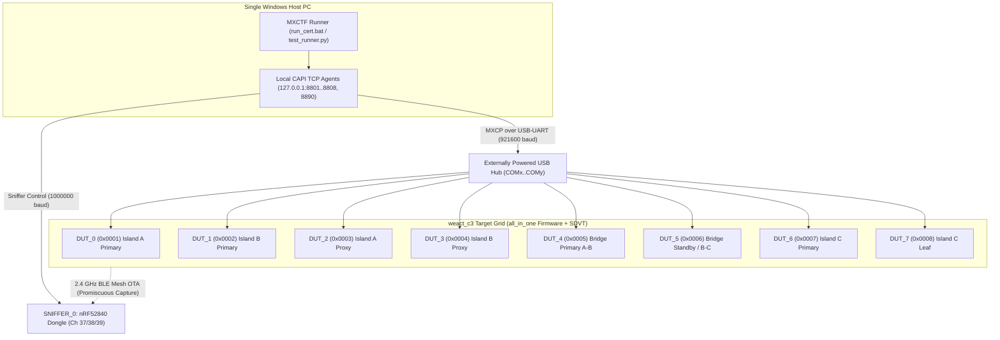
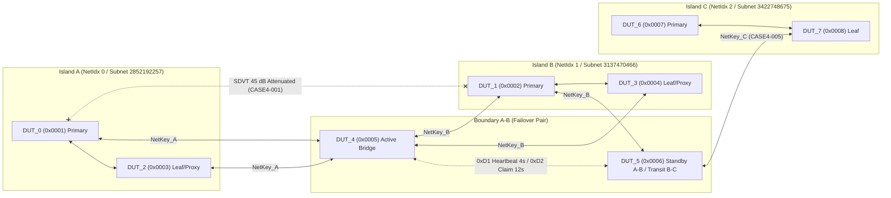

# MXCTF Target Test Design: Island Subnet Coexistence (`Case 4`)

**Target Framework:** MeshX Certification Test Framework (`D:\MXCTF`)
**Parent Spec:** [requirements.md](d:/MeshX/.specs/island-subnet-coexistence/requirements.md)
**Firmware MXCP Contract:** [meshx_mxcp.h](d:/MeshX/main/component/meshx/ble_mesh/common/inc/meshx_mxcp.h), [meshx_mxcp.c](d:/MeshX/main/component/meshx/ble_mesh/common/src/meshx_mxcp.c)
**MXCTF CAPI Reference:** [mxcp_codec.py](D:/MXCTF/capi/port/target/mxcp_codec.py), [wire_schemas.py](D:/MXCTF/capi/port/target/wire_schemas.py), [dut_mxcp_driver.py](D:/MXCTF/capi/port/target/dut_mxcp_driver.py)

---

## 1. Testbed Architecture & Hardware Topology

MXCTF executes from a **single Windows host** driving all DUTs over USB-UART (MXCP) and capturing BLE advertising/mesh frames over-the-air (OTA) via nRF52840 sniffer(s). Island isolation, attenuation, and downstream packet loss are injected in firmware using **SDVT virtual topology** (`topo_set_link_attenuation`, `virtual_topo_set_peer`), eliminating the need for scattered hosts or RF shielding boxes.

### Host & USB Hub Physical Testbed Diagram



### Multi-Island Logical RF & Bridge Topology



### 1.1 Ideal Full Testbed (8 DUTs + 1–3 Sniffers)

Based on [topology_multi_island.json](D:/MXCTF/capi/config/topology_multi_island.json) and [testbed_topology.json](D:/MXCTF/capi/config/testbed_topology.json), a full hardware run uses an externally powered USB hub connected to one host PC:

| Agent ID | Role | Zone | Unicast | Global Subnet ID | Hardware Driver Config |
| :--- | :--- | :--- | :--- | :--- | :--- |
| `DUT_0` | `island_a_primary` | `island_a` | `0x0001` | `2852192257` | `dut_mxcp`, `921600` baud, `reset_strategy: "esp"` |
| `DUT_1` | `island_b_primary` | `island_b` | `0x0002` | `3137470466` | `dut_mxcp`, `921600` baud, `reset_strategy: "esp"` |
| `DUT_2` | `island_a_proxy` | `island_a` | `0x0003` | — | `dut_mxcp`, `921600` baud, `reset_strategy: "esp"` |
| `DUT_3` | `island_b_proxy` | `island_b` | `0x0004` | — | `dut_mxcp`, `921600` baud, `reset_strategy: "esp"` |
| `DUT_4` | `boundary_bridge_primary` | `island_a` | `0x0005` | — | `dut_mxcp`, `921600` baud, `reset_strategy: "esp"` |
| `DUT_5` | `boundary_bridge_standby` / `BRIDGE_BC` | `island_b` | `0x0006` | — | `dut_mxcp`, `921600` baud, `reset_strategy: "esp"` |
| `DUT_6` | `island_c_primary` | `island_c` | `0x0007` | `3422748675` | `dut_mxcp`, `921600` baud, `reset_strategy: "esp"` |
| `DUT_7` | `island_c_leaf` | `island_c` | `0x0008` | — | `dut_mxcp`, `921600` baud, `reset_strategy: "esp"` |
| `SNIFFER_0` *(or `SNIFFER_A/B/C`)* | BLE Sniffer (Ch 37/38/39) | OTA | — | — | `sniffer_nrf`, `1000000` baud |

> [!NOTE]
> On Windows, two agent processes cannot open the same `COM` port simultaneously. When running with **1 physical nRF52840 dongle** on a single-desk OTA setup, use a single `sniffer_nrf` agent (`SNIFFER_0`) rather than three separate processes on the same port.
> Also, [topology_multi_island.json](D:/MXCTF/capi/config/topology_multi_island.json) currently uses `"driver": "mock_dut"` (`115200` baud); for real `weact_c3` boards, create a sibling hardware topology (e.g. `capi/config/topology_multi_island_hw.json`) with `"driver": "dut_mxcp"`, `"baudrate": 921600`, `"reset_strategy": "esp"`, and `"shift_mxcp_to_logging_channel": true`.

### 1.2 Scaled-Down Hardware Profiles

| Board Count | Active Agents | Runnable `subnet` / `sec_kr` Cases |
| :--- | :--- | :--- |
| **3 DUTs** (+ optional 1 Sniffer) | `DUT_0`, `DUT_1`, `DUT_4` | `CASE4-001`, `CASE4-004`, `CASE4-006`, `CASE4-007` (new), `KR-3PHASE-001`, `KR-OVERLAP-002`, `KR-RECOVERY-003` |
| **4 DUTs** | `DUT_0`, `DUT_1`, `DUT_4`, `DUT_5` | Above + `CASE4-002`, `CASE4-003` |
| **5+ DUTs** | `DUT_0`, `DUT_1`, `DUT_4`, `DUT_5`, `DUT_7` | Above + `CASE4-005` |
| **8 DUTs** | `DUT_0`..`DUT_7` | Full unmodified `subnet` + `sec_kr` suites |

---

## 2. MXCP Wire Protocol & CAPI Driver Mapping

| CAPI Command | Request Opcode | Response Event | Firmware Handler (`meshx_mxcp.c`) | MXCTF Target Status |
| :--- | :--- | :--- | :--- | :--- |
| `subnet_list` | `0x3B` (`MXCP_CMD_SUBNET_LIST`) | `0xBA` (`MXCP_EVT_SUBNET_LIST_RSP`) | `mxcp_cmd_fn_subnet_list` | Implemented (`wire_schemas.py`, `dut_mxcp_driver.py`) |
| `subnet_bridge_add` | `0x3C` (`MXCP_CMD_SUBNET_BRIDGE_ADD`) | `0xBB` (`MXCP_EVT_SUBNET_BRIDGE_ADD_RSP`) | `mxcp_cmd_fn_subnet_bridge_add` | Implemented (`<HIB16s`) |
| `subnet_bridge_del` | `0x3D` (`MXCP_CMD_SUBNET_BRIDGE_DEL`) | `0xBC` (`MXCP_EVT_SUBNET_BRIDGE_DEL_RSP`) | `mxcp_cmd_fn_subnet_bridge_del` | Implemented (`<HB`) |
| `subnet_rule_set` | `0x3E` (`MXCP_CMD_SUBNET_RULE_SET`) | `0xBD` (`MXCP_EVT_SUBNET_RULE_SET_RSP`) | `mxcp_cmd_fn_subnet_rule_set` | Implemented (`<HHHHBBI`) |
| `bridge_cluster_key_update` | `0x3F` (`MXCP_CMD_BRIDGE_CLUSTER_KEY_UPDATE`) | `0xBE` (`MXCP_EVT_BRIDGE_CLUSTER_KEY_RSP`) | `mxcp_cmd_fn_bridge_cluster_key_update` | Implemented (`<II16s` in MXCTF) |
| `subnet_commission_pair` | `0x40` (`MXCP_CMD_SUBNET_COMMISSION_PAIR`) | `0xBF` (`MXCP_EVT_SUBNET_COMMISSION_RSP`) | `mxcp_cmd_fn_subnet_commission_pair` | **Gap — needs wiring in MXCTF** |

### Required MXCTF Driver Addition (`0x40` / `0xBF`)

Firmware defines `mxcp_cmd_subnet_commission_pair_t` in [meshx_mxcp.h](d:/MeshX/main/component/meshx/ble_mesh/common/inc/meshx_mxcp.h#L704-L711):
- `src_net_idx` (`uint16_t`)
- `local_elem_addr` (`uint16_t`)
- `remote_global_subnet_id` (`uint32_t`)
- `remote_phys_addr` (`uint16_t`)
- `func_id` (`uint16_t`)
- `role_flags` (`uint8_t`)

Wire pack format for `wire_schemas.py`: `<HHIHHB` (`13` bytes), expecting `MXCP_EVT_SUBNET_COMMISSION_RSP` (`0xBF`) with `_unpack_subnet_op_rsp`.

---

## 3. Requirements Traceability Matrix

| MXCTF Test Case | Protocol Dir | Requirements Covered | Primary Targets |
| :--- | :--- | :--- | :--- |
| `MX-CERT-SUBNET-BUILDUP-000` *(new gate)* | `subnet` | Independent ZGB self-provisioning per island, anchor `0x0001` birth, non-destructive proximity convergence | `DUT_0`..`DUT_7`, `SNIFFER_0` |
| `MX-CERT-SUBNET-CASE4-001` | `subnet` | `REQ-F01` (discovery), `REQ-F03` (NAT), `REQ-F07.1` ($K_{\text{bridge}}$) | `DUT_0`, `DUT_1`, `DUT_4`, `SNIFFER_A`, `SNIFFER_B` |
| `MX-CERT-SUBNET-CASE4-002` | `subnet` | `REQ-F02.2`, `REQ-F02.3` (14-band group), `REQ-F03.1` (Tier-1/Tier-2 NAT) | `DUT_2`, `DUT_3`, `DUT_4` |
| `MX-CERT-SUBNET-CASE4-003` | `subnet` | `REQ-F05.1`, `REQ-F05.2`, `REQ-F05.3` (failover & split-brain fencing) | `DUT_4`, `DUT_5` |
| `MX-CERT-SUBNET-CASE4-004` | `subnet` | `REQ-F04.1` (epoch quarantine), per-subnet KR isolation | `DUT_4`, `SNIFFER_B` |
| `MX-CERT-SUBNET-CASE4-005` | `subnet` | `REQ-F06.1`, `REQ-F06.2`, `REQ-F06.3` (transit header & loop filter) | `DUT_0`, `DUT_4`, `DUT_5`, `DUT_7`, `SNIFFER_C` |
| `MX-CERT-SUBNET-CASE4-006` | `subnet` | `REQ-F04.3`, `REQ-F04.4` (drop-newest backpressure, `0xD7`/`0xD9` NACK, purge) | `DUT_0`, `DUT_4`, `SNIFFER_B` |
| `MX-CERT-SUBNET-CASE4-007` *(new)* | `subnet` | `REQ-F01.1` (intent-driven commissioning pair via `0x40`) | `DUT_0`, `DUT_1`, `DUT_4` |
| `MX-CERT-KR-3PHASE-001` | `sec_kr` | 3-phase Zero-ACK KR burst commit | `DUT_0`, `DUT_1` |
| `MX-CERT-KR-OVERLAP-002` | `sec_kr` | Overlapping epoch handling | `DUT_0`, `DUT_1` |
| `MX-CERT-KR-RECOVERY-003` | `sec_kr` | KR recovery after outage | `DUT_0`, `DUT_1` |

---

## 4. Test Case Specifications & Step Procedures

### 4.1 Subnet Coexistence Cases (`capi/cases/subnet/`)

#### `MX-CERT-SUBNET-BUILDUP-000` *(Primary Gate)* — Autonomous ZGB Island Self-Provisioning & Proximity Convergence
- **Planned Artifact:** `D:\MXCTF\capi\cases\subnet\MX-CERT-SUBNET-BUILDUP-000.json`
- **Purpose:** Verify that each island autonomously self-provisions via ZGB while RF-isolated, reaches `provisioned` completion with its own Anchor (`0x0001`) and `NetKey`, and preserves its provisioned state when brought into RF proximity for bridging.
- **Target Bindings:** `DUT_0`..`DUT_7`, `SNIFFER_0`

| Step | Target | Command | Key Parameters | Expected Result |
| :--- | :--- | :--- | :--- | :--- |
| 1 | `DUT_0`..`DUT_7` | `prov_get_state` | `{}` | `state_desc: "unprovisioned"` (fresh/erased NVS baseline) |
| 2 | `HOST` / `DUT_0`..`DUT_7` | `virtual_topo_set_partition` | Isolate `{DUT_0, DUT_2, DUT_4}` (Island A), `{DUT_1, DUT_3, DUT_5}` (Island B), `{DUT_6, DUT_7}` (Island C) | `status: "CONFIGURED"` |
| 3 | `SNIFFER_0` | `sniffer_start` | `pcap_file: "artifacts/captures/MX-CERT-SUBNET-BUILDUP-000.pcap"`, `channels: [37, 38, 39]` | `capturing: true` |
| 4 | `DUT_0`, `DUT_1`, `DUT_6` | `prov_bootstrap_commission` | `{}` (triggered per isolated partition) | `state_desc: "commissioning"` (each elects Anchor `0x0001` with independent HWRNG `NetKey`) |
| 5 | `DUT_2`, `DUT_4`, `DUT_3`, `DUT_5`, `DUT_7` | `prov_enable` | `{ "bearer_mask": 1 }` (PB-ADV unprovisioned beacons inside respective partitions) | `state_desc: "beaconing"` |
| 6 | `DUT_0`, `DUT_1`, `DUT_6` | `prov_get_state` (`wait_sec: 15`) | `{}` | `prov_status: "provisioned"`, `unicast_addr: 1` on all 3 island anchors |
| 7 | `DUT_2`, `DUT_4`, `DUT_3`, `DUT_5`, `DUT_7` | `dev_get_info` | `{}` | `prov_status: "provisioned"` on all island members (Primary Provisioning Gate passed) |
| 8 | `HOST` | `topo_set_link_attenuation` | Open RF visibility to boundary bridges `DUT_4` (A↔B) and `DUT_5` (B↔C); `DUT_0` ↔ `DUT_1` attenuated `45` dB | `status: "CONFIGURED"` |
| 9 | `DUT_0`, `DUT_1`, `DUT_6` | `prov_get_state` | `{}` | `prov_status: "provisioned"`, `unicast_addr: 1` (non-destructive preservation across proximity) |

---

#### `MX-CERT-SUBNET-CASE4-001` — Non-Destructive Island Discovery & Boundary Pairing
- **JSON Artifact:** [MX-CERT-SUBNET-CASE4-001.json](D:/MXCTF/capi/cases/subnet/MX-CERT-SUBNET-CASE4-001.json)
- **Target Bindings:** `ISLAND_A_PRIMARY` (`DUT_0`), `ISLAND_B_PRIMARY` (`DUT_1`), `BRIDGE_PRIMARY` (`DUT_4`), `SNIFFER_A`, `SNIFFER_B`

| Step | Target | Command | Key Parameters | Expected Result |
| :--- | :--- | :--- | :--- | :--- |
| 1 | `HOST` | `topo_set_link_attenuation` | `node_a: "DUT_0"`, `node_b: "DUT_1"`, `attenuation_db: 45` | `status: "CONFIGURED"` |
| 2 | `ISLAND_A_PRIMARY` | `prov_get_state` | `{}` | `unicast_addr: 1` |
| 3 | `BRIDGE_PRIMARY` | `bridge_cluster_key_update` | `cluster_epoch: 1`, `active_term: 1`, `k_bridge: "A1B2...0F10"` | `status_code: 0`, `success: true`, `cluster_epoch: 1`, `active_term: 1` |
| 4 | `BRIDGE_PRIMARY` | `subnet_bridge_add` | `net_idx: 0`, `global_subnet_id: 2852192257`, `role: 1`, `net_key: "11..11"` | `status_code: 0`, `success: true`, `slot_n: 0` |
| 5 | `BRIDGE_PRIMARY` | `subnet_bridge_add` | `net_idx: 1`, `global_subnet_id: 3137470466`, `role: 1`, `net_key: "22..22"` | `status_code: 0`, `success: true`, `slot_n: 1` |
| 6 | `BRIDGE_PRIMARY` | `subnet_rule_set` | `net_idx_1: 0`, `net_idx_2: 1`, `addr_1: 1`, `addr_2: 2`, `directions: 2`, `enable: 1`, `group_forward_bitmap: 0` | `status_code: 0`, `success: true`, `enabled: true` |
| 7 | `BRIDGE_PRIMARY` | `subnet_list` | `{}` | `status_code: 0`, `count: 2`, `entry_0_global_subnet_id: 2852192257`, `entry_1_global_subnet_id: 3137470466` |
| 8 | `SNIFFER_B` | `sniffer_start` | `pcap_file: "artifacts/captures/MX-CERT-SUBNET-CASE4-001.pcap"`, `channels: [37, 38, 39]` | `capturing: true` |
| 9 | `ISLAND_A_PRIMARY` | `el_set_state` | `elem_id: 1`, `val: 1` | `sent: true` |
| 10 | `SNIFFER_B` | `sniffer_verify_packet` | `opcode: 221`, `timeout_ms: 4000` | `verified: true`, `matched: true` |

---

#### `MX-CERT-SUBNET-CASE4-002` — Cross-Subnet Unicast NAT & Selective 14-Band Group Bridging
- **JSON Artifact:** [MX-CERT-SUBNET-CASE4-002.json](D:/MXCTF/capi/cases/subnet/MX-CERT-SUBNET-CASE4-002.json)
- **Target Bindings:** `ISLAND_A_LEAF` (`DUT_2`), `ISLAND_B_LEAF` (`DUT_3`), `BRIDGE_PRIMARY` (`DUT_4`)

| Step | Target | Command | Key Parameters | Expected Result |
| :--- | :--- | :--- | :--- | :--- |
| 1 | `BRIDGE_PRIMARY` | `subnet_bridge_add` | `net_idx: 0`, `global_subnet_id: 2852192257`, `role: 1`, `net_key: "11..11"` | `status_code: 0`, `success: true` |
| 2 | `BRIDGE_PRIMARY` | `subnet_bridge_add` | `net_idx: 1`, `global_subnet_id: 3137470466`, `role: 1`, `net_key: "22..22"` | `status_code: 0`, `success: true` |
| 3 | `BRIDGE_PRIMARY` | `subnet_rule_set` | `net_idx_1: 0`, `net_idx_2: 1`, `addr_1: 17411` (`0x4403`), `addr_2: 259` (`0x0103`), `directions: 2`, `enable: 1`, `group_forward_bitmap: 0` | `status_code: 0`, `success: true`, `enabled: true` |
| 4 | `BRIDGE_PRIMARY` | `subnet_rule_set` | `net_idx_1: 0`, `net_idx_2: 1`, `addr_1: 30720` (`0x7800`), `addr_2: 260` (`0x0104`), `directions: 2`, `enable: 1`, `group_forward_bitmap: 0` | `status_code: 0`, `success: true`, `enabled: true` |
| 5 | `BRIDGE_PRIMARY` | `subnet_rule_set` | `net_idx_1: 0`, `net_idx_2: 1`, `addr_1: 51205`, `addr_2: 50181`, `directions: 2`, `enable: 1`, `group_forward_bitmap: 33` (`0x21`) | `status_code: 0`, `success: true`, `group_forward_bitmap: 33`, `rule_count: 3` |
| 6 | `BRIDGE_PRIMARY` | `subnet_list` | `{}` | `status_code: 0`, `count: 2`, `entry_0_local_net_idx: 0`, `entry_1_local_net_idx: 1` |
| 7 | `ISLAND_A_LEAF` | `el_set_state` | `elem_id: 2`, `val: 1` | `sent: true` |
| 8 | `ISLAND_B_LEAF` | `el_get_state` | `elem_id: 2` | `state: 1`, `match: true` |

---

#### `MX-CERT-SUBNET-CASE4-003` — Active-Standby Bridge Failover & Split-Brain Suppression
- **JSON Artifact:** [MX-CERT-SUBNET-CASE4-003.json](D:/MXCTF/capi/cases/subnet/MX-CERT-SUBNET-CASE4-003.json)
- **Target Bindings:** `BRIDGE_PRIMARY` (`DUT_4`), `BRIDGE_STANDBY` (`DUT_5`)

| Step | Target | Command | Key Parameters | Expected Result |
| :--- | :--- | :--- | :--- | :--- |
| 1 | `BRIDGE_PRIMARY` | `bridge_cluster_key_update` | `cluster_epoch: 1`, `active_term: 2`, `k_bridge: "B1B2...0F10"` | `status_code: 0`, `active_term: 2` |
| 2 | `BRIDGE_STANDBY` | `bridge_cluster_key_update` | `cluster_epoch: 1`, `active_term: 2`, `k_bridge: "B1B2...0F10"` | `status_code: 0`, `active_term: 2` |
| 3 | `BRIDGE_PRIMARY` | `subnet_bridge_add` | `net_idx: 0`, `global_subnet_id: 2852192257`, `role: 1`, `net_key: "11..11"` | `status_code: 0`, `role: 1` |
| 4 | `BRIDGE_STANDBY` | `subnet_bridge_add` | `net_idx: 0`, `global_subnet_id: 2852192257`, `role: 2`, `net_key: "11..11"` | `status_code: 0`, `role: 2` |
| 5 | `BRIDGE_PRIMARY` | `prov_disable` | `{}` | `success: true` |
| 6 | `BRIDGE_STANDBY` | `subnet_list` (`wait_sec: 14`) | `{}` | `status_code: 0`, `entry_0_role: 1`, `active_term: 3`, `entry_0_active_bridge_addr: 6` |
| 7 | `BRIDGE_PRIMARY` | `prov_enable` | `{}` | `state: 1` |
| 8 | `BRIDGE_PRIMARY` | `subnet_list` | `{}` | `status_code: 0`, `entry_0_role: 2`, `active_term: 3`, `entry_0_active_bridge_addr: 6` |

---

#### `MX-CERT-SUBNET-CASE4-004` — Independent Per-Subnet Key Rotation & Burst Quarantine
- **JSON Artifact:** [MX-CERT-SUBNET-CASE4-004.json](D:/MXCTF/capi/cases/subnet/MX-CERT-SUBNET-CASE4-004.json)
- **Target Bindings:** `BRIDGE_PRIMARY` (`DUT_4`), `SNIFFER_B`

| Step | Target | Command | Key Parameters | Expected Result |
| :--- | :--- | :--- | :--- | :--- |
| 1 | `BRIDGE_PRIMARY` | `subnet_bridge_add` | `net_idx: 0`, `global_subnet_id: 2852192257`, `role: 1`, `net_key: "11..11"` | `status_code: 0`, `slot_n: 0` |
| 2 | `BRIDGE_PRIMARY` | `subnet_bridge_add` | `net_idx: 1`, `global_subnet_id: 3137470466`, `role: 1`, `net_key: "22..22"` | `status_code: 0`, `slot_n: 1` |
| 3 | `SNIFFER_B` | `sniffer_start` | `pcap_file: "artifacts/captures/MX-CERT-SUBNET-CASE4-004.pcap"`, `channels: [37, 38, 39]` | `capturing: true` |
| 4 | `BRIDGE_PRIMARY` | `uvp_key_rotate_trigger` | `phase: 1`, `net_idx: 1`, `target_epoch: 2`, `new_key: "F0E1...1E0F"` | `current_phase: 1`, `success: true` |
| 5 | `BRIDGE_PRIMARY` | `subnet_list` | `{}` | `status_code: 0`, `entry_0_kr_phase: 0`, `entry_1_kr_phase: 1` |
| 6 | `SNIFFER_B` | `sniffer_verify_packet` | `opcode: 196` (`0xC4`), `timeout_ms: 4000` | `verified: true`, `matched: true` |
| 7 | `BRIDGE_PRIMARY` | `uvp_key_rotate_trigger` | `phase: 2`, `net_idx: 1`, `target_epoch: 2` | `current_phase: 2`, `success: true` |
| 8 | `BRIDGE_PRIMARY` | `subnet_list` | `{}` | `status_code: 0`, `entry_0_kr_phase: 0`, `entry_1_kr_phase: 2` |
| 9 | `BRIDGE_PRIMARY` | `uvp_key_rotate_trigger` | `phase: 3`, `net_idx: 1`, `target_epoch: 2` | `current_phase: 3`, `success: true` |
| 10 | `BRIDGE_PRIMARY` | `subnet_list` | `{}` | `status_code: 0`, `entry_0_kr_phase: 0`, `entry_1_kr_phase: 0` |

---

#### `MX-CERT-SUBNET-CASE4-005` — Multi-Island Transit Routing & Split-Horizon Loop Prevention
- **JSON Artifact:** [MX-CERT-SUBNET-CASE4-005.json](D:/MXCTF/capi/cases/subnet/MX-CERT-SUBNET-CASE4-005.json)
- **Target Bindings:** `ISLAND_A_PRIMARY` (`DUT_0`), `ISLAND_C_LEAF` (`DUT_7`), `BRIDGE_AB` (`DUT_4`), `BRIDGE_BC` (`DUT_5`), `SNIFFER_C`

| Step | Target | Command | Key Parameters | Expected Result |
| :--- | :--- | :--- | :--- | :--- |
| 1 | `BRIDGE_AB` | `subnet_bridge_add` | `net_idx: 0`, `global_subnet_id: 2852192257`, `role: 1`, `net_key: "11..11"` | `status_code: 0` |
| 2 | `BRIDGE_AB` | `subnet_bridge_add` | `net_idx: 1`, `global_subnet_id: 3137470466`, `role: 1`, `net_key: "22..22"` | `status_code: 0` |
| 3 | `BRIDGE_AB` | `subnet_rule_set` | `net_idx_1: 0`, `net_idx_2: 1`, `addr_1: 1`, `addr_2: 4`, `directions: 2`, `enable: 1`, `group_forward_bitmap: 0` | `status_code: 0`, `enabled: true` |
| 4 | `BRIDGE_BC` | `subnet_bridge_add` | `net_idx: 1`, `global_subnet_id: 3137470466`, `role: 1`, `net_key: "22..22"` | `status_code: 0` |
| 5 | `BRIDGE_BC` | `subnet_bridge_add` | `net_idx: 2`, `global_subnet_id: 3422748675`, `role: 1`, `net_key: "33..33"` | `status_code: 0` |
| 6 | `BRIDGE_BC` | `subnet_rule_set` | `net_idx_1: 1`, `net_idx_2: 2`, `addr_1: 4`, `addr_2: 8`, `directions: 2`, `enable: 1`, `group_forward_bitmap: 0` | `status_code: 0`, `enabled: true` |
| 7 | `SNIFFER_C` | `sniffer_start` | `pcap_file: "artifacts/captures/MX-CERT-SUBNET-CASE4-005.pcap"`, `channels: [37, 38, 39]` | `capturing: true` |
| 8 | `ISLAND_A_PRIMARY` | `el_set_state` | `elem_id: 2`, `val: 1` | `sent: true` |
| 9 | `SNIFFER_C` | `sniffer_verify_packet` | `opcode: 222` (`0xDE`), `timeout_ms: 4000` | `verified: true`, `matched: true` |
| 10 | `ISLAND_C_LEAF` | `el_get_state` | `elem_id: 2` | `state: 1`, `match: true` |

---

#### `MX-CERT-SUBNET-CASE4-006` — Bridge Queue Backpressure Pre-ACK Drop-Newest & Boundary Purge
- **JSON Artifact:** [MX-CERT-SUBNET-CASE4-006.json](D:/MXCTF/capi/cases/subnet/MX-CERT-SUBNET-CASE4-006.json)
- **Target Bindings:** `ISLAND_A_PRIMARY` (`DUT_0`), `BRIDGE_PRIMARY` (`DUT_4`), `SNIFFER_B`

| Step | Target | Command | Key Parameters | Expected Result |
| :--- | :--- | :--- | :--- | :--- |
| 1 | `BRIDGE_PRIMARY` | `subnet_bridge_add` | `net_idx: 0`, `global_subnet_id: 2852192257`, `role: 1`, `net_key: "11..11"` | `status_code: 0` |
| 2 | `BRIDGE_PRIMARY` | `subnet_bridge_add` | `net_idx: 1`, `global_subnet_id: 3137470466`, `role: 1`, `net_key: "22..22"` | `status_code: 0` |
| 3 | `BRIDGE_PRIMARY` | `subnet_rule_set` | `net_idx_1: 0`, `net_idx_2: 1`, `addr_1: 1`, `addr_2: 2`, `directions: 2`, `enable: 1`, `group_forward_bitmap: 0` | `status_code: 0`, `enabled: true` |
| 4 | `BRIDGE_PRIMARY` | `virtual_topo_set_peer` | `peer_addr: 2`, `rssi_offset_db: -60`, `drop_rate_pct: 100`, `blocked: 1` | `status: "CONFIGURED"` |
| 5 | `SNIFFER_B` | `sniffer_start` | `pcap_file: "artifacts/captures/MX-CERT-SUBNET-CASE4-006.pcap"`, `channels: [37, 38, 39]` | `capturing: true` |
| 6 | `ISLAND_A_PRIMARY` | `el_set_state` | `elem_id: 1`, `val: 1` | `sent: true` |
| 7 | `SNIFFER_B` | `sniffer_verify_packet` | `opcode: 217` (`0xD9`), `timeout_ms: 4000` | `verified: true`, `matched: true` |
| 8 | `BRIDGE_PRIMARY` | `subnet_bridge_del` | `net_idx: 1`, `force_purge: 1` | `status_code: 0`, `purged: true`, `remaining_subnets: 1` |
| 9 | `BRIDGE_PRIMARY` | `subnet_list` | `{}` | `status_code: 0`, `count: 1`, `entry_0_local_net_idx: 0` |

---

#### `MX-CERT-SUBNET-CASE4-007` *(Proposed)* — Intent-Driven Commissioning Pair (`0x40`)
- **Planned Artifact:** `D:\MXCTF\capi\cases\subnet\MX-CERT-SUBNET-CASE4-007.json`
- **Target Bindings:** `ISLAND_A_PRIMARY` (`DUT_0`), `ISLAND_B_PRIMARY` (`DUT_1`), `BRIDGE_PRIMARY` (`DUT_4`)

| Step | Target | Command | Key Parameters | Expected Result |
| :--- | :--- | :--- | :--- | :--- |
| 1 | `BRIDGE_PRIMARY` | `subnet_bridge_add` | `net_idx: 0`, `global_subnet_id: 2852192257`, `role: 1`, `net_key: "11..11"` | `status_code: 0`, `slot_n: 0` |
| 2 | `BRIDGE_PRIMARY` | `subnet_bridge_add` | `net_idx: 1`, `global_subnet_id: 3137470466`, `role: 1`, `net_key: "22..22"` | `status_code: 0`, `slot_n: 1` |
| 3 | `BRIDGE_PRIMARY` | `subnet_commission_pair` | `src_net_idx: 0`, `local_elem_addr: 1`, `remote_global_subnet_id: 3137470466`, `remote_phys_addr: 2`, `func_id: 1`, `role_flags: 1` | `status_code: 0`, `success: true` |
| 4 | `BRIDGE_PRIMARY` | `subnet_list` | `{}` | `status_code: 0`, `count: 2` |
| 5 | `ISLAND_A_PRIMARY` | `el_set_state` | `elem_id: 1`, `val: 1` | `sent: true` |
| 6 | `ISLAND_B_PRIMARY` | `el_get_state` | `elem_id: 1` | `state: 1`, `match: true` |

---

### 4.2 Key Rotation Certification Cases (`capi/cases/sec_kr/`)

#### `MX-CERT-KR-3PHASE-001` — Zero-ACK 3-Burst Key Rotation Protocol Flow Conformance
- **JSON Artifact:** [MX-CERT-KR-3PHASE-001.json](D:/MXCTF/capi/cases/sec_kr/MX-CERT-KR-3PHASE-001.json)
- **Target Bindings:** `MASTER` (`DUT_0`), `MEMBER` (`DUT_1`)

| Step | Target | Command | Key Parameters | Expected Result |
| :--- | :--- | :--- | :--- | :--- |
| 1 | `DUT_0` | `uvp_key_rotate_trigger` | `phase: 1`, `target_epoch: 2`, `new_netkey: "F0E1...1E0F"` | `status: "BURST_DISPATCHED"`, `current_phase: 1` |
| 2 | `DUT_0` | `uvp_key_rotate_trigger` | `phase: 2`, `target_epoch: 2` | `status: "BURST_DISPATCHED"`, `current_phase: 2` |
| 3 | `DUT_0` | `uvp_key_rotate_trigger` | `phase: 3`, `target_epoch: 2` | `status: "BURST_DISPATCHED"`, `current_phase: 3` |
| 4 | `DUT_1` | `dev_get_info` | `{}` | `kr_epoch: 2`, `active_key_switched: true` |

#### `MX-CERT-KR-OVERLAP-002` — 4-Minute Dual-Key Decryption Overlap Horizon
- **JSON Artifact:** [MX-CERT-KR-OVERLAP-002.json](D:/MXCTF/capi/cases/sec_kr/MX-CERT-KR-OVERLAP-002.json)
- **Target Bindings:** `DUT_MASTER` (`DUT_0`), `DUT_MEMBER` (`DUT_1`), `SNIFFER` (`SNIFFER_0`)

| Step | Target | Command | Key Parameters | Expected Result |
| :--- | :--- | :--- | :--- | :--- |
| 1 | `DUT_0` | `uvp_key_rotate_trigger` | `phase: 1`, `target_epoch: 2`, `new_netkey: "F0E1...1E0F"` | `status: "BURST_DISPATCHED"` |
| 2 | `SNIFFER_0` | `sniffer_verify_packet` | `opcode: 196` (`0xC4`), `timeout_ms: 5000` | `verified: true`, `matched: true` |
| 3 | `DUT_0` | `uvp_key_rotate_trigger` | `phase: 2`, `target_epoch: 2`, `new_netkey: ""` | `status: "BURST_DISPATCHED"` |
| 4 | `DUT_0` | `uvp_key_rotate_trigger` | `phase: 3`, `target_epoch: 2`, `new_netkey: ""` | `status: "BURST_DISPATCHED"` |
| 5 | `DUT_1` | `dev_get_info` | `{}` | `kr_epoch: 2`, `active_key_switched: true`, `key_error_count: 0` |

#### `MX-CERT-KR-RECOVERY-003` — Monotonic NVS Epoch Resume Post-Brownout
- **JSON Artifact:** [MX-CERT-KR-RECOVERY-003.json](D:/MXCTF/capi/cases/sec_kr/MX-CERT-KR-RECOVERY-003.json)
- **Target Bindings:** `DUT_TARGET` (`DUT_6`), `DUT_MASTER` (`DUT_0`)

| Step | Target | Command | Key Parameters | Expected Result |
| :--- | :--- | :--- | :--- | :--- |
| 1 | `DUT_6` | `dev_get_info` | `{}` | `link_epoch` (`integer >= 0`) |
| 2 | `DUT_6` | `dev_reset` | `node_id: 6`, `node_type: "leaf_node"` | `initiated: true` |
| 3 | `DUT_6` | `dev_get_info` (`wait_sec: 5`) | `{}` | `link_epoch` (`integer >= 0`) |
| 4 | `DUT_6` | `dev_get_info` | `{}` | `prov_status: "provisioned"` |

---

## 5. Execution Workflow

1. **Phase 1 — Mock-Bed Baseline (no hardware required)**:
   ```bat
   cd /d D:\MXCTF
   run_cert.bat --topology capi/config/topology_multi_island.json --start-local-bed --protocol subnet
   run_cert.bat --topology capi/config/topology_multi_island.json --start-local-bed --protocol sec_kr
   ```
2. **Phase 2 — Wire `0x40` (`subnet_commission_pair`) & `CASE4-007` in MXCTF**:
   - Update `mxcp_codec.py`, `wire_schemas.py`, `dut_mxcp_driver.py`, and `mock_drivers.py` in `D:\MXCTF\capi\port\`.
   - Add `D:\MXCTF\capi\cases\subnet\MX-CERT-SUBNET-CASE4-007.json`.
3. **Phase 3 — Target Hardware Execution (`weact_c3`, `all_in_one`)**:
   - Build & flash `weact_c3` (`all_in_one`) firmware onto each connected board.
   - Create `D:\MXCTF\capi\config\topology_multi_island_hw.json` mapping connected `COM` ports with `"driver": "dut_mxcp"`.
   - Run preflight and suites:
     ```bat
     cd /d D:\MXCTF
     run_cert.bat --topology capi/config/topology_multi_island_hw.json --preflight-only
     run_cert.bat --topology capi/config/topology_multi_island_hw.json --start-local-bed --protocol subnet
     run_cert.bat --topology capi/config/topology_multi_island_hw.json --start-local-bed --protocol sec_kr
     ```
