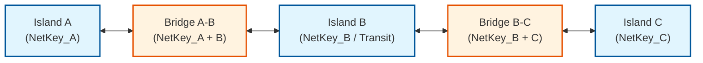

# TRD Page 10: Multi-Hop Transit NAT & Inter-Bridge Synchronization

**Module:** `TRD-SUBNET-10`
**Parent Index:** [TRD Index](./README.md)
**Requirements:** [requirements.md](../requirements.md) (REQ-F03, REQ-F06)
**Parent Pages:** [page1_overview_topologies.md](./page1_overview_topologies.md), [page2_addressing_nat.md](./page2_addressing_nat.md)
**Related Fixes:** Remediation of B findings from `REVIEW_ROUND2_FINDINGS.md`

---

## 1. Problem Statement: Topology B (Linear / Mesh Graph)



When Node `0x0002` on Island A communicates with Node `0x0005` on Island C:
1. `Bridge A-B` only possesses `NetKey_A` and `NetKey_B`.
2. `Bridge B-C` only possesses `NetKey_B` and `NetKey_C`.
3. Intermediate Island B serves as a **transit subnet**.

---

## 2. Authoritative Worked Example & Transit Address Path

To eliminate the conflicting address assignments noted in finding **B**:
- **Island A's Local Registry**: Maps Island C $\longrightarrow$ **Slot 1 (Base `0x4400`)**.
- **Island B's Transit Registry**: Maps Island A $\longrightarrow$ **Slot 0 (Base `0x4000`)**; Maps Island C $\longrightarrow$ **Slot 2 (Base `0x4800`)**.
- **Island C's Local Registry**: Maps Island A $\longrightarrow$ **Slot 1 (Base `0x4400`)**.

```
+─────────────────────────────────────────────────────────────────────────────+
|                       AUTHORITATIVE TRANSIT ADDRESS PATH                    |
+─────────────────────────────────────────────────────────────────────────────+
| 1. In Island A: Target is addressed to Slot 1 Proxy:        0x4405          |
|                                                                             |
| 2. [Bridge A-B Translates for Transit Subnet B]:                            |
|    - Ingress: Dst 0x4405 (Slot 1 on A), Src 0x0002 (Physical on A)          |
|    - Egress into B: Dst 0x4805 (Slot 2 on B), Src 0x4002 (Slot 0 on B)      |
|    - Inserts K_bridge-HMAC authenticated meshx_subnet_transit_hdr_t:        |
|        orig_subnet_id = Island_A, orig_phys_src = 0x0002, hop_limit = 15    |
|        visited_subnets_mask |= (1 << (Island_A & 0xF)) | (1 << (Island_B & 0xF)) |
|        boundary_id = 0x00AB, active_term = term_AB                          |
|        orig_seq_auth = sender_seq_num, orig_iv_index = Island_A_iv_index    |
|                                                                             |
| 3. In Island B (Transit Medium): Transits over NetKey_B as: Dst 0x4805      |
|                                                             Src 0x4002      |
|                                                                             |
| 4. [Bridge B-C Translates for Egress Subnet C]:                             |
|    - Ingress on B: Validates K_bridge HMAC & Echo Filter on Orig A 0x0002   |
|      (Matches Dst 0x4805 -> Physical 0x0005 on C; checks egress C != Orig A)|
|    - Egress into C: Dst 0x0005 (Physical on C), Src 0x4402 (Slot 1 on C)    |
|    - Decrements hop_limit (14), sets visited_subnets_mask |= (1<<(Island_C&0xF)) |
|                                                                             |
| 5. In Island C: Target Node 0x0005 receives frame from Src: 0x4402          |
+─────────────────────────────────────────────────────────────────────────────+
```

### 2.1 Multihop NACK (`0xD7`) Return Path Routing
If delivery to Destination `0x0005` fails on Subnet C:
1. `Bridge B-C` formats `MESHX_UVP_OP_ROUTER_NACK` (`0xD7`) authenticated with $K_{\text{bridge}}$ HMAC (suppressing recursive `0xD7` generation if an upstream `0xD7`/`0xD9` control frame itself fails).
2. To route back to `0x0002` across Subnet B, `Bridge B-C` inspects `ingress_src_addr` preserved inside `meshx_router_queue_entry_t` (covering both Tier-1 `0x4002` and Tier-2 `0x78xx` upstream proxies):
   - Destination address is set to `ingress_src_addr` (`0x4002` on Subnet B).
   - Payload carries `orig_subnet_id = Island_A` and `orig_phys_src = 0x0002`.
3. `Bridge A-B` intercepts `0xD7` on Subnet B matching `ingress_src_addr`, validates $K_{\text{bridge}}$ HMAC, recognizes `orig_subnet_id == Island_A`, terminates the $K_{\text{bridge}}$ envelope, and forwards local `0xD7` to `0x0002` on Island A.

---

## 3. Authenticated Inter-Bridge Route Announcements (`0xD6`)

Bridges synchronize transit routes by broadcasting authenticated route advertisements (periodic `30.0s` refresh; `90.0s` aging timeout; split-horizon with poison reverse):

```c
/* Natural field alignment: uint32_t -> uint16_t -> uint8_t = 35 B packed */
typedef struct {
    uint32_t active_term;           /* Monotonic fencing epoch of bridge */
    uint32_t bridge_nonce;          /* Anti-replay monotonic counter from NVS pool */
    uint16_t target_global_subnet;  /* Target Island Global ID */
    uint16_t proxy_prefix_base;     /* Allocated Virtual Base (e.g. 0x4800, or 0x7800 for Tier-2) */
    uint16_t bridge_addr;           /* Unicast address of announcing bridge */
    uint16_t route_ttl_sec;         /* Route lifetime in seconds (90s default; 0x0000 = WITHDRAW) */
    uint8_t  cost_metric;           /* Hop count (1 = directly attached subnet; 0xFF = infinity/poison) */
    uint8_t  hmac_signature[16];    /* Truncated HMAC-SHA256 (128-bit) under K_bridge */
} MESHX_PACKED meshx_uvp_route_adv_t;
```

1. **Direct & Transitive Announcements**: Every active bridge advertises its directly attached neighbor subnets (`cost_metric = 1`) as well as learned transitive subnets (respecting split-horizon so routes learned on Subnet B are not re-advertised back into B with lower cost).
2. **`Bridge B-C` example on Subnet B**:
   > *"I can reach Island C with hop cost = 1 (`route_ttl_sec = 90`). Address Island C nodes on Subnet B using prefix `0x4800`."*
3. **HMAC Verification-Before-Mutation & Eviction**:
   - Receivers MUST verify the HMAC signature and validate `bridge_nonce` against the per-sender sliding window before caching or mutating any transit route table.
   - Explicit route withdrawal (`route_ttl_sec == 0` or `cost_metric == 0xFF`) or `90.0s` aging timeout removes dead routes from the bounded 8-entry transit route cache without blackholing traffic.
   - Truncated 128-bit HMAC (16 bytes) provides 128-bit collision resistance matching standard AES-128 security while fitting within BLE Mesh transport limits.
4. `Bridge A-B` caches the route in its transit table:
   $$\mathbf{\text{Target: Island C} \longrightarrow \text{Next Hop: Bridge B-C}, \ \text{Transit Prefix: } 0\text{x4800}}$$
