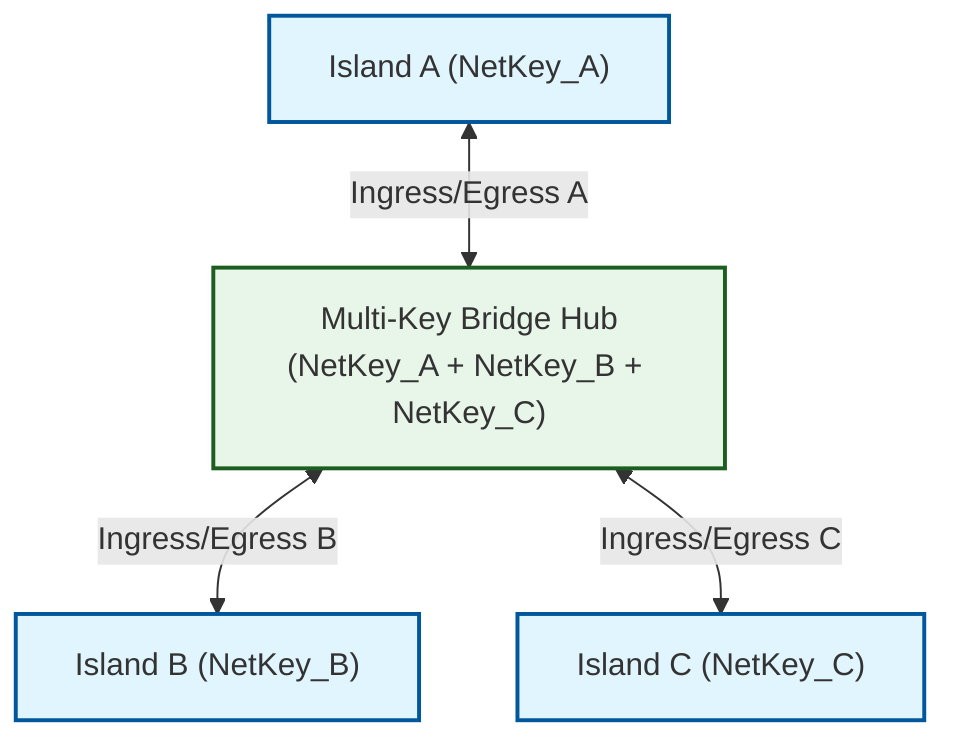
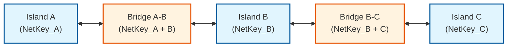

# TRD Page 1: System Overview & Multi-Island Topologies

**Module:** `TRD-SUBNET-01`
**Parent Index:** [TRD Index](./README.md)
**Requirements:** [requirements.md](../requirements.md) (REQ-F01, REQ-F04)

---

## 1. Problem Statement & Motivation

In a Zero-Gateway Bootstrapping (ZGB) environment, two or more provisioned mesh islands can bootstrap out of mutual RF proximity. Each island independently establishes its own Anchor at unicast `0x0001`, its own primary `NetKey`, and populates unicast addresses within the range `0x0001..0x7FFF`. When these islands later move into RF proximity or expand until their RF coverage overlaps, Bluetooth Mesh Network Layer decryption fails across islands (causing continuous MIC verification failures) because UVP and standard mesh network frames are encrypted using the respective island's NetKey.

Standard re-provisioning to merge islands into a single NetKey is destructive: it wipes all element models, node subscriptions, publication addresses, scenes, groups, and device keys.

**Island Subnet Coexistence** specifies non-destructive inter-island communication:
- Both islands preserve their original `NetKey`s and provisioned configurations.
- A multi-key bridge router decrypts and re-encrypts frames across subnet boundaries at the Network Layer.
- Application Layer payloads (`AppKey`) remain end-to-end opaque.

---

## 2. Multi-Island Network Topologies

MeshX supports arbitrary $N \ge 2$ island topologies:

### 2.1 Topology A: Star / Hub-and-Spoke Architecture
A central multi-key bridge hub sits in the common RF overlap of multiple autonomous islands:


### 2.2 Topology B: Linear / Mesh Graph Architecture
Daisy-chained islands connected via intermediate boundary bridges:


---

## 3. Platform Abstraction Layer (PAL) Extensions

The platform layer (`main/component/meshx/interface/meshx_platform.h`) provides multi-subnet primitives mapped to Zephyr and ESP-IDF:

```c
/**
 * @brief Add a secondary network key / subnet to the platform mesh stack.
 */
meshx_status_t meshx_plat_subnet_add(uint16_t net_idx, const meshx_key_t net_key);

/**
 * @brief Remove a secondary network key / subnet.
 */
meshx_status_t meshx_plat_subnet_del(uint16_t net_idx);

/**
 * @brief Enable or disable subnet bridging engine on the platform.
 */
meshx_status_t meshx_plat_subnet_bridge_set(bool enable);

/**
 * @brief Populate a hardware/stack-accelerated bridging table entry if supported.
 */
meshx_status_t meshx_plat_subnet_bridge_rule_add(const meshx_bridge_rule_t *rule);
```

