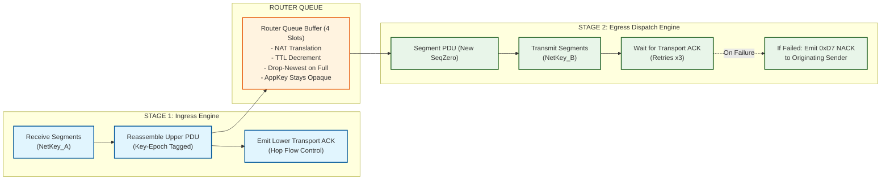
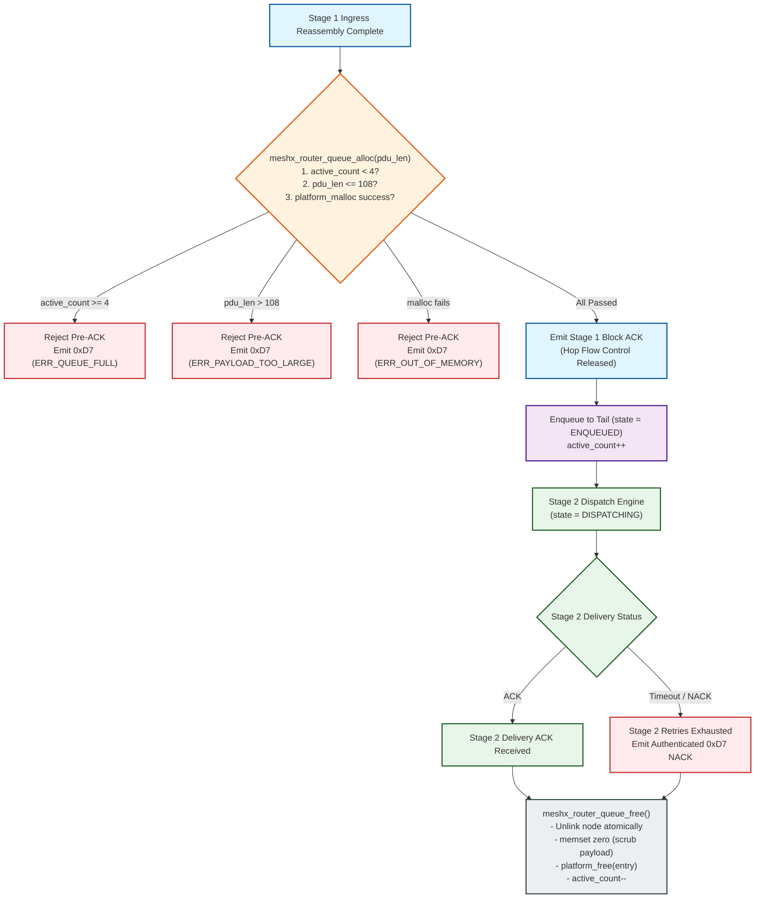

# TRD Page 4: 2-Stage Store-and-Forward Router Architecture

**Module:** `TRD-SUBNET-04`
**Parent Index:** [TRD Index](./README.md)
**Requirements:** [requirements.md](../requirements.md) (REQ-F04, REQ-F06)
**Related Fixes:** Remediation of C2, R2, R3 findings from `REVIEW_FINDINGS.md`

---

## 1. Architectural Motivation

Direct transparent forwarding across NetKey boundaries couples the timings of two distinct RF domains. If the destination subnet suffers from interference or contention, the originating node's transport retransmission timer expires, causing unnecessary packet duplication and network congestion.

MeshX implements a **2-Stage Store-and-Forward Router Architecture**:
1. **Stage 1 (Ingress Engine)**: Reassembles segmented packets on Subnet A and handles hop-by-hop transport flow control.
2. **Inter-Stage (Queue Buffer)**: Holds the opaque Upper Transport PDU, translates addresses via NAT, decrements Network TTL, and enforces epoch bindings.
3. **Stage 2 (Egress Engine)**: Initiates an independent Segmentation and Reassembly (SAR) session on Subnet B, transmitting segments and monitoring Subnet B's Transport Block ACK locally.

---

## 2. Router Pipeline & Stage 1/2 ACK Semantics

To prevent the silent packet loss identified in finding **C2** (where emitting a Lower Transport ACK prematurely before Stage 2 confirmation caused silent drops upon downstream failure):

### 2.1 The Two-Tier Delivery Model
MeshX decouples **Hop Flow Control** from **Application Delivery Confirmation**:
1. **Lower Transport Block ACK (`Segment ACK`)**:
   - Acts strictly as **Hop-by-Hop Flow Control**: Once Stage 1 successfully reassembles all segments into the router queue, it issues a Lower Transport Block ACK to the Subnet A sender. This satisfies the BLE Mesh Lower Transport layer contract and releases radio buffers on Island A.
2. **Stage 2 Failure Notification & Backpressure (`MESHX_UVP_OP_ROUTER_NACK` / `0xD7`)**:
   - **Pre-Check & Segmented/Router NACK Policy**:
     - Local router admission failures (`QUEUE_FULL`, `OOM`, `PAYLOAD_TOO_LARGE`, `TTL_EXPIRED`, `NO_ROUTE`, `NAT_FULL`) emit `0xD7` immediately prior to Stage 1 ACK emission using a **reserved 64 B static emergency TX buffer** (never `platform_malloc`, guaranteeing delivery even during `ERR_OUT_OF_MEMORY`).
     - In standard BLE Mesh (v1.1 §3.5.3.2), group/multicast destinations (`>= 0xC000`) and unsegmented Access PDUs (`SEG = 0`) never emit Lower Transport Segment ACKs. Therefore, Stage 2 monitors Transport Block ACKs (retries $\times 3$) strictly for **unicast egress SAR (`SEG = 1`)** transactions (cross-subnet unacknowledged reliability requests optionally elevate `SEG = 1` at the Shim). Segmented group multicasts (`>= 0xC000`) complete deterministically after `SEG_TX_COUNT` repetitions without triggering spurious timeout `0xD7` NACKs.
     - **Anti-Recursion Guard**: Bridges SHALL NEVER generate `0xD7` in response to failures delivering control opcodes (`0xD1..0xDE`), preventing recursive `0xD7` NACK storms.
   - If Stage 2 unicast SAR dispatch fails after standard retries (or queue aging exceeds $10.0\text{s}$ timeout -> `ERR_TIMEOUT`):
     - The router emits `MESHX_UVP_OP_ROUTER_NACK` (`0xD7`) back towards the originating sender.
     - **Cryptographic Boundary & Edge Protection**:
       - Between intermediate bridges (e.g. Bridge B-C to Bridge A-B), `0xD7` transit frames are authenticated using the shared Bridge Cluster Key $K_{\text{bridge}}$ HMAC.
       - Across the final hop into the originating island, ordinary mesh endpoints (e.g. switch `0x0002`) do not possess $K_{\text{bridge}}$. Therefore, the edge bridge (Bridge A-B) terminates the $K_{\text{bridge}}$ envelope and converts the notification into a local `0xD7` UVP frame authenticated under the originating island's local `NetKey_A` / `AppKey_Shared`.
     - **Reliable NACK Handshake & Assigned Opcode `0xD9`**:
       - The router NACK transaction requires an explicit acknowledgement: `MESHX_UVP_OP_ROUTER_NACK_ACK` assigned to opcode **`0xD9`**.
       - Between intermediate bridges, both `0xD7` and `0xD9` frames are authenticated with $K_{\text{bridge}}$ HMAC.
       - At the edge bridge interfacing the originating island, the bridge acts as the cryptographic terminator: it terminates the $K_{\text{bridge}}$ HMAC envelope and converts `0xD7` into a local UVP frame authenticated under the local subnet's `NetKey_A` / `AppKey_Shared`.
       - The edge node (MeshX Transport Shim) validates the local MIC, notifies the model layer, and returns `0xD9` (`MESHX_UVP_OP_ROUTER_NACK_ACK`) authenticated under `NetKey_A`.
       - The edge bridge intercepts this `0xD9`, verifies it, and relays it upstream over intermediate bridge hops with $K_{\text{bridge}}$ HMAC (up to 3 retries, $1.0\text{s}$ timeout), closing the reliable delivery loop.
     - **Correlation & Transport Shim Interception**:
       - The MeshX Transport Shim hooks into the BLE Mesh stack's transport layer. For cross-subnet flows, the shim caches a pending delivery descriptor keyed by `(orig_seq_zero, dst_proxy_addr)`.
       - The `0xD7` payload carries: `orig_subnet_id`, `orig_phys_src`, `failed_dst_addr`, `ingress_seq_zero`, `err_reason` (`UNREACHABLE`, `QUEUE_FULL`, `TTL_EXPIRED`, `OOM`, `PAYLOAD_TOO_LARGE`, `NO_ROUTE`, `NAT_FULL`, `TIMEOUT`), and a dedup token `orig_flow_id = (orig_seq_auth ^ (uint32_t)trans_mic)`.
       - If an unacknowledged model (e.g. `Generic OnOff Set Unacknowledged`) was transmitted, standard BLE Mesh transport would free the PDU upon hop ACK (and opt into `SEG=1` hop confirmation when end-to-end delivery feedback is requested). The MeshX Transport Shim preserves the pending transaction state for $3.0\text{s}$ or until destination completion; upon receiving `0xD7`, the shim immediately notifies the application layer of packet delivery failure.
       - If the application initiates a retry following NACK, it re-enters with the same idempotent transaction identifier, preventing duplicate state mutations on non-idempotent models.
3. **End-to-End Model Layer Confirmation**:
   - Acknowledged application models (e.g. `Generic OnOff Set Acknowledged`) retain their end-to-end retry timers until the authentic Model Layer Status response arrives from the destination node.

### 2.2 Option B UVP Data-Plane Tunnel (`0xDF` / `MESHX_UVP_OP_SUBNET_DATA_TUNNEL`)
To keep `D:/MeshX` self-contained without patching external Zephyr or ESP-IDF BLE Mesh Lower-Transport internals, MeshX-to-MeshX cross-subnet data-plane traffic uses UVP opcode `0xDF` (`MESHX_UVP_OP_SUBNET_DATA_TUNNEL`) carrying `meshx_uvp_data_tunnel_hdr_t` (27 B: `ttl`, `flags`, `key_epoch`, `orig_src_addr`, `orig_dst_addr`, `egress_net_idx`, `orig_seq_auth`, `orig_iv_index`, `trans_mic`, `pdu_len`) followed by the Upper PDU (`<= 108 B`). Bridges feed incoming `0xDF` frames into `meshx_subnet_coex_on_pdu_rx()`, translate addresses via NAT, queue Stage 2, and emit `0xDF` on `entry->tx_net_idx` via `coex_router_tx_cb()`; destination nodes validate canonical replay and deliver to `meshx_subnet_coex_register_data_rx()`.



---

## 3. Upper Transport MIC & Key Epoch Binding

### 3.1 Transport MIC Nonce Formulation & Dual-Address Preservation
- The **Upper Transport PDU MIC (32-bit or 64-bit TransMIC)** is computed end-to-end across the application access payload and encryption nonce using `AppKey_Shared`.
- In standard Bluetooth Mesh (v1.1 §3.8.4), the encryption nonce for an Application Access PDU binds:
  $$\mathbf{\text{Application Nonce} = [\text{Nonce Type (0x01)} \parallel \text{ASZMIC} \parallel \text{SeqAuth (24-bit)} \parallel \text{SRC (16-bit)} \parallel \text{DST (16-bit)} \parallel \text{IV Index (32-bit)}]}$$
  - For **unsegmented access messages**, $\text{SeqAuth}$ equals the 24-bit Sequence Number of the packet.
  - For **segmented access messages**, $\text{SeqAuth}$ equals the 24-bit Sequence Number of the **first segment (Segment 0)** of the Lower Transport transaction, which remains constant across all segments of the message.
- **The Cross-Subnet TransMIC Challenge & Canonical Pair Resolution**:
  - Because `slot_id` is locally scoped to each bridge (page 11) and dynamic aliases (`0x7800..0x7FFF`) are assigned on-the-fly, an originating node on Island A does not know the final destination island's local NAT slot or proxy address for Island A.
  - Furthermore, if the Bridge Router were to alter Network-layer `SRC` and `DST` without addressing TransMIC nonce binding, the receiving destination node would attempt TransMIC verification using the egress local addresses (`virtual_src_addr`, `dst_phys_addr`), causing immediate TransMIC failure. The router cannot re-sign or modify the Upper Transport payload because it possesses no `AppKey` (REQ-F04.2).
- **The Canonical Nonce Invariant**:
  1. **Canonical Virtual Addressing**:
     - **Unicast Traffic**: During initial Intent-Driven Pairing (stored in `meshx_pair_record_t` on both sender and receiver), endpoints agree upon the **Canonical Address Pair**:
       - $\text{CANONICAL\_SRC} = \text{orig\_phys\_src}$ (e.g. `0x0002` on Island A)
       - $\text{CANONICAL\_DST} = \text{dest\_phys\_dst}$ (e.g. `0x0005` on Island B)
     - **Group Multicast Traffic**: For group multicast publication (`0xC000..0xFBFF`), the canonical destination address is the originating group address agreed upon during group binding ($\text{CANONICAL\_DST} = \text{orig\_group\_addr}$, e.g. `0xC001`). Intermediate bridges rewrite the Network Layer group destination to the remote band (e.g. `0xC401`), while destination nodes subscribe at the BLE Mesh layer strictly to the translated alias (`0xC401`, preserving isolation of local `0xC001`) and query $\text{CANONICAL\_DST}$ strictly inside the MeshX Transport Shim (`meshx_pair_record_t`) when computing the Upper Transport Nonce.
  2. **TransMIC Nonce Generation (Sender)**: The sender constructs the Application Nonce using $\text{CANONICAL\_SRC}$, $\text{CANONICAL\_DST}$, the 24-bit $\text{SeqAuth}$ (`orig_seq_auth`), `ASZMIC` (32/64-bit TransMIC flag), and the originating island's IV Index.
  3. **Preservation Across Intermediate Hops & Transit Metadata Relay**:
     - The Upper Transport PDU (Access Payload + TransMIC) is transmitted byte-for-byte across all bridge hops untouched.
     - As the frame transits intermediate subnets, the Network Layer header rewrites hop-local `SRC` and `DST` (NAT translation) to route frames across local radio meshes.
     - Lower Transport Segmentation and Reassembly (SAR) executes hop-by-hop: intermediate bridges reassemble segments on ingress before enqueuing, and segment afresh on egress with fresh hop-local Lower Transport headers (preserving `ASZMIC` on egress `SZMIC` bit).
     - The ingress bridge encapsulates the sender's full 24-bit $\text{SeqAuth}$ (`orig_seq_auth`) and originating island's `orig_iv_index` into `meshx_subnet_transit_hdr_t`.
  4. **Destination Reassembly, Decryption & Canonical Replay Defense**:
     - Upon completing Lower Transport reassembly, the destination node's MeshX Transport Shim identifies the ingress frame as arriving from a cross-subnet proxy (source address in `0x4000..0x7FFF`).
     - The shim queries `meshx_pair_record_t` using the disambiguating key `(ingress_src_virtual_addr, network_dst_addr)` to obtain `CANONICAL_SRC` (`0x0002`) and `CANONICAL_DST` (`0x0005` or `0xC001`).
     - **Canonical Upper-Layer Replay Check**: Before accepting the decrypted Upper PDU, the shim validates that `(orig_iv_index, orig_seq_auth)` is strictly newer than the last accepted canonical sequence tuple recorded for `(CANONICAL_SRC, global_subnet_src)` (preventing a rogue peer on the destination subnet from replaying historical `AppKey_Shared` PDUs with bumped hop-local `SEQ_B`).
     - The shim extracts `orig_seq_auth` and `orig_iv_index` from the transit header and passes the exact canonical 6-tuple `(0x01, ASZMIC, orig_seq_auth, CANONICAL_SRC, CANONICAL_DST, orig_iv_index)` into the BLE Mesh Upper Transport decryption engine.
     - The reassembled TransMIC computes against the original canonical nonce, achieving 100% cryptographic authentication end-to-end for both single-segment and multi-segment frames without requiring intermediate bridges to possess application keys or alter TransMIC.

### 3.2 Single-Epoch Reassembly Context
To prevent corruption when key rotation occurs mid-flight (finding **R3**):
- When the first segment of a multi-segment frame arrives, the reassembly context is tagged with the active `epoch_id` (a full `uint32_t`) used for ingress decryption.
- Subsequent segments MUST decrypt successfully under the **same key epoch**. Any segment bearing a different key epoch is rejected, preventing mixed-key reassembly corruption.

---

## 4. Router Queue Data Structure & Overflow Policy

The router queue employs a **per-flow dynamic linked-list allocation model (Option B)** with explicit allocation/deallocation lifecycle guards:

### 4.1 Memory Model & Significance of MESHX_MAX_UPPER_PDU_LEN (108)
- **BLE Mesh Theoretical Limit**: Bluetooth Mesh v1.1 Lower Transport supports up to 32 segments (`SegN` $\in [0..31]$), which at 12 bytes/segment yields a theoretical maximum of $384\text{ bytes}$.
- **MeshX Operational Ceiling (`MESHX_MAX_UPPER_PDU_LEN = 108`, Multi-Hop App Ceiling = `85`)**:
  - $108\text{ bytes}$ represents **exactly 9 Lower Transport segments** ($9 \times 12\text{ B}$) for the combined enqueued wire payload (`pdu[]`).
  - **Multi-Hop Transit Encapsulation Accounting**: Because intermediate hops encapsulate the **23-byte `meshx_subnet_transit_hdr_t`** alongside the opaque Upper PDU, originating endpoints transmitting across multi-hop bridges MUST cap their application Upper Transport PDU to **`MESHX_MAX_MULTIHOP_APP_PDU_LEN = 85` bytes** ($85\text{ B app} + 23\text{ B transit hdr} = 108\text{ B}$), preventing silent `ERR_PAYLOAD_TOO_LARGE` drops at downstream bridges.
  - Setting a practical ceiling of $108\text{ bytes}$ protects embedded SRAM from exhaustion. Enqueued frames exceeding $108\text{ bytes}$ are rejected pre-ACK with `0xD7` (`ERR_PAYLOAD_TOO_LARGE`).
- **Single-Block Allocation (Zero Heap Fragmentation)**:
  - To prevent memory fragmentation from nested allocations (one `malloc` for the struct and another for the PDU), the queue node and its variable-length payload are allocated as a **single contiguous dynamic block**:
    $$\mathbf{\text{alloc\_size} = \text{sizeof}(\text{meshx\_router\_queue\_entry\_t}) + \text{pdu\_len}}$$
  - The flexible array member `uint8_t pdu[]` resides directly at the tail of the struct.

### 4.2 Allocation & Deallocation Lifecycle State Machine

### 2.2 Option B UVP Data-Plane Tunnel (`0xDF` / `MESHX_UVP_OP_SUBNET_DATA_TUNNEL`)
To keep `D:/MeshX` self-contained without patching external Zephyr or ESP-IDF BLE Mesh Lower-Transport internals, MeshX-to-MeshX cross-subnet data-plane traffic uses UVP opcode `0xDF` (`MESHX_UVP_OP_SUBNET_DATA_TUNNEL`) carrying `meshx_uvp_data_tunnel_hdr_t` (27 B: `ttl`, `flags`, `key_epoch`, `orig_src_addr`, `orig_dst_addr`, `egress_net_idx`, `orig_seq_auth`, `orig_iv_index`, `trans_mic`, `pdu_len`) followed by the Upper PDU (`<= 108 B`). Bridges feed incoming `0xDF` frames into `meshx_subnet_coex_on_pdu_rx()`, translate addresses via NAT, queue Stage 2, and emit `0xDF` on `entry->tx_net_idx` via `coex_router_tx_cb()`; destination nodes validate canonical replay and deliver to `meshx_subnet_coex_register_data_rx()`.



### 4.3 Safe Lifecycle API Specifications

```c
#define MESHX_ROUTER_QUEUE_CAPACITY    4
#define MESHX_MAX_UPPER_PDU_LEN        108
#define MESHX_MAX_MULTIHOP_APP_PDU_LEN 85  /* 108 - sizeof(meshx_subnet_transit_hdr_t) */

/* Flags for meshx_router_queue_entry_t */
#define MESHX_Q_FLAG_ASZMIC            (1U << 0) /* Preserve 64-bit TransMIC across egress SAR */
#define MESHX_Q_FLAG_IS_GROUP          (1U << 1) /* Multicast DST: skip Stage 2 Block ACK wait */
#define MESHX_Q_FLAG_IS_TRANSIT        (1U << 2) /* Carries encapsulated transit metadata */
#define MESHX_Q_FLAG_IS_CONTROL        (1U << 3) /* Control opcode 0xD1..0xDE: suppress recursive 0xD7 */

/* Natural field alignment on 32-bit MCU: pointer -> uint32_t -> uint16_t -> uint8_t = 52 B packed */
typedef struct meshx_router_queue_entry {
    struct meshx_router_queue_entry *next; /* Pointer for singly-linked list (4 B on 32-bit MCU) */
    uint32_t orig_seq_auth;                /* Full 24-bit first-segment SeqAuth for canonical TransMIC */
    uint32_t orig_iv_index;                /* Originating island IV Index for canonical TransMIC */
    uint32_t trans_mic;                    /* Low 32-bit Upper Transport TransMIC for flow dedup */
    uint32_t key_epoch;                    /* Full 32-bit key epoch used for ingress decryption */
    uint32_t enqueue_ts_ms;                /* Monotonic ms timestamp (10,000 ms aging; wrap-safe delta) */
    uint16_t ingress_net_idx;              /* Source subnet */
    uint16_t egress_net_idx;               /* Target subnet */
    uint16_t orig_subnet_id;               /* Originating Global Subnet ID */
    uint16_t src_phys_addr;                /* Original physical source address */
    uint16_t dst_phys_addr;                /* Target physical destination address */
    uint16_t ingress_src_addr;             /* Immediate upstream hop proxy addr (Tier-1/2 return NACK) */
    uint16_t virtual_src_addr;             /* Translated virtual proxy source on egress subnet */
    uint16_t ingress_seq_zero;             /* Lower transport SeqZero on ingress */
    uint16_t egress_seq_zero;              /* Lower transport SeqZero allocated for egress */
    uint16_t visited_subnets_mask;         /* Telemetry loop mask (1 << (global_subnet_id & 0x0F)) */
    uint16_t boundary_id;                  /* Boundary cluster ID owning this queue flow */
    uint8_t  ttl;                          /* Decremented Network TTL */
    uint8_t  hop_limit;                    /* Decremented multi-hop transit hop limit */
    uint8_t  state;                        /* 1: Enqueued, 2: Dispatching */
    uint8_t  pdu_len;                      /* Upper Transport PDU length (<= 108) */
    uint8_t  retry_count;                  /* Egress retry counter (max 3) */
    uint8_t  flags;                        /* MESHX_Q_FLAG_* bitmask */
    uint8_t  pdu[];                        /* Flexible array member: contiguous payload block */
} MESHX_PACKED meshx_router_queue_entry_t;

typedef struct {
    meshx_router_queue_entry_t *head;      /* Pointer to head of active flow list */
    meshx_router_queue_entry_t *tail;      /* Pointer to tail of active flow list */
    uint32_t dropped_full_count;           /* Telemetry counter (naturally 4-byte aligned at offset 8) */
    uint8_t  active_count;                 /* Currently allocated/enqueued flows */
    uint8_t  max_capacity;                 /* Capacity ceiling (MESHX_ROUTER_QUEUE_CAPACITY = 4) */
} MESHX_PACKED meshx_router_queue_t;       /* 14 B packed on 32-bit MCU */
```

#### Deterministic Memory Invariants & Dispatch Scheduling:
1. **Single Allocation**: `meshx_router_queue_alloc(pdu_len)` executes exactly one `meshx_platform_malloc(sizeof(meshx_router_queue_entry_t) + pdu_len)`. If `pdu_len > MESHX_MAX_UPPER_PDU_LEN` or allocation fails, no buffer is leaked and `NULL` is returned (pre-ACK `0xD7` uses the reserved static emergency TX buffer).
2. **Atomic Unlink & Scrub**: `meshx_router_queue_free(entry)` unlinks the node atomically under critical section / mutex, sanitizes the memory with `memset(entry, 0, total_size)` to scrub cryptographic payload data, and executes `meshx_platform_free(entry)`. Expired entries (`(int32_t)(now_ms - entry->enqueue_ts_ms) >= 10000`) emit `0xD7` (`ERR_TIMEOUT`) before freeing.
3. **Head-of-Line & Per-Flow SAR Serialization**: Stage 2 skips queued entries whose `(virtual_src_addr, dst_phys_addr)` tuple already has an active `DISPATCHING` SAR transaction (preserving BLE Mesh SAR sequencing), while dispatching independent destination flows concurrently without Head-of-Line stalls.
4. **Boundary-Scoped Standby Demotion Purge**: Upon demotion of a boundary to Standby (`BRIDGE_ROLE_STANDBY`), `meshx_router_queue_purge_boundary(boundary_id)` traverses the linked list, freeing all entries tagged with `entry->boundary_id == boundary_id`, decrementing `active_count`, and preserving healthy traffic across orthogonal boundaries on multi-boundary hubs. Zero dangling pointers or orphaned allocations!
