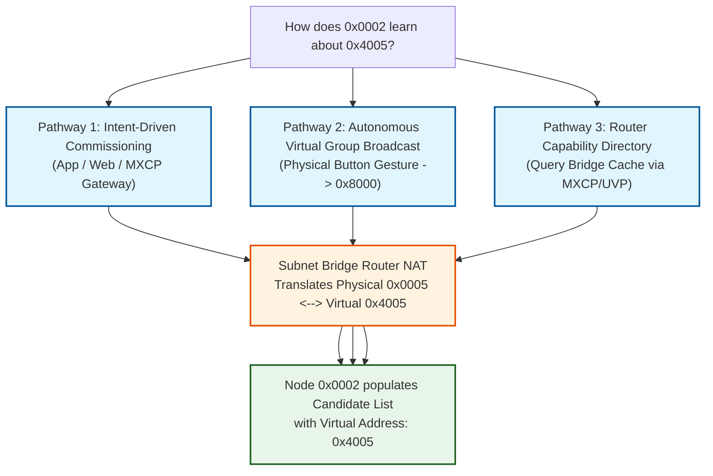
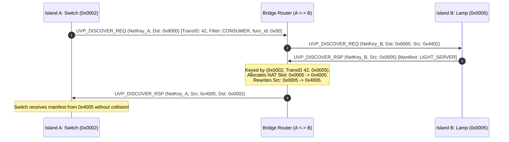

# TRD Page 5: Cross-Island Discovery, Pairing & Progression Protocols

**Module:** `TRD-SUBNET-05`  
**Parent Index:** [TRD Index](./README.md)  
**Requirements:** [requirements.md](../requirements.md) (REQ-F01, REQ-F03, REQ-F04)  
**Parent Integration:** [.specs/autonomous-element-pairing/](../autonomous-element-pairing/requirements.md)  
**Related Fixes:** Remediation of R4 findings from `REVIEW_FINDINGS.md`  

---

## 1. Cross-Island Discovery Pathways

How does Node `0x0002` on Island A discover target nodes on Island B?



### Pathway 1: Intent-Driven Commissioning (User App / Gateway)
1. The smartphone or edge gateway queries composition manifests across both islands via GATT proxy or UART MXCP.
2. The user selects: *"Connect Switch 1 (Island A) to Chandelier (Island B)"*.
3. The app checks Tier-1 bounds (`Slot_B <= 13` and `0x0001 <= target_phys_addr < 1024`):
   - If in Tier-1 bounds: $\text{Virtual Address} = 0\text{x4000} \mid (\text{Slot\_B} \ll 10) \mid (\text{target\_phys\_addr} \ \& \ 0\text{x03FF})$ (e.g. `0x4005`).
   - Otherwise (`target_phys_addr >= 1024` or overflow slot): requests a persistent Tier-2 alias in `0x7800..0x7FFF` via the router (`NAT_FLAG_PERSISTENT`).
4. The app configures Switch `0x0002`: `pub_addr = 0x4005`, `app_idx = AppKey_Shared`.

### Pathway 2: Autonomous Virtual Group Broadcast (`0x8000` Relay) with Transaction Isolation
To prevent the discovery alias collision identified in finding **R4** (where multiple simultaneous switches received colliding Tier-2 alias mappings):
- Every discovery probe carries a 16-bit Transaction ID (`trans_id`), an 8-bit `hop_limit` (initialized to 4), and a transit loop mask so `0xDC`/`0xDD` broadcasts never storm across looped multi-bridge rings.
- For Tier-1 responses (`phys_addr < 1024`), nodes map deterministically to the shared canonical slot address (`0x4005`). For Tier-2 responses (`phys_addr >= 1024` or overflow), temporary discovery NAT entries (`NAT_FLAG_TEMP_DISCOVERY`, 30 s TTL, capped below persistent flows so discovery scans cannot evict active paired flows) key by:
  $$\mathbf{\text{Discovery NAT Key} = (global\_subnet\_src, requestor\_addr, trans\_id, remote\_phys\_addr)}$$
- Each concurrent Tier-2 pairing session receives a unique, collision-free candidate proxy address in Island A's candidate table.



---

## 2. Semantic Compatibility & Progression Protocols

### 2.1 Type-Safe Trait Validation
The Semantic Compatibility Engine (`meshx_compat_matrix.c`) executes locally:
$$\mathtt{LIGHT\_CLIENT} \ (func\_id: 0x00) \Longleftrightarrow \mathtt{LIGHT\_SERVER} \ (func\_id: 0x00) \implies \mathbf{PASS}$$

### 2.2 Progression & Lifecycle Protocol Compatibility

| Lifecycle Feature | Subsystem Reference | Cross-Island Execution |
|---|---|---|
| **NVS Persistence & `link_epoch`** | REQ-006 / REQ-010 | Nodes commit bindings to NVS and increment monotonic `link_epoch`. Mobile apps reconcile lazily without re-polling. |
| **Epoch Resync Protocol** | REQ-010 | If router or endpoint reboots, nodes execute a 2-way `MESHX_UVP_OP_EPOCH_SYNC` (`0xD8`) handshake prior to teardown. Between cluster bridges, `0xD8` is authenticated with $K_{\text{bridge}}$ HMAC. When executing between a bridge and an edge endpoint (which lacks $K_{\text{bridge}}$), `0xD8` is authenticated using the shared subnet `NetKey` / `AppKey_Shared`. The initiating node sends `0xD8` with a $3.0\text{s}$ timeout and up to 3 exponential-backoff retries. If the peer is temporarily offline, teardown is withheld and the link transitions to `LINK_STATE_SUSPENDED`. To prevent bilateral suspension deadlock when two islands share identical physical unicast addresses (`0x0002 == 0x0002`), the endpoint with the lexicographically lower **`(global_subnet_id, phys_addr)`** tuple acts as the authoritative resume probe initiator, probing at $10.0\text{s}$ and backing off to $60.0\text{s}$ if offline; an explicit unknown-link NACK from a re-provisioned peer triggers clean local unpair. |
| **Pre-Reset Unpair Teardown** | REQ-008 | Resetting node broadcasts `MESHX_UVP_OP_UNPAIR_NOTIFY`. Router forwards across NetKey boundary; remote switch clears `pub_addr = 0x0000`. |
| **Personality Audit on Boot** | REQ-011 | Nodes audit NVS on boot (`meshx_link_reconcile()`); mutated or missing elements are dismantled immediately. |

---

## 3. Persistent Pairing Record Structure (`meshx_pair_record_t`)

During Intent-Driven Pairing (Pathway 1) or Autonomous Virtual Group Broadcast (Pathway 2), both endpoints and the participating bridge routers commit an authoritative pairing record to NVS:

```c
/* Exact packed size: 8 x uint16_t (16 B) + 4 x uint8_t (4 B) = 20 B (natural 2-byte alignment) */
typedef struct {
    uint16_t canonical_src;         /* Originating physical element address (CANONICAL_SRC) */
    uint16_t canonical_dst;         /* Destination physical element or group address (CANONICAL_DST) */
    uint16_t global_subnet_src;     /* Originating Global Subnet ID */
    uint16_t global_subnet_dst;     /* Destination Global Subnet ID */
    uint16_t virtual_proxy_addr;    /* Assigned proxy address in local Tier-1/Tier-2 window */
    uint16_t app_idx;               /* Application Key index (AppKey_Shared) */
    uint16_t func_id;               /* UVP function ID bound to this link */
    uint16_t link_epoch;            /* Monotonic link configuration epoch */
    uint8_t  src_elem_idx;          /* Local element index on source node */
    uint8_t  dst_elem_idx;          /* Remote element index on destination node */
    uint8_t  state;                 /* 0: ACTIVE, 1: SUSPENDED */
    uint8_t  flags;                 /* Bit 0: IS_CROSS_SUBNET, Bit 1: IS_GROUP */
} MESHX_PACKED meshx_pair_record_t;
```

### Deterministic Recovery & TransMIC Resolution:
1. **At Destination Node**: When reassembly completes for an ingress frame from `virtual_proxy_addr`, the transport shim queries `meshx_pair_record_t` using the composite tuple **`(ingress_src_virtual_addr, network_dst_addr)`** (with `IS_GROUP` match for translated group bands) to obtain unambiguous `(canonical_src, canonical_dst)`. This reconstructs the invariant canonical TransMIC Application Nonce without colliding across shared unicast and group bindings.
2. **At Promoted Standby Bridge**: If an active bridge crashes before replicating non-colliding dynamic NAT states, the promoted standby inspects the incoming return frame's `(virtual_proxy_addr, dst_phys_addr)`, matches it against `meshx_pair_record_t`, and recovers `(global_subnet_src, canonical_src, global_subnet_dst, canonical_dst)`. Re-computing the deterministic CRC16 formula restores the identical reverse NAT alias without dropped return packets.
