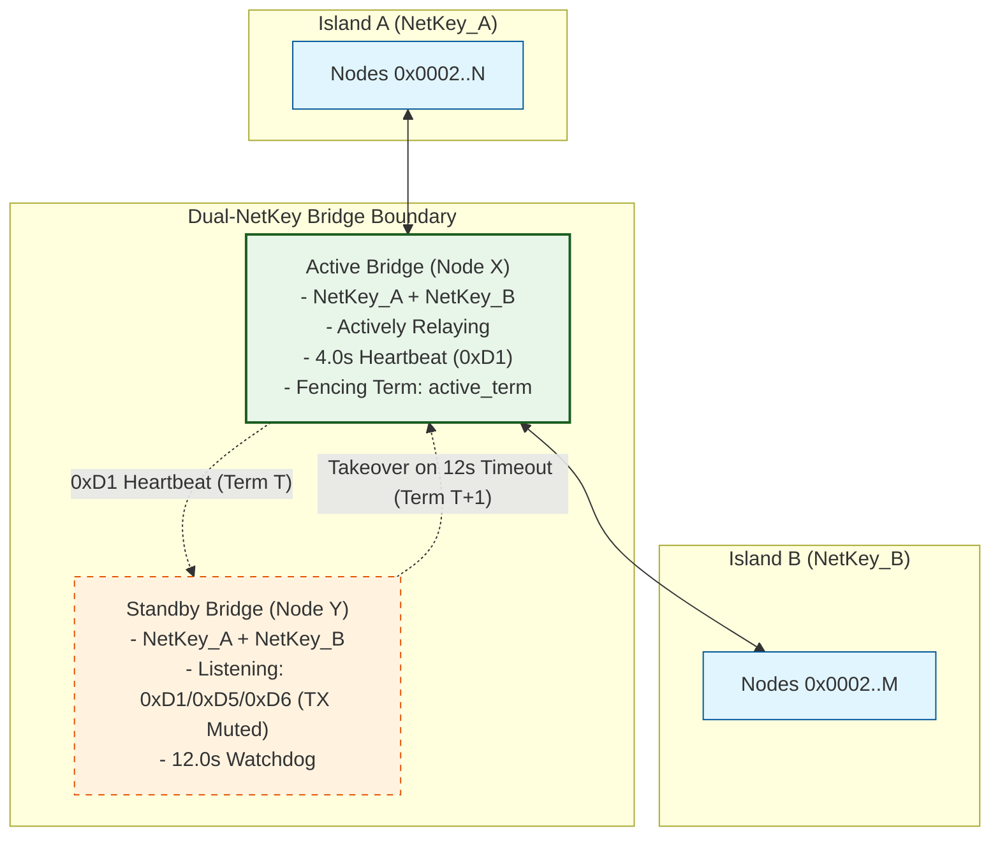

# TRD Page 7: Active-Standby Redundancy ($N+1$) & Loop Prevention

**Module:** `TRD-SUBNET-07`  
**Parent Index:** [TRD Index](./README.md)  
**Requirements:** [requirements.md](../requirements.md) (REQ-F05, REQ-F06)  
**Related Fixes:** Remediation of C3, R2, D findings from `REVIEW_ROUND2_FINDINGS.md`  

---

## 1. High-Availability Architecture & Role State Machine

Each inter-island boundary supports an **Active Bridge** and one or more **Standby Bridges**:



---

## 2. Authenticated Split-Brain Fencing & Demotion Enforcement

To eliminate unauthenticated or soft cooperative demotions:

### 2.1 Monotonic Fencing Epoch (`active_term`) & Per-Boundary Scoping
1. Every bridge cluster maintains a monotonic 32-bit counter: `active_term` scoped strictly per `(boundary_id, bridge_addr)`.
   - In multi-island topologies (e.g. A $\leftrightarrow$ B and B $\leftrightarrow$ C), each boundary cluster operates under an independent `boundary_id` (e.g. `0x00AB`, `0x00BC`).
   - Fencing comparisons and takeover claims are evaluated strictly within the matching `boundary_id`. A downstream bridge at boundary B-C never compares or drops transit traffic from upstream boundary A-B on account of differing term counters.
2. **Boot Listening Grace Window & Active Promotion Term Rule**:
   - **Boot Grace**: Every bridge boots into `BRIDGE_ROLE_STANDBY` (TX muted) for a mandatory listening grace window of **$6.0\text{s}$** ($1.5 \times T_{\text{heartbeat}}$) to observe live `0xD1` heartbeats and current cluster `active_term`, preventing a rebooting old Active bridge from usurping a healthy promoted Standby.
   - **Promotion Increment**: Only when promoting from Standby to Active (after boot grace or watchdog expiration) does the bridge compute:
     $$\mathbf{\text{new\_term} = \max(\text{last\_persisted\_term}, \text{last\_observed\_term}) + 1}$$
     and persist `new_term` to NVS prior to asserting Active TX.
   - **Wraparound Guard**: If `active_term` reaches `0xFFFFFFF0`, the cluster Master triggers `K_bridge` rotation (`MXCP_CMD_BRIDGE_CLUSTER_KEY_UPDATE`) to reset fencing epochs safely below 32-bit wraparound.
3. When a Standby Bridge detects that the Active Bridge of its boundary is dead (watchdog expiration across either constituent subnet) and waits a rank-weighted backoff jitter `(255 - priority_rank) * 2 ms` to prevent multi-Standby takeover storms, it increments `new_term` and broadcasts `MESHX_UVP_OP_BRIDGE_TAKEOVER_CLAIM` (`0xD2`) authenticated with $K_{\text{bridge}}$ HMAC.
   The `0xD2` frame carries (27 B packed, natural field alignment):
   ```c
   typedef struct {
       uint32_t active_term;          /* Claimed new monotonic term */
       uint32_t bridge_nonce;         /* Monotonic anti-replay counter */
       uint16_t boundary_id;          /* Boundary cluster identifier (e.g. 0x00AB) */
       uint16_t bridge_unicast_addr;  /* Unicast address of claiming bridge */
       uint8_t  priority_rank;        /* Configured priority rank (0..255) */
       uint8_t  hmac_signature[16];   /* Truncated HMAC-SHA256 under K_bridge */
   } MESHX_PACKED meshx_uvp_takeover_claim_t;
   ```
   Carrying `priority_rank` and `bridge_unicast_addr` explicitly inside the wire payload allows all peer bridges in the cluster to evaluate the deterministic score tie-break unambiguously.
4. All forwarding frames across inter-bridge transit hops encapsulate `boundary_id` and `active_term` inside `meshx_subnet_transit_hdr_t`. **Inter-bridge transit frames MUST be authenticated with $K_{\text{bridge}}$ HMAC** (covering header + `bridge_nonce`; plain `NetKey_Transit` without $K_{\text{bridge}}$ is never sufficient on bridge-to-bridge transit links, closing forged-term DoS demotions by ordinary nodes). When an authenticated transit frame is received:
   - If `hdr.boundary_id == local_boundary_id` and `hdr.active_term < current_boundary_term`: the frame is **DROPPED** immediately as stale.
   - If `hdr.boundary_id == local_boundary_id` and `hdr.active_term > current_boundary_term`: the local active bridge demotes immediately to `BRIDGE_ROLE_STANDBY` upon validating the transit sender's $K_{\text{bridge}}$ HMAC.
   - If `hdr.boundary_id != local_boundary_id`: the frame belongs to an orthogonal upstream boundary (e.g. boundary A-B vs B-C); term comparisons are bypassed, and the frame is routed strictly according to transit routing rules.
5. On boundary demotion to Standby, `meshx_router_queue_purge_boundary(boundary_id)` flushes only flows belonging to that demoted `boundary_id`, leaving healthy orthogonal boundaries on multi-boundary hubs unaffected.

### 2.2 Immediate Demotion on Term Divergence & Split-Brain Tie-Breaker
- If an Active Bridge receives an authenticated control frame or transit frame with matching `boundary_id` and `term > current_term`:
  - **It MUST demote immediately to `BRIDGE_ROLE_STANDBY`** (no forwarding grace period).
- If two bridges claim identical `active_term` with equal rank within the same `boundary_id`:
  $$\mathbf{\text{Score} = (\text{Priority\_Rank} \ll 16) \mid (\sim\text{Unicast\_Address} \ \& \ 0\text{xFFFF})}$$
  - The bridge with the lower score emits an explicit `MESHX_UVP_OP_BRIDGE_DEMOTE` (`0xDB`) frame and reverts to Standby.
  - The winning bridge emits an authoritative `0xD1` heartbeat claiming the term, instantly silencing the duplicate forwarder.
- **External Network Enforcement of Loser Demotion**:
  - When the winning bridge claims term $T$, neighboring nodes and transit bridges accept only frames bearing $T$ for that boundary.
  - Any duplicate forwarding attempt by a rogue or faulty un-demoted bridge emitting frames with stale term $< T$ is dropped at ingress by all cluster peers under REQ-F05.3 and REQ-F07.2, neutralizing split-brain duplicates externally.

---

## 3. Strict Timing Alignment

- **Heartbeat Interval**: $T_{\text{heartbeat}} = 4.0\text{ seconds}$ transmitted across **both** constituent subnets of each active boundary (with per-boundary health confirmation so a single-radio half-dead bridge triggers failover).
- **Watchdog Timeout**: $T_{\text{watchdog}} = 12.0\text{ seconds}$ (timer resets strictly on receipt of a valid, authenticated heartbeat matching the local `boundary_id`, confirming healthy reachability on both bridged sides).
- **Takeover Execution**: Standby promotes, claims `0xD2`, and begins forwarding in $\approx 200\text{ ms}$.
- **Total Failover Time**:
  $$\mathbf{12.0\text{s} \le T_{\text{failover}} \le 12.5\text{s} \quad (\le 15.5\text{s})}$$
  All specifications, requirements, and tasks are strictly aligned to the **$\le 15.5\text{s}$ failover boundary**.

---

## 4. Multi-Island Transit Header & Loop Prevention

### 4.1 Subnet Transit Header (`meshx_subnet_transit_hdr_t`)
The transit header is inserted by the first bridge entering multihop transit and preserved across intermediate bridges:

```c
/* Natural field alignment: uint32_t -> uint16_t -> uint8_t = 23 B packed */
typedef struct {
    uint32_t orig_seq_auth;        /* Full 24-bit first-segment SeqAuth for canonical TransMIC nonce */
    uint32_t orig_iv_index;        /* Originating island IV Index for canonical TransMIC nonce */
    uint32_t active_term;          /* Monotonic fencing epoch of transmitting bridge boundary */
    uint16_t visited_subnets_mask; /* 16-bit global hash telemetry bitmask (1 << (global_subnet_id & 0x0F)) */
    uint16_t orig_subnet_id;       /* Originating Global Subnet ID */
    uint16_t orig_phys_src;        /* Originating physical source node */
    uint16_t orig_seq_num;         /* Origin sequence number for echo filtering */
    uint16_t boundary_id;          /* Boundary cluster identifier */
    uint8_t  hop_limit;            /* Initialized to 15 at origin bridge */
} MESHX_PACKED meshx_subnet_transit_hdr_t;
```

### 4.2 Deterministic Loop Prevention (Zero Cross-Island Slot Collisions)
Because `slot_id` (`0..13`) is locally scoped per island and Tier-2 overflow islands carry no fixed slot index, authoritative loop prevention uses global identifiers and exact keyed echo state rather than cross-island slot bit comparisons:
1. **Hop Exhaustion Check**: If `hdr.hop_limit <= 1`, frame is **DROPPED**.
2. **Originating Subnet Re-Entry Check**: If `egress_global_subnet == hdr.orig_subnet_id`, frame has looped back toward its source island; frame is **DROPPED**.
3. **Exact Keyed Circular Echo Filter (Authoritative Loop Cut)**: The 32-entry Echo Filter evaluates `keyed_digest`. Any duplicate transit frame attempting to re-enter a previously traversed bridge within $5.0\text{ seconds}$ is **DROPPED** immediately (zero false positives and zero Tier-2 overflow shift UB).
4. **Global Hash Telemetry Update**: Bridge records `hdr.visited_subnets_mask |= (1U << (global_subnet_in & 0x0F)) | (1U << (global_subnet_out & 0x0F))` using bounded `& 0x0F` global subnet hashes (diagnostic / trace vector only; never triggers sole-bit false drops) and decrements `hdr.hop_limit -= 1`.

### 4.3 Keyed Circular Echo Filter
- The 32-entry Echo Filter stores `(keyed_digest, timestamp_sec)` where:
  $$\mathbf{\text{keyed\_digest} = \text{CRC32}(\text{orig\_subnet\_id} \parallel \text{orig\_seq\_num} \parallel K_{\text{bridge}}[0..3])}$$
- Entries older than **$5.0\text{ seconds}$** (`(int32_t)(now_s - timestamp_sec) >= 5`, wrap-safe delta) expire automatically.
- Prevents adversary preimage attacks and ensures legitimate retransmissions are not dropped.
