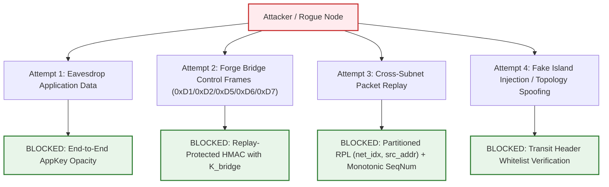

# TRD Page 8: Man-in-the-Middle (MitM) Defense & Threat Modeling

**Module:** `TRD-SUBNET-08`  
**Parent Index:** [TRD Index](./README.md)  
**Requirements:** [requirements.md](../requirements.md) (REQ-F07)  
**Related Fixes:** Remediation of A, B findings from `REVIEW_ROUND2_FINDINGS.md`  

---

## 1. Adversary Attack Tree

---

## 2. Bridge Cluster Key ($K_{\text{bridge}}$) Lifecycle & Anti-Replay

### 2.0 Unified Control Opcode Allocation Table
To guarantee complete coverage, deterministic dispatch, and eliminate unassigned opcode ambiguities:

| Opcode | Enumeration Identifier | Cryptographic Context | Direction / Function |
|---|---|---|---|
| `0xD1` | `MESHX_UVP_OP_BRIDGE_HEARTBEAT` | $K_{\text{bridge}}$ HMAC | Active Bridge $\rightarrow$ Cluster (4.0s keepalive, term) |
| `0xD2` | `MESHX_UVP_OP_BRIDGE_TAKEOVER_CLAIM` | $K_{\text{bridge}}$ HMAC | Standby $\rightarrow$ Cluster (Watchdog timeout promotion) |
| `0xD3` | `MESHX_UVP_OP_BRIDGE_CANDIDATE_REPORT` | $K_{\text{bridge}}$ HMAC | Candidate $\rightarrow$ Master (Free heap, mains power) |
| `0xD4` | `MESHX_UVP_OP_BRIDGE_INVITE` | Candidate `DevKey` (CCM) | Master $\rightarrow$ Candidate ($K_{\text{bridge}}$ commissioning delivery) |
| `0xD5` | `MESHX_UVP_OP_BRIDGE_NAT_SYNC` | $K_{\text{bridge}}$ HMAC | Active Bridge $\rightarrow$ Standby (Dynamic alias sync) |
| `0xD6` | `MESHX_UVP_OP_ROUTE_ADV` | $K_{\text{bridge}}$ HMAC | Bridge $\rightarrow$ Transit Mesh (Subnet reachability) |
| `0xD7` | `MESHX_UVP_OP_ROUTER_NACK` | $K_{\text{bridge}}$ (Inter) / Subnet Key (Edge) | Router $\rightarrow$ Origin (Stage 2 delivery failure) |
| `0xD8` | `MESHX_UVP_OP_EPOCH_SYNC` | $K_{\text{bridge}}$ (Inter) / Subnet Key (Edge) | Endpoint $\leftrightarrow$ Router (Link suspension & resync) |
| `0xD9` | `MESHX_UVP_OP_ROUTER_NACK_ACK` | $K_{\text{bridge}}$ (Inter) / Subnet Key (Edge) | Origin $\rightarrow$ Router (Reliable NACK confirmation) |
| `0xDA` | `MESHX_UVP_OP_BRIDGE_INVITE_ACK` | $K_{\text{bridge}}$ HMAC | Candidate $\rightarrow$ Master (Dedicated wire opcode for invite ACK) |
| `0xDB` | `MESHX_UVP_OP_BRIDGE_DEMOTE` | $K_{\text{bridge}}$ HMAC | Tie-break loser $\rightarrow$ Cluster (Immediate step-down) |
| `0xDC` | `MESHX_UVP_OP_DISCOVER_REQ` | Subnet `NetKey` | Switch $\rightarrow$ `0x8000` (Autonomous cross-subnet discovery) |
| `0xDD` | `MESHX_UVP_OP_DISCOVER_RSP` | Subnet `NetKey` | Target Element $\rightarrow$ Switch (Candidate manifest report) |
| `0xDE` | `MESHX_UVP_OP_QUERY_SUBNET_DIRECTORY` | Subnet `NetKey` / $K_{\text{bridge}}$ | Commissioner $\rightarrow$ Router (Query synthesized directory) |

All inter-bridge control frames (`0xD1`, `0xD2`, `0xD3`, `0xD5`, `0xD6`, `0xD7`, `0xD8`, `0xD9`, `0xDA`, `0xDB`) are protected by a shared 128-bit key $K_{\text{bridge}}$:

### 2.1 Replay Protection & Clock-Free Monotonic Window
Independently-bootstrapped subnets lack a common Real-Time Clock (RTC) synchronization protocol. Rejecting frames using absolute wall-clock timestamps creates catastrophic false rejections on unsynchronized nodes.

To achieve robust anti-replay without clock synchronization:
$$\mathbf{\text{HMAC Input} = [\text{Opcode} \parallel \text{Term (32-bit)} \parallel \text{Sender\_Addr (16-bit)} \parallel \text{Bridge\_Nonce (32-bit)} \parallel \text{Payload}]}$$

1. **Per-Sender Nonce Sliding Window, Bounded Eviction & Floor Monotonicity**:
   - Replay protection is evaluated in a 16-entry cache keyed by `(sender_addr, boundary_id)`.
   - Each entry tracks the highest observed `bridge_nonce`, a 32-bit bitmask window for out-of-order delivery, and `last_seen_s` (`uint32_t` monotonic seconds, compared via wrap-safe `(int32_t)(now_s - last_seen_s)`).
   - Any frame with a `bridge_nonce` that is duplicate or behind the 32-bit sliding window is rejected immediately.
   - **Cache Eviction With Monotonic Nonce Floor (Zero Post-Eviction Replay)**: When all 16 entries are occupied, the cache evicts the oldest inactive entry (`inactivity > 60s`), promoting that entry's `highest_nonce` into a per-boundary `min_evicted_nonce_floor` (`uint32_t`, updated monotonically). Re-admitting an evicted sender or untracked sender (e.g., `0xD6` in $>16$-bridge clusters) requires either `bridge_nonce > boundary_min_evicted_nonce_floor` (plus fresh highest `0xD6` tracking in the Route table for `0xD6`) or a strictly higher verified `active_term`.
2. **NVS Nonce Checkpointing, Boot Margin & Wrap Guard**:
   - The active `bridge_nonce` counter is checkpointed to NVS every 1,024 emitted control frames.
   - Upon node reboot, the bridge increments its persisted nonce by a recovery margin:
     $$\mathbf{\text{boot\_nonce} = \text{persisted\_nonce} + 10,000}$$
   - **Pre-Wrap Key Rotation Guard**: When `bridge_nonce >= 0xFFFF0000`, the cluster Master triggers `K_bridge` rotation (`MXCP_CMD_BRIDGE_CLUSTER_KEY_UPDATE`) before 32-bit unsigned wraparound can occur.

### 2.2 Commissioning & NVS Commit-Before-Activate
1. **DevKey Tunneling**: Master delivers $K_{\text{bridge}}$ inside `MESHX_UVP_OP_BRIDGE_INVITE` (`0xD4`), encrypted with the candidate node's immutable `DevKey` using standard BLE Mesh Upper Transport AES-128-CCM (13-byte Device Nonce `0x02`, `L=2`).
2. **Commit-Before-Activate with Reliable ACK Handshake**:
   - A candidate node MUST commit $K_{\text{bridge}}$ to secure NVS slot `NVS_KEY_BRIDGE_CLUSTER` before returning an authenticated `MESHX_UVP_OP_BRIDGE_INVITE_ACK` (`0xDA`).
   - The Master node retransmits `0xD4` every $1.0\text{s}$ (up to 5 retries) until `0xDA` is received.
   - If `0xDA` is lost, the candidate remains committed in Standby/Candidate state and accepts retransmitted `0xD4` idempotently.
   - Only after receiving `0xDA` does the Master register the candidate in the bridge cluster.
3. **Mandatory Revocation, Secure Wipe & Healthy Cluster Re-Keying**:
   - If a bridge is quarantined or decommissioned, the Master issues `MXCP_CMD_BRIDGE_CLUSTER_KEY_UPDATE` (`0x76`, next sequential 1-byte MXCP command following `0x75` in `meshx_mxcp.h`) locally via UART/host or forces OTA revocation by rotating to a new $K'_{\text{bridge}}$:
     - Master re-invites every non-revoked healthy bridge over its immutable `DevKey` via `0xD4` (carrying `new_key_epoch`), then drains in-flight frames for $5.0\text{s}$ before retiring the old $K_{\text{bridge}}$ globally.
     - Accessible decommissioned nodes execute a hardware NVS erase of `NVS_KEY_BRIDGE_CLUSTER`; compromised or offline nodes locked on the revoked $K_{\text{bridge}}$ are permanently isolated once healthy nodes activate $K'_{\text{bridge}}$.

---

## 3. Multihop Ingress Whitelist Verification

To close finding **B** (where an attacker on Subnet B could spoof virtual proxy or transit sources):
- The router validates ingress source addresses against the active transit header and NAT registry:
  $$\mathbf{\text{Accept Ingress Frame on Subnet } B \iff \text{Local Physical } \lor \text{Active Dynamic NAT } \lor \text{Valid Transit}}$$
1. **Condition 1 (Local Physical Source)**:
   - `src_addr >= 0x0001 && src_addr <= 0x3FFF`.
2. **Condition 2 (Authorized Virtual Proxy in Dynamic NAT Table)**:
   - `src_addr >= 0x7800 && src_addr <= 0x7FFF`, **AND**
   - `src_addr` matches an active reverse mapping entry in the local dynamic NAT table.
3. **Condition 3 (Authenticated Multihop Transit — Tier-1 & Tier-2)**:
   - Frame carries `meshx_subnet_transit_hdr_t` (`hop_limit >= 1`, `orig_subnet_id != egress_subnet_id`) authenticated with valid **$K_{\text{bridge}}$ HMAC** and anti-replay `bridge_nonce` (plain `NetKey_Transit` without $K_{\text{bridge}}$ HMAC is rejected), **AND**
   - `src_addr` matches the bridge's valid ingress proxy range for `orig_subnet_id`: either Tier-1 slot prefix (`0x4000..0x77FF`) mapped to `orig_subnet_id` OR Tier-2 overflow range (`0x7800..0x7FFF`) when `orig_phys_src >= 1024` or local slot overflow is active.

Frames failing all three checks are dropped immediately as spoofed.

---

## 4. Replay Protection Lists (`RPL`) & Canonical Upper-Layer Defense

- **Multi-Subnet Network RPL**: Strictly keyed by **`(net_idx, src_addr, key_epoch)`** with a 32-bit sliding window (`highest_seq` + `seq_window`, 16 B per entry across 32 entries = `512 B`).
- **Canonical Upper-Layer Replay Floor**: Destination Transport Shims additionally track the monotonic `(orig_iv_index, orig_seq_auth)` ceiling per `(CANONICAL_SRC, global_subnet_src)` before accepting decrypted `AppKey_Shared` payloads, blocking replay of archived Upper PDUs disguised with bumped local `SEQ_B` by rogue peers sharing `NetKey_B`.
- **Sequence Exhaustion & Boot Margin**: Egress sequence numbers are allocated monotonically from NVS counters checkpointed every 256 frames (`+512` recovery jump on reboot). Before 24-bit saturation (`last_seq_num >= 0xF00000`), the bridge executes IV Index Update on that subnet so sequence numbers never wrap under active peer RPLs.
