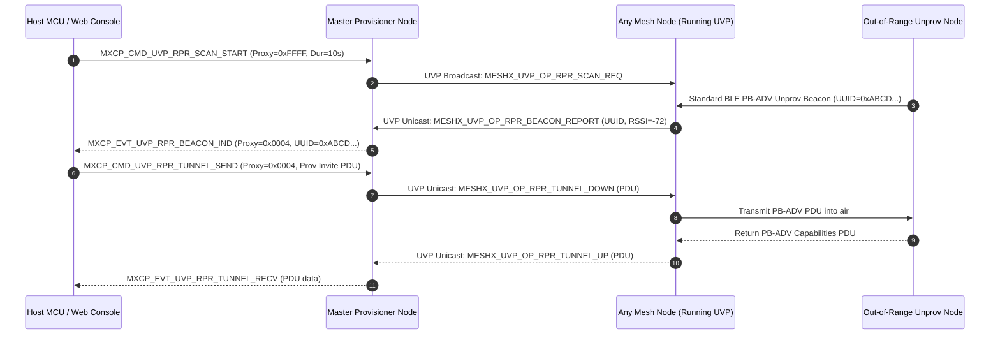
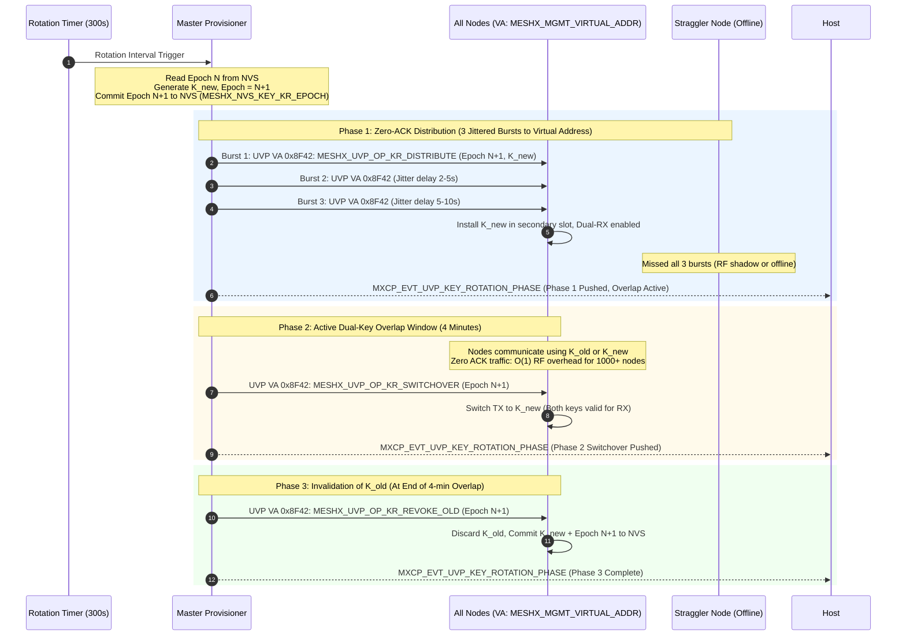
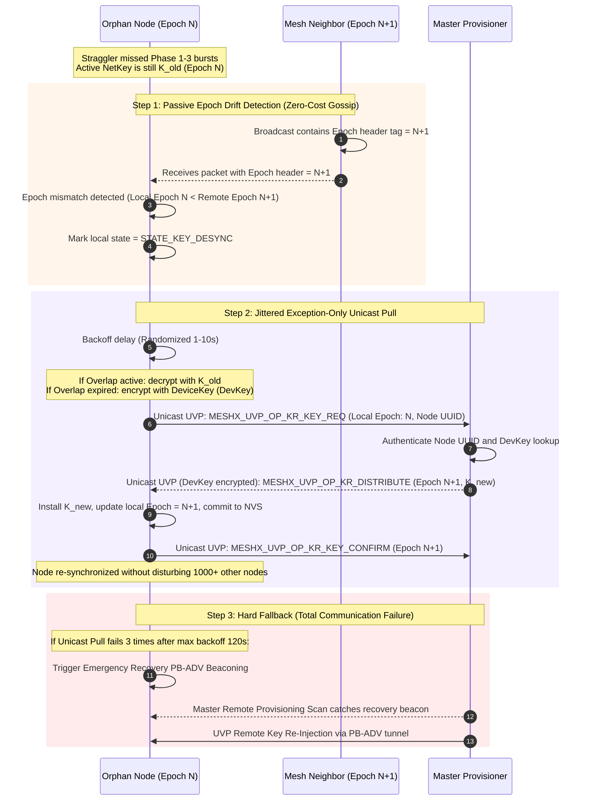

# Design Specification: UVP-Driven Provisioning & Security Management with MXCP Capability

**Subsystems:** `meshx_prov_srv`, `meshx_uvp_dispatcher`, `meshx_mxcp`, `meshx_api`
**Status:** In Review (Zero-Bloat UVP Architecture)
**Related Requirements:** [requirements.md](./requirements.md) (REQ-F01 to REQ-F06, REQ-NF01 to REQ-NF03)

---

## 1. Architectural Philosophy: The UVP-Driven Paradigm

Rather than compiling bulky, proprietary, or standard SIG models (`RPR_SRV`, `RPR_CLI`, `CONFIG_CLIENT`, `PROVISIONER`) into the firmware, MeshX utilizes its **Unified Vendor Protocol (UVP)** to handle Remote Provisioning tunneling, 5-Minute Key Rotation, and Provisioner Redundancy.

```
                      ┌────────────────────────────────────────┐
                      │          Host MCU / Web Console        │
                      └───────────────────▲────────────────────┘
                                          │ MXCP Frames (UART / Serial)
                      ┌───────────────────▼────────────────────┐
                      │          MXCP Dispatch Engine          │
                      │             (meshx_mxcp.c)             │
                      └─────────┬────────────────────┬─────────┘
                                │                    │
              Control Path [0x0B..0x0F]     Data & Mgmt Path [0x30..0x3F]
                                │                    │
             ┌──────────────────▼──────┐   ┌─────────▼──────────────────┐
             │   Native Prov Server    │   │       UVP Dispatcher       │
             │   (Virgin Node Onboard) │   │  - Remote Prov Tunneling   │
             │   CONFIG_BLE_MESH_PROV  │   │  - 5-Min Key Rotation (KR) │
             │   (Only PB-ADV/PB-GATT) │   │  - Redundancy Sync Engine  │
             └─────────────────────────┘   └─────────┬──────────────────┘
                                                     │
             ┌───────────────────────────────────────▼──────────────────┐
             │       Standard ESP-IDF BLE Mesh Node Subsystem           │
             │    CONFIG_BLE_MESH_NODE=y (NO PROVISIONER / NO RPR)      │
             └──────────────────────────────────────────────────────────┘
```

---

## 2. Protocol & Wire Definitions

### 2.1 MXCP Host Commands (Host → Engine, Bit 7 = 0)

| Command ID | Enum Name | Description | Payload Struct |
|---|---|---|---|
| `0x0B` | `MXCP_CMD_PROV_ENABLE` | Enable virgin unprov beaconing | `mxcp_cmd_prov_enable_t` |
| `0x0C` | `MXCP_CMD_PROV_DISABLE` | Disable virgin unprov beaconing | None (0 bytes) |
| `0x0D` | `MXCP_CMD_PROV_GET_STATE` | Query node prov state & unicast addr | None (0 bytes) |
| `0x0E` | `MXCP_CMD_PROV_SET_NAME` | Set unprov device friendly name | `mxcp_cmd_prov_set_name_t` |
| `0x0F` | `MXCP_CMD_PROV_AUTH_INPUT` | Submit user/host OOB auth input | `mxcp_cmd_prov_auth_input_t` |
| `0x30` | `MXCP_CMD_UVP_RPR_SCAN_START` | Command mesh nodes to scan for unprov beacons | `mxcp_cmd_uvp_rpr_scan_t` |
| `0x31` | `MXCP_CMD_UVP_RPR_TUNNEL_SEND`| Tunnel prov PDU via intermediate node | `mxcp_cmd_uvp_rpr_tunnel_t` |
| `0x32` | `MXCP_CMD_UVP_KEY_ROTATE_TRIGGER` | Initiate 5-min key rotation phase | `mxcp_cmd_uvp_key_rotate_t` |
| `0x33` | `MXCP_CMD_UVP_REDUNDANCY_SET_ROLE`| Configure Master/Standby redundancy role | `mxcp_cmd_uvp_redundancy_role_t` |
| `0x34` | `MXCP_CMD_UVP_FAST_PROV_START`    | Initiate fast bulk provisioning session | `mxcp_cmd_uvp_fast_prov_start_t` |

### 2.2 MXCP Host Events (Engine → Host, Bit 7 = 1)

| Event ID | Enum Name | Description | Payload Struct |
|---|---|---|---|
| `0x81` | `MXCP_EVT_PROV_COMP` | Virgin node provisioning complete | `mxcp_evt_prov_comp_t` |
| `0x82` | `MXCP_EVT_PROV_FAILED` | Virgin node provisioning failed | `mxcp_evt_prov_failed_t` |
| `0x8C` | `MXCP_EVT_PROV_STATE_IND` | Local provisioning status indication | `mxcp_evt_prov_state_ind_t` |
| `0x8D` | `MXCP_EVT_PROV_LINK_OPEN` | Local link opened | `mxcp_evt_prov_link_open_t` |
| `0x8E` | `MXCP_EVT_PROV_LINK_CLOSE`| Local link closed | `mxcp_evt_prov_link_close_t` |
| `0x8F` | `MXCP_EVT_PROV_AUTH_REQ` | Local OOB authentication request | `mxcp_evt_prov_auth_req_t` |
| `0xB0` | `MXCP_EVT_UVP_RPR_BEACON_IND` | Unprov beacon discovered by remote mesh node | `mxcp_evt_uvp_rpr_beacon_ind_t` |
| `0xB1` | `MXCP_EVT_UVP_RPR_TUNNEL_RECV`| PDU response received from remote unprov node | `mxcp_evt_uvp_rpr_tunnel_recv_t` |
| `0xB2` | `MXCP_EVT_UVP_KEY_ROTATION_PHASE`| Key rotation phase update (Phase 1, 2, 3) | `mxcp_evt_uvp_key_rot_phase_t` |
| `0xB3` | `MXCP_EVT_UVP_REDUNDANCY_STATUS`| Active/Standby health & epoch status | `mxcp_evt_uvp_redundancy_status_t` |
| `0xB4` | `MXCP_EVT_UVP_FAST_PROV_PROGRESS`| Bulk provisioning batch progress update | `mxcp_evt_uvp_fast_prov_progress_t` |

### 2.3 UVP Vendor Opcode Extensions (Inter-Node Mesh Control)

| UVP Opcode | Macro / Identifier | Direction | Purpose |
|---|---|---|---|
| `0xC0` | `MESHX_UVP_OP_RPR_SCAN_REQ` | Master $\rightarrow$ Mesh Group | Instruct intermediate nodes to listen for unprov beacons |
| `0xC1` | `MESHX_UVP_OP_RPR_BEACON_REPORT`| Intermediate Node $\rightarrow$ Master | Report discovered unprov device UUID, RSSI, OOB info |
| `0xC2` | `MESHX_UVP_OP_RPR_TUNNEL_DOWN` | Master $\rightarrow$ Intermediate Node | Send provisioning PDU down to unprov node over PB-ADV |
| `0xC3` | `MESHX_UVP_OP_RPR_TUNNEL_UP` | Intermediate Node $\rightarrow$ Master | Send provisioning response PDU up to Master |
| `0xC4` | `MESHX_UVP_OP_KR_DISTRIBUTE` | Master $\rightarrow$ Mesh Group | Distribute new Key/Salt (KR Phase 1) |
| `0xC5` | `MESHX_UVP_OP_KR_SWITCHOVER` | Master $\rightarrow$ Mesh Group | Switch primary TX key to new key (KR Phase 2) |
| `0xC6` | `MESHX_UVP_OP_KR_REVOKE_OLD` | Master $\rightarrow$ Mesh Group | Invalidate old key slot (KR Phase 3) |
| `0xC7` | `MESHX_UVP_OP_REDUNDANCY_SYNC` | Master $\rightarrow$ Standby | Synchronize node allocation high-water mark & DevKeys |
| `0xC8` | `MESHX_UVP_OP_FAST_PROV_BATCH_DESC` | Master $\rightarrow$ Intermediate Proxy | Transfer batch address range & pre-shared key credentials |
| `0xC9` | `MESHX_UVP_OP_FAST_PROV_REPORT` | Intermediate Proxy $\rightarrow$ Master | Report completed nodes in current batch |


---

## 3. Data Structures & Framing

```c
#pragma pack(push, 1)

/**
 * @brief Payload for MXCP_CMD_UVP_RPR_SCAN_START
 */
typedef struct {
    uint16_t proxy_node_addr;   /* 0xFFFF for all nodes, or specific relay address */
    uint8_t  duration_sec;      /* Scan duration (seconds) */
    uint8_t  uuid_filter[16];   /* All 0s = match any unprov node */
} mxcp_cmd_uvp_rpr_scan_t;

/**
 * @brief Payload for MXCP_CMD_UVP_RPR_TUNNEL_SEND
 */
typedef struct {
    uint16_t proxy_node_addr;   /* Address of relay node in range of unprov device */
    uint8_t  target_uuid[16];   /* Target unprovisioned node UUID */
    uint8_t  pdu_len;           /* Length of raw provisioning PDU */
    uint8_t  pdu_data[64];      /* Provisioning PDU bytes */
} mxcp_cmd_uvp_rpr_tunnel_t;

/**
 * @brief Payload for MXCP_EVT_UVP_RPR_BEACON_IND
 */
typedef struct {
    uint16_t proxy_node_addr;   /* Node that heard the beacon */
    uint8_t  uuid[16];          /* Discovered device UUID */
    int8_t   rssi;              /* Received signal strength */
    uint16_t oob_info;          /* Advertised OOB info */
} mxcp_evt_uvp_rpr_beacon_ind_t;

/**
 * @brief Payload for MXCP_CMD_UVP_KEY_ROTATE_TRIGGER
 */
typedef struct {
    uint8_t  phase;             /* 1 = Distribute, 2 = Switchover, 3 = Revoke */
    uint16_t net_idx;           /* Primary NetKey index */
    uint8_t  new_key[16];       /* 16-byte NetKey payload (only for Phase 1) */
} mxcp_cmd_uvp_key_rotate_t;

/**
 * @brief Payload for MXCP_EVT_UVP_KEY_ROTATION_PHASE
 */
typedef struct {
    uint8_t  current_phase;     /* 1, 2, or 3 */
    uint32_t rotation_epoch;    /* Monotonically increasing epoch */
    uint8_t  status_code;       /* 0 = Success */
} mxcp_evt_uvp_key_rot_phase_t;

/**
 * @brief Payload for MXCP_CMD_UVP_REDUNDANCY_SET_ROLE
 */
typedef struct {
    uint8_t  role;              /* 1 = Master, 2 = Standby */
    uint16_t peer_addr;         /* Peer provisioner unicast address */
    uint16_t pool_start;        /* Assigned address pool start */
    uint16_t pool_end;          /* Assigned address pool end */
} mxcp_cmd_uvp_redundancy_role_t;

#pragma pack(pop)
```

---

## 4. Workflows & Sequence Diagrams

### 4.1 UVP-Driven Remote Provisioning (Zero-Bloat RPR)



### 4.2 UVP-Driven Key Rotation (Zero-ACK Push with Dual-Key Overlap via Virtual Address)

> [!IMPORTANT]
> **Virtual Address Policy for Management & Control**:
> Group address `0xC000` is a general-purpose application group address. Emitting network-wide security control frames over generic group addresses violates protocol isolation and risks collisions with application models. Control bursts MUST strictly use the **Virtual Address Policy** (`MESHX_MGMT_VIRTUAL_ADDR`, resolving to `0x8F42` in the `0x8000..0xBFFF` virtual address range, hash-derived from the MeshX Management Label UUID). All nodes auto-subscribe their UVP management endpoint to this virtual address during initialization.

> [!CAUTION]
> **Key Rotation Epoch Persistence & Reboot Resiliency**:
> `Epoch` cannot remain solely in volatile RAM. A power cycle or watchdog reboot would reset `Epoch` to 0, corrupting the monotonic progression and causing false desync loops.
> 1. **Persistent Epoch Storage**: The Master and all nodes persist `kr_epoch` (uint32_t) in dedicated NVS key (`MESHX_NVS_KEY_KR_EPOCH` / `kr_epoch`).
> 2. **Pre-Broadcast NVS Commit**: Master increments and flushes `kr_epoch = N + 1` to NVS *before* transmitting Burst 1. On reboot, Master reads `kr_epoch` directly from NVS and resumes monotonic advancement.
> 3. **Node NVS Commit**: When a node commits `K_new` in Phase 3, it writes the corresponding `kr_epoch` to NVS alongside the primary NetKey.
> 4. **Master Sudden Reboot Recovery**: If the Master reboots during an in-flight rotation, it inspects its persisted rotation stage. If Phase 1/2 was in progress, it re-reads its saved state and issues the switchover/revoke bursts with the persisted `Epoch N+1`, preventing any epoch rollback.



### 4.3 Orphan Node Recovery Sequence (Gossip-Triggered Unicast Pull and DevKey Fallback)



---

## 5. Resilience, Failure Modes & Mitigation Matrix

The following matrix identifies the primary corner cases, deadlock vectors, and network lockup risks inherent to provisioning, key rotation, redundancy, and UART framing, along with their concrete architectural mitigations:

| Failure Mode / Vector | Triggering Scenario | Potential System Impact | Concrete Architectural Mitigation | Watchdog / Recovery Threshold |
|---|---|---|---|---|
| **1. OOB Authentication Deadlock** | Host MCU / Web Console fails to respond with `MXCP_CMD_PROV_AUTH_INPUT` during input OOB authentication. | Node state machine hangs indefinitely in `WAIT_INPUT`; radio is tied up and new provisioning is blocked. | **Dedicated OOB Input Watchdog**: Arm a 30s timer on emitting `MXCP_EVT_PROV_AUTH_REQ`. If no input arrives, node calls `esp_ble_mesh_node_prov_disable()`, emits `MXCP_EVT_PROV_FAILED(REASON_TIMEOUT)`, and resets state. | **30 seconds** |
| **2. Abrupt Link Teardown / Orphaned State** | Remote provisioner moves out of radio range or drops PB-ADV link midway through key exchange. | Node retains half-negotiated session state, ephemeral keys in RAM, or remains in half-provisioned zombie state. | **Clean Abort & Key Purge**: `CONTROL_TASK_MSG_EVT_IDENTIFY_STOP` checks completion flag. If incomplete, wipes ephemeral keys, clears partial state, resets PB-ADV beaconing, and emits `MXCP_EVT_PROV_LINK_CLOSE`. | **Immediate upon link loss** |
| **3. Double-Provisioning Collision** | Host sends `MXCP_CMD_PROV_ENABLE` or rogue provisioner connects to an already-provisioned node. | `esp_ble_mesh_node_prov_enable()` triggers `ESP_ERR_INVALID_STATE` or corrupts active NVS identity keys. | **Pre-State Guard in MXCP Handler**: `mxcp_cmd_fn_prov_enable` checks `meshx_is_node_provisioned()`. If already provisioned, immediately replies with `MXCP_EVT_PROV_STATE_IND(PROVISIONED)` and rejects the call. | **Immediate rejection** |
| **4. Dual Master "Split-Brain" Collision** | Transient RF blackout causes Standby Provisioner to miss 3 heartbeats and promote itself while Master is still alive. | Two active Masters provisioning simultaneously on the mesh. | **Deterministic UUID Tie-Breaker + Pool Partitioning**: 1) Master uses Pool A (`0x0002..0x3FFF`) and Standby uses Pool B (`0x4000..0x7FFF`) $\rightarrow$ **zero address collisions**. 2) When heartbeat resumes, the provisioner with the **lower Device UUID/MAC automatically yields** and demotes to Standby. | **3 missed beats (15s)** to promote; instant demotion upon peer collision |
| **5. Large-Scale Key Rotation Storm & Blackout** | Master advances from Phase 1 to Phase 3 while straggler nodes missed Phase 1; OR Master requires ACKs from 1,000+ nodes. | **ACK Implosion**: 1,000 nodes replying simultaneously creates massive RF channel saturation. **Node Blackout**: Nodes missing the key are cut off permanently. | **Zero-ACK Epochs + Extended Overlap + Passive Gossip**: 1) Master uses **Zero-ACK push** (3 randomized bursts, $O(1)$ constant RF traffic). 2) **Dual-Key Overlap**: Nodes accept both $K_{old}$ and $K_{new}$ for 4 mins. 3) **Gossip Pull**: Stragglers detect epoch mismatch from neighbor telemetry and trigger a single jittered unicast pull. 4) Static **DevKey fallback** recovers isolated nodes. | **4-minute overlap** window; 3 randomized bursts ($\pm 15$s jitter) |
| **6. UART Serial Framing Lockup** | Electrical noise or plug-in glitches inject `0xFF` into `STATE_LEN` in `meshx_serial.c`. | Parser enters `STATE_PAYLOAD` expecting 255 bytes, swallowing all subsequent valid MXCP frames. | **Inter-Byte UART Timeout**: If parser remains in `STATE_PAYLOAD` without a newly received byte for >50 ms, reset state machine unconditionally back to `STATE_SOF`. | **50 ms inter-byte timeout** |
| **7. Key Rotation Epoch Rollback upon Sudden Reboot** | Master Node or Mesh Nodes experience sudden watchdog reboot, brownout, or power cut mid-rotation. | If `Epoch` is held in volatile RAM, node resets `Epoch = 0`. Master re-uses stale epochs or nodes trigger false desync pull storms thinking they are desynchronized. | **Pre-Broadcast NVS Commit & Monotonic Epoch**: 1) Master writes `kr_epoch = N+1` to NVS (`MESHX_NVS_KEY_KR_EPOCH`) *before* transmitting Phase 1 Burst 1. 2) On reboot, Master reads `kr_epoch` from NVS to resume monotonically. 3) Nodes commit `Epoch N+1` atomically with `K_new` in NVS. 4) If Master reboots mid-rotation, it detects unfinished phase and resumes switchover without epoch rollback. | **Atomic NVS commit** prior to RF distribution |

---

## 6. Memory & Flash Impact Analysis (Zero-Bloat Comparison)

| Subsystem Approach | Kconfig Flags Required | Flash Delta | RAM Delta |
|---|---|---|---|
| **Native SIG Stack Approach** | `CONFIG_BLE_MESH_PROVISIONER=y`<br/>`CONFIG_BLE_MESH_CONFIG_CLIENT=y`<br/>`CONFIG_BLE_MESH_RPR_SRV=y`<br/>`CONFIG_BLE_MESH_RPR_CLI=y` | **+125 KB to +150 KB** | **+6.5 KB** |
| **MeshX UVP-Driven Approach (This Design)** | **NONE** (`CONFIG_BLE_MESH_NODE=y`, `CONFIG_BLE_MESH_PROV=y` unchanged) | **+8 KB to +12 KB total** | **< 1.0 KB** |

### Safety Margin Summary:
- **Flash App Partition**: `1900 KB`
- **Current Firmware Size**: `1031 KB`
- **Projected Firmware Size**: `1042 KB` (`~1.02 MB`)
- **Remaining Free Flash Margin**: **`858 KB` (45.1% free headroom)**
- **Conclusion**: The UVP-driven approach avoids compiler space issues entirely while providing 100% native control over Remote Provisioning and Key Rotation.

---

## 7. Future Architecture Roadmap

For detailed specifications on the Gateway and Connectivity evolution (Binary MXCP over MQTT, TCP Stream-based OTA, and lwIP mDNS LAN Discovery), see the dedicated roadmap document:
👉 **[Gateway & Connectivity Evolution Plan](../../docs/plans/gateway_and_connectivity_evolution.md)**


