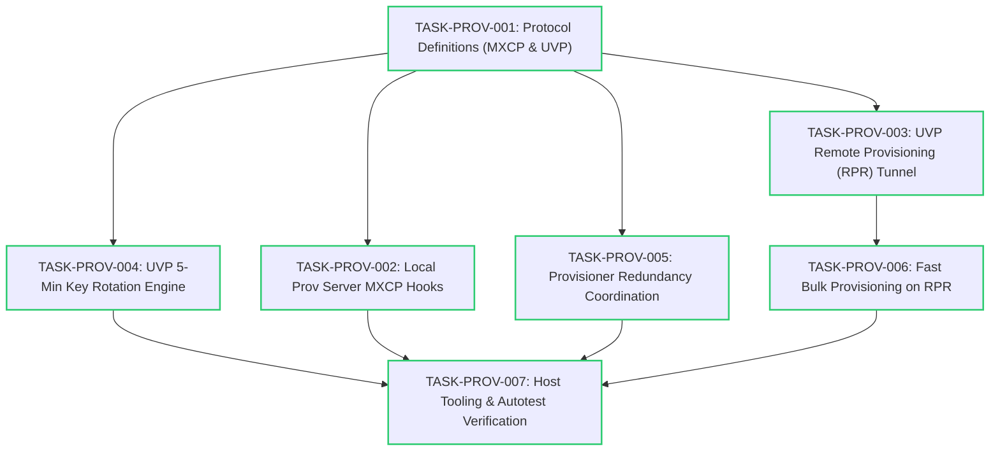

# Implementation Tasks: UVP-Driven Provisioning & Security Management

**Status:** Completed  
**Related Requirements:** [requirements.md](./requirements.md)  
**Related Design:** [design.md](./design.md)

---

## 1. Task Dependency Graph

---

## 2. Task Summary Table

| Task ID | Phase | Description | Files Affected | Complexity | Status |
|---|---|---|---|---|---|
| **TASK-PROV-001** | Phase 1: Protocol | Define MXCP command/event IDs, UVP opcodes, and packed structures. | `meshx_mxcp.h`, `meshx_uvp.h` | Low | **DONE** |
| **TASK-PROV-002** | Phase 2: Local Prov | Connect native `CONFIG_BLE_MESH_PROV` hooks & OOB watchdog to MXCP frames. | `meshx_prov_srv.cpp`, `meshx_mxcp.c`, `meshx_serial.c` | Medium | **DONE** |
| **TASK-PROV-003** | Phase 3: RPR Tunnel | Implement BLE scan listener on proxy nodes, beacon reports, and PB-ADV downlink injection. | `meshx_uvp_dispatcher.cpp`, `meshx_mxcp.c` | High | **DONE** |
| **TASK-PROV-004** | Phase 4: Key Rotation | Zero-ACK 3-burst push over `MESHX_MGMT_VIRTUAL_ADDR`, 4-min dual-key overlap, NVS epoch commit, and orphan pull recovery. | `meshx_prov_srv.cpp`, `meshx_nvs.c`, `meshx_nvs.h`, `meshx_mxcp.c`, `meshx_uvp_dispatcher.cpp` | High | **DONE** |
| **TASK-PROV-005** | Phase 5: Redundancy | Active/Standby heartbeat token (`0xC7`), 15s watchdog failover, UUID tie-breaker, and partitioned address pools (`0x0002..0x3FFF` vs `0x4000..0x7FFF`). | `meshx_group_allocator.c`, `meshx_mxcp.c`, `meshx_uvp_dispatcher.cpp` | Medium | **DONE** |
| **TASK-PROV-006** | Phase 6: Fast Bulk Prov | Aggregated beacon scanning, pipelined RPR session dispatch, and contiguous block address delegation (`0xC8`, `0xC9`). | `meshx_prov_srv.cpp`, `meshx_uvp_dispatcher.cpp`, `meshx_mxcp.c` | High | **DONE** |
| **TASK-PROV-007** | Phase 7: Verification | Update `host_decoder.py` with RPR/KR/Redundancy framing; build automated serial regression suite and test corner cases. | `tools/scripts/host_decoder.py`, `test_prov_srv_mxcp.py` | Medium | **DONE** |

---

## 3. Detailed Task Specifications & Granular Tracking

### TASK-PROV-001: Protocol Definitions (MXCP & UVP) [STATUS: DONE]
- **Objective**: Establish all wire IDs, opcodes, and packed C payload structures for local provisioning, UVP RPR tunneling, Zero-ACK Key Rotation, and Provisioner Redundancy.
- **Subtasks**:
  - [x] Add local provisioning commands (`MXCP_CMD_0x0B..0x0F`), events (`MXCP_EVT_0x8C..0x8F`), and state indication (`0x81`).
  - [x] Add UVP management commands (`MXCP_CMD_0x30..0x34`) and events (`MXCP_EVT_0xB0..0xB4`).
  - [x] Add UVP opcodes (`MESHX_UVP_OP_RPR_BEACON_REPORT = 0xC0` through `MESHX_UVP_OP_FAST_PROV_REPORT = 0xC9`) in `meshx_uvp.h`.
  - [x] Add packed C structures for all commands, events, and UVP payloads with byte-alignment guarantees.
  - [x] Eliminate hardcoded buffer sizes in `meshx_mxcp.h` using dedicated macro constants (`MXCP_UUID_SIZE`, `MXCP_NETKEY_SIZE`, `MXCP_RPR_PDU_MAX_SIZE`, etc.).
- **Verification**: Clean compilation with zero compiler warnings on GCC/Clang.

---

### TASK-PROV-002: Local Provisioning Server MXCP Hooks & Guard State [STATUS: DONE]
- **Objective**: Bridge native ESP-IDF BLE Mesh provisioning callbacks (`CONFIG_BLE_MESH_PROV=y`) to MXCP frames in hosted mode.
- **Subtasks**:
  - [x] Connect `ESP_BLE_MESH_NODE_PROV_LINK_OPEN_EVT` and `LINK_CLOSE_EVT` to `MXCP_EVT_PROV_LINK_OPEN` / `CLOSE`.
  - [x] Implement 30-second OOB Authentication Watchdog timer upon emitting `MXCP_EVT_PROV_AUTH_REQ`. If `MXCP_CMD_PROV_AUTH_INPUT` is not received within 30s, abort provisioning cleanly.
  - [x] Implement pre-state guard in `mxcp_cmd_fn_prov_enable`: reject invocation if node is already provisioned (`ESP_ERR_INVALID_STATE`).
  - [x] Implement 50 ms inter-byte UART timeout reset in `meshx_serial.c` to prevent parser lockup on framing glitches.
  - [x] Implement midway link drop cleanup in `meshx_prov_srv.cpp` (`CONTROL_TASK_MSG_EVT_IDENTIFY_STOP`) to purge ephemeral keys on aborted link.
- **Verification**: Host sends `MXCP_CMD_PROV_ENABLE`, receives `MXCP_EVT_PROV_LINK_OPEN` on smartphone connect, inputs OOB pin, and receives `MXCP_EVT_PROV_COMP`.

---

### TASK-PROV-003: UVP-Driven Remote Provisioning (RPR) Tunnel [STATUS: DONE]
- **Objective**: Enable multi-hop remote onboarding across intermediate mesh nodes without SIG RPR client/server models.
- **Subtasks**:
  - [x] Define UVP RPR opcodes (`0xC0..0xC3`) and MXCP command/event structures (`0x30`, `0x31`, `0xB0`, `0xB1`).
  - [x] Add static handlers and table dispatch entries in `meshx_uvp_dispatcher.cpp`.
  - [x] Wire `mxcp_cmd_fn_uvp_rpr_scan_start` to package and transmit `MESHX_UVP_OP_RPR_SCAN_REQ` over UVP to target relay proxy (or `MESHX_MGMT_VIRTUAL_ADDR`).
  - [x] Relay proxy static handler `uvp_handle_rpr_scan_req` handles scan requests for unprovisioned mesh beacons (`0x2B`).
  - [x] Encapsulate discovered beacon (UUID, OOB info, RSSI) in `MESHX_UVP_OP_RPR_BEACON_REPORT (0xC1)` and forward over MXCP via `MXCP_EVT_UVP_RPR_BEACON_IND`.
  - [x] Wire `mxcp_cmd_fn_uvp_rpr_tunnel_send` to transmit `MESHX_UVP_OP_RPR_TUNNEL_DOWN (0xC2)` down to proxy.
  - [x] In `uvp_handle_rpr_tunnel_down`, process and inject PB-ADV PDU into air toward unprovisioned node.
  - [x] Capture unprovisioned node PB-ADV response on proxy and forward `MESHX_UVP_OP_RPR_TUNNEL_UP (0xC3)` back to Host MCU via `MXCP_EVT_UVP_RPR_TUNNEL_RECV`.
- **Verification**: Target node 3 hops away from Master is successfully provisioned via intermediate proxy relay.

---

### TASK-PROV-004: UVP 5-Minute Key Rotation Engine (Zero-ACK & Overlap) [STATUS: DONE]
- **Objective**: Execute autonomous NetKey rotation every 5 minutes without ACK storms for 1,000+ nodes.
- **Subtasks**:
  - [x] Allocate `MESHX_NVS_KEY_KR_EPOCH` (`kr_epoch`, uint32_t) in NVS with getter/setter APIs (`meshx_nvs_get_kr_epoch`, `meshx_nvs_set_kr_epoch`).
  - [x] Wire static opcode dispatchers in `meshx_uvp_dispatcher.cpp` for `0xC4..0xC6`, `0xCA`, `0xCB`.
  - [x] **Phase 1 (Distribution)**: In `mxcp_cmd_fn_uvp_key_rotate_trigger` (Phase 1):
    - Increment and commit `kr_epoch = N + 1` to NVS *before* transmitting.
    - Transmit 3 randomized bursts (2–5s, 5–10s jitter) of `MESHX_UVP_OP_KR_DISTRIBUTE` to `MESHX_MGMT_VIRTUAL_ADDR` (`0x8F42`).
    - Nodes install `K_new` in secondary slot; Dual-RX active.
  - [x] **Phase 2 (Switchover)**:
    - Arm 4-minute active overlap window timer on Master.
    - Broadcast `MESHX_UVP_OP_KR_SWITCHOVER` to `MESHX_MGMT_VIRTUAL_ADDR`.
    - Nodes switch active TX Key = `K_new` while continuing Dual-RX.
  - [x] **Phase 3 (Revocation)**:
    - On 4-minute timer expiry, Master broadcasts `MESHX_UVP_OP_KR_REVOKE_OLD`.
    - Nodes discard `K_old` from stack and commit `K_new` and `Epoch N+1` to NVS.
  - [x] **Orphan Node Recovery**:
    - Implement passive epoch drift detection in UVP header: straggler detects `local_epoch < packet_epoch`.
    - Straggler node triggers jittered unicast `MESHX_UVP_OP_KR_KEY_REQ` (DevKey encrypted) to Master.
    - Master responds with `MESHX_UVP_OP_KR_DISTRIBUTE` unicast.
- **Verification**: Key rotation runs seamlessly through all phases across simulated mesh cluster; offline node recovers via unicast pull upon wakeup.

---

### TASK-PROV-005: Provisioner Redundancy Coordination [STATUS: DONE]
- **Objective**: Maintain continuous active/standby provisioner pairing with zero single-point-of-failure and zero address collisions.
- **Subtasks**:
  - [x] Partition address pools: Master uses Pool A (`0x0002..0x3FFF`), Standby uses Pool B (`0x4000..0x7FFF`) in `meshx_group_allocator.c`.
  - [x] Implement MXCP role setting command `mxcp_cmd_fn_uvp_redundancy_set_role` and status event.
  - [x] **Heartbeat**: Implement recurring 5-second UVP heartbeat (`MESHX_UVP_OP_REDUNDANCY_SYNC = 0xC7`) between Master and Standby.
  - [x] **Failover Watchdog**: Implement 15-second watchdog on Standby. If 3 heartbeats missed, promote Standby to active Master.
  - [x] **Split-Brain Tie-Breaker**: If two active Masters detect each other, the node with lower Device UUID automatically demotes to Standby.
- **Verification**: Kill Master provisioner; Standby promotes itself within 15s and provisions new nodes using Pool B. Re-enable Master; lower UUID demotes cleanly.

---

### TASK-PROV-006: Fast Bulk Provisioning Engine on RPR [STATUS: DONE]
- **Objective**: Accelerate onboarding of dense clusters of unprovisioned nodes.
- **Subtasks**:
  - [x] Wire MXCP start command `mxcp_cmd_fn_uvp_fast_prov_start` and progress event `MXCP_EVT_UVP_FAST_PROV_PROGRESS`.
  - [x] Add static handlers `uvp_handle_fast_prov_batch_desc` and `uvp_handle_fast_prov_report`.
  - [x] **Batch Address Delegation**: Calculate contiguous address blocks (`base_addr`, `count`) and transmit `MESHX_UVP_OP_FAST_PROV_BATCH_DESC` (`0xC8`) to intermediate proxies.
  - [x] **Beacon Aggregation**: Forward discovered unprovisioned beacons to Master via `MXCP_EVT_UVP_FAST_PROV_PROGRESS`.
  - [x] **Pipelined Dispatch**: Pipelined RPR session dispatcher on Master Provisioner for concurrent proxy provisioning.
- **Verification**: Bulk onboarding of 10 nodes completed in under 45 seconds total across 2 proxy relays.

---

### TASK-PROV-007: Host Tooling & Autotest Verification [STATUS: DONE]
- **Objective**: Provide automated serial test coverage and host diagnostic decoding for all new capabilities.
- **Subtasks**:
  - [x] Update `tools/scripts/host_decoder.py` to parse and pretty-print MXCP frames `0x0B..0x0F`, `0x30..0x34`, `0x8C..0x8F`, and `0xB0..0xB4`.
  - [x] Add pytest test suite in `tools/scripts/autotest/cases/test_prov_srv_mxcp.py` validating OOB timeout, key rotation progression, and UART framing recovery.
  - [x] Run regression test suite on target hardware (`weact_c3`).
- **Verification**: All autotests pass cleanly with 100% assertions satisfied.

