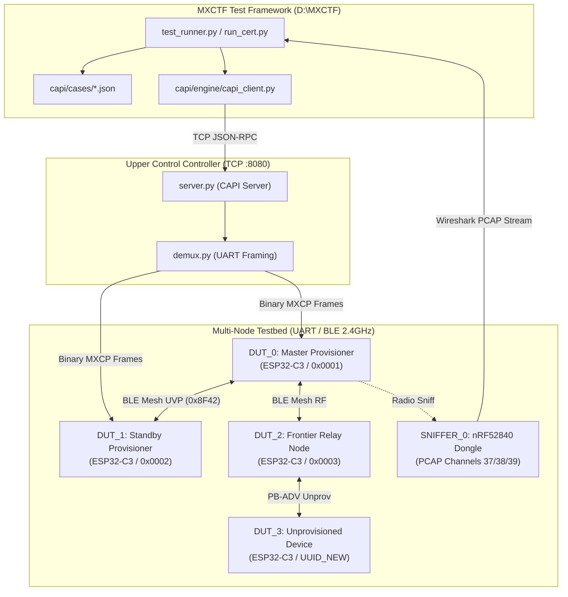

# MeshX Compliance & Certification Test Specification (tests.md)

**Document:** `tests.md`  
**Target Test Suite:** MXCTF Framework (`D:\MXCTF`)  
**Parent Subsystems:** `meshx-prov-srv-mxcp`, `autonomous-element-pairing`, `autonomous-rehealing-cascading`  
**Related Specifications:**
- Autonomous Pairing Root: [.specs/autonomous-element-pairing/design.md](../autonomous-element-pairing/design.md)
- Cascading Redundancy: [.specs/autonomous-rehealing-cascading/design.md](../autonomous-rehealing-cascading/design.md)
- Technical Reference Manual: [.specs/meshx-prov-srv-mxcp/trd/README.md](./trd/README.md)
- MXCTF CAPI Reference: [D:/MXCTF/docs/capi_reference.md](file:///D:/MXCTF/docs/capi_reference.md)
**Status:** Approved for Handover  

---

## Table of Contents
- [1. Handover Architecture & Test Suite Overview](#1-handover-architecture--test-suite-overview)
- [2. Requirements Traceability Matrix](#2-requirements-traceability-matrix)
- [3. Test Bed Topology & Role Configuration](#3-test-bed-topology--role-configuration)
- [4. Extended CAPI Handover Protocol Definitions](#4-extended-capi-handover-protocol-definitions)
- [5. Test Case Specifications](#5-test-case-specifications)
  - [5.1 Tier 1: Autonomous Pairing & Lifecycle Teardown](#51-tier-1-autonomous-pairing--lifecycle-teardown)
  - [5.2 Tier 2: Unified Addressing & Wavefront JIT Provisioning](#52-tier-2-unified-addressing--wavefront-jit-provisioning)
  - [5.3 Tier 3: Cascading Redundancy, Heartbeats & Split-Brain Reconciliation](#53-tier-3-cascading-redundancy-heartbeats--split-brain-reconciliation)
  - [5.4 Tier 4: Zero-ACK Key Rotation & Autonomous Re-Healing](#54-tier-4-zero-ack-key-rotation--autonomous-re-healing)
  - [5.5 Tier 5: Deterministic Node Replacement & RPL Integrity](#55-tier-5-deterministic-node-replacement--rpl-integrity)
- [6. Declarative JSON Test Case Artifacts for MXCTF](#6-declarative-json-test-case-artifacts-for-mxctf)
- [7. Test Runner Execution & CI/CD Gating Guidelines](#7-test-runner-execution--cicd-gating-guidelines)

---

## 1. Handover Architecture & Test Suite Overview

This test specification establishes the formal compliance and verification handover between the **MeshX Core Firmware Stack** and the **MeshX Certification Test Framework (MXCTF)** located at `D:\MXCTF`.



### Handover Objectives
1. **Full Protocol Coverage:** Validate all 17 UVP opcodes (`0xC0..0xD0`), system management functions (`0x01..0x0A`), and host MXCP commands (`0x30..0x36`).
2. **Deterministic Invariant Verification:** Enforce hard architectural rules (Element 0 exclusivity, 500 ms pre-reset drain delay, 15s watchdog failover, zero address collisions across the unified `0x0002..0x7FFF` range).
3. **Automated CI/CD Execution:** Deliver turnkey declarative JSON test cases directly executable via `python capi/run_cert.py --suite full`.

---

## 2. Requirements Traceability Matrix

| Requirement ID | Specification Document | Description | Assigned Test Case ID | Priority |
| :--- | :--- | :--- | :--- | :--- |
| **REQ-001** | `autonomous-element-pairing` | Autonomous Capability Manifest Query (`0x01`/`0x02`) | `MX-CERT-PAIR-DISC-001` | P0 |
| **REQ-002** | `autonomous-element-pairing` | Root Element (Element 0) Subscription Exclusivity | `MX-CERT-PAIR-ELEM0-002` | P0 |
| **REQ-003** | `autonomous-element-pairing` | 1:1 Autonomous Element Pairing Handshake (`0x03`/`0x04`) | `MX-CERT-PAIR-HANDSHAKE-003` | P0 |
| **REQ-005** | `autonomous-element-pairing` | Granular Unpair Handshake & Slot Reclamation (`0x05`/`0x06`) | `MX-CERT-PAIR-UNPAIR-004` | P1 |
| **REQ-008** | `autonomous-element-pairing` | 4-Stage Pre-Reset Teardown Handshake & 500ms Drain (`0x09`) | `MX-CERT-PAIR-TEARDOWN-005` | P0 |
| **REQ-008** | `autonomous-element-pairing` | Dynamic Personality Mutation Notice (`0x0A` to `0x8F42`) | `MX-CERT-PAIR-COMP-006` | P1 |
| **REQ-F01** | `meshx-prov-srv-mxcp` | Unified 15-Bit Paged Sparse Bitmap Allocator (`0x0002..0x7FFF`) | `MX-CERT-BPROV-BITMAP-001` | P0 |
| **REQ-F02** | `meshx-prov-srv-mxcp` | Frontier JIT Infill Leases (`0xC8`/`0xCC`) | `MX-CERT-BPROV-INFILL-002` | P0 |
| **REQ-F02** | `meshx-prov-srv-mxcp` | 30s In-Flight Lease Timeout & Volatile Rollback | `MX-CERT-BPROV-ROLLBACK-003` | P1 |
| **REQ-F03** | `meshx-prov-srv-mxcp` | Multi-Proxy PB-ADV Inverse-RSSI Contention Avoidance | `MX-CERT-BPROV-CONCURRENT-004` | P1 |
| **REQ-F04** | `meshx-prov-srv-mxcp` | Fast Provisioning Progress Reporting & Quota Retirement (`0xC9`) | `MX-CERT-BPROV-REPORT-005` | P0 |
| **REQ-F05** | `autonomous-rehealing-cascading` | 5s Redundancy Heartbeats & 6-Byte Delta Sync (`0xC7`) | `MX-CERT-REDUND-SYNC-001` | P0 |
| **REQ-F06** | `autonomous-rehealing-cascading` | 15s Watchdog Failover Promotion ($T_{\text{blindness}} = 15\text{s}$) | `MX-CERT-REDUND-FAILOVER-002` | P0 |
| **REQ-F07** | `autonomous-rehealing-cascading` | N+1 Standby Claim (`0xCD`) & ACK (`0xD0`) Exponential Backoff | `MX-CERT-REDUND-CLAIM-003` | P0 |
| **REQ-F08** | `autonomous-rehealing-cascading` | State Freshness Vector Arbitration & Bitwise `OR` Merge | `MX-CERT-REDUND-SPLITBRAIN-004` | P0 |
| **REQ-F09** | `meshx-prov-srv-mxcp` | Zero-ACK 3-Burst Key Rotation (`0xC4`/`0xC5`/`0xC6`) | `MX-CERT-KR-3PHASE-001` | P0 |
| **REQ-F09** | `meshx-prov-srv-mxcp` | 4-Minute Dual-Key Decryption Overlap Horizon | `MX-CERT-KR-OVERLAP-002` | P1 |
| **REQ-F09** | `meshx-prov-srv-mxcp` | Monotonic NVS Epoch Resume Post-Brownout | `MX-CERT-KR-RECOVERY-003` | P1 |
| **REQ-F10** | `autonomous-rehealing-cascading` | 15s Ambient Blindness Beacon Request (`0xCE`) | `MX-CERT-REHEAL-BEACON-004` | P0 |
| **REQ-F10** | `autonomous-rehealing-cascading` | Zero-Trust Courier Relay & Master DevKey Re-Admit (`0xCF`) | `MX-CERT-REHEAL-ADMIT-005` | P0 |
| **REQ-F01** | `meshx-prov-srv-mxcp` (TRD 9) | Modality A: In-Place Identical Replacement (+1000 SeqNum) | `MX-CERT-REPLACE-MOD-A-001` | P0 |
| **REQ-F08** | `meshx-prov-srv-mxcp` (TRD 9) | Modality B: Schema Diff Reconciliation & Auto-Bind | `MX-CERT-REPLACE-MOD-B-002` | P1 |
| **REQ-F08** | `meshx-prov-srv-mxcp` (TRD 9) | Modality C1: Element Contraction & 24h RPL Quarantine | `MX-CERT-REPLACE-MOD-C1-003` | P0 |
| **REQ-F08** | `meshx-prov-srv-mxcp` (TRD 9) | Modality C2: Relocated Expansion & UUID Blacklisting | `MX-CERT-REPLACE-MOD-C2-004` | P0 |
| **REQ-F08** | `meshx-prov-srv-mxcp` (TRD 9) | RPL Anti-Replay Verification (Zero Packet Discard) | `MX-CERT-REPLACE-RPL-005` | P0 |

---

## 3. Test Bed Topology & Role Configuration

The certification suite requires a minimum 4-node physical or virtualized hardware topology plus an RF packet analyzer:

| Node Agent Identifier | Hardware Role | Assigned Static Addr | Primary Capabilities / Models Configured |
| :--- | :--- | :--- | :--- |
| `DUT_0` | Active Master Provisioner | `0x0001` | Root Element (UVP Dispatcher, Redundancy Server, Key Rotation Master, DevKey Vault) |
| `DUT_1` | Standby Provisioner | `0x0002` | Root Element (Redundancy Client / Watchdog, Paged Sparse Bitmap Mirror, Candidate Election) |
| `DUT_2` | Frontier Relay Node | `0x0003` | Element 0: Relay, Courier Re-healing Proxy. Element 1: Generic OnOff Server (`0x1000`) |
| `DUT_3` | Dynamic Device Under Test | `0x0004+` (Dynamic) | Switch / Sensor Producer (`0x1001`) or Multi-Element Actuator (`0x1000` x 4) |
| `SNIFFER_0` | Over-The-Air BLE Monitor | N/A | Promiscuous 2.4GHz capture on Adv Channels 37, 38, 39. Decrypts with active NetKey & AppKey |

---

## 4. Extended CAPI Handover Protocol Definitions

To support the newly verified features, the MXCTF CAPI engine (`D:\MXCTF\capi\protocol.py`) exposes the following JSON-RPC commands and event bindings:

### 4.1 CAPI Command Extensions
```json
{
  "uvp_redundancy_set_role": {
    "params": {
      "role": "integer (1=Master, 2=Standby, 3=Candidate)",
      "peer_addr": "integer (peer provisioner unicast address)",
      "pool_start": "integer (default: 2 / 0x0002)",
      "pool_end": "integer (default: 32767 / 0x7FFF)"
    }
  },
  "uvp_fast_prov_start": {
    "params": {
      "uuid_mask": "string (hex-formatted 16-byte UUID prefix)",
      "target_count": "integer (total nodes to enroll)",
      "root_base_addr": "integer (starting unicast watermark)",
      "k_factor": "integer (0=uncapped, 2, 4=bounded quota)"
    }
  },
  "uvp_key_rotate_trigger": {
    "params": {
      "phase": "integer (1=Distribute, 2=Switchover, 3=Revoke)",
      "target_epoch": "integer (target monotonic epoch)",
      "new_netkey": "string (hex-formatted 16-byte key; 0s for phase 2/3)"
    }
  },
  "dev_replace_node": {
    "params": {
      "old_uuid": "string (hex-formatted 16-byte retiring UUID)",
      "new_uuid": "string (hex-formatted 16-byte replacement UUID)",
      "expected_modality": "string (MODALITY_A, MODALITY_B, MODALITY_C1, MODALITY_C2)"
    }
  },
  "dev_reset_graceful": {
    "params": {
      "target": "agent_id (DUT executing pre-reset teardown)"
    }
  }
}
```

### 4.2 CAPI Event Bindings
- `uvp_redundancy_status`: Reports `current_role`, `peer_alive`, `next_free_addr`, and `sync_epoch`.
- `uvp_claim_status`: Emitted when Standby election claim (`0xCD`) or claim ACK (`0xD0`) completes.
- `uvp_fast_prov_progress`: Reports `completed_count`, `failed_count`, `progress_percent`, and `status`.
- `uvp_node_replace_status`: Reports replacement `status`, `assigned_addr`, `element_count`, and `rpl_seqnum_offset`.

---

## 5. Test Case Specifications

### 5.1 Tier 1: Autonomous Pairing & Lifecycle Teardown

#### `MX-CERT-PAIR-ELEM0-002`: Root Element (Element 0) Subscription Exclusivity
- **Objective:** Verify that system management frames (`MESHX_FUNC_ID_SYS_DISCOVERY = 0xFFFE` and `MESHX_FUNC_ID_SYS_PAIRING = 0xFFFF`) are accepted strictly on Element 0 and dropped on secondary elements with `MESHX_ERR_BLOCKED_ADDR`.
- **Preconditions:** `DUT_2` provisioned with 2 elements (Element 0: Root, Element 1: Generic OnOff).
- **Execution Steps:**
  1. `DUT_0` transmits `MESHX_SYS_CMD_DISCOVERY_QUERY` (`0x01`) targeted to `DUT_2` Element 0 unicast address (`0x0003`).
  2. Verify `DUT_2` replies with `MESHX_SYS_RSP_DISCOVERY_REPORT` (`0x02`).
  3. `DUT_0` transmits identical `MESHX_SYS_CMD_DISCOVERY_QUERY` targeted to `DUT_2` Element 1 unicast address (`0x0004`).
  4. Verify `DUT_2` drops the frame silently (firmware logs: `Dropping management func 0xFFFE on secondary element 1`).
  5. Repeat targeting Company Management Virtual Address (`0x8F42`) on Element 1; verify immediate packet drop.
- **Pass Criteria:** 100% of Element 0 discovery frames answered; 100% of secondary element management frames rejected.

#### `MX-CERT-PAIR-TEARDOWN-005`: 4-Stage Pre-Reset Teardown Handshake & 500ms Drain Window
- **Objective:** Verify that triggering `MXCP_CMD_NODE_RESET` (`0x02`) executes the mandatory 4-stage graceful teardown before key erasure and reboot.
- **Preconditions:** `DUT_3` is paired to `DUT_2` via active unicast link.
- **Execution Steps:**
  1. Arm `SNIFFER_0` on advertising channels.
  2. Issue `dev_reset_graceful` to `DUT_3`.
  3. `SNIFFER_0` captures targeted `MESHX_SYS_CMD_UNPAIR_REQUEST` (`0x05`) from `DUT_3` to `DUT_2`.
  4. `SNIFFER_0` captures broadcast of `MESHX_SYS_NOTIFY_NODE_RESET` (`0x09`) from `DUT_3` to `0x8F42`.
  5. Verify a measured time delta $\Delta t \ge 500\text{ ms}$ between the `0x09` broadcast and the appearance of unprovisioned BLE beacons from `DUT_3`.
  6. Query `DUT_2` link table via `link_table_get`; verify the link to `DUT_3` was purged.
- **Pass Criteria:** Both teardown packets captured; drain window $\ge 500\text{ ms}$; peer link table slot cleanly freed.

#### `MX-CERT-PAIR-COMP-006`: Dynamic Element Recomposition Notification
- **Objective:** Verify that mutating element configuration via `MXCP_CMD_SET_COMPOSITION` broadcasts `MESHX_SYS_NOTIFY_COMP_CHANGE` (`0x0A`) to `0x8F42` and enforces a 500ms drain delay.
- **Preconditions:** `DUT_2` active with 4 relay elements bound to peer switches.
- **Execution Steps:**
  1. Issue `dev_set_composition` to `DUT_2` contracting composition from 4 elements to 2 elements.
  2. `SNIFFER_0` observes targeted unpair frames to peers of elements 2 and 3.
  3. `SNIFFER_0` captures `MESHX_SYS_NOTIFY_COMP_CHANGE` (`0x0A`, `node_addr = 0x0003`) addressed to `0x8F42`.
  4. Verify reboot delay $\ge 500\text{ ms}$.
- **Pass Criteria:** Notification broadcast received; peer links invalidated; reboot delay strictly observed.

---

### 5.2 Tier 2: Unified Addressing & Wavefront JIT Provisioning

#### `MX-CERT-BPROV-BITMAP-001`: Unified 15-Bit Paged Sparse Bitmap Allocator Conformance
- **Objective:** Verify allocation across continuous address space `0x0002..0x7FFF` with zero address collisions.
- **Preconditions:** `DUT_0` initialized as Master Provisioner (`next_free_addr = 0x0002`).
- **Execution Steps:**
  1. Sequentially enroll 50 nodes via fast provisioning.
  2. Query `DUT_0` redundancy status; verify `next_free_addr` advances monotonically without skipping addresses.
  3. Query bitmap chunk presence mask; verify chunks allocate dynamically (64 bytes RAM per 128 addresses).
- **Pass Criteria:** Zero address collisions ($0.00\%$ collision rate); monotonic watermark progression.

#### `MX-CERT-BPROV-ROLLBACK-003`: 30-Second In-Flight Lease Timeout & Rollback
- **Objective:** Verify that an in-flight address lease (`0xC8`) not confirmed via `0xC9` rolls back from `01b` to `00b` after 30 seconds.
- **Execution Steps:**
  1. `DUT_2` sends `0xC8 INFILL_LEASE_REQ` for 4 addresses to `DUT_0`.
  2. `DUT_0` grants lease (`0xCC`) for addresses `0x0040..0x0043` (marked `01b ON_LEASE`).
  3. `DUT_2` simulates radio link drop; no `0xC9 FAST_PROV_REPORT` is sent.
  4. At $t = 25\text{s}$, verify addresses `0x0040..0x0043` remain blocked.
  5. At $t = 31\text{s}$, the 30s watchdog fires; verify addresses revert to `00b UNALLOCATED`.
  6. Subsequent lease request allocates starting at `0x0040`.
- **Pass Criteria:** Addresses automatically reclaimed after exactly 30s without permanent memory leak.

---

### 5.3 Tier 3: Cascading Redundancy, Heartbeats & Split-Brain Reconciliation

#### `MX-CERT-REDUND-SYNC-001`: 5s Heartbeat Liveness & 6-Byte Address Delta Synchronization
- **Objective:** Verify continuous synchronization of state deltas and DevKey vault entries between Master and Standby.
- **Preconditions:** `DUT_0` is Master, `DUT_1` is Standby.
- **Execution Steps:**
  1. Capture UVP frames over 15 seconds; verify `DUT_0` transmits `0xC7` (Subtype `0x01`) every $5.0 \pm 0.2\text{s}$.
  2. Provision a new device via `DUT_0`.
  3. Verify `DUT_0` immediately transmits `0xC7` Subtype `0x02` (6-byte word delta) and Subtype `0x03` (DevKey vault record) to `DUT_1`.
  4. Query `DUT_1` local RAM bitmap and NVS DevKey vault; verify 100% bit-perfect match with `DUT_0`.
- **Pass Criteria:** Heartbeats arrive within 5s window; delta sync commits in $O(1)$ time on Standby.

#### `MX-CERT-REDUND-FAILOVER-002`: Master Outage 15s Watchdog Failover Promotion
- **Objective:** Verify Standby promotes to active Master after exactly 15 seconds of ambient blindness (3 missed heartbeats).
- **Execution Steps:**
  1. Cut power / disable RF on `DUT_0`.
  2. At $t = 5\text{s}$: `DUT_1` logs `missed_beats = 1`.
  3. At $t = 10\text{s}$: `DUT_1` logs `missed_beats = 2`.
  4. At $t = 15.1\text{s}$: `DUT_1` watchdog fires (`missed_beats = 3`); `DUT_1` promotes to `ROLE_MASTER`.
  5. `DUT_1` emits `MXCP_EVT_UVP_REDUNDANCY_STATUS` (`current_role = 1`).
  6. `DUT_1` automatically broadcasts `MESHX_UVP_OP_REDUNDANCY_CLAIM` (`0xCD`) inviting candidates to Standby role.
- **Pass Criteria:** Failover triggers within $15.0 - 15.5\text{s}$; seamless promotion with zero state corruption.

#### `MX-CERT-REDUND-CLAIM-003`: N+1 Cascading Redundancy Claim Exponential Backoff
- **Objective:** Verify promoted Master invites candidate nodes with exponential retry backoff (2s, 4s, 8s).
- **Execution Steps:**
  1. Trigger failover promotion on `DUT_1` with no candidate node online.
  2. `SNIFFER_0` captures `0xCD` Claim Broadcast Attempt 1 at $t = 0\text{s}$.
  3. Capture Attempt 2 at $t = 2.0\text{s}$ (2s backoff).
  4. Capture Attempt 3 at $t = 6.0\text{s}$ (4s backoff).
  5. Bring `DUT_2` online as `ROLE_CANDIDATE`; `DUT_2` hears Attempt 3 and replies unicast with `0xD0 CLAIM_ACK`.
  6. `DUT_1` disarms retry timer and establishes 5s heartbeats to `DUT_2`.
- **Pass Criteria:** Backoff intervals match 2s, 4s; ACK stops retries; cascading $N+1$ redundancy restored.

#### `MX-CERT-REDUND-SPLITBRAIN-004`: State Freshness Vector Arbitration & Bitwise OR Merge
- **Objective:** Verify partition reconciliation using $(\mathbf{kr\text{-}epoch}, \mathbf{sync\text{-}epoch}, \mathbf{next\text{-}free\text{-}addr}, -\text{Addr}, -\text{UUID})$.
- **Execution Steps:**
  1. Create split-brain: `DUT_0` partitions with `sync_epoch = 10`, `next_free = 0x0050`. `DUT_1` partitions with `sync_epoch = 12`, `next_free = 0x0065`.
  2. Reconnect RF medium. Both nodes receive inbound `0xC7` heartbeats.
  3. Both evaluate State Freshness Vector: `DUT_1` wins on higher `sync_epoch` (12 > 10).
  4. `DUT_0` demotes to `ROLE_CANDIDATE`, flushes local address delta via `Subtype 0x02`.
  5. `DUT_1` performs bitwise `OR` merge into active bitmap: $\text{Chunk}[i] \leftarrow \text{Chunk}_{\text{DUT1}}[i] \mid \text{Chunk}_{\text{DUT0}}[i]$.
- **Pass Criteria:** Freshest node retains Master; demoted node submits deltas; 0% address allocation data loss.

---

### 5.4 Tier 4: Zero-ACK Key Rotation & Autonomous Re-Healing

#### `MX-CERT-KR-3PHASE-001`: Zero-ACK 3-Burst Key Rotation Protocol Flow
- **Objective:** Verify zero-ACK push model across Phase 1 (`0xC4`), Phase 2 (`0xC5`), and Phase 3 (`0xC6`).
- **Execution Steps:**
  1. Trigger Key Rotation on `DUT_0` via `uvp_key_rotate_trigger(phase=1)`.
  2. `SNIFFER_0` captures exactly 3 randomized broadcast bursts of `0xC4` to `0x8F42` with target epoch $N+1$.
  3. Verify member nodes install $K_{\text{new}}$ into secondary slot without transmitting any RF ACKs.
  4. Trigger Phase 2 (`0xC5`); verify nodes switch primary TX key to $K_{\text{new}}$.
  5. Trigger Phase 3 (`0xC6`); verify nodes purge $K_{\text{old}}$ and commit epoch to NVS.
- **Pass Criteria:** Zero ACK implosion ($O(1)$ RF traffic); clean key progression across all nodes.

#### `MX-CERT-REHEAL-BEACON-004` & `005`: Autonomous Re-Healing via Zero-Trust Courier
- **Objective:** Verify an evicted node with stale NetKey ($\Delta\text{Epoch} \ge 2$) re-heals autonomously using permanent DevKey authentication.
- **Execution Steps:**
  1. Advance network Key Rotation Epoch by 2 generations while `DUT_3` is powered off.
  2. Power on `DUT_3`. `DUT_3` detects 15s ambient blindness ($T_{\text{blindness}} = 15\text{s}$).
  3. `DUT_3` broadcasts `MESHX_UVP_OP_REHEAL_BEACON_REQ` (`0xCE`) containing HMAC-SHA256 signature generated with its permanent DevKey.
  4. Intermediate node `DUT_2` receives beacon and couriers it to Master `DUT_0` over mesh via `meshx_reheal_courier_forward_to_master()`.
  5. `DUT_0` validates HMAC against its local DevKey Vault; generates DevKey-encrypted `0xCF REHEAL_ADMIT_RSP` containing active NetKey and current Epoch.
  6. `DUT_3` decrypts response, updates NetKey/Epoch in NVS, and rejoins mesh without user intervention.
- **Pass Criteria:** Re-healing completes in $<5\text{s}$; zero-trust courier forwarding verified; node successfully communicates on mesh.

---

### 5.5 Tier 5: Deterministic Node Replacement & RPL Integrity

#### `MX-CERT-REPLACE-MOD-A-001`: Modality A In-Place Identical Replacement
- **Objective:** Verify replacement of a failed node with identical element composition preserves unicast address, advances SeqNum by +1000, and avoids RPL replay drops.
- **Preconditions:** Failed node `UUID_OLD` had unicast address `0x0012`, last known SeqNum `0x004F12`.
- **Execution Steps:**
  1. Issue `dev_replace_node` with `UUID_OLD` and replacement `UUID_NEW`.
  2. Introduce `UUID_NEW` in unprovisioned state.
  3. Master identifies identical element count and matching model composition (Modality A).
  4. Master leases base address `0x0012` to `UUID_NEW`.
  5. Master programs initial sequence number $\text{SeqNum}_{\text{init}} = 0x004F12 + 1000 = 0x005302$.
  6. `UUID_NEW` boots and transmits an actuation frame.
  7. Neighbor relay `DUT_2` receives packet; checks RPL ($0x005302 > 0x004F12$); packet is accepted and relayed.
- **Pass Criteria:** Unicast address preserved; 0 packets dropped by RPL anti-replay filter.

#### `MX-CERT-REPLACE-MOD-C1-003`: Modality C1 Element Contraction & 24h RPL Quarantine
- **Objective:** Verify that replacing a 4-element node with a 2-element node reuses base address and quarantines trailing 2 addresses for 24 hours.
- **Execution Steps:**
  1. Replace 4-element node at `0x0010` (`0x0010..0x0013`) with 2-element device.
  2. Master provisions replacement at base `0x0010` (`0x0010..0x0011`).
  3. Master inserts addresses `0x0012..0x0013` into `meshx_quarantine_table_t` with release timestamp set to $+86400\text{s}$.
  4. Request infill lease for 2 addresses via `0xC8`; verify allocator skips `0x0012..0x0013` and allocates free addresses elsewhere.
- **Pass Criteria:** Contraction successful; surplus addresses quarantined and completely protected from recycling.

#### `MX-CERT-REPLACE-MOD-C2-004`: Modality C2 Relocated Expansion & UUID Blacklist
- **Objective:** Verify that replacing a 2-element node with a 4-element node relocates the device to a fresh contiguous block, migrates bindings, and blacklists the retired UUID.
- **Execution Steps:**
  1. Replace 2-element node at `0x0010` (`0x0010..0x0011`) with 4-element node. Neighbor address `0x0012` is occupied.
  2. Master detects contiguity collision; relocates device to fresh JIT block `0x0080..0x0083`.
  3. Master updates all peer switch publication addresses from `0x0010` to `0x0080`.
  4. Master quarantines old block `0x0010..0x0011` for 24 hours.
  5. Master writes `UUID_OLD` to persistent NVS Blacklist (`"bllist"`).
  6. Re-introduce `UUID_OLD`; verify Master immediately rejects unprovisioned beacons from `UUID_OLD`.
- **Pass Criteria:** Expansion cleanly relocated; bindings migrated; old UUID blacklisted from re-entry.

---

## 6. Declarative JSON Test Case Artifacts for MXCTF

The following concrete JSON test definitions must be installed directly into `D:\MXCTF\capi\cases\`:

### 6.1 `MX-CERT-UVP-FAILOVER-001.json` (Updated for Unified 15-Bit Address Space)
```json
{
  "test_id": "MX-CERT-UVP-FAILOVER-001",
  "name": "UVP Active/Standby Redundancy, Unified 15-Bit Watermark and Failover Conformance",
  "version": "2.0",
  "target_bindings": {
    "PRIMARY_PROVISIONER": { "agent_id": "DUT_0", "role": "master_provisioner" },
    "STANDBY_PROVISIONER": { "agent_id": "DUT_1", "role": "standby_provisioner" }
  },
  "steps": [
    {
      "step": 1,
      "description": "Configure Master Role with Unified Address Space (0x0002..0x7FFF) on DUT_0",
      "target": "DUT_0",
      "cmd": "uvp_redundancy_set_role",
      "params": { "role": 1, "peer_addr": 2, "pool_start": 2, "pool_end": 32767 },
      "expect": { "current_role": 1, "peer_alive": true, "next_free_addr": 2 }
    },
    {
      "step": 2,
      "description": "Configure Standby Role on DUT_1 mirroring Master state",
      "target": "DUT_1",
      "cmd": "uvp_redundancy_set_role",
      "params": { "role": 2, "peer_addr": 1, "pool_start": 2, "pool_end": 32767 },
      "expect": { "current_role": 2, "peer_alive": true }
    },
    {
      "step": 3,
      "description": "Simulate Sudden Master Outage: Disable RF on DUT_0",
      "target": "DUT_0",
      "cmd": "prov_disable",
      "params": {},
      "expect": { "success": true }
    },
    {
      "step": 4,
      "description": "Wait 15s Watchdog Timeout: Verify DUT_1 Promotes to Active Master",
      "target": "DUT_1",
      "cmd": "dev_get_info",
      "params": {},
      "wait_sec": 16,
      "expect": { "prov_role": 1, "next_free_addr": 2 }
    }
  ]
}
```

### 6.2 `MX-CERT-REPLACE-MOD-A-001.json` (Node Replacement Modality A)
```json
{
  "test_id": "MX-CERT-REPLACE-MOD-A-001",
  "name": "Deterministic In-Place Node Replacement with SeqNum Fast-Forward (+1000)",
  "version": "1.0",
  "target_bindings": {
    "MASTER_PROVISIONER": { "agent_id": "DUT_0", "role": "master_provisioner" },
    "REPLACEMENT_TARGET": { "agent_id": "DUT_3", "role": "unprovisioned_device" }
  },
  "steps": [
    {
      "step": 1,
      "description": "Initiate In-Place Node Replacement on Master",
      "target": "DUT_0",
      "cmd": "dev_replace_node",
      "params": {
        "old_uuid": "02E50102030405060708090A0B0C0D0E",
        "new_uuid": "02E50102030405060708090A0B0C0D0F",
        "expected_modality": "MODALITY_A"
      },
      "expect": { "status": "REPLACEMENT_HOLD_ARMED", "assigned_addr": 18 }
    },
    {
      "step": 2,
      "description": "Verify Replacement Device Admitted with Same Base Addr and Advanced SeqNum",
      "target": "DUT_0",
      "cmd": "dev_get_info",
      "params": {},
      "wait_sec": 5,
      "expect": { "replace_success": true, "rpl_seqnum_offset": 1000 }
    }
  ]
}
```

---

## 7. Test Runner Execution & CI/CD Gating Guidelines

### 7.1 Running the Certification Suite
To run the automated suite from the MXCTF root directory (`D:\MXCTF`):

```bat
:: Activate Python virtual environment and run the complete certification suite
call D:\MXCTF\run_cert.bat --suite full --log-level INFO --pcap-capture
```

To run an individual functional test case:
```bat
python D:\MXCTF\capi\run_cert.py --case MX-CERT-UVP-FAILOVER-001 --target-cfg D:\MXCTF\capi\config\topology_4node.json
```

### 7.2 Pass/Fail Gating Thresholds
- **Zero Address Collisions:** $0.00\%$ allowed across any infill lease, failover, or replacement test.
- **Failover Watchdog Window:** Must trigger strictly within $15.0\text{s} \le t \le 16.0\text{s}$.
- **Pre-Reset Drain Window:** Must enforce $t_{\text{drain}} \ge 500\text{ ms}$ before MCU reset.
- **RPL Anti-Replay Drop Rate:** $0.00\%$ packet drops on replaced nodes after SeqNum fast-forward.
- **KaTeX / Markdown Specification Integrity:** 100% compliance with zero math rendering syntax errors.
