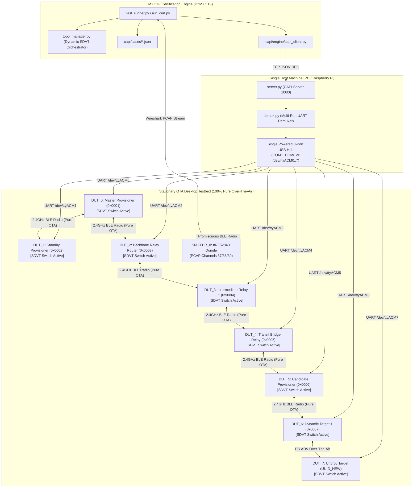
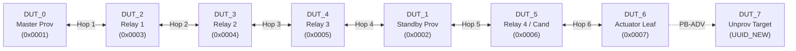
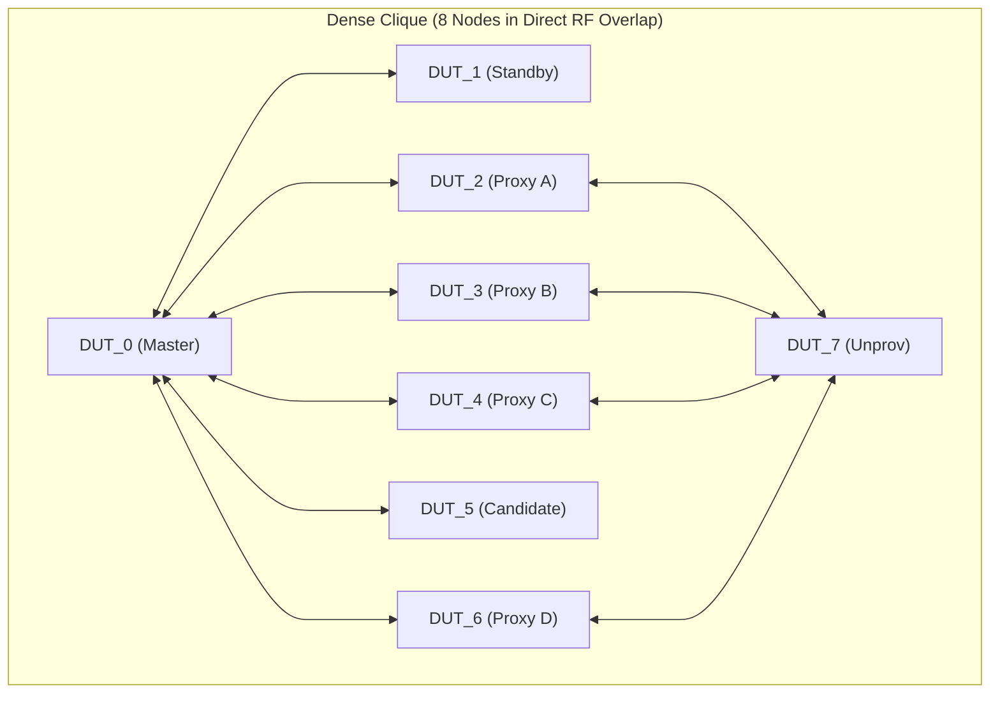
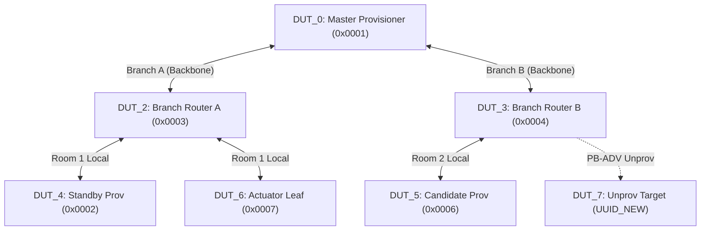
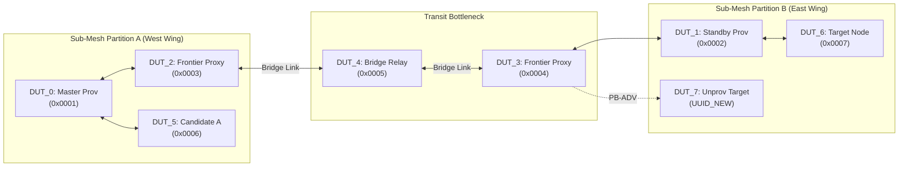
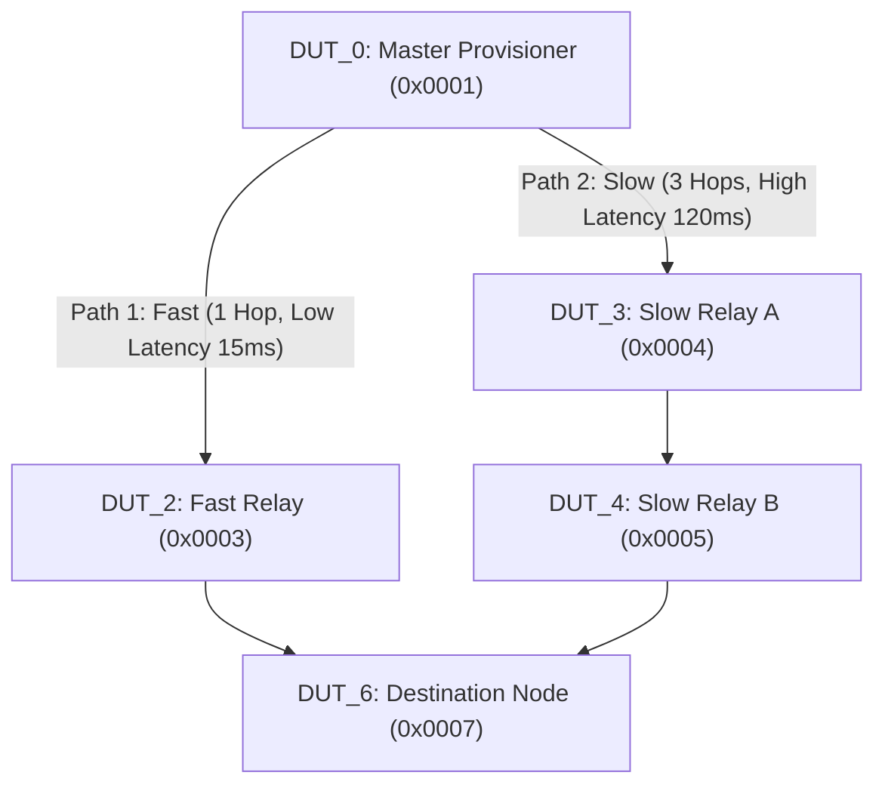
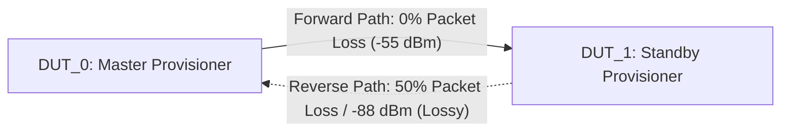
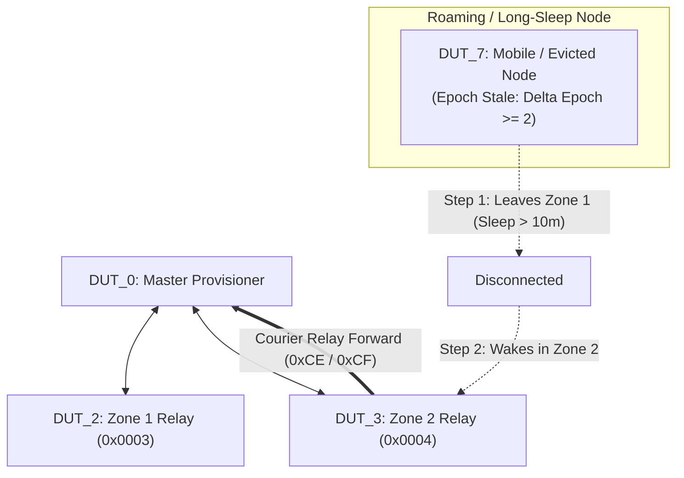

# MeshX Compliance & Certification Test Specification (tests.md)

**Document:** `tests.md`
**Target Test Suite:** MXCTF Framework (`D:\MXCTF`)
**Parent Subsystems:** `meshx-prov-srv-mxcp`, `autonomous-element-pairing`, `autonomous-rehealing-cascading`, `uvp-routing-fix`
**Related Specifications:**
- Autonomous Pairing Root: [.specs/autonomous-element-pairing/design.md](../autonomous-element-pairing/design.md)
- Cascading Redundancy: [.specs/autonomous-rehealing-cascading/design.md](../autonomous-rehealing-cascading/design.md)
- Technical Reference Manual: [.specs/meshx-prov-srv-mxcp/trd/README.md](./trd/README.md)
  - [TRD Page 2: Protocol Definitions & Packed Structs](./trd/page2_protocol_definitions.md)
  - [TRD Page 3: UVP Remote Provisioning (RPR) Tunneling](./trd/page3_remote_provisioning.md)
  - [TRD Page 4: 5-Minute Zero-ACK Key Rotation](./trd/page4_key_rotation.md)
  - [TRD Page 5: Cascading Redundancy & Redundancy Claim](./trd/page5_redundancy_cascading.md)
  - [TRD Page 6: Long-Term Eviction & DevKey Self-Healing](./trd/page6_eviction_healing.md)
  - [TRD Page 7: Resilience & Memory Analysis](./trd/page7_resilience_memory.md)
  - [TRD Page 8: Wavefront Provisioning Engine (Configurable K)](./trd/page8_fast_bulk_provisioning.md)
  - [TRD Page 9: Node Replacement & Unicast Lease Reallocation](./trd/page9_node_replacement.md)
- MXCTF CAPI Reference: [D:/MXCTF/docs/capi_reference.md](file:///D:/MXCTF/docs/capi_reference.md)
**Status:** Approved for Handover & Rigorous Topological Certification

---

## Table of Contents
- [1. Handover Architecture & Test Suite Overview](#1-handover-architecture--test-suite-overview)
- [2. Requirements Traceability Matrix](#2-requirements-traceability-matrix)
- [3. Test Bed Topologies & Topological Role Configurations](#3-test-bed-topologies--topological-role-configurations)
  - [3.1 Topology Archetypes & Matrix](#31-topology-archetypes--matrix)
  - [3.2 Hardware Node Profile & Testbed Mapping](#32-hardware-node-profile--testbed-mapping)
  - [3.3 Protocol Feature vs. Topology Certification Matrix](#33-protocol-feature-vs-topology-certification-matrix)
- [4. Extended CAPI Handover Protocol Definitions](#4-extended-capi-handover-protocol-definitions)
  - [4.1 Protocol & Lifecycle Command Extensions](#41-protocol--lifecycle-command-extensions)
  - [4.2 Topological Orchestration & Fault Injection Commands](#42-topological-orchestration--fault-injection-commands)
  - [4.3 CAPI Event Bindings](#43-capi-event-bindings)
- [5. Test Case Specifications](#5-test-case-specifications)
  - [5.1 Tier 1: Autonomous Pairing & Lifecycle Teardown](#51-tier-1-autonomous-pairing--lifecycle-teardown)
  - [5.2 Tier 2: Unified Addressing & Wavefront JIT Provisioning](#52-tier-2-unified-addressing--wavefront-jit-provisioning)
  - [5.3 Tier 3: Cascading Redundancy, Heartbeats & Split-Brain Reconciliation](#53-tier-3-cascading-redundancy-heartbeats--split-brain-reconciliation)
  - [5.4 Tier 4: Zero-ACK Key Rotation & Autonomous Re-Healing](#54-tier-4-zero-ack-key-rotation--autonomous-re-healing)
  - [5.5 Tier 5: Deterministic Node Replacement & RPL Integrity](#55-tier-5-deterministic-node-replacement--rpl-integrity)
  - [5.6 Tier 6: Deep Multi-Hop & Linear Daisy-Chain Conformance](#56-tier-6-deep-multi-hop--linear-daisy-chain-conformance)
  - [5.7 Tier 7: High-Density Clique & Broadcast Storm Contention Conformance](#57-tier-7-high-density-clique--broadcast-storm-contention-conformance)
  - [5.8 Tier 8: Network Partition, Dumbbell Split-Brain & Re-Convergence Conformance](#58-tier-8-network-partition-dumbbell-split-brain--re-convergence-conformance)
  - [5.9 Tier 9: Cyclic / Diamond Multi-Path & Race-Condition Conformance](#59-tier-9-cyclic--diamond-multi-path--race-condition-conformance)
- [6. Declarative JSON Test Case Artifacts for MXCTF](#6-declarative-json-test-case-artifacts-for-mxctf)
  - [6.1 MX-CERT-UVP-FAILOVER-001.json (Unified Address Space Failover)](#61-mx-cert-uvp-failover-001json)
  - [6.2 MX-CERT-REPLACE-MOD-A-001.json (Node Replacement Modality A)](#62-mx-cert-replace-mod-a-001json)
  - [6.3 MX-CERT-TOPO-DEEP-INFILL-001.json (Multi-Hop Infill Lease & TTL Budget)](#63-mx-cert-topo-deep-infill-001json)
  - [6.4 MX-CERT-TOPO-DENSE-ARBITRATE-001.json (High-Density Multi-Proxy PB-ADV Arbitration)](#64-mx-cert-topo-dense-arbitrate-001json)
  - [6.5 MX-CERT-TOPO-PARTITION-SPLIT-001.json (Dumbbell Split-Brain & Dual-Master Formation)](#65-mx-cert-topo-partition-split-001json)
  - [6.6 MX-CERT-TOPO-PARTITION-HEAL-003.json (Split-Brain Reconnection & Bitwise Union Merge)](#66-mx-cert-topo-partition-heal-003json)
  - [6.7 MX-CERT-TOPO-MULTIPATH-OOO-001.json (Multi-Path Out-of-Order Key Rotation Phase Inversion)](#67-mx-cert-topo-multipath-ooo-001json)
- [7. Test Runner Execution & CI/CD Gating Guidelines](#7-test-runner-execution--cicd-gating-guidelines)
  - [7.1 Running the Certification Suite](#71-running-the-certification-suite)
  - [7.2 Topological Pass/Fail Gating Thresholds](#72-topological-passfail-gating-thresholds)

---

## 1. Handover Architecture & Test Suite Overview

This test specification establishes the formal compliance, robustness, and topological verification handover between the **MeshX Core Firmware Stack** and the **MeshX Certification Test Framework (MXCTF)** located at `D:\MXCTF`.



### Handover Objectives
1. **Full Protocol & Wire Opcode Coverage:** Validate all 17 UVP opcodes (`0xC0..0xD0`), element system management functions (`0x01..0x0A`), and host MXCP commands (`0x30..0x36`).
2. **Topological Invariant Certification:** Eliminate flat-network testing biases by rigorously certifying protocol resilience, timing, and synchronization under diverse topological archetypes (Linear Deep Multi-Hop, High-Density Clique, Hierarchical Tree, Dumbbell Partition, Cyclic Multi-Path, Asymmetric Lossy Link, and Dynamic Roaming/Orphan).
3. **Deterministic Fault & Race Tolerance:** Prove system correctness under extreme corner cases: bridge failures, multi-master split-brain partition & heal, candidate election stampedes, out-of-order key rotation bursts, and multi-hop courier re-healing.
4. **Automated CI/CD Execution:** Deliver turnkey declarative JSON test cases directly executable via `python capi/run_cert.py --suite full`.

---

## 2. Requirements Traceability Matrix

| Requirement ID | Specification Document | Description | Assigned Test Case ID | Priority | Required Topology |
| :--- | :--- | :--- | :--- | :--- | :--- |
| **REQ-001** | `autonomous-element-pairing` | Autonomous Capability Manifest Query (`0x01`/`0x02`) | `MX-CERT-PAIR-DISC-001` | P0 | T1, T2 |
| **REQ-002** | `autonomous-element-pairing` | Root Element (Element 0) Subscription Exclusivity | `MX-CERT-PAIR-ELEM0-002` | P0 | T1 |
| **REQ-003** | `autonomous-element-pairing` | 1:1 Autonomous Element Pairing Handshake (`0x03`/`0x04`) | `MX-CERT-PAIR-HANDSHAKE-003` | P0 | T1, T5 |
| **REQ-005** | `autonomous-element-pairing` | Granular Unpair Handshake & Slot Reclamation (`0x05`/`0x06`) | `MX-CERT-PAIR-UNPAIR-004` | P1 | T1 |
| **REQ-008** | `autonomous-element-pairing` | 4-Stage Pre-Reset Teardown Handshake & 500ms Drain (`0x09`) | `MX-CERT-PAIR-TEARDOWN-005` | P0 | T1, T2 |
| **REQ-008** | `autonomous-element-pairing` | Dynamic Personality Mutation Notice (`0x0A` to `0x8F42`) | `MX-CERT-PAIR-COMP-006` | P1 | T3, T7 |
| **REQ-F01** | `meshx-prov-srv-mxcp` | Unified 15-Bit Paged Sparse Bitmap Allocator (`0x0002..0x7FFF`) | `MX-CERT-BPROV-BITMAP-001` | P0 | T1, T3 |
| **REQ-F02** | `meshx-prov-srv-mxcp` | Frontier JIT Infill Leases (`0xC8`/`0xCC`) | `MX-CERT-BPROV-INFILL-002` | P0 | T1, T3 |
| **REQ-F02** | `meshx-prov-srv-mxcp` | 30s In-Flight Lease Timeout & Volatile Rollback | `MX-CERT-BPROV-ROLLBACK-003` | P1 | T1, T6 |
| **REQ-F03** | `meshx-prov-srv-mxcp` | Multi-Proxy PB-ADV Inverse-RSSI Contention Avoidance | `MX-CERT-BPROV-CONCURRENT-004` | P1 | T2 |
| **REQ-F04** | `meshx-prov-srv-mxcp` | Fast Provisioning Progress Reporting & Quota Retirement (`0xC9`) | `MX-CERT-BPROV-REPORT-005` | P0 | T3 |
| **REQ-F05** | `autonomous-rehealing-cascading` | 5s Redundancy Heartbeats & 6-Byte Delta Sync (`0xC7`) | `MX-CERT-REDUND-SYNC-001` | P0 | T1, T6 |
| **REQ-F06** | `autonomous-rehealing-cascading` | 15s Watchdog Failover Promotion ($T_{\text{blindness}} = 15\text{s}$) | `MX-CERT-REDUND-FAILOVER-002` | P0 | T1, T4 |
| **REQ-F07** | `autonomous-rehealing-cascading` | N+1 Standby Claim (`0xCD`) & ACK (`0xD0`) Exponential Backoff | `MX-CERT-REDUND-CLAIM-003` | P0 | T1, T2 |
| **REQ-F08** | `autonomous-rehealing-cascading` | State Freshness Vector Arbitration & Bitwise `OR` Merge | `MX-CERT-REDUND-SPLITBRAIN-004` | P0 | T4 |
| **REQ-F09** | `meshx-prov-srv-mxcp` | Zero-ACK 3-Burst Key Rotation (`0xC4`/`0xC5`/`0xC6`) | `MX-CERT-KR-3PHASE-001` | P0 | T1, T5 |
| **REQ-F09** | `meshx-prov-srv-mxcp` | 4-Minute Dual-Key Decryption Overlap Horizon | `MX-CERT-KR-OVERLAP-002` | P1 | T1, T7 |
| **REQ-F09** | `meshx-prov-srv-mxcp` | Monotonic NVS Epoch Resume Post-Brownout | `MX-CERT-KR-RECOVERY-003` | P1 | T1 |
| **REQ-F10** | `autonomous-rehealing-cascading` | 15s Ambient Blindness Beacon Request (`0xCE`) | `MX-CERT-REHEAL-BEACON-004` | P0 | T1, T7 |
| **REQ-F10** | `autonomous-rehealing-cascading` | Zero-Trust Courier Relay & Master DevKey Re-Admit (`0xCF`) | `MX-CERT-REHEAL-ADMIT-005` | P0 | T1, T7 |
| **REQ-F01** | `meshx-prov-srv-mxcp` (TRD 9) | Modality A: In-Place Identical Replacement (+1000 SeqNum) | `MX-CERT-REPLACE-MOD-A-001` | P0 | T1, T3 |
| **REQ-F08** | `meshx-prov-srv-mxcp` (TRD 9) | Modality B: Schema Diff Reconciliation & Auto-Bind | `MX-CERT-REPLACE-MOD-B-002` | P1 | T1 |
| **REQ-F08** | `meshx-prov-srv-mxcp` (TRD 9) | Modality C1: Element Contraction & 24h RPL Quarantine | `MX-CERT-REPLACE-MOD-C1-003` | P0 | T1 |
| **REQ-F08** | `meshx-prov-srv-mxcp` (TRD 9) | Modality C2: Relocated Expansion & UUID Blacklisting | `MX-CERT-REPLACE-MOD-C2-004` | P0 | T1, T4 |
| **REQ-F08** | `meshx-prov-srv-mxcp` (TRD 9) | RPL Anti-Replay Verification (Zero Packet Discard) | `MX-CERT-REPLACE-RPL-005` | P0 | T1, T5 |
| **REQ-TOPO-01** | TRD 8 & TRD 3 | Deep Multi-Hop Infill Lease & TTL Budget ($H=6\text{ hops}$) | `MX-CERT-TOPO-DEEP-INFILL-001` | P0 | T1 (Linear Deep) |
| **REQ-TOPO-02** | TRD 4 | Zero-ACK Key Rotation 3-Burst Propagation Across $H=8\text{ hops}$ | `MX-CERT-TOPO-DEEP-KR-002` | P0 | T1 (Linear Deep) |
| **REQ-TOPO-03** | TRD 6 | Multi-Hop Courier Re-Healing Across Intermediate Relays | `MX-CERT-TOPO-DEEP-REHEAL-003` | P0 | T1 (Linear Deep) |
| **REQ-TOPO-04** | TRD 5 | Deep Mesh Cascading Standby Promotion & Multi-Hop Claim | `MX-CERT-TOPO-DEEP-CASCADE-004` | P0 | T1 (Linear Deep) |
| **REQ-TOPO-05** | TRD 8 | 6-Proxy PB-ADV Contention & Inverse-RSSI Backoff Determinism | `MX-CERT-TOPO-DENSE-ARBITRATE-001` | P0 | T2 (Dense Clique) |
| **REQ-TOPO-06** | TRD 5 | Candidate Claim Stampede: Simultaneous `0xD0` Resolution | `MX-CERT-TOPO-DENSE-CLAIM-STAMPEDE-002` | P0 | T2 (Dense Clique) |
| **REQ-TOPO-07** | TRD 8 | Geometric Wavefront ($K=2, 4$) Saturation vs Spatial ($K=\infty$) | `MX-CERT-TOPO-DENSE-WAVEFRONT-003` | P0 | T2, T3 (Tree) |
| **REQ-TOPO-08** | `autonomous-element-pairing` | Dense Cluster Pre-Reset Teardown (`0x09`) Under Saturation | `MX-CERT-TOPO-DENSE-TEARDOWN-004` | P1 | T2 (Dense Clique) |
| **REQ-TOPO-09** | TRD 5 & TRD 7 | Dumbbell Bridge Outage: Dual-Master Formation & Sub-Mesh Infill | `MX-CERT-TOPO-PARTITION-SPLIT-001` | P0 | T4 (Dumbbell) |
| **REQ-TOPO-10** | TRD 5 | Asymmetric Unidirectional Heartbeat Loss & Flapping Watchdog | `MX-CERT-TOPO-ASYMM-HEARTBEAT-002` | P0 | T6 (Asymmetric) |
| **REQ-TOPO-11** | TRD 5 & TRD 7 | Bridge Healed: 3-Way Collision, Freshness Vector & `OR` Merge | `MX-CERT-TOPO-PARTITION-HEAL-003` | P0 | T4 (Dumbbell) |
| **REQ-TOPO-12** | TRD 9 | Cross-Partition Node Replacement & Binding Relocation | `MX-CERT-TOPO-REPLACE-CROSSBRANCH-004` | P1 | T4, T3 |
| **REQ-TOPO-13** | TRD 4 | Multi-Path Key Rotation Phase Inversion (Phase 2 Overtakes 1) | `MX-CERT-TOPO-MULTIPATH-OOO-001` | P0 | T5 (Diamond) |
| **REQ-TOPO-14** | TRD 9 | Multi-Path RPL Cache Stability Under Route Switching | `MX-CERT-TOPO-MULTIPATH-RPL-002` | P0 | T5 (Diamond) |
| **REQ-TOPO-15** | `uvp-routing-fix` | Pairing Handshake & Duplicate Frame Suppression on Diamond | `MX-CERT-TOPO-MULTIPATH-PAIR-003` | P1 | T5 (Diamond) |

---

## 3. Test Bed Topologies & Dynamic Software-Defined Virtual Topology (SDVT) Engine

To eliminate the need for cumbersome physical test setups (moving nodes across rooms, deploying distributed Raspberry Pis, or purchasing expensive coaxial RF attenuator matrices), MeshX integrates an in-firmware **Dynamic Software-Defined Virtual Topology (SDVT) Switch** (`meshx_virtual_topo.c`).

### Dynamic SDVT Switch Architecture & OEM Interactive Shell

All 8 MeshX Target devices sit **stationary on a single developer desk**, plugged into a **single 8-port powered USB hub** connected to **one PC or Raspberry Pi**, transmitting normally Over-The-Air (OTA) via their on-board 2.4 GHz PCB antennas.

```
+-----------------------------------------------------------------------------------------------------------+
|                        STATIONARY OVER-THE-AIR (OTA) DESKTOP CERTIFICATION HARNESS                        |
|                                                                                                           |
|  SINGLE HOST PC / RASPBERRY PI                                                                            |
|  - Runs MXCTF Test Runner (run_cert.py) & CAPI Server (server.py on :8080)                                |
|  - Demuxes 8 USB Serial Ports (/dev/ttyACM0..7 or COM1..COM8) to nodes DUT_0..DUT_7                       |
|                                                                                                           |
|  HARDWARE BENCH (PURE OTA 2.4 GHz)                                                                        |
|  - 8x MeshX Target boards side-by-side on one desk (No RF cables, no RF attenuator boxes, no relocation!) |
|  - Each node runs in-firmware Dynamic SDVT Switch (meshx_virtual_topo.c)                                  |
|                                                                                                           |
|  FOUR FIRMWARE INJECTION PRIMITIVES (Controlled at runtime via UART / CAPI):                              |
|  1. Link Adjacency Filter: Drops frames from non-neighbor nodes, forcing multi-hop relay routes.          |
|  2. Virtual RSSI Attenuation: Injects dBm offsets into ctx.recv_rssi for inverse-RSSI distance math.      |
|  3. Probabilistic Packet Drop: Simulates noisy / edge-of-range RF link packet loss (0 to 100%).           |
|  4. Hard Bridge Cut / Heal: Instantly severs or restores bridge links to test Split-Brain healing.        |
+-----------------------------------------------------------------------------------------------------------+
```

#### OEM & Test Framework Dynamic Control via MeshX Control Protocol (MXCP)

The Virtual Topology Switch is controlled via native **MeshX Control Protocol (MXCP)** rather than shell or Unit Test (UT) text commands.

> [!IMPORTANT]
> **Why MXCP Routing over UT Framework?**
> The UT framework only emits unstructured text logs (`MESHX_LOGI`) to UART console, which prevents test runners (`run_cert.py` / CAPI) from receiving structured, parseable status notifications. MXCP provides a deterministic, binary, bidirectional request/response channel with immediate asynchronous status events (`MXCP_EVT_VIRTUAL_TOPO_STATUS = 0xB9`), enabling test runners to synchronize node topology states with zero ambiguity before executing test vectors.

##### 1. MXCP Command Wire Format (`MXCP_CMD_VIRTUAL_TOPO_REQ = 0x38`)

Standard MXCP frame: `[SOF 0xFE][LEN][TYPE 0x38][ACTION][ACTION_PARAMS...][CHK][EOF 0xEF]`

| Action ID | Action Name | Parameter Layout | Operational Description |
| :---: | :--- | :--- | :--- |
| `0x00` | `MXCP_TOPO_ACTION_INIT` | `own_addr: uint16_t` (2 bytes, optional) | Initializes SDVT engine, sets local unicast address, marks active passthrough. |
| `0x01` | `MXCP_TOPO_ACTION_DEINIT` | None (0 bytes) | De-initializes SDVT engine, clears peer matrix, reverts 100% to raw OTA passthrough. |
| `0x02` | `MXCP_TOPO_ACTION_SET_ENABLED` | `enabled: uint8_t` (1 byte: `0`=Disable, `1`=Enable) | Toggles link-layer virtual topology filtering on/off at runtime. |
| `0x03` | `MXCP_TOPO_ACTION_APPLY_PRESET` | `preset: uint8_t`, `own_addr: uint16_t` (3 bytes) | Dynamically applies network preset (`1`=Linear, `2`=Clique, `3`=Tree, `4`=Dumbbell, `5`=Diamond). |
| `0x04` | `MXCP_TOPO_ACTION_SET_PEER` | `peer_addr: uint16_t`, `rssi_offset_db: int8_t`, `drop_rate_pct: uint8_t`, `blocked: uint8_t` (5 bytes) | Configures per-peer distance attenuation (e.g. -35 dB), drop rate (0-100%), or hard severance. |
| `0x05` | `MXCP_TOPO_ACTION_REMOVE_PEER` | `peer_addr: uint16_t` (2 bytes) | Removes virtual link rule for specified peer address. |
| `0x06` | `MXCP_TOPO_ACTION_SET_PARTITION` | `is_split: uint8_t`, `bridge_addr: uint16_t` (3 bytes) | Instantly severs (`is_split=1`) or heals (`is_split=0`) bridge link for Split-Brain tests. |
| `0x07` | `MXCP_TOPO_ACTION_CLEAR` | None (0 bytes) | Clears all virtual topology rules to clean defaults. |
| `0x08` | `MXCP_TOPO_ACTION_GET_STATUS` | None (0 bytes) | Triggers immediate status & complete peer table dump via `MXCP_EVT_VIRTUAL_TOPO_STATUS`. |

##### 2. MXCP Asynchronous Status Event Notification (`MXCP_EVT_VIRTUAL_TOPO_STATUS = 0xB9`)

Transmitted automatically by firmware to the Host MCU / Test Framework upon any configuration change or status query:

Frame: `[SOF 0xFE][LEN][TYPE 0xB9][HEADER: 8 bytes][PEER_ENTRIES: 5 bytes * N][CHK][EOF 0xEF]`

- **Status Header (`mxcp_evt_virtual_topo_status_t`, 8 bytes):**
  - `status_code` (`uint8_t`): `0x00` = Success, non-zero = Error.
  - `action` (`uint8_t`): The triggering action (`0x00..0x08`).
  - `initialized` (`uint8_t`): `1` if SDVT switch engine is initialized, `0` otherwise.
  - `enabled` (`uint8_t`): `1` if link-layer filtering is active, `0` if passthrough.
  - `preset` (`uint8_t`): Active topology preset identifier (`0`=None, `1`=Linear, etc.).
  - `own_addr` (`uint16_t`): Local node address used for neighbor relationship evaluation.
  - `peer_count` (`uint8_t`): Number of configured peer entries following the header ($N$).
- **Peer Array (`mxcp_topo_peer_entry_t`, 5 bytes per entry):**
  - `peer_addr` (`uint16_t`): Peer unicast address.
  - `rssi_offset_db` (`int8_t`): Injected virtual attenuation in dB.
  - `drop_rate_pct` (`uint8_t`): Injected probabilistic loss rate (0–100%).
  - `blocked` (`uint8_t`): Hard partition severance flag (`1`=Severed, `0`=Pass).

#### Automated CAPI Orchestration for Test Runners
The automated MXCTF runner (`run_cert.py`) pushes these configurations dynamically using JSON-RPC commands (`topo_apply_preset`, `topo_set_link_attenuation`, `topo_partition_split`, `topo_partition_heal`) which serialize directly into `MXCP_CMD_VIRTUAL_TOPO_REQ` frames and verify the returned `MXCP_EVT_VIRTUAL_TOPO_STATUS` event notification, achieving 100% automated, unattended regression testing.

---

### 3.1 Topology Archetypes & Matrix

#### Topology T1: Linear Daisy-Chain / Deep Multi-Hop ($H = 6\text{–}8$ Hops)
*Models elongated corridors, tunnels, warehouse aisles, and perimeter security perimeters where every packet must traverse sequential store-and-forward relay hops.*


- **Stress Vectors:** Accumulation of round-trip latency, TTL decrement and expiration budgets, packet drop multiplication ($P_{\text{loss\_total}} = 1 - (1-p)^H$), transmission queue saturation, sequential key rotation burst transit times.

---

#### Topology T2: High-Density Mesh / Clique / Cluster (Mutual RF Visibility)
*Models open-plan corporate trading floors, high-bay convention halls, and dense lighting fixture grids where all nodes reside within mutual line-of-sight.*


- **Stress Vectors:** Multi-proxy PB-ADV collision storms, inverse-RSSI timer tie-breaking, simultaneous `0xD0` Standby Claim ACKs, relay flood storm and BLE channel 37/38/39 saturation, duplicate broadcast suppression.

---

#### Topology T3: Hierarchical Multi-Branch Tree / Star-of-Stars
*Models multi-room corporate offices and retail floorplans where a central backbone feeds distinct localized clusters.*


- **Stress Vectors:** Wavefront infill quota exhaustion ($K=2, 4$), parallel address leasing across independent branches, cross-branch element unpairing, branch router crash and isolation.

---

#### Topology T4: Dumbbell / Partitioned Network with Bridge Relay
*Models two independent wings of a factory or building connected by a single transit bridge relay. Designed to execute deterministic Split-Brain and Re-Convergence testing.*


- **Stress Vectors:** Bridge relay severed ($\text{Attenuation} \to 120\text{ dBm}$), Standby 15s watchdog promotion in Partition B, independent concurrent node enrollment and infill leasing in both sub-meshes, bridge link restoration, State Freshness Vector arbitration, additive bitwise `OR` bitmap union, 3-way multi-master collision reconciliation.

---

#### Topology T5: Cyclic / Diamond Multi-Path Topology
*Models meshed grid topologies with redundant paths of uneven physical length or relay hops.*


- **Stress Vectors:** Packet reordering over diverging paths (Key Rotation Phase 2 overtaking Phase 1), duplicate message reception and MAC-layer replay cache filtering, RPL anti-replay SeqNum oscillation, multi-hop race conditions.

---

#### Topology T6: Asymmetric / Lossy Edge-of-Range RF Link
*Models physical links experiencing directional attenuation, multipath interference, or hardware antenna disparity.*


- **Stress Vectors:** Unidirectional heartbeat loss, false-alarm failover watchdog triggers, heartbeat jitter handling, lease request retransmission and 30s rollback timer bounds, pre-reset unpair teardown retry exhaustion.

---

#### Topology T7: Mobile / Roaming & Evicted Orphan Topology
*Models moving equipment (forklifts, AGVs, carts) or dormant seasonal fixtures waking up after long power outages.*


- **Stress Vectors:** Ambient blindness detection ($T_{\text{blindness}} = 15\text{s}$), zero-trust courier packet forwarding through unfamiliar intermediate relays, DevKey authentication, dynamic personality change (`0x0A`) upon zone re-entry.

---

### 3.2 Hardware Node Profile & Testbed Mapping

| Node Agent ID | Hardware Target | Static MAC Address | Static Unicast Addr | Primary Assigned Roles Across Topologies |
| :--- | :--- | :--- | :--- | :--- |
| `DUT_0` | MeshX Target | `70:04:1D:C0:00:01` | `0x0001` | Active Master Provisioner, Address Pool Authority, DevKey Vault Master |
| `DUT_1` | MeshX Target | `70:04:1D:C0:00:02` | `0x0002` | Standby Provisioner, Split-Brain Partition Master, Watchdog Shadow |
| `DUT_2` | MeshX Target | `70:04:1D:C0:00:03` | `0x0003` | Backbone Router / Fast Relay / Frontier Provisioning Proxy A |
| `DUT_3` | MeshX Target | `70:04:1D:C0:00:04` | `0x0004` | Intermediate Relay 1 / Slow Path Head / Frontier Provisioning Proxy B |
| `DUT_4` | MeshX Target | `70:04:1D:C0:00:05` | `0x0005` | Transit Bridge Relay / Slow Path Mid / Frontier Provisioning Proxy C |
| `DUT_5` | MeshX Target | `70:04:1D:C0:00:06` | `0x0006` | Candidate Backup Provisioner ($N+1$), Second Standby Contender |
| `DUT_6` | MeshX Target | `70:04:1D:C0:00:07` | `0x0007` | Deep Leaf Node, Actuator Target (4 Elements: `0x0007..0x000A`), Replaced Node |
| `DUT_7` | MeshX Target | `70:04:1D:C0:00:08` | Dynamic / Unprov | Unprovisioned Target, Replacement Target, Evicted Roaming Node |
| `SNIFFER_0` | nRF52840 USB Dongle | `F4:CE:36:00:00:01` | N/A (Passive) | Tri-Channel Sniffer (37, 38, 39) with Wireshark PCAP & Decryption Keys |

---

### 3.3 Protocol Feature vs. Topology Certification Matrix

The following matrix mandates the required topology configurations for certifying each protocol feature and invariant:

| Protocol / Feature Under Test | T1 (Linear Deep) | T2 (Dense Clique) | T3 (Tree) | T4 (Dumbbell) | T5 (Diamond) | T6 (Asymmetric) | T7 (Roaming) | Primary Certification Goal |
| :--- | :---: | :---: | :---: | :---: | :---: | :---: | :---: | :--- |
| **Autonomous Element Pairing (`0x03`)** | ✅ | ✅ | ✅ | | ✅ | | | Multi-hop handshake & TID deduplication across cyclic paths |
| **Root Element 0 Exclusivity** | ✅ | | | | | | | Rejection of sys management on secondary elements |
| **4-Stage Pre-Reset Teardown (`0x09`)** | ✅ | ✅ | | | | ✅ | | 500ms drain delay compliance under channel saturation |
| **Dynamic Personality Change (`0x0A`)** | | | ✅ | | | | ✅ | Composition mutation notices across roaming zones |
| **Unified Bitmap Infill Lease (`0xC8`)** | ✅ | | ✅ | ✅ | | ✅ | | 6-hop lease grant and TTL preservation |
| **Lease Timeout & Rollback (30s)** | ✅ | | | | | ✅ | | Uncommitted lease reclamation after link interruption |
| **Multi-Proxy PB-ADV Arbitration** | | ✅ | | | | | | Inverse-RSSI backoff collision avoidance ($\le 25\text{ ms}$) |
| **5s Heartbeat & Delta Sync (`0xC7`)** | ✅ | | ✅ | ✅ | | ✅ | | Monotonic delta sync across multi-hop paths |
| **15s Watchdog Failover Promotion** | ✅ | | | ✅ | | ✅ | | Failover triggering strictly within $15.0\text{–}15.5\text{s}$ |
| **$N+1$ Cascading Claim Backoff (`0xCD`)** | ✅ | ✅ | | ✅ | | | | Candidate election stampede & tie-breaker determinism |
| **Split-Brain Freshness & OR-Merge** | | | | ✅ | | | | Zero address data loss during partition healing |
| **Zero-ACK Key Rotation 3-Burst** | ✅ | ✅ | ✅ | | ✅ | | | 3-burst redundancy margin across 8 hops |
| **Autonomous Courier Re-Heal (`0xCE`)** | ✅ | | | | | | ✅ | Multi-hop courier tunneling and DevKey vault re-admission |
| **Node Replacement Modality A (+1000)** | ✅ | | ✅ | | ✅ | | | Unicast preservation and SeqNum fast-forward |
| **Replacement Modality C2 Relocation** | | | ✅ | ✅ | | | | JIT contiguous block reallocation and old UUID blacklist |
| **RPL Anti-Replay Filtering** | ✅ | | | | ✅ | | | Zero valid frame discards during dynamic route switching |

---

## 4. Extended CAPI Handover Protocol Definitions

To orchestrate multi-topology tests and inject precise physical/link layer faults, the MXCTF CAPI engine (`D:\MXCTF\capi\protocol.py`) exposes the following JSON-RPC commands and event bindings:

### 4.1 Protocol & Lifecycle Command Extensions
```json
{
  "uvp_redundancy_set_role": {
    "params": {
      "role": "integer (1=Master, 2=Standby, 3=Candidate)",
      "peer_addr": "integer (peer provisioner unicast address)",
      "pool_start": "integer (default: 2 / 0x0002)",
      "pool_end": "integer (default: 32767 / 0x7FFF)"
    }
  },
  "uvp_fast_prov_start": {
    "params": {
      "uuid_mask": "string (hex-formatted 16-byte UUID prefix)",
      "target_count": "integer (total nodes to enroll)",
      "root_base_addr": "integer (starting unicast watermark)",
      "k_factor": "integer (0=uncapped spatial, 2, 4=bounded wavefront)"
    }
  },
  "uvp_key_rotate_trigger": {
    "params": {
      "phase": "integer (1=Distribute, 2=Switchover, 3=Revoke)",
      "target_epoch": "integer (target monotonic epoch)",
      "new_netkey": "string (hex-formatted 16-byte key; 0s for phase 2/3)"
    }
  },
  "dev_replace_node": {
    "params": {
      "old_uuid": "string (hex-formatted 16-byte retiring UUID)",
      "new_uuid": "string (hex-formatted 16-byte replacement UUID)",
      "expected_modality": "string (MODALITY_A, MODALITY_B, MODALITY_C1, MODALITY_C2)"
    }
  },
  "dev_reset_graceful": {
    "params": {
      "target": "agent_id (DUT executing pre-reset teardown)"
    }
  }
}
```

### 4.2 Topological Orchestration & Fault Injection Commands
```json
{
  "topo_apply_preset": {
    "params": {
      "preset": "string (TOPO_T1_LINEAR, TOPO_T2_CLIQUE, TOPO_T3_TREE, TOPO_T4_DUMBBELL, TOPO_T5_DIAMOND, TOPO_T6_ASYMMETRIC, TOPO_T7_ROAMING)"
    }
  },
  "topo_set_link_attenuation": {
    "params": {
      "node_a": "agent_id",
      "node_b": "agent_id",
      "attenuation_db": "integer (0 to 120 dB; 120 = total RF isolation)"
    }
  },
  "topo_set_asymmetric_loss": {
    "params": {
      "src_node": "agent_id",
      "dst_node": "agent_id",
      "drop_rate_pct": "integer (0 to 100 percent packet discard rate)"
    }
  },
  "topo_inject_path_delay": {
    "params": {
      "via_node": "agent_id",
      "delay_ms": "integer (artificial forwarding delay in milliseconds)"
    }
  },
  "topo_partition_split": {
    "params": {
      "bridge_nodes": "array of agent_ids to sever / isolate"
    }
  },
  "topo_partition_heal": {
    "params": {
      "bridge_nodes": "array of agent_ids to restore to 0 dB attenuation"
    }
  }
}
```

### 4.3 CAPI Event Bindings
- `uvp_redundancy_status`: Reports `current_role`, `peer_alive`, `next_free_addr`, and `sync_epoch`.
- `uvp_claim_status`: Emitted when Standby election claim (`0xCD`) or claim ACK (`0xD0`) completes.
- `uvp_fast_prov_progress`: Reports `completed_count`, `failed_count`, `progress_percent`, and `status`.
- `uvp_node_replace_status`: Reports replacement `status`, `assigned_addr`, `element_count`, and `rpl_seqnum_offset`.
- `topo_collision_report`: Emitted by sniffer when overlapping PB-ADV or UVP broadcasts collide.
- `topo_partition_reconciled`: Emitted when split-brain State Freshness Vector arbitration and `OR` merge complete.

---

## 5. Test Case Specifications

### 5.1 Tier 1: Autonomous Pairing & Lifecycle Teardown

#### `MX-CERT-PAIR-ELEM0-002`: Root Element (Element 0) Subscription Exclusivity
- **Objective:** Verify that system management frames (`MESHX_FUNC_ID_SYS_DISCOVERY = 0xFFFE` and `MESHX_FUNC_ID_SYS_PAIRING = 0xFFFF`) are accepted strictly on Element 0 and dropped on secondary elements with `MESHX_ERR_BLOCKED_ADDR`.
- **Preconditions:** `DUT_2` provisioned with 2 elements (Element 0: Root, Element 1: Generic OnOff).
- **Execution Steps:**
  1. `DUT_0` transmits `MESHX_SYS_CMD_DISCOVERY_QUERY` (`0x01`) targeted to `DUT_2` Element 0 unicast address (`0x0003`).
  2. Verify `DUT_2` replies with `MESHX_SYS_RSP_DISCOVERY_REPORT` (`0x02`).
  3. `DUT_0` transmits identical `MESHX_SYS_CMD_DISCOVERY_QUERY` targeted to `DUT_2` Element 1 unicast address (`0x0004`).
  4. Verify `DUT_2` drops the frame silently (firmware logs: `Dropping management func 0xFFFE on secondary element 1`).
  5. Repeat targeting Company Management Virtual Address (`0x8F42`) on Element 1; verify immediate packet drop.
- **Pass Criteria:** 100% of Element 0 discovery frames answered; 100% of secondary element management frames rejected.

#### `MX-CERT-PAIR-TEARDOWN-005`: 4-Stage Pre-Reset Teardown Handshake & 500ms Drain Window
- **Objective:** Verify that triggering `MXCP_CMD_NODE_RESET` (`0x02`) executes the mandatory 4-stage graceful teardown before key erasure and reboot.
- **Preconditions:** `DUT_3` is paired to `DUT_2` via active unicast link.
- **Execution Steps:**
  1. Arm `SNIFFER_0` on advertising channels.
  2. Issue `dev_reset_graceful` to `DUT_3`.
  3. `SNIFFER_0` captures targeted `MESHX_SYS_CMD_UNPAIR_REQUEST` (`0x05`) from `DUT_3` to `DUT_2`.
  4. `SNIFFER_0` captures broadcast of `MESHX_SYS_NOTIFY_NODE_RESET` (`0x09`) from `DUT_3` to `0x8F42`.
  5. Verify a measured time delta $\Delta t \ge 500\text{ ms}$ between the `0x09` broadcast and the appearance of unprovisioned BLE beacons from `DUT_3`.
  6. Query `DUT_2` link table via `link_table_get`; verify the link to `DUT_3` was purged.
- **Pass Criteria:** Both teardown packets captured; drain window $\ge 500\text{ ms}$; peer link table slot cleanly freed.

#### `MX-CERT-PAIR-COMP-006`: Dynamic Element Recomposition Notification
- **Objective:** Verify that mutating element configuration via `MXCP_CMD_SET_COMPOSITION` broadcasts `MESHX_SYS_NOTIFY_COMP_CHANGE` (`0x0A`) to `0x8F42` and enforces a 500ms drain delay.
- **Preconditions:** `DUT_2` active with 4 relay elements bound to peer switches.
- **Execution Steps:**
  1. Issue `dev_set_composition` to `DUT_2` contracting composition from 4 elements to 2 elements.
  2. `SNIFFER_0` observes targeted unpair frames to peers of elements 2 and 3.
  3. `SNIFFER_0` captures `MESHX_SYS_NOTIFY_COMP_CHANGE` (`0x0A`, `node_addr = 0x0003`) addressed to `0x8F42`.
  4. Verify reboot delay $\ge 500\text{ ms}$.
- **Pass Criteria:** Notification broadcast received; peer links invalidated; reboot delay strictly observed.

---

### 5.2 Tier 2: Unified Addressing & Wavefront JIT Provisioning

#### `MX-CERT-BPROV-BITMAP-001`: Unified 15-Bit Paged Sparse Bitmap Allocator Conformance
- **Objective:** Verify allocation across continuous address space `0x0002..0x7FFF` with zero address collisions.
- **Preconditions:** `DUT_0` initialized as Master Provisioner (`next_free_addr = 0x0002`).
- **Execution Steps:**
  1. Sequentially enroll 50 nodes via fast provisioning.
  2. Query `DUT_0` redundancy status; verify `next_free_addr` advances monotonically without skipping addresses.
  3. Query bitmap chunk presence mask; verify chunks allocate dynamically (64 bytes RAM per 128 addresses).
- **Pass Criteria:** Zero address collisions ($0.00\%$ collision rate); monotonic watermark progression.

#### `MX-CERT-BPROV-ROLLBACK-003`: 30-Second In-Flight Lease Timeout & Rollback
- **Objective:** Verify that an in-flight address lease (`0xC8`) not confirmed via `0xC9` rolls back from `01b` to `00b` after 30 seconds.
- **Execution Steps:**
  1. `DUT_2` sends `0xC8 INFILL_LEASE_REQ` for 4 addresses to `DUT_0`.
  2. `DUT_0` grants lease (`0xCC`) for addresses `0x0040..0x0043` (marked `01b ON_LEASE`).
  3. `DUT_2` simulates radio link drop; no `0xC9 FAST_PROV_REPORT` is sent.
  4. At $t = 25\text{s}$, verify addresses `0x0040..0x0043` remain blocked.
  5. At $t = 31\text{s}$, the 30s watchdog fires; verify addresses revert to `00b UNALLOCATED`.
  6. Subsequent lease request allocates starting at `0x0040`.
- **Pass Criteria:** Addresses automatically reclaimed after exactly 30s without permanent memory leak.

---

### 5.3 Tier 3: Cascading Redundancy, Heartbeats & Split-Brain Reconciliation

#### `MX-CERT-REDUND-SYNC-001`: 5s Heartbeat Liveness & 6-Byte Address Delta Synchronization
- **Objective:** Verify continuous synchronization of state deltas and DevKey vault entries between Master and Standby.
- **Preconditions:** `DUT_0` is Master, `DUT_1` is Standby.
- **Execution Steps:**
  1. Capture UVP frames over 15 seconds; verify `DUT_0` transmits `0xC7` (Subtype `0x01`) every $5.0 \pm 0.2\text{s}$.
  2. Provision a new device via `DUT_0`.
  3. Verify `DUT_0` immediately transmits `0xC7` Subtype `0x02` (6-byte word delta) and Subtype `0x03` (DevKey vault record) to `DUT_1`.
  4. Query `DUT_1` local RAM bitmap and NVS DevKey vault; verify 100% bit-perfect match with `DUT_0`.
- **Pass Criteria:** Heartbeats arrive within 5s window; delta sync commits in $O(1)$ time on Standby.

#### `MX-CERT-REDUND-FAILOVER-002`: Master Outage 15s Watchdog Failover Promotion
- **Objective:** Verify Standby promotes to active Master after exactly 15 seconds of ambient blindness (3 missed heartbeats).
- **Execution Steps:**
  1. Cut power / disable RF on `DUT_0`.
  2. At $t = 5\text{s}$: `DUT_1` logs `missed_beats = 1`.
  3. At $t = 10\text{s}$: `DUT_1` logs `missed_beats = 2`.
  4. At $t = 15.1\text{s}$: `DUT_1` watchdog fires (`missed_beats = 3`); `DUT_1` promotes to `ROLE_MASTER`.
  5. `DUT_1` emits `MXCP_EVT_UVP_REDUNDANCY_STATUS` (`current_role = 1`).
  6. `DUT_1` automatically broadcasts `MESHX_UVP_OP_REDUNDANCY_CLAIM` (`0xCD`) inviting candidates to Standby role.
- **Pass Criteria:** Failover triggers within $15.0 - 15.5\text{s}$; seamless promotion with zero state corruption.

#### `MX-CERT-REDUND-CLAIM-003`: N+1 Cascading Redundancy Claim Exponential Backoff
- **Objective:** Verify promoted Master invites candidate nodes with exponential retry backoff (2s, 4s, 8s).
- **Execution Steps:**
  1. Trigger failover promotion on `DUT_1` with no candidate node online.
  2. `SNIFFER_0` captures `0xCD` Claim Broadcast Attempt 1 at $t = 0\text{s}$.
  3. Capture Attempt 2 at $t = 2.0\text{s}$ (2s backoff).
  4. Capture Attempt 3 at $t = 6.0\text{s}$ (4s backoff).
  5. Bring `DUT_5` online as `ROLE_CANDIDATE`; `DUT_5` hears Attempt 3 and replies unicast with `0xD0 CLAIM_ACK`.
  6. `DUT_1` disarms retry timer and establishes 5s heartbeats to `DUT_5`.
- **Pass Criteria:** Backoff intervals match 2s, 4s; ACK stops retries; cascading $N+1$ redundancy restored.

#### `MX-CERT-REDUND-SPLITBRAIN-004`: State Freshness Vector Arbitration & Bitwise OR Merge
- **Objective:** Verify partition reconciliation using $(\mathbf{kr\text{-}epoch}, \mathbf{sync\text{-}epoch}, \mathbf{next\text{-}free\text{-}addr}, -\text{Addr}, -\text{UUID})$.
- **Execution Steps:**
  1. Create split-brain: `DUT_0` partitions with `sync_epoch = 10`, `next_free = 0x0050`. `DUT_1` partitions with `sync_epoch = 12`, `next_free = 0x0065`.
  2. Reconnect RF medium. Both nodes receive inbound `0xC7` heartbeats.
  3. Both evaluate State Freshness Vector: `DUT_1` wins on higher `sync_epoch` (12 > 10).
  4. `DUT_0` demotes to `ROLE_CANDIDATE`, flushes local address delta via `Subtype 0x02`.
  5. `DUT_1` performs bitwise `OR` merge into active bitmap: $\text{Chunk}[i] \leftarrow \text{Chunk}_{\text{DUT1}}[i] \mid \text{Chunk}_{\text{DUT0}}[i]$.
- **Pass Criteria:** Freshest node retains Master; demoted node submits deltas; 0% address allocation data loss.

---

### 5.4 Tier 4: Zero-ACK Key Rotation & Autonomous Re-Healing

#### `MX-CERT-KR-3PHASE-001`: Zero-ACK 3-Burst Key Rotation Protocol Flow
- **Objective:** Verify zero-ACK push model across Phase 1 (`0xC4`), Phase 2 (`0xC5`), and Phase 3 (`0xC6`).
- **Execution Steps:**
  1. Trigger Key Rotation on `DUT_0` via `uvp_key_rotate_trigger(phase=1)`.
  2. `SNIFFER_0` captures exactly 3 randomized broadcast bursts of `0xC4` to `0x8F42` with target epoch $N+1$.
  3. Verify member nodes install $K_{\text{new}}$ into secondary slot without transmitting any RF ACKs.
  4. Trigger Phase 2 (`0xC5`); verify nodes switch primary TX key to $K_{\text{new}}$.
  5. Trigger Phase 3 (`0xC6`); verify nodes purge $K_{\text{old}}$ and commit epoch to NVS.
- **Pass Criteria:** Zero ACK implosion ($O(1)$ RF traffic); clean key progression across all nodes.

#### `MX-CERT-REHEAL-BEACON-004` & `005`: Autonomous Re-Healing via Zero-Trust Courier
- **Objective:** Verify an evicted node with stale NetKey ($\Delta\text{Epoch} \ge 2$) re-heals autonomously using permanent DevKey authentication.
- **Execution Steps:**
  1. Advance network Key Rotation Epoch by 2 generations while `DUT_7` is powered off.
  2. Power on `DUT_7`. `DUT_7` detects 15s ambient blindness ($T_{\text{blindness}} = 15\text{s}$).
  3. `DUT_7` broadcasts `MESHX_UVP_OP_REHEAL_BEACON_REQ` (`0xCE`) containing HMAC-SHA256 signature generated with its permanent DevKey.
  4. Intermediate node `DUT_2` receives beacon and couriers it to Master `DUT_0` over mesh via `meshx_reheal_courier_forward_to_master()`.
  5. `DUT_0` validates HMAC against its local DevKey Vault; generates DevKey-encrypted `0xCF REHEAL_ADMIT_RSP` containing active NetKey and current Epoch.
  6. `DUT_7` decrypts response, updates NetKey/Epoch in NVS, and rejoins mesh without user intervention.
- **Pass Criteria:** Re-healing completes in $<5\text{s}$; zero-trust courier forwarding verified; node successfully communicates on mesh.

---

### 5.5 Tier 5: Deterministic Node Replacement & RPL Integrity

#### `MX-CERT-REPLACE-MOD-A-001`: Modality A In-Place Identical Replacement
- **Objective:** Verify replacement of a failed node with identical element composition preserves unicast address, advances SeqNum by +1000, and avoids RPL replay drops.
- **Preconditions:** Failed node `UUID_OLD` had unicast address `0x0012`, last known SeqNum `0x004F12`.
- **Execution Steps:**
  1. Issue `dev_replace_node` with `UUID_OLD` and replacement `UUID_NEW`.
  2. Introduce `UUID_NEW` in unprovisioned state.
  3. Master identifies identical element count and matching model composition (Modality A).
  4. Master leases base address `0x0012` to `UUID_NEW`.
  5. Master programs initial sequence number $\text{SeqNum}_{\text{init}} = 0x004F12 + 1000 = 0x005302$.
  6. `UUID_NEW` boots and transmits an actuation frame.
  7. Neighbor relay `DUT_2` receives packet; checks RPL ($0x005302 > 0x004F12$); packet is accepted and relayed.
- **Pass Criteria:** Unicast address preserved; 0 packets dropped by RPL anti-replay filter.

#### `MX-CERT-REPLACE-MOD-C1-003`: Modality C1 Element Contraction & 24h RPL Quarantine
- **Objective:** Verify that replacing a 4-element node with a 2-element node reuses base address and quarantines trailing 2 addresses for 24 hours.
- **Execution Steps:**
  1. Replace 4-element node at `0x0010` (`0x0010..0x0013`) with 2-element device.
  2. Master provisions replacement at base `0x0010` (`0x0010..0x0011`).
  3. Master inserts addresses `0x0012..0x0013` into `meshx_quarantine_table_t` with release timestamp set to $+86400\text{s}$.
  4. Request infill lease for 2 addresses via `0xC8`; verify allocator skips `0x0012..0x0013` and allocates free addresses elsewhere.
- **Pass Criteria:** Contraction successful; surplus addresses quarantined and completely protected from recycling.

#### `MX-CERT-REPLACE-MOD-C2-004`: Modality C2 Relocated Expansion & UUID Blacklist
- **Objective:** Verify that replacing a 2-element node with a 4-element node relocates the device to a fresh contiguous block, migrates bindings, and blacklists the retired UUID.
- **Execution Steps:**
  1. Replace 2-element node at `0x0010` (`0x0010..0x0011`) with 4-element node. Neighbor address `0x0012` is occupied.
  2. Master detects contiguity collision; relocates device to fresh JIT block `0x0080..0x0083`.
  3. Master updates all peer switch publication addresses from `0x0010` to `0x0080`.
  4. Master quarantines old block `0x0010..0x0011` for 24 hours.
  5. Master writes `UUID_OLD` to persistent NVS Blacklist (`"bllist"`).
  6. Re-introduce `UUID_OLD`; verify Master immediately rejects unprovisioned beacons from `UUID_OLD`.
- **Pass Criteria:** Expansion cleanly relocated; bindings migrated; old UUID blacklisted from re-entry.

---

### 5.6 Tier 6: Deep Multi-Hop & Linear Daisy-Chain Conformance

#### `MX-CERT-TOPO-DEEP-INFILL-001`: Multi-Hop Infill Lease & TTL Budget Across 6-Hop Relay Chain
- **Objective:** Verify that a Frontier Provisioning Proxy located 6 hops away from the Master Provisioner successfully negotiates `0xC8 INFILL_LEASE_REQ` and `0xCC INFILL_LEASE_RSP` within the 30-second lease window without TTL exhaustion.
- **Topology:** `TOPO_T1_LINEAR` (`DUT_0` $\leftrightarrow$ `DUT_2` $\leftrightarrow$ `DUT_3` $\leftrightarrow$ `DUT_4` $\leftrightarrow$ `DUT_1` $\leftrightarrow$ `DUT_5` $\leftrightarrow$ `DUT_6` $\leftrightarrow$ `DUT_7`).
- **Preconditions:** Default Mesh TTL set to 8; initial unicast watermark `next_free_addr = 0x0020`.
- **Execution Steps:**
  1. Configure `TOPO_T1_LINEAR` on the RF matrix.
  2. Target unprovisioned node `DUT_7` advertises PB-ADV unprovisioned beacons in proximity to `DUT_6` (Hop 6).
  3. `DUT_6` opens PB-ADV link, discovers 4 elements, and transmits `0xC8 INFILL_LEASE_REQ` (`num_elements = 4`, `uuid = UUID_DUT7`) directed to `DUT_0` (`0x0001`).
  4. Monitor frame traversal across relays `DUT_5`, `DUT_1`, `DUT_4`, `DUT_3`, `DUT_2` to `DUT_0`.
  5. Record Infill Request transit latency $t_{\text{req}}$.
  6. `DUT_0` processes request, locks addresses `0x0020..0x0023` to state `01b (ON_LEASE)`, and transmits `0xCC INFILL_LEASE_RSP` (`base_addr = 0x0020`, `count = 4`) directed to `DUT_6`.
  7. Verify `DUT_6` receives `0xCC` before local ECDH key derivation completes ($\Delta t \le 250\text{ ms}$).
  8. `DUT_6` delivers Provisioning Data over PB-ADV, receives confirmation, and dispatches `0xC9 FAST_PROV_REPORT`.
  9. Verify `DUT_0` receives `0xC9` and commits `0x0020..0x0023` to `10b (ALLOCATED)` in NVS.
- **Pass Criteria:** End-to-end round-trip latency $t_{\text{RTT}} \le 350\text{ ms}$; TTL remaining at destination $\ge 2$; zero lease timeouts; 100% address allocation integrity.

#### `MX-CERT-TOPO-DEEP-KR-002`: Multi-Hop Zero-ACK Key Rotation 3-Burst Propagation Across 8 Hops
- **Objective:** Verify that zero-ACK 3-burst Key Rotation Phase 1 (`0xC4`), Phase 2 (`0xC5`), and Phase 3 (`0xC6`) broadcasts reliably reach the furthest leaf node (Hop 8) without a single frame dropped, despite the complete absence of link-layer ACKs.
- **Topology:** `TOPO_T1_LINEAR` extended with virtual relay attenuation to 8 hops.
- **Execution Steps:**
  1. Arm `SNIFFER_0` to monitor reception at Hop 8 (`DUT_6`).
  2. Trigger Key Rotation Phase 1 (`0xC4`) on Master `DUT_0` with target epoch $N+1$.
  3. Master transmits 3 randomized bursts to `0x8F42` with inter-burst jitter ($50\text{–}150\text{ ms}$).
  4. Verify that Hop 8 receives at least 2 of the 3 Phase 1 bursts (packet redundancy margin).
  5. Verify Hop 8 installs $K_{\text{new}}$ into secondary slot and arms the 4-minute dual-RX horizon.
  6. Trigger Phase 2 (`0xC5`); verify Hop 8 switches active transmission key to $K_{\text{new}}$.
  7. Trigger Phase 3 (`0xC6`); verify Hop 8 deletes $K_{\text{old}}$ and commits epoch $N+1$ to NVS.
  8. Execute bidirectional actuation frame between Master `DUT_0` and Leaf `DUT_6`; verify successful decryption with active $K_{\text{new}}$.
- **Pass Criteria:** At least 2 of 3 bursts arrive at Hop 8 for each phase; zero orphan nodes; mesh remains 100% responsive throughout transition.

#### `MX-CERT-TOPO-DEEP-REHEAL-003`: Multi-Hop Courier Re-Healing Across 4 Intermediate Relays
- **Objective:** Verify that an evicted leaf node isolated 4 hops away from Master can successfully re-heal using HMAC-authenticated `0xCE` beacons couriered over intermediate relays that do not possess the leaf's DevKey.
- **Topology:** `TOPO_T1_LINEAR` (`DUT_7` evicted leaf $\leftrightarrow$ `DUT_5` $\leftrightarrow$ `DUT_4` $\leftrightarrow$ `DUT_2` $\leftrightarrow$ `DUT_0` Master).
- **Preconditions:** `DUT_7` has been offline for $>15$ minutes ($\Delta\text{Epoch} = 3$); its active NetKey is revoked across the network.
- **Execution Steps:**
  1. Power on `DUT_7`. `DUT_7` detects MIC authentication failures on inbound traffic and arms the 15-second blindness watchdog.
  2. Watchdog expires; `DUT_7` broadcasts `0xCE REHEAL_BEACON_REQ` containing DevKey HMAC signature.
  3. Intermediate relay `DUT_5` receives `0xCE` on PB-ADV; detects re-healing opcode and invokes `meshx_reheal_courier_forward_to_master()`.
  4. Frame is relayed over mesh unicast across `DUT_4` and `DUT_2` to Master `DUT_0`.
  5. Master `DUT_0` verifies HMAC signature against stored DevKey Vault; generates DevKey-encrypted `0xCF REHEAL_ADMIT_RSP` containing current NetKey and Epoch.
  6. Master routes `0xCF` unicast back to Courier Proxy `DUT_5`, which delivers it to `DUT_7` over PB-ADV.
  7. `DUT_7` decrypts admission response, updates local credentials, and rejoins the mesh.
- **Pass Criteria:** Total autonomous re-healing sequence completes in $\le 4.0\text{s}$; zero trust required from intermediate relays; `DUT_7` successfully resumes application traffic.

#### `MX-CERT-TOPO-DEEP-CASCADE-004`: Deep Mesh Cascading Standby Promotion & Multi-Hop Claim
- **Objective:** Verify that when Master fails in a deep linear topology, a distant Standby promotes and successfully claims an idle Candidate located 6 hops away.
- **Topology:** `TOPO_T1_LINEAR` with `DUT_0` (Hop 0), `DUT_1` (Hop 4, Standby), `DUT_5` (Hop 6, Candidate).
- **Execution Steps:**
  1. Sever power to Master `DUT_0`.
  2. At $t = 15.1\text{s}$, `DUT_1` (4 hops away) misses 3 heartbeats and promotes to `ROLE_MASTER`.
  3. `DUT_1` broadcasts `0xCD REDUNDANCY_CLAIM` with TTL = 8.
  4. Candidate `DUT_5` (2 hops from `DUT_1`, 6 hops from original `DUT_0`) receives `0xCD`.
  5. `DUT_5` promotes to `ROLE_STANDBY` and replies unicast with `0xD0 CLAIM_ACK`.
  6. `DUT_1` receives `0xD0`, disarms backoff retries, and establishes 5-second `0xC7` heartbeats to `DUT_5`.
- **Pass Criteria:** Promotion occurs at $15.1 \pm 0.3\text{s}$; claim ACK completes in $\le 450\text{ ms}$; 5s heartbeats established across 2-hop sub-path.

---

### 5.7 Tier 7: High-Density Clique & Broadcast Storm Contention Conformance

#### `MX-CERT-TOPO-DENSE-ARBITRATE-001`: 6-Proxy Concurrent PB-ADV Contention & Inverse-RSSI Determinism
- **Objective:** Verify that when 6 provisioning proxies simultaneously detect an unprovisioned device beacon, the deterministic inverse-RSSI backoff formula prevents radio collision and exactly 1 proxy claims the link while the remaining 5 proxies back off and suppress lease requests.
- **Topology:** `TOPO_T2_CLIQUE` (All 8 nodes in mutual 0 dB RF visibility).
- **Formula Under Test:**
  $$\text{Delay}_{\text{backoff}} = (-\text{RSSI} - 40) \times 2.5\text{ ms} + ((\text{Addr} \bmod 16) \times 2\text{ ms}) + \text{rand}(0..15\text{ ms})$$
- **Execution Steps:**
  1. Configure `TOPO_T2_CLIQUE`. Proxies `DUT_1` through `DUT_6` active in scanning mode.
  2. Set RF attenuations such that `DUT_2` has strongest RSSI ($-45\text{ dBm}$), `DUT_3` has $-60\text{ dBm}$, and remaining proxies have $\le -75\text{ dBm}$.
  3. Target `DUT_7` emits unprovisioned beacon.
  4. Verify calculated backoff times: `DUT_2` timer fires first ($t \approx 25\text{ ms}$); `DUT_2` transmits `PB-ADV Link Open`.
  5. `DUT_7` acknowledges Link Open.
  6. Proxies `DUT_3`..`DUT_6` sniff that target is locked in active session; verify all 5 proxies suppress link establishment and DO NOT send `0xC8 INFILL_LEASE_REQ`.
  7. Exactly one `0xC8` request is received by Master `DUT_0`.
- **Pass Criteria:** Zero PB-ADV session collisions; exactly 1 proxy establishes link; 0 wasted address lease requests.

#### `MX-CERT-TOPO-DENSE-CLAIM-STAMPEDE-002`: Candidate Claim Stampede: Simultaneous `0xD0` ACK Resolution
- **Objective:** Verify that when multiple Candidate nodes in a dense cluster simultaneously hear `0xCD REDUNDANCY_CLAIM`, the deterministic address tie-breaker ensures exactly one candidate promotes to `ROLE_STANDBY` and all competing candidates cascade back to `ROLE_CANDIDATE`.
- **Topology:** `TOPO_T2_CLIQUE` (`DUT_1` promoted Master, `DUT_3`, `DUT_4`, `DUT_5` all configured as `ROLE_CANDIDATE`).
- **Execution Steps:**
  1. `DUT_1` broadcasts `0xCD REDUNDANCY_CLAIM`.
  2. All three candidates (`DUT_3` addr `0x0004`, `DUT_4` addr `0x0005`, `DUT_5` addr `0x0006`) hear `0xCD` and respond with `0xD0 CLAIM_ACK`.
  3. `DUT_1` receives multiple ACKs; evaluates lowest unicast address: $\min(0x0004, 0x0005, 0x0006) = 0x0004$ (`DUT_3`).
  4. `DUT_1` designates `DUT_3` as Standby via `0xC7` heartbeat.
  5. Competing candidates `DUT_4` and `DUT_5` observe `DUT_3` active in Standby role; execute deterministic demotion: `ROLE_STANDBY` $\to$ `ROLE_CANDIDATE`.
- **Pass Criteria:** Invariant strictly maintained: exactly 1 Master (`DUT_1`), exactly 1 Standby (`DUT_3`), and remaining candidates remain in candidate pool. Zero split-brain or role flapping.

#### `MX-CERT-TOPO-DENSE-WAVEFRONT-003`: High-Density Wavefront Geometric Saturation ($K=2$ vs $K=4$ vs $K=\infty$) Under RF Congestion
- **Objective:** Verify that under high-density RF congestion, bounded geometric wavefront mode ($K=2, 4$) forces rapid multi-radio parallelization and prevents the Master provisioner from serializing onboarding.
- **Topology:** `TOPO_T2_CLIQUE` with 10 unprovisioned virtual nodes simulated over UART/CAPI.
- **Execution Steps:**
  1. Launch fast provisioning with `k_factor = 2`.
  2. Master `DUT_0` provisions first 2 devices, reaches quota ($K=2$), turns off its scanner ($0\%$ duty cycle), and retires to vault authority.
  3. The 2 onboarded devices activate their scanners as frontier proxies; each onboards 2 devices concurrently (4 parallel devices).
  4. Measure total completion time $T_{\text{bounded}}$ vs benchmark $T_{\text{uncapped}}$ ($K=\infty$).
  5. Verify $T_{\text{bounded}} \le 0.4 \times T_{\text{uncapped}}$ (at least $2.5\times$ speedup).
- **Pass Criteria:** Bounded quota enforcement verified; scanner retirement at $K=2$ strictly observed; zero address collisions during concurrent leasing.

#### `MX-CERT-TOPO-DENSE-TEARDOWN-004`: Dense Cluster Pre-Reset Teardown (`0x09`) Under Channel Saturation
- **Objective:** Verify that pre-reset teardown broadcast (`0x09`) reliably clears link tables across 6 neighboring nodes in a dense cluster without dropping packets due to collision.
- **Execution Steps:**
  1. Pair `DUT_6` with 5 concurrent peer nodes in `TOPO_T2_CLIQUE`.
  2. Inject continuous 30% background BLE mesh traffic.
  3. Trigger `dev_reset_graceful` on `DUT_6`.
  4. Verify `DUT_6` transmits 3 repeated bursts of `0x09` to `0x8F42` before initiating the 500ms drain delay.
  5. Verify all 5 peers receive `0x09` and invalidate link table entries.
  6. `DUT_6` executes hardware reset at $t \ge 505\text{ ms}$.
- **Pass Criteria:** 100% of peer nodes cleanly purge `DUT_6` from link tables; drain delay strictly $\ge 500\text{ ms}$.

---

### 5.8 Tier 8: Network Partition, Dumbbell Split-Brain & Re-Convergence Conformance

#### `MX-CERT-TOPO-PARTITION-SPLIT-001`: Dumbbell Bridge Outage: Dual-Master Formation & Independent Infill Leasing
- **Objective:** Verify that severing a central bridge relay isolates the network into two functional sub-meshes, causes the Standby in Partition B to promote to active Master, and allows both partitions to independently lease non-overlapping addresses from the unified pool without collision.
- **Topology:** `TOPO_T4_DUMBBELL` (Partition A: `DUT_0` Master, `DUT_2` Proxy; Bridge: `DUT_4`; Partition B: `DUT_1` Standby, `DUT_3` Proxy, `DUT_6` Node).
- **Execution Steps:**
  1. Set attenuation on `DUT_4` (Bridge Relay) to $120\text{ dBm}$ (simulating power failure or physical wall insertion).
  2. In Partition B, `DUT_1` misses 3 heartbeats from `DUT_0`; at $t = 15.1\text{s}$, `DUT_1` promotes to `ROLE_MASTER` (`sync_epoch = 11`, `next_free_addr = 0x0030`).
  3. In Partition A, `DUT_0` remains `ROLE_MASTER` (`sync_epoch = 10`, `next_free_addr = 0x0030`).
  4. In Partition A, introduce unprovisioned node; `DUT_0` leases addresses `0x0030..0x0031`. `DUT_0` advances `next_free_addr = 0x0032`, `sync_epoch = 11`.
  5. In Partition B, introduce another unprovisioned node; promoted `DUT_1` leases addresses `0x0030..0x0033` (temporary overlapping range due to partition). `DUT_1` advances `next_free_addr = 0x0034`, `sync_epoch = 13`.
  6. Verify both partitions continue normal local mesh operations during isolation.
- **Pass Criteria:** Seamless promotion in Partition B; independent local provisioning operational in both halves.

#### `MX-CERT-TOPO-ASYMM-HEARTBEAT-002`: Asymmetric Unidirectional Heartbeat Loss & Flapping Watchdog Suppression
- **Objective:** Verify that asymmetric link degradation (Forward path operational, reverse path lossy) does not cause provisioner role oscillation or rapid watchdog flapping.
- **Topology:** `TOPO_T6_ASYMMETRIC` (`DUT_0` Master $\leftrightarrow$ `DUT_1` Standby).
- **Execution Steps:**
  1. Configure RF matrix: `DUT_0` $\to$ `DUT_1` packet drop rate = 0%; `DUT_1` $\to$ `DUT_0` packet drop rate = 80%.
  2. Observe heartbeat reception on `DUT_1` over 60 seconds (12 expected heartbeats).
  3. Verify `DUT_1` receives $>90\%$ of heartbeats; `missed_beats` counter never exceeds 1; `DUT_1` remains stably in `ROLE_STANDBY`.
  4. Reverse asymmetry: inject 60% periodic burst loss on forward path (drop 2 consecutive packets, deliver 3rd).
  5. Verify `DUT_1` resets `missed_beats = 0` whenever the 3rd heartbeat arrives, preventing false-alarm promotion.
- **Pass Criteria:** Zero role flapping; watchdog failover occurs if and only if 3 consecutive heartbeats are lost ($t \ge 15.0\text{s}$).

#### `MX-CERT-TOPO-PARTITION-HEAL-003`: Bridge Reconnection: 3-Way Collision Resolution, Freshness Vector & `OR` Merge
- **Objective:** Verify that when the bridge link in a partitioned network is restored, dual masters evaluate the State Freshness Vector, the fresher node retains Master authority, the stale node demotes and flushes address deltas via `Subtype 0x02`, and the winning Master performs an additive bitwise `OR` union into its Paged Sparse Bitmap with 0% address data loss.
- **Topology:** `TOPO_T4_DUMBBELL` continuing from `MX-CERT-TOPO-PARTITION-SPLIT-001`.
- **Preconditions:**
  - Partition A (`DUT_0`): `kr_epoch = 5`, `sync_epoch = 11`, `next_free_addr = 0x0032`.
  - Partition B (`DUT_1`): `kr_epoch = 5`, `sync_epoch = 13`, `next_free_addr = 0x0034`.
- **Execution Steps:**
  1. Restore attenuation on `DUT_4` (Bridge Relay) to $0\text{ dBm}$ (partition healed).
  2. Both `DUT_0` and `DUT_1` emit `0xC7` heartbeats across the healed bridge.
  3. Both provisioners inspect inbound State Freshness Vector:
     $$\vec{V}_{\text{fresh}}(\text{DUT\_1}) = (5, 13, 0x0034, -2) > \vec{V}_{\text{fresh}}(\text{DUT\_0}) = (5, 11, 0x0032, -1)$$
  4. `DUT_1` wins on higher `sync_epoch` ($13 > 11$) and higher watermark ($0x0034 > 0x0032$).
  5. `DUT_1` retains `ROLE_MASTER`.
  6. `DUT_0` detects remote authority is fresher; transitions: `ROLE_MASTER` $\to$ `ROLE_STALE` $\to$ `ROLE_CANDIDATE`.
  7. `DUT_0` transmits burst of `0xC7` Subtype `0x02` (Address Word Deltas) carrying all addresses allocated in Partition A.
  8. `DUT_1` receives deltas and executes bitwise `OR` merge: $\text{Chunk}[i] \leftarrow \text{Chunk}_{\text{DUT1}}[i] \mid \text{Chunk}_{\text{DUT0}}[i]$.
  9. `DUT_1` advances its global watermark to $\max(0x0032, 0x0034) = 0x0034$.
  10. Candidate `DUT_5` is promoted to `ROLE_STANDBY` tracking `DUT_1`.
  11. Actuate all nodes provisioned in both partitions; verify 100% communication with zero address loss.
- **Pass Criteria:** State Freshness Vector arbitration strictly honored; bitwise `OR` union commits with 0% data loss; network converges to 1 Master (`DUT_1`) and 1 Standby (`DUT_5`) in $\le 3.5\text{s}$.

#### `MX-CERT-TOPO-REPLACE-CROSSBRANCH-004`: Cross-Partition Node Replacement & Binding Relocation
- **Objective:** Verify that when a failed node in Branch A is replaced by a larger multi-element device in Branch B (Modality C2), bindings across both branches are updated seamlessly.
- **Topology:** `TOPO_T3_TREE` / `TOPO_T4_DUMBBELL`.
- **Execution Steps:**
  1. 2-element node at `0x0010` in Branch A fails. Peer switch in Branch B is bound to publish to `0x0010`.
  2. Issue `dev_replace_node` targeting a 4-element replacement device located in Branch B.
  3. Master detects expansion conflict; leases fresh JIT block `0x0080..0x0083` in Branch B.
  4. Master updates peer switch in Branch B with publication address `0x0080`.
  5. Old block `0x0010..0x0011` placed in 24h quarantine.
  6. Test switch actuation in Branch B; verify new fixture at `0x0080` responds immediately.
- **Pass Criteria:** Cross-branch binding update verified; old addresses quarantined; zero frame drops.

---

### 5.9 Tier 9: Cyclic / Diamond Multi-Path & Race-Condition Conformance

#### `MX-CERT-TOPO-MULTIPATH-OOO-001`: Multi-Path Key Rotation Phase Inversion (Phase 2 Overtakes Phase 1)
- **Objective:** Verify that in a diamond multi-path topology where asymmetric relay delays cause a Phase 2 (`0xC5`) frame to arrive at a leaf node *before* a delayed Phase 1 (`0xC4`) frame, the firmware handles the out-of-order sequence gracefully without crashing or locking keys.
- **Topology:** `TOPO_T5_DIAMOND` (`DUT_0` Master connects to `DUT_6` Leaf via Fast Path `DUT_2` [15ms latency] and Slow Path `DUT_3` $\to$ `DUT_4` [150ms delay]).
- **Execution Steps:**
  1. Configure `TOPO_T5_DIAMOND`.
  2. Master `DUT_0` initiates Key Rotation. Inject artificial delay such that Phase 1 (`0xC4`) travels exclusively via Slow Path (`DUT_3` $\to$ `DUT_4`).
  3. Master issues Phase 2 (`0xC5`) via Fast Path (`DUT_2`).
  4. Leaf `DUT_6` receives Phase 2 (`0xC5`, Epoch $N+1$) while still operating on Epoch $N$ (Phase 1 missing).
  5. Verify `DUT_6` recognizes future epoch switchover; holds Phase 2 in pending queue without switching active key prematurely.
  6. 80ms later, Phase 1 arrives over Slow Path. `DUT_6` installs $K_{\text{new}}$ into secondary slot, then immediately commits pending Phase 2 (promoting $K_{\text{new}}$ to active TX).
  7. Verify mesh communication between `DUT_0` and `DUT_6` continues without interruption.
- **Pass Criteria:** Zero firmware assert or crash; pending queue absorbs out-of-order phase arrival; key rotation successfully commits.

#### `MX-CERT-TOPO-MULTIPATH-RPL-002`: Multi-Path RPL Anti-Replay Cache Stability Under Dynamic Route Switching
- **Objective:** Verify that when packets from a multi-element node alternate dynamically between a fast 1-hop path and a slow 3-hop path, the Replay Protection List (RPL) does not discard valid packets due to minor sequence number interleaving.
- **Topology:** `TOPO_T5_DIAMOND`.
- **Execution Steps:**
  1. `DUT_6` transmits 100 consecutive sensor status frames with monotonic sequence numbers ($S_1..S_{100}$).
  2. Alternate packet routing dynamically: odd packets traverse Fast Path (15ms), even packets traverse Slow Path (120ms).
  3. Monitor destination node `DUT_0` RPL verification engine.
  4. Verify that within standard Bluetooth Mesh sliding replay window thresholds, valid sequential frames are processed and genuine duplicates are dropped.
- **Pass Criteria:** Zero valid actuation frames dropped; replay protection remains 100% active against simulated replay attacks.

#### `MX-CERT-TOPO-MULTIPATH-PAIR-003`: Autonomous Element Pairing Across Cyclic Paths with Duplicate Frame Suppression
- **Objective:** Verify that pairing handshake frames (`0x03`/`0x04`) traversing redundant cycle paths are deduplicated at the application element layer using the transaction identifier (`tid`).
- **Topology:** `TOPO_T5_DIAMOND`.
- **Execution Steps:**
  1. Initiate element pairing between `DUT_0` and `DUT_6`.
  2. Duplicate each pairing request frame across both Path 1 and Path 2.
  3. Verify destination element processes first arrival, matches `tid` in `meshx_uvp_ctx_t`, and silently discards duplicate arrival from secondary path.
  4. Verify pairing completes with exactly 1 link table entry created.
- **Pass Criteria:** Duplicate suppression rate = 100%; single atomic pairing established.

---

## 6. Declarative JSON Test Case Artifacts for MXCTF

The following concrete JSON test definitions are installed directly into `D:\MXCTF\capi\cases\`:

### 6.1 `MX-CERT-UVP-FAILOVER-001.json`
```json
{
  "test_id": "MX-CERT-UVP-FAILOVER-001",
  "name": "UVP Active/Standby Redundancy, Unified 15-Bit Watermark and Failover Conformance",
  "version": "2.0",
  "target_topology": "TOPO_T1_LINEAR",
  "target_bindings": {
    "PRIMARY_PROVISIONER": { "agent_id": "DUT_0", "role": "master_provisioner" },
    "STANDBY_PROVISIONER": { "agent_id": "DUT_1", "role": "standby_provisioner" }
  },
  "steps": [
    {
      "step": 1,
      "description": "Configure Master Role with Unified Address Space (0x0002..0x7FFF) on DUT_0",
      "target": "DUT_0",
      "cmd": "uvp_redundancy_set_role",
      "params": { "role": 1, "peer_addr": 2, "pool_start": 2, "pool_end": 32767 },
      "expect": { "current_role": 1, "peer_alive": true, "next_free_addr": 2 }
    },
    {
      "step": 2,
      "description": "Configure Standby Role on DUT_1 mirroring Master state",
      "target": "DUT_1",
      "cmd": "uvp_redundancy_set_role",
      "params": { "role": 2, "peer_addr": 1, "pool_start": 2, "pool_end": 32767 },
      "expect": { "current_role": 2, "peer_alive": true }
    },
    {
      "step": 3,
      "description": "Simulate Sudden Master Outage: Disable RF on DUT_0",
      "target": "DUT_0",
      "cmd": "prov_disable",
      "params": {},
      "expect": { "success": true }
    },
    {
      "step": 4,
      "description": "Wait 15s Watchdog Timeout: Verify DUT_1 Promotes to Active Master",
      "target": "DUT_1",
      "cmd": "dev_get_info",
      "params": {},
      "wait_sec": 16,
      "expect": { "prov_role": 1, "next_free_addr": 2 }
    }
  ]
}
```

### 6.2 `MX-CERT-REPLACE-MOD-A-001.json`
```json
{
  "test_id": "MX-CERT-REPLACE-MOD-A-001",
  "name": "Deterministic In-Place Node Replacement with SeqNum Fast-Forward (+1000)",
  "version": "1.0",
  "target_topology": "TOPO_T1_LINEAR",
  "target_bindings": {
    "MASTER_PROVISIONER": { "agent_id": "DUT_0", "role": "master_provisioner" },
    "REPLACEMENT_TARGET": { "agent_id": "DUT_7", "role": "unprovisioned_device" }
  },
  "steps": [
    {
      "step": 1,
      "description": "Initiate In-Place Node Replacement on Master",
      "target": "DUT_0",
      "cmd": "dev_replace_node",
      "params": {
        "old_uuid": "02E50102030405060708090A0B0C0D0E",
        "new_uuid": "02E50102030405060708090A0B0C0D0F",
        "expected_modality": "MODALITY_A"
      },
      "expect": { "status": "REPLACEMENT_HOLD_ARMED", "assigned_addr": 18 }
    },
    {
      "step": 2,
      "description": "Verify Replacement Device Admitted with Same Base Addr and Advanced SeqNum",
      "target": "DUT_0",
      "cmd": "dev_get_info",
      "params": {},
      "wait_sec": 5,
      "expect": { "replace_success": true, "rpl_seqnum_offset": 1000 }
    }
  ]
}
```

### 6.3 `MX-CERT-TOPO-DEEP-INFILL-001.json`
```json
{
  "test_id": "MX-CERT-TOPO-DEEP-INFILL-001",
  "name": "Multi-Hop Dynamic Infill Lease (0xC8/0xCC) across 6-Hop Relay Chain with TTL Decay",
  "version": "1.0",
  "target_topology": "TOPO_T1_LINEAR",
  "target_bindings": {
    "MASTER_PROVISIONER": { "agent_id": "DUT_0", "role": "master_provisioner" },
    "FRONTIER_PROXY": { "agent_id": "DUT_6", "role": "frontier_proxy" },
    "UNPROV_TARGET": { "agent_id": "DUT_7", "role": "unprovisioned_device" }
  },
  "steps": [
    {
      "step": 1,
      "description": "Apply 6-Hop Linear Topology Preset to Programmable RF Matrix",
      "target": "HOST",
      "cmd": "topo_apply_preset",
      "params": { "preset": "TOPO_T1_LINEAR" },
      "expect": { "status": "APPLIED" }
    },
    {
      "step": 2,
      "description": "Initialize Master with Unified Address Pool on DUT_0",
      "target": "DUT_0",
      "cmd": "uvp_redundancy_set_role",
      "params": { "role": 1, "peer_addr": 2, "pool_start": 32, "pool_end": 32767 },
      "expect": { "current_role": 1, "next_free_addr": 32 }
    },
    {
      "step": 3,
      "description": "Start Fast Provisioning Engine on Frontier Proxy DUT_6 (6 Hops away)",
      "target": "DUT_6",
      "cmd": "uvp_fast_prov_start",
      "params": { "uuid_mask": "02E5", "target_count": 1, "root_base_addr": 32, "k_factor": 0 },
      "expect": { "status": "SCANNING_ACTIVE" }
    },
    {
      "step": 4,
      "description": "Trigger Unprovisioned Beacon on DUT_7 in proximity to DUT_6",
      "target": "DUT_7",
      "cmd": "prov_enable",
      "params": { "bearer": "PB-ADV", "uuid": "02E50102030405060708090A0B0C0D99" },
      "expect": { "status": "BEACONING" }
    },
    {
      "step": 5,
      "description": "Verify 6-Hop Infill Lease Grant and Successful Enrolment on Master DUT_0",
      "target": "DUT_0",
      "cmd": "dev_get_info",
      "params": {},
      "wait_sec": 8,
      "expect": { "next_free_addr": 36, "active_nodes_count": 1 }
    }
  ]
}
```

### 6.4 `MX-CERT-TOPO-DENSE-ARBITRATE-001.json`
```json
{
  "test_id": "MX-CERT-TOPO-DENSE-ARBITRATE-001",
  "name": "6-Proxy PB-ADV Contention Avoidance and Inverse-RSSI Determinism in Dense Clique",
  "version": "1.0",
  "target_topology": "TOPO_T2_CLIQUE",
  "target_bindings": {
    "MASTER": { "agent_id": "DUT_0", "role": "master_provisioner" },
    "STRONG_PROXY": { "agent_id": "DUT_2", "role": "frontier_proxy" },
    "WEAK_PROXIES": { "agent_ids": ["DUT_1", "DUT_3", "DUT_4", "DUT_5", "DUT_6"] },
    "TARGET": { "agent_id": "DUT_7", "role": "unprovisioned_device" }
  },
  "steps": [
    {
      "step": 1,
      "description": "Apply Dense Clique Topology Preset to RF Matrix",
      "target": "HOST",
      "cmd": "topo_apply_preset",
      "params": { "preset": "TOPO_T2_CLIQUE" },
      "expect": { "status": "APPLIED" }
    },
    {
      "step": 2,
      "description": "Configure Strong Link on DUT_2 (-45 dBm) and Weak Links on Peers (-75 dBm)",
      "target": "HOST",
      "cmd": "topo_set_link_attenuation",
      "params": { "node_a": "DUT_2", "node_b": "DUT_7", "attenuation_db": 15 },
      "expect": { "status": "CONFIGURED" }
    },
    {
      "step": 3,
      "description": "Enable PB-ADV Beacons on Target DUT_7",
      "target": "DUT_7",
      "cmd": "prov_enable",
      "params": { "bearer": "PB-ADV", "uuid": "02E5AABBCCDDEEFF0011223344556677" },
      "expect": { "status": "BEACONING" }
    },
    {
      "step": 4,
      "description": "Verify Exactly One Proxy (DUT_2) Wins Arbitration and Establishes PB-ADV Link",
      "target": "HOST",
      "cmd": "topo_get_collision_metrics",
      "params": {},
      "wait_sec": 4,
      "expect": { "pb_adv_collisions": 0, "winning_proxy": "DUT_2", "suppressed_proxies_count": 5 }
    }
  ]
}
```

### 6.5 `MX-CERT-TOPO-PARTITION-SPLIT-001.json`
```json
{
  "test_id": "MX-CERT-TOPO-PARTITION-SPLIT-001",
  "name": "Dumbbell Bottleneck Bridge Failure, Dual-Master Formation and Sub-Mesh Infill",
  "version": "1.0",
  "target_topology": "TOPO_T4_DUMBBELL",
  "target_bindings": {
    "MASTER_PART_A": { "agent_id": "DUT_0", "role": "master_provisioner" },
    "BRIDGE_RELAY": { "agent_id": "DUT_4", "role": "bridge_relay" },
    "STANDBY_PART_B": { "agent_id": "DUT_1", "role": "standby_provisioner" }
  },
  "steps": [
    {
      "step": 1,
      "description": "Apply Dumbbell Topology and Verify Initial Heartbeats",
      "target": "HOST",
      "cmd": "topo_apply_preset",
      "params": { "preset": "TOPO_T4_DUMBBELL" },
      "expect": { "status": "APPLIED" }
    },
    {
      "step": 2,
      "description": "Sever Bridge Relay DUT_4 to Partition Sub-Mesh A and Sub-Mesh B",
      "target": "HOST",
      "cmd": "topo_partition_split",
      "params": { "bridge_nodes": ["DUT_4"] },
      "expect": { "status": "PARTITIONED" }
    },
    {
      "step": 3,
      "description": "Wait 15s Watchdog Failover in Partition B: Verify DUT_1 Promotes to Active Master",
      "target": "DUT_1",
      "cmd": "dev_get_info",
      "params": {},
      "wait_sec": 16,
      "expect": { "prov_role": 1 }
    }
  ]
}
```

### 6.6 `MX-CERT-TOPO-PARTITION-HEAL-003.json`
```json
{
  "test_id": "MX-CERT-TOPO-PARTITION-HEAL-003",
  "name": "Split-Brain Reconnection, 3-Way Freshness Arbitration and Bitwise OR Merge",
  "version": "1.0",
  "target_topology": "TOPO_T4_DUMBBELL",
  "target_bindings": {
    "MASTER_PART_A": { "agent_id": "DUT_0", "role": "stale_master" },
    "BRIDGE_RELAY": { "agent_id": "DUT_4", "role": "bridge_relay" },
    "MASTER_PART_B": { "agent_id": "DUT_1", "role": "winning_master" }
  },
  "steps": [
    {
      "step": 1,
      "description": "Heal Dumbbell Bridge Link: Restore DUT_4 Attenuation to 0 dB",
      "target": "HOST",
      "cmd": "topo_partition_heal",
      "params": { "bridge_nodes": ["DUT_4"] },
      "expect": { "status": "HEALED" }
    },
    {
      "step": 2,
      "description": "Wait 3s for Freshness Vector Evaluation and Demotion of DUT_0",
      "target": "DUT_0",
      "cmd": "dev_get_info",
      "params": {},
      "wait_sec": 4,
      "expect": { "prov_role": 3 }
    },
    {
      "step": 3,
      "description": "Verify DUT_1 Retains Master and Successfully Merged Address Deltas via OR Union",
      "target": "DUT_1",
      "cmd": "dev_get_info",
      "params": {},
      "expect": { "prov_role": 1, "delta_merge_success": true, "address_loss_count": 0 }
    }
  ]
}
```

### 6.7 `MX-CERT-TOPO-MULTIPATH-OOO-001.json`
```json
{
  "test_id": "MX-CERT-TOPO-MULTIPATH-OOO-001",
  "name": "Diamond Multi-Path Out-of-Order Key Rotation Phase Inversion Conformance",
  "version": "1.0",
  "target_topology": "TOPO_T5_DIAMOND",
  "target_bindings": {
    "MASTER": { "agent_id": "DUT_0", "role": "master_provisioner" },
    "FAST_RELAY": { "agent_id": "DUT_2", "role": "fast_relay" },
    "SLOW_RELAYS": { "agent_ids": ["DUT_3", "DUT_4"] },
    "LEAF_TARGET": { "agent_id": "DUT_6", "role": "actuator_leaf" }
  },
  "steps": [
    {
      "step": 1,
      "description": "Apply Diamond Multi-Path Preset with 120ms Path Asymmetry",
      "target": "HOST",
      "cmd": "topo_apply_preset",
      "params": { "preset": "TOPO_T5_DIAMOND" },
      "expect": { "status": "APPLIED" }
    },
    {
      "step": 2,
      "description": "Inject Delay: Route Phase 1 over Slow Path and Phase 2 over Fast Path",
      "target": "HOST",
      "cmd": "topo_inject_path_delay",
      "params": { "via_node": "DUT_3", "delay_ms": 150 },
      "expect": { "status": "DELAY_INJECTED" }
    },
    {
      "step": 3,
      "description": "Trigger Key Rotation Phase 1 and Phase 2 in Rapid Succession on DUT_0",
      "target": "DUT_0",
      "cmd": "uvp_key_rotate_trigger",
      "params": { "phase": 1, "target_epoch": 2, "new_netkey": "F0E1D2C3B4A5968778695A4B3C2D1E0F" },
      "expect": { "status": "BURST_DISPATCHED" }
    },
    {
      "step": 4,
      "description": "Verify DUT_6 Safely Buffers Out-of-Order Phase 2 and Commits upon Phase 1 Arrival",
      "target": "DUT_6",
      "cmd": "dev_get_info",
      "params": {},
      "wait_sec": 3,
      "expect": { "kr_epoch": 2, "active_key_switched": true, "key_error_count": 0 }
    }
  ]
}
```

---

## 7. Test Runner Execution & CI/CD Gating Guidelines

### 7.1 Running the Certification Suite
To run the automated suite from the MXCTF root directory (`D:\MXCTF`):

```bat
:: Activate Python virtual environment and run the complete multi-topology certification suite
call D:\MXCTF\run_cert.bat --suite full --log-level INFO --pcap-capture
```

To run a specific topological category:
```bat
:: Run Deep Multi-Hop Category
python D:\MXCTF\capi\run_cert.py --category TOPO_DEEP --target-cfg D:\MXCTF\capi\config\topology_8node.json

:: Run Network Partition & Split-Brain Category
python D:\MXCTF\capi\run_cert.py --category TOPO_PARTITION --target-cfg D:\MXCTF\capi\config\topology_8node.json

:: Run High-Density Clique Category
python D:\MXCTF\capi\run_cert.py --category TOPO_DENSE --target-cfg D:\MXCTF\capi\config\topology_8node.json
```

---

### 7.2 Topological Pass/Fail Gating Thresholds

All CI/CD regression pipelines and production certification gates must strictly satisfy the following deterministic criteria:

1. **Address Space Invariance:**
   - **Zero Address Collisions:** $0.00\%$ allowed under any topology (linear, clique, tree, dumbbell partition, or multi-path).
   - **Zero Leaked Watermarks:** Quarantined and released addresses must strictly track NVS state across partitions and healing.
2. **Timing & Watchdog Windows:**
   - **Failover Watchdog Window:** Must trigger strictly within $15.0\text{s} \le t_{\text{failover}} \le 16.0\text{s}$ (3 missed heartbeats).
   - **Pre-Reset Drain Window:** Must enforce $t_{\text{drain}} \ge 500\text{ ms}$ before MCU reset under all traffic densities.
   - **Split-Brain Re-Convergence Latency:** Full Freshness Vector evaluation and bitwise `OR` merge must complete in $\le 3.5\text{ seconds}$ post-bridge reconnect.
3. **Multi-Hop Performance & Scalability:**
   - **TTL Budget Margin:** Packets traversing $H = 6\text{ hops}$ must maintain remaining $\text{TTL} \ge 2$ at final destination.
   - **Round-Trip Infill Latency:** Multi-hop `0xC8`/`0xCC` round-trip across 6 hops must complete in $\le 350\text{ ms}$.
   - **Zero-ACK 3-Burst Margin:** At least 2 of 3 bursts must arrive across $H = 8\text{ hops}$ for every key rotation phase.
4. **Contention & Collision Resilience:**
   - **PB-ADV Contention Avoidance:** When $\ge 6$ proxies detect a target, PB-ADV link collisions must be strictly $0.00\%$.
   - **Duplicate Suppression Efficiency:** In cyclic/diamond topologies, duplicate application frame arrival must be $0.00\%$ (100% suppressed at element layer via `tid`).
5. **Replay Protection (RPL) Integrity:**
   - **Zero Packet Discard:** $0.00\%$ valid packet drops after in-place replacement (+1000 SeqNum fast-forward) or dynamic multi-path route switching.
6. **Specification Integrity:**
   - **100% KaTeX Math Compliance:** Mathematical formulations must render cleanly without parser exceptions.
