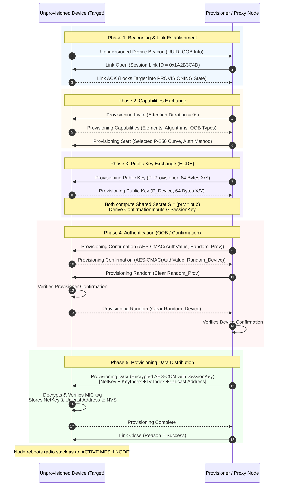

# TRD Page 1: Architectural Philosophy & System Overview

**Module:** `TRD-PROV-01`  
**Parent Document:** [TRD Index](./README.md)  
**Related Requirements:** [requirements.md](../requirements.md) (REQ-F01, REQ-NF01, REQ-NF02)  

---

## Table of Contents
- [1. Architectural Philosophy: The Zero-Bloat UVP Paradigm](#1-architectural-philosophy-the-zero-bloat-uvp-paradigm)
- [2. Separation of Concerns](#2-separation-of-concerns)
- [3. Standard Provisioning Procedure (5 Phases)](#3-standard-provisioning-procedure-5-phases)
  - [3.1 Phase Breakdown & Cryptographic Boundaries](#31-phase-breakdown--cryptographic-boundaries)

---

## 1. Architectural Philosophy: The Zero-Bloat UVP Paradigm

Rather than compiling bulky, proprietary, or standard SIG models (`RPR_SRV`, `RPR_CLI`, `CONFIG_CLIENT`, `PROVISIONER`) into the firmware, MeshX utilizes its **Unified Vendor Protocol (UVP)** to handle Remote Provisioning tunneling, 5-Minute Key Rotation, and Provisioner Redundancy.

```
                      ┌────────────────────────────────────────┐
                      │          Host MCU / Web Console        │
                      └───────────────────▲────────────────────┘
                                          │ MXCP Frames (UART / Serial)
                      ┌───────────────────▼────────────────────┐
                      │          MXCP Dispatch Engine          │
                      │             (meshx_mxcp.c)             │
                      └─────────┬────────────────────┬─────────┘
                                │                    │
              Control Path [0x0B..0x0F]     Data & Mgmt Path [0x30..0x3F]
                                │                    │
             ┌──────────────────▼──────┐   ┌─────────▼──────────────────┐
             │   Native Prov Server    │   │       UVP Dispatcher       │
             │   (Virgin Node Onboard) │   │  - Remote Prov Tunneling   │
             │   CONFIG_BLE_MESH_PROV  │   │  - 5-Min Key Rotation (KR) │
             │   (Only PB-ADV/PB-GATT) │   │  - Redundancy Sync Engine  │
             └─────────────────────────┘   └─────────┬──────────────────┘
                                                     │
             ┌───────────────────────────────────────▼──────────────────┐
             │       Standard ESP-IDF BLE Mesh Node Subsystem           │
             │    CONFIG_BLE_MESH_NODE=y (NO PROVISIONER / NO RPR)      │
             └──────────────────────────────────────────────────────────┘
```

---

## 2. Separation of Concerns

1. **Virgin Node Onboarding (Native Prov Server Only)**:
   - The local node utilizes the lightweight, mandatory `CONFIG_BLE_MESH_PROV=y` solely for initial network joining (receiving its primary NetKey, AppKey, and initial Unicast Address).
   - Once provisioned, native unprovisioned beaconing is permanently gated.

2. **Remote Provisioning via UVP Tunneling**:
   - Out-of-range unprovisioned device beacons are captured by standard mesh nodes via BLE advertisement scanning and tunneled across the mesh network as UVP Vendor Messages (`0xC0..0xC3`).
   - **Native RPR Client/Server stacks remain completely disabled (`CONFIG_BLE_MESH_RPR_*=n`)**.

3. **5-Minute Key Rotation via UVP Control Messages**:
   - Key Refresh (Phases 1, 2, and 3) is orchestrated using authenticated, encrypted UVP vendor frames (`0xC4..0xC6`).
   - Receiving nodes update keys locally via node-level key management APIs.
   - **Native Config Client / Provisioner stacks remain completely disabled (`CONFIG_BLE_MESH_CONFIG_CLIENT=n`)**.

4. **The Provisioner as Pure Cryptographic Trust Authority & Unified Allocator**:
   - In traditional architectures, the Provisioner is burdened with stateful remote PDU tunneling and coarse block slicing.
   - In MeshX, **address allocation is handled via JIT Dynamic Element Leases (`0xC8`/`0xCC`) from a Unified 15-Bit Address Space (`0x0002..0x7FFF`)** managed by a high-efficiency Paged Sparse 2-Bit Bitmap on the Master.
   - **Configurable Wavefront Engine ($K \in [0..\infty]$):** Default $K=0$ ($K=\infty$, Natural Spatial Clustering with 15s silence retirement) achieves minimum physical hop depth (1–2 hops) and ultra-low normal relay latency ($< 50\text{ ms}$), while bounded $K \ge 2$ forces multi-radio fanning for massive open halls.
   - **100% Local Proxy Crypto:** Proxies compute P-256 ECDH in ~35 ms on their local ESP32 hardware core, completely eliminating 128-byte public key tunneling over multi-hop mesh.
   - Consequently, the Provisioner's core responsibilities are:
     1. **Key Generation & 5-Minute Key Rotation:** Orchestrating Zero-ACK distribution (`0xC4`), switchover (`0xC5`), and revocation (`0xC6`) across Epochs.
     2. **Master DevKey Vault:** Persisting immutable `[UUID -> DevKey]` records in NVS (received via `0xC9`) to empower **Autonomous DevKey Re-Healing (`0xCE`/`0xCF`)**.
     3. **Atomic 3-State Address Locking:** Granting contiguous address blocks for multi-element nodes ($N_{elem} \in [1..255]$) with 30s watchdog rollback.
     4. **Host Gateway:** Surfacing security indications and topology discovery events to the Host MCU via MXCP.
   - **Unified Address Space:** Hard-partitioned address pools (`Pool A` and `Pool B`) are completely superseded; the network operates on a single, continuous, non-colliding address space (`0x0001..0x7FFF`).

---

## 3. Standard Provisioning Procedure (5 Phases)

Under both direct PB-ADV onboarding and UVP-tunneled proxy onboarding, the link-layer handshake adheres to the standard 5-phase procedure defined by the **Bluetooth Mesh Profile Specification (Section 5.4)**:



### 3.1 Phase Breakdown & Cryptographic Boundaries
1. **Phase 1: Beaconing & Single-Session Link Establishment:**
   - Target device advertises unprovisioned beacons (`UUID`, `OOB Info`).
   - Provisioner initiates `Link Open` with a 32-bit `Link ID`. The target locks into `PROVISIONING_ACTIVE`, ensuring competing provisioners receive `Bearer Busy`.
2. **Phase 2: Capabilities Exchange:**
   - Device declares element count, FIPS P-256 elliptic curve support, and OOB options (`Static`, `Output`, `Input`, or `None`).
3. **Phase 3: P-256 ECDH Public Key Exchange:**
   - Both peers swap 64-byte public keys and calculate the shared Diffie-Hellman secret $S = P_{priv} \times Q_{pub}$.
   - From $S$, both sides independently derive the **`SessionKey`** (for payload encryption) and **`DeviceKey` (DevKey)** (persisted in Provisioner NVS for future re-healing).
4. **Phase 4: Two-Way Confirmation Authentication:**
   - Prevents Man-in-the-Middle (MITM) attacks by generating and verifying mutual `AES-CMAC` confirmation hashes over random nonces and auth values.
5. **Phase 5: Secure Data Distribution:**
   - Provisioner transmits the **Network Key (`NetKey`)**, **Key Index**, **IV Index**, and **Assigned Unicast Address** (allocated via JIT Dynamic Element Lease `0xC8`/`0xCC` from the Master's Unified Address Space).
   - The payload is encrypted with `SessionKey` via **AES-CCM**.
   - Target decrypts, confirms the MIC tag, saves credentials to NVS, and transitions into a fully operational mesh node.
