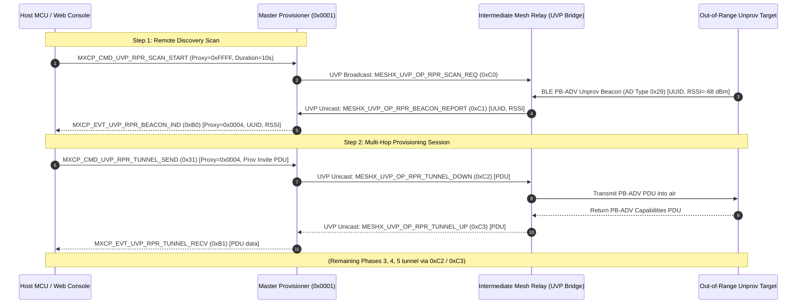

# TRD Page 3: UVP-Driven Remote Provisioning (RPR) Tunneling & Wavefront Architecture

**Module:** `TRD-PROV-03`
**Subsystem:** `meshx_prov_srv`, `meshx_uvp_dispatcher`, `meshx_mxcp`
**Opcodes Covered:** `MESHX_UVP_OP_RPR_SCAN_REQ` (`0xC0`), `MESHX_UVP_OP_RPR_BEACON_REPORT` (`0xC1`), `MESHX_UVP_OP_RPR_TUNNEL_DOWN` (`0xC2`), `MESHX_UVP_OP_RPR_TUNNEL_UP` (`0xC3`), `MESHX_UVP_OP_INFILL_LEASE_REQ` (`0xC8`), `MESHX_UVP_OP_FAST_PROV_REPORT` (`0xC9`), `MESHX_UVP_OP_INFILL_LEASE_RSP` (`0xCC`)
**MXCP Commands & Events:** `MXCP_CMD_UVP_RPR_SCAN_START` (`0x30`), `MXCP_CMD_UVP_RPR_TUNNEL_SEND` (`0x31`), `MXCP_CMD_UVP_FAST_PROV_START` (`0x34`), `MXCP_EVT_UVP_RPR_BEACON_IND` (`0xB0`), `MXCP_EVT_UVP_RPR_TUNNEL_RECV` (`0xB1`), `MXCP_EVT_UVP_FAST_PROV_PROGRESS` (`0xB4`)
**Parent Document:** [TRD Index](./README.md)
**Related Requirements:** [requirements.md](../requirements.md) (REQ-F04, REQ-F07) | [page8_fast_bulk_provisioning.md](./page8_fast_bulk_provisioning.md)

---

## Table of Contents
- [1. Remote Provisioning (RPR) Dual-Model Architecture](#1-remote-provisioning-rpr-dual-model-architecture)
- [2. Model A: Ad-Hoc Interactive Remote Provisioning (Transparent Tunneling)](#2-model-a-ad-hoc-interactive-remote-provisioning-transparent-tunneling)
- [3. Model B: Autonomous Fast Wavefront Provisioning (High-Density Bulk Engine)](#3-model-b-autonomous-fast-wavefront-provisioning-high-density-bulk-engine)
  - [3.1 Why PDU Tunneling Fails for Dense Bulk Deployments](#31-why-pdu-tunneling-fails-for-dense-bulk-deployments)
  - [3.2 The Wavefront Solution: Local Crypto with Pipelined JIT Leases](#32-the-wavefront-solution-local-crypto-with-pipelined-jit-leases)

---

## 1. Remote Provisioning (RPR) Dual-Model Architecture

Standard SIG Remote Provisioning requires heavy client and server models (`CONFIG_BLE_MESH_RPR_SRV` and `CONFIG_BLE_MESH_RPR_CLI`), inflating flash footprint by $>60\text{ KB}$ and complicating multi-hop mesh transport.

MeshX replaces standard SIG RPR with **lightweight, UVP-driven remote commissioning**, supporting two distinct operational models based on commissioning context:

```
+---------------------------------------------------------------------------------------------------------+
|                                    MESHX REMOTE PROVISIONING DUAL MODELS                                |
|                                                                                                         |
|  MODEL A: AD-HOC INTERACTIVE TUNNELING (Manual Single-Node Commissioning)                               |
|  - Use Case: Technician selects and inspects an out-of-range device via Web Console / Host MCU.         |
|  - Mechanics: Master drives provisioning; intermediate relay acts as a transparent RF bridge.           |
|  - Frames: 0xC0 (Scan Req), 0xC1 (Beacon Report), 0xC2 (Tunnel Down PDU), 0xC3 (Tunnel Up PDU).         |
|                                                                                                         |
|  MODEL B: AUTONOMOUS FAST WAVEFRONT COMMISSIONING (High-Density Bulk Grid)                              |
|  - Use Case: Automated greenfield deployment of 50-500+ commercial luminaires and multi-sensors.        |
|  - Mechanics: Bypasses PDU tunneling entirely. Proxies run 100% local crypto on ESP32 hardware core.    |
|  - Address Management: Pipelined JIT Dynamic Element Leases (0xC8 / 0xCC) from Master Unified Pool.     |
|  - Concurrency Control: Configurable K-Factor (K=0 uncapped natural clustering, or K>=2 bounded tree).  |
+---------------------------------------------------------------------------------------------------------+
```

---

## 2. Model A: Ad-Hoc Interactive Remote Provisioning (Transparent Tunneling)

In Model A, an intermediate mesh node acts as a transparent, zero-trust RF bridge:
1. **Unprovisioned Beacon Sniffing:** Intermediate node listens on BLE advertising channels 37, 38, and 39 for `AD Type 0x29` Unprovisioned Device Beacons and encapsulates the UUID and measured RSSI in a `MESHX_UVP_OP_RPR_BEACON_REPORT` (`0xC1`) unicast frame to the Master.
2. **Downward PDU Tunneling:** The Master/Host generates standard PB-ADV Provisioning PDUs (Invite, Public Key, Confirmation, Provisioning Data) and tunnels them to the relay via `MESHX_UVP_OP_RPR_TUNNEL_DOWN` (`0xC2`). The relay transmits the raw PDU over the local radio airwaves.
3. **Upward PDU Forwarding:** Responses from the target (Capabilities, Public Key, Confirmation, Complete) are encapsulated by the relay and returned to the Master via `MESHX_UVP_OP_RPR_TUNNEL_UP` (`0xC3`).



---

## 3. Model B: Autonomous Fast Wavefront Provisioning (High-Density Bulk Engine)

### 3.1 Why PDU Tunneling Fails for Dense Bulk Deployments
While Model A is well-suited for single ad-hoc replacements, tunneling individual PDUs across the mesh during 100-node bulk commissioning causes severe network failure:
* **Relay Congestion:** Tunneling 128-byte P-256 ECDH public keys over multi-hop mesh relays produces 10 to 12 frames per node, saturating mesh buffers.
* **Severe Latency:** Round-trips across a multi-hop mesh stretch single-node provisioning time to **$2.5\text{–}3.5\text{ seconds}$**, causing a 100-node venue to take **$15\text{ to }25\text{ minutes}$**.

### 3.2 The Wavefront Solution: Local Crypto with Pipelined JIT Leases
Model B eliminates multi-hop PDU tunneling entirely:
1. **100% Local Proxy Crypto:** Intermediate proxies compute P-256 ECDH (~35 ms) and derive SessionKeys locally on their ESP32 hardware accelerator. Zero public keys or confirmation nonces travel over the mesh.
2. **Pipelined Background Lease (`0xC8`/`0xCC`):** The proxy requests a contiguous address block for the target's declared element count ($N_{elem} \in [1..255]$) via `0xC8 INFILL_LEASE_REQ`. The request is masked during local Phase 3 and 4 radio airtime ($1.2\text{–}1.8\text{ s}$), delivering **zero perceived lease latency**.
3. **Configurable $K$-Factor:**
   * **`k_factor = 0` ($K = \infty$, Default):** Natural Spatial Clustering. Proxies onboard local line-of-sight devices until a 15-second quiet window ($T_{\text{quiet}}$) triggers retirement, yielding a network diameter of only **1 to 2 hops** and ultra-low normal relay latency (**$< 50\text{ ms}$**).
   * **`k_factor > 0` ($K = 2, 4$):** Bounded Wavefront. Proxies retire immediately after $K$ children, forcing multi-radio fanning across large open spaces (e.g., 64 fixtures in 18s).
4. **Post-Closure DevKey Vault (`0xC9`):** Upon link closure, the proxy forwards the derived `DevKey` to the Master via `0xC9 FAST_PROV_REPORT`, registering it in the Master's NVS Vault for **Autonomous Re-Healing (`0xCE`/`0xCF`)**.

```
Model Comparison:
  Model A (Ad-Hoc Tunneling):  10-12 Mesh Frames per Node  |  Central ECDH  |  ~3.0s per Node
  Model B (Fast Wavefront):    ONLY 2 Mesh Frames per Node |  Local Proxy   |  ~0.7s per Node (Parallel)
```

> [!IMPORTANT]
> For the comprehensive technical specification of Model B, including the Paged Sparse 2-Bit Bitmap, Inverse-RSSI Backoff delays, collision recovery sequences, and cross-platform NVS debounce, see **[page8_fast_bulk_provisioning.md](./page8_fast_bulk_provisioning.md)**.
