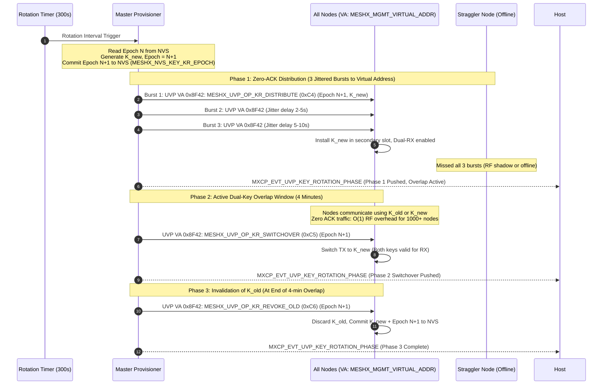
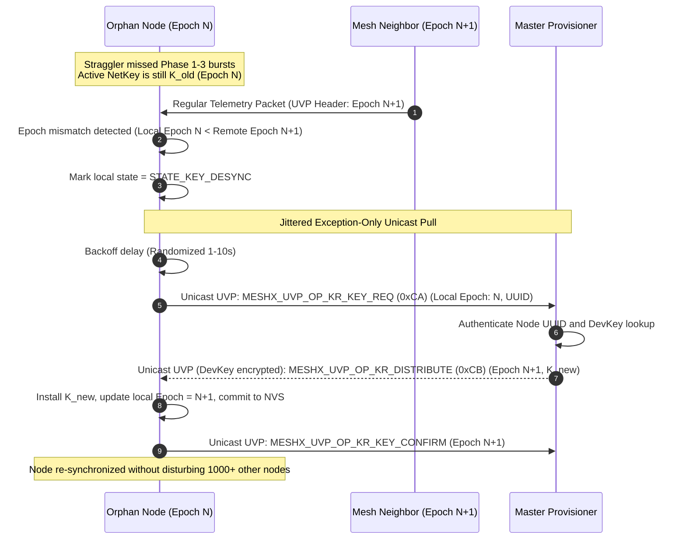

# TRD Page 4: 5-Minute Zero-ACK Key Rotation Engine

**Module:** `TRD-PROV-04`  
**Parent Document:** [TRD Index](./README.md)  
**Related Requirements:** [requirements.md](../requirements.md) (REQ-F05)  

---

## Table of Contents
- [1. Company Secret Virtual Addressing & Security Architecture](#1-company-secret-virtual-addressing--security-architecture)
  - [1.1 Virtual Address Policy & Product Profile Configuration](#11-virtual-address-policy--product-profile-configuration)
  - [1.2 Reverse-Engineering Threat Analysis & Cryptographic Defense-in-Depth](#12-reverse-engineering-threat-analysis--cryptographic-defense-in-depth)
- [2. Key Rotation Epoch Persistence & Reboot Resiliency](#2-key-rotation-epoch-persistence--reboot-resiliency)
- [3. Zero-ACK 3-Phase Key Rotation Sequence](#3-zero-ack-3-phase-key-rotation-sequence)
- [4. Orphan Node Recovery Sequence (Gossip Pull)](#4-orphan-node-recovery-sequence-gossip-pull)
- [5. Multi-Hop Relaying & Timeline Horizon Analysis](#5-multi-hop-relaying--timeline-horizon-analysis)
  - [5.1 Case A: Overlap Window Active ($\le 4$ Minutes, Delta Epoch = 1)](#51-case-a-overlap-window-active-le-4-minutes-delta-epoch--1)
  - [5.2 Case B: Overlap Window Expired ($> 4$ Minutes, Delta Epoch $\ge 2$)](#52-case-b-overlap-window-expired--4-minutes-delta-epoch-ge-2)
- [6. Blindness Detection & Zero-Trust Courier Model](#6-blindness-detection--zero-trust-courier-model)
  - [6.1 How the Orphan Detects it is $>4$ Minutes Behind](#61-how-the-orphan-detects-it-is-4-minutes-behind)
  - [6.2 Zero-Trust Blind Courier Forwarding](#62-zero-trust-blind-courier-forwarding)
- [7. RFC 1982 Modular Epoch Rollover Arithmetic](#7-rfc-1982-modular-epoch-rollover-arithmetic)

---

## 1. Company Secret Virtual Addressing & Security Architecture

### 1.1 Virtual Address Policy & Product Profile Configuration
Group address `0xC000` is a general-purpose application group address. Emitting network-wide security control frames over generic group addresses violates protocol isolation and risks collisions with application models. Control bursts MUST strictly use the **Virtual Address Policy** (`MESHX_MGMT_VIRTUAL_ADDR`, resolving to a dedicated address in the `0x8000..0xBFFF` virtual address range, hash-derived from the company's 128-bit Management Label UUID). All nodes auto-subscribe their UVP management endpoint to this virtual address during initialization.

#### Company Secret Configuration via `prod_profile.yml`
To ensure cross-product isolation and brand security, the management addressing parameters are configurable centrally in `prod_profile.yml` under the root `prod:` section. This secret is identical across all products within a company's product line:

```yaml
prod:
    cid: 0x7908
    # Company Secret Management Configuration (Shared across all products in product line)
    mgmt_uuid: "e6a2b840-7f24-4d89-915b-18a0a9ef8f42" # 128-bit Management Label UUID
    mgmt_virtual_addr: 0x8F42                          # 16-bit Virtual Address (0x8000..0xBFFF)
    products:
        - name: 4_relay_panel
          pid: 0x0001
          ...
```

#### Build Pipeline Generation (`code_gen.py`)
During the build process, `code_gen.py` parses `prod.mgmt_uuid` and `prod.mgmt_virtual_addr`:
1. If `mgmt_virtual_addr` is specified, it validates that `0x8000 <= mgmt_virtual_addr <= 0xBFFF`.
2. If `mgmt_virtual_addr` is omitted, it deterministically computes the virtual address using the Bluetooth Mesh standard hash derivation:
   $$\text{Virtual Address} = 0x8000 \mid \Big(\text{SHA256}(\text{"vtad"} \parallel \text{mgmt-uuid})[0..1] \ \& \ 0x3FFF\Big)$$
3. It generates compile-time macros into `meshx_config_internal.h`:
   ```c
   #define MESHX_MGMT_LABEL_UUID       { 0xE6, 0xA2, 0xB8, 0x40, 0x7F, 0x24, 0x4D, 0x89, 0x91, 0x5B, 0x18, 0xA0, 0xA9, 0xEF, 0x8F, 0x42 }
   #define MESHX_MGMT_VIRTUAL_ADDR     0x8F42
   ```

> [!IMPORTANT]
> **Root Element (Element 0) Subscription Exclusivity:**
> Per the authoritative Pairing Specification ([`.specs/autonomous-element-pairing/design.md`](../../autonomous-element-pairing/design.md)), the Company Management Virtual Address subscription is held **exclusively on Element 0 (the Primary Element)**. Secondary elements (Elements 1..N) host purely application models and must never ingest management frames. Furthermore, the OEM Company ID is defined globally in `prod_profile.yml` (`cid: 0x7908` in the active BSP profile; `0x02E5` was used as a reference example).

---

### 1.2 Reverse-Engineering Threat Analysis & Cryptographic Defense-in-Depth

#### The Attack Scenario
> **Threat Vector:** An attacker physically steals or purchases an edge node, connects hardware debugging probes or reads raw flash via external SPI readers, extracts firmware or the MXC configuration, and discovers the company secret `MESHX_MGMT_VIRTUAL_ADDR` (`0x8F42`) and `MESHX_MGMT_LABEL_UUID`.
>
> **Core Question:** Does the extraction of `MESHX_MGMT_VIRTUAL_ADDR` compromise the security of the deployed mesh network?

#### Protocol Reality: Addressing vs. Cryptographic Enforcement (Kerckhoffs's Principle)
1. **Over-The-Air (RF) Visibility**:
   In Bluetooth Mesh (and IEEE 802.15.1/802.15.4), destination addresses (including Virtual Addresses `0x8000..0xBFFF`) are transmitted in packet headers over the RF physical medium. Any adversary equipped with an inexpensive ($15) BLE sniffer (e.g., nRF52840 dongle running Wireshark) can capture broadcast frames and immediately observe destination address `0x8F42` in clear RF packets without touching physical hardware or dumping flash.
   - **Architectural Rule**: In accordance with Kerckhoffs's Principle, **a network address MUST NEVER be treated as an encryption secret or sole security perimeter**. `MESHX_MGMT_VIRTUAL_ADDR` functions as an **RF multicast grouping token and vendor hardware filter**, preventing cross-vendor cross-talk and minimizing CPU wakeups—not as an access-control key.

2. **Five-Tier Defense-in-Depth Perimeter**:
   Even if an attacker possesses the exact `MESHX_MGMT_VIRTUAL_ADDR`, the network is cryptographically immune to injection, spoofing, and eavesdropping through five independent defensive layers:

   | Layer | Security Mechanism | Failure Mode for Rogue Attacker |
   | :--- | :--- | :--- |
   | **Layer 1: Network Layer** | **AES-CCM NetKey Encryption & NetMIC** | Packets sent to `0x8F42` without the active `NetKey` fail Network Message Integrity Check (NetMIC). Hardware/stack drops the packet at Layer 3; zero application execution. |
   | **Layer 2: Transport Layer** | **AES-CCM AppKey / DevKey & TransMIC** | Key Rotation commands (`0xC4..0xC6`) require valid Application/Management Key authentication. Unauthenticated access PDUs cannot be decrypted. |
   | **Layer 3: Replay & Monotonicity** | **Replay Protection Cache + RFC 1982 Epoch Engine** | Replayed packets are dropped by the Bluetooth Mesh sequence cache. Forged epochs with $\Delta \le 0$ or $\Delta > 1000$ are instantly rejected by the modular drift checker. |
   | **Layer 4: Silicon Hardware Security** | **ESP32 Flash Encryption & Secure Boot V2** | In production units, flash is encrypted at rest via hardware AES-XTS-256 eFuse keys; JTAG/UART ROM download modes are permanently disabled (`DIS_PAD_JTAG`, `DIS_DOWNLOAD_MODE`). Raw flash dumps produce indecipherable ciphertext. |
   | **Layer 5: Active Node Eviction** | **Zero-ACK Key Rotation Blacklisting** | If a node is reported physically stolen, the Master Provisioner evicts its unicast address and triggers a 5-minute key rotation. Within 5 minutes, $K_{old}$ is permanently revoked network-wide, cutting off any credentials extracted from that node. |

---

## 2. Key Rotation Epoch Persistence & Reboot Resiliency

`Epoch` cannot remain solely in volatile RAM. A power cycle or watchdog reboot would reset `Epoch` to 0, corrupting monotonic progression and causing false desync loops:
1. **Persistent Epoch Storage**: The Master and all nodes persist `kr_epoch` (uint32_t) in dedicated NVS key (`MESHX_NVS_KEY_KR_EPOCH` / `kr_epoch`).
2. **Pre-Broadcast NVS Commit**: Master increments and flushes `kr_epoch = N + 1` to NVS *before* transmitting Burst 1. On reboot, Master reads `kr_epoch` directly from NVS and resumes monotonic advancement.
3. **Node NVS Commit**: When a node commits `K_new` in Phase 3, it writes the corresponding `kr_epoch` to NVS alongside the primary NetKey.
4. **Master Sudden Reboot Recovery**: If the Master reboots during an in-flight rotation, it inspects its persisted rotation stage. If Phase 1/2 was in progress, it re-reads its saved state and issues the switchover/revoke bursts with the persisted `Epoch N+1`, preventing any epoch rollback.

---

## 3. Zero-ACK 3-Phase Key Rotation Sequence



---

## 4. Orphan Node Recovery Sequence (Gossip Pull)

When an offline straggler boots during or shortly after a rotation cycle:



---

## 5. Multi-Hop Relaying & Timeline Horizon Analysis

A critical architectural distinction governs how an orphan communicates with an out-of-range Master:

### 5.1 Case A: Overlap Window Active ($\le 4$ Minutes, Delta Epoch = 1)
- **Mesh Relay Routing**: Intermediate relay nodes (`0x0002`, `0x0003`, etc.) are in **Dual-RX Mode**.
- Relays still hold $K_{old}$ in their secondary key slot.
- The orphan transmits `MESHX_UVP_OP_KR_KEY_REQ` (`0xCA`) to unicast destination `0x0001` (Master).
- Relays decrypt the Network Layer PDU using $K_{old}$, decrement TTL, re-encrypt, and flood it to the Master.
- The unicast pull succeeds over multiple hops because the cryptographic transport path is still open.

### 5.2 Case B: Overlap Window Expired ($> 4$ Minutes, Delta Epoch $\ge 2$)
- **Network Layer Cryptographic Wall**: Intermediate relays have executed Phase 3 (`0xC6`) and **wiped $K_{old}$ from memory and NVS**.
- Any standard packet encrypted with $K_{old}$ is immediately rejected by intermediate relays (MIC authentication failure).
- **Resolution**: The orphan cannot use managed flooding. It switches to **Proxy-Assisted DevKey Re-Healing (`0xCE` $\rightarrow$ `0xCF`)** detailed in [TRD Page 6](./page6_eviction_healing.md).

---

## 6. Blindness Detection & Zero-Trust Courier Model

### 6.1 How the Orphan Detects it is $>4$ Minutes Behind
Because embedded nodes lack battery-backed real-time clocks, detection is driven by passive observation:
1. **Plaintext Metadata Inspection**: UVP unencrypted transport headers carry `uint32_t epoch`. If an inbound packet is authenticated with $K_{old}$ and `packet_epoch >= local_epoch + 2`, the node knows $K_{old}$ is revoked.
2. **Cryptographic Blindness Fallback**: If the node powers on and sniffs ambient mesh traffic for **15 seconds** but **100% of packets fail MIC authentication** (or 3 consecutive `0xCA` pulls timeout), the node concludes it is blind and enters `PROV_STATE_ISOLATED_HEALING`.

### 6.2 Zero-Trust Blind Courier Forwarding
Neighbors sniffing `MESHX_UVP_OP_REHEAL_BEACON_REQ` (`0xCE`) **do not verify former membership** because they do not hold other nodes' DevKeys:
1. The neighbor acts purely as a transport courier: it encapsulates the raw `[UUID || Old_Addr || Nonce || HMAC-16]` into a standard UVP message and forwards it to Master `0x0001` using its **own active $K_{new}$**.
2. **Sole Judge (Master Provisioner)**: Master verifies the HMAC signature using its secure DevKey database.
3. **Neighbor DoS Protection**: Neighbor nodes apply a strict token bucket rate limiter: **max 1 forward per unique UUID every 30 seconds**.

---

## 7. RFC 1982 Modular Epoch Rollover Arithmetic

Even though `uint32_t` rotating every 5 minutes takes $\sim 40,850$ years to overflow, rollover can occur during bench tests, NVS fault injection, or corruption. Naive comparisons (`incoming > local + 1`) fail when `0xFFFFFFFF -> 0x00000001`.

MeshX enforces **RFC 1982 Modular Signed Distance**:

```c
/* Signed two's-complement distance modulo 2^32 */
int32_t delta = (int32_t)(incoming_epoch - local_epoch);
```

### Rollover Boundaries:
- `delta == 0`: In sync; no action.
- `delta == 1`: Standard next epoch (Overlap Active).
- `2 <= delta <= MESHX_KR_MAX_FORWARD_DRIFT` (`1000`): Legitimate forward advance across rollover (e.g. `0xFFFFFFFF -> 0x00000002` yields `delta = +3`). Triggers recovery pull or re-healing.
- `delta < 0` or `delta > 1000`: Stale replay or wild out-of-bounds jump $\rightarrow$ **Dropped immediately**.
- **Reserved Epoch**: `Epoch = 0` is strictly reserved as an "Uninitialized / Erased" sentinel. On rollover from `0xFFFFFFFF`, the counter advances directly to `1`.

