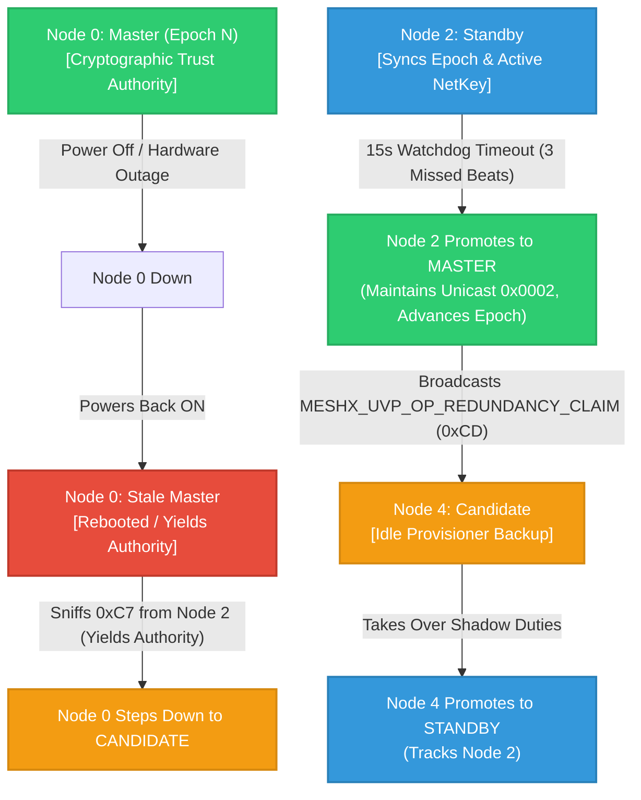
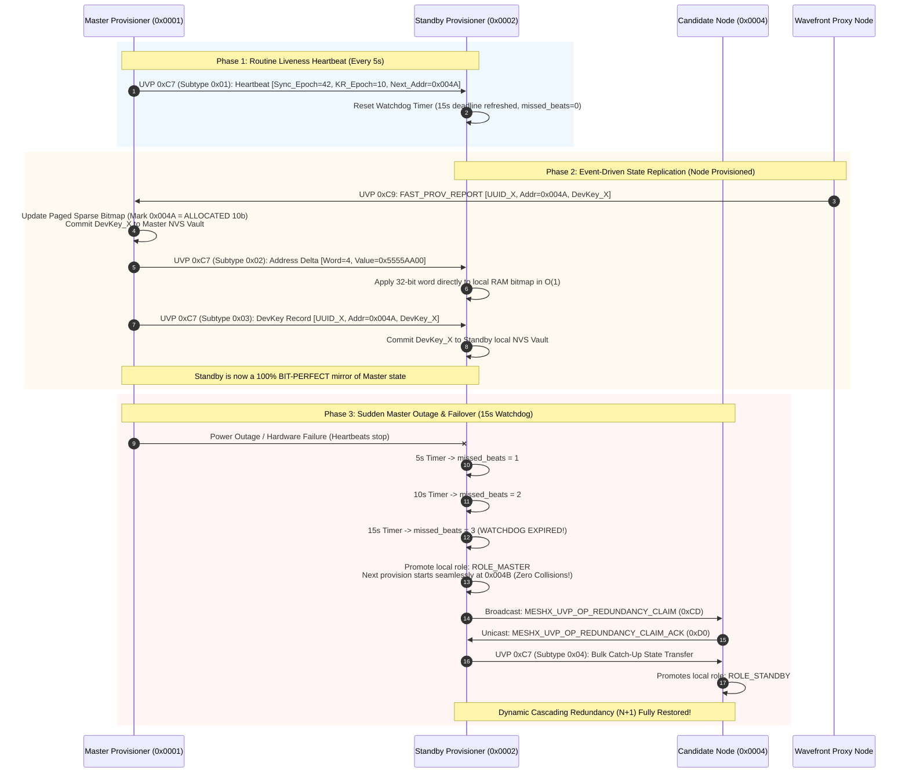
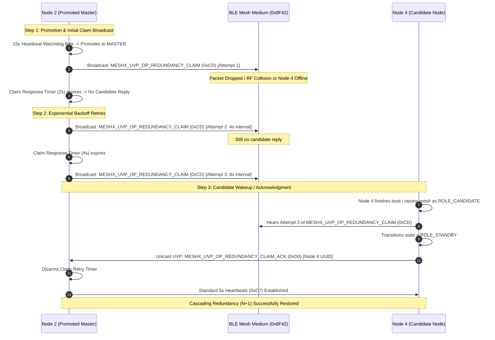
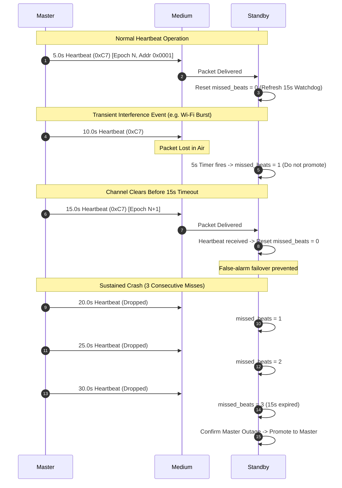
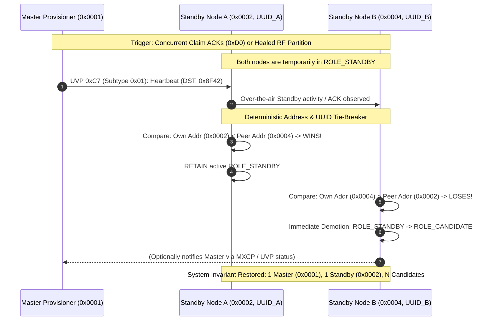
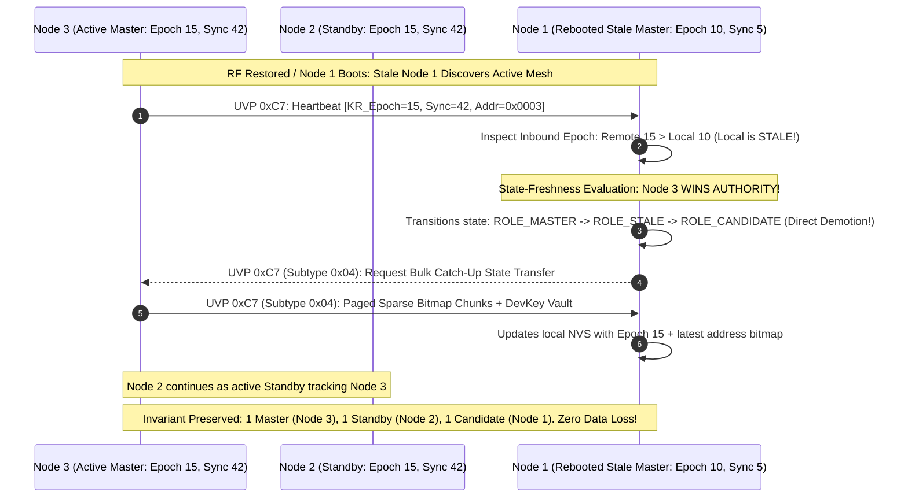
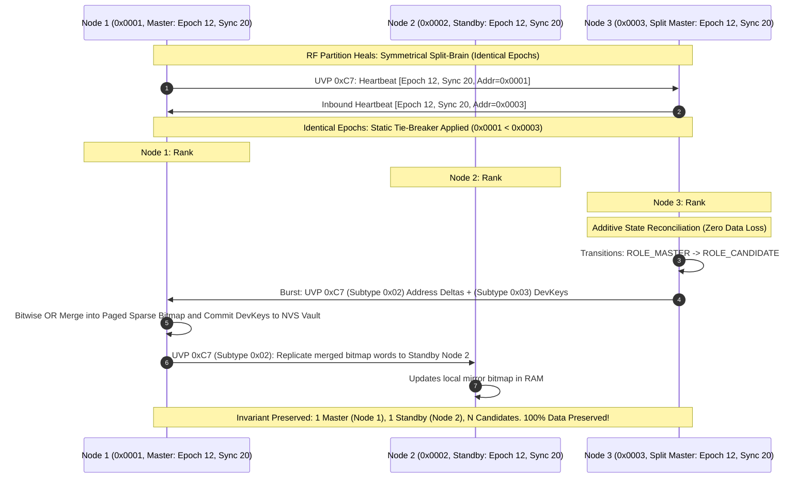

# TRD Page 5: Cascading Redundancy & Redundancy Claim

**Module:** `TRD-PROV-05`
**Parent Document:** [TRD Index](./README.md)
**Related Requirements:** [requirements.md](../requirements.md) (REQ-F06, REQ-F08)

---

## Table of Contents
- [1. Dynamic Cascading Redundancy ($N+1$)](#1-dynamic-cascading-redundancy-n1)
- [2. State Machine Roles & Unified Address Space](#2-state-machine-roles--unified-address-space)
- [3. Master $\leftrightarrow$ Standby State Synchronization Engine](#3-master-leftrightarrow-standby-state-synchronization-engine)
  - [3.1 Three Synchronization Domains](#31-three-synchronization-domains)
  - [3.2 Wire Protocol Layouts (MESHX_UVP_OP_REDUNDANCY_SYNC = 0xC7)](#32-wire-protocol-layouts-meshx_uvp_op_redundancy_sync--0xc7)
  - [3.3 End-to-End Synchronization Sequence](#33-end-to-end-synchronization-sequence)
- [4. Failure Scenarios & Mitigation Sequences](#4-failure-scenarios--mitigation-sequences)
  - [4.1 Scenario A: Standby Claim Broadcast (0xCD) Lost or No Candidate Responds](#41-scenario-a-standby-claim-broadcast-0xcd-lost-or-no-candidate-responds)
  - [4.2 Scenario B: Transient RF Blackout / Intermittent Heartbeat (0xC7) Loss](#42-scenario-b-transient-rf-blackout--intermittent-heartbeat-0xc7-loss)
  - [4.3 Scenario C: Dual Master Split-Brain Recovery & Bitmap Reconciliation](#43-scenario-c-dual-master-split-brain-recovery--bitmap-reconciliation)
  - [4.4 Scenario D: Dual Standby Collision & Deterministic Demotion to Candidate](#44-scenario-d-dual-standby-collision--deterministic-demotion-to-candidate)
  - [4.5 Scenario E: 3-Way Cascading Collision (Dual Master + Existing Standby) & Total Rank Convergence](#45-scenario-e-3-way-cascading-collision-dual-master--existing-standby--total-rank-convergence)

---

## 1. Dynamic Cascading Redundancy ($N+1$)

To prevent single-point-of-failure vulnerabilities when the primary Standby is promoted to Master, the system implements dynamic multi-tiered provisioner cascading:



---

## 2. State Machine Roles & Unified Address Space

Under the Master's Unified Address Space managed via the Paged Sparse 2-Bit Bitmap and JIT Dynamic Element Leasing (`0xC8`/`0xCC`), address collision between concurrent proxies is mathematically eliminated ($0.00\%$). Therefore, **artificial dual pools (`Pool A` and `Pool B`) are completely obsolete**. All nodes exist within the **unified continuous 15-bit address space (`0x0001..0x7FFF`)**.

To ensure seamless failover without state loss, the Provisioner state replicated between Master and Standby comprises:
$$\text{Replicated Provisioner State} = \{\text{Cryptographic KR State}, \ \text{Unified Address Allocation Bitmap}, \ \text{Master DevKey Vault}\}$$

| Role Identifier | Value | Primary Behavior |
|---|---|---|
| `MESHX_PROV_ROLE_NONE` | `0` | Standard non-provisioner node. |
| `MESHX_PROV_ROLE_MASTER` | `1` | Authoritative cryptographic root, emits 5s heartbeats (`0xC7`), orchestrates 5-minute key rotation, leases addresses via JIT dynamic element engine. |
| `MESHX_PROV_ROLE_STANDBY` | `2` | Active shadow backup: maintains mirrored Paged Sparse Bitmap and DevKey Vault via `0xC7` delta sync; promotes on 15s watchdog timeout (3 missed beats). **Dual-Standby Tie-Breaker:** Lower address/UUID retains Standby; higher address immediately demotes to `CANDIDATE`. |
| `MESHX_PROV_ROLE_CANDIDATE` | `3` | Standby-eligible backup node. Absorbs demoted redundant Standbys. Listens for `MESHX_UVP_OP_REDUNDANCY_CLAIM` (`0xCD`) to promote to Standby ($N+1$). |
| `MESHX_PROV_ROLE_STALE` | `4` | Recovered previous Master. Yields authority upon receiving heartbeat from active Master and demotes to Candidate. |

---

## 3. Master $\leftrightarrow$ Standby State Synchronization Engine

The Master and Standby provisioners maintain continuous real-time synchronization across three critical architectural domains using the `MESHX_UVP_OP_REDUNDANCY_SYNC` (`0xC7`) vendor protocol family:

### 3.1 Three Synchronization Domains

1. **Domain 1: Cryptographic Key Rotation State**
   - **Active Key & Epoch:** Current Key Rotation Epoch $N$, Active Primary NetKey ID, and Secondary Overlap NetKey ID.
   - **Phase Tracking:** Key rotation stage (`PHASE_IDLE`, `PHASE_DISTRIBUTE`, `PHASE_SWITCHOVER`, `PHASE_REVOKE`).
   - **Zero-Lag Advantage:** Because the Standby is an active mesh node subscribed to `MESHX_MGMT_VIRTUAL_ADDR` (`0x8F42`), it receives Key Rotation Phase 1 (`0xC4`), Phase 2 (`0xC5`), and Phase 3 (`0xC6`) bursts over the air concurrently with the rest of the mesh. The 5-second `0xC7` heartbeat serves as a sanity check and monotonic sequence barrier.

2. **Domain 2: Unified Address Allocation Bitmap (Paged Sparse 2-Bit Bitmap)**
   - **High-Water Mark Horizon:** Master advertises `next_free_addr` in every 5-second heartbeat, giving the Standby an immediate monotonic allocation baseline.
   - **Incremental Word Delta Sync (6 Bytes):** Whenever Master commits a dynamic element lease (from an incoming `0xC9 FAST_PROV_REPORT`), it immediately transmits an incremental delta packet carrying `[word_index (2B) | word_value (4B)]`. Standby writes the 32-bit word directly to its local RAM bitmap in $O(1)$ constant time.
   - **Zero-Collision Guarantee:** Because Standby mirrors the Master's exact bitmap, if Master experiences sudden power failure, the promoted Standby continues allocating strictly from the true next available slots ($Addr_{\text{new}} \ge \text{Next-Free-Addr}$), eliminating address overlap ($0.00\%$ collision rate).

3. **Domain 3: Master DevKey Vault Replication**
   - **Permanent Identity Records:** To support **Autonomous Re-Healing (`0xCE`/`0xCF`)**, the Master maintains persistent `[UUID -> DevKey]` records in NVS.
   - **Event-Driven Vault Mirroring:** When the Master receives `0xC9 FAST_PROV_REPORT` containing a newly provisioned child's `DevKey`, it replicates the 34-byte vault entry `[UUID (16B) | Addr (2B) | DevKey (16B)]` to the Standby over UVP. Standby commits it to local NVS (`MESHX_NVS_KEY_DEVKEY_PREFIX`). If Master dies, the Standby can re-admit and re-heal any node in the network without lost credentials.

---

### 3.2 Wire Protocol Layouts (`MESHX_UVP_OP_REDUNDANCY_SYNC = 0xC7`)

The `0xC7` opcode carries a 1-byte `subtype` header to multiplex routine heartbeats, event-driven bitmap deltas, and vault replication:

#### Subtype 0x01: Periodic Heartbeat & Liveness Token (Every 5 Seconds)
```
[ Opcode 0xC7 (1B) | Subtype 0x01 (1B) | Sync_Epoch (4B) | Master_Addr (2B) | KR_Epoch (4B) | Next_Free_Addr (2B) | Active_NetKey_ID (2B) ]
Total: 16 Bytes
```
- Transmitted every 5.0 seconds from Master to Standby unicast address (or `MESHX_MGMT_VIRTUAL_ADDR`).
- Resets the Standby's 15-second failover watchdog timer (`s_redundancy_missed_beats = 0`).

#### Subtype 0x02: Incremental Address Delta Sync (Event-Driven upon Node Enrollment)
```
[ Opcode 0xC7 (1B) | Subtype 0x02 (1B) | Word_Index (2B) | Word_Value (4B) ]
Total: 8 Bytes (6 Bytes payload)
```
- Transmitted by Master immediately after committing an address block in the sparse bitmap.
- `word_index`: Sparse bitmap word index ($0..2047$).
- `word_value`: Updated 32-bit 2-bit state representation of the 16 corresponding unicast addresses.

#### Subtype 0x03: DevKey Vault Replication Record (Event-Driven upon 0xC9 Post-Closure)
```
[ Opcode 0xC7 (1B) | Subtype 0x03 (1B) | Node_UUID (16B) | Allocated_Addr (2B) | DevKey (16B) ]
Total: 36 Bytes (34 Bytes payload)
```
- Replicates new device credentials into Standby NVS storage for future re-healing authentication.

#### Subtype 0x04: Bulk Catch-Up State Transfer (On Candidate Promotion / Post-Reboot)
```
[ Opcode 0xC7 (1B) | Subtype 0x04 (1B) | Chunk_Index (1B) | Active_Chunks_Mask (32B) | Chunk_Data (32B) ]
Total: 67 Bytes
```
- Used only during initial pairing of a new Standby candidate to bulk-transfer active bitmap pages without transmitting empty address space.

#### Standby Claim Wire Protocol Layout (`MESHX_UVP_OP_REDUNDANCY_CLAIM = 0xCD`)
```
[ Opcode 0xCD (1B) | Claim_Epoch (4B) | Master_Addr (2B) | Next_Free_Addr (2B) | Reserved (2B) ]
Total: 11 Bytes (10 Bytes payload)
```
- `claim_epoch`: Master claim epoch counter.
- `master_addr`: Promoted Master primary unicast address.
- `next_free_addr`: Monotonic allocation high-water mark across unified address space (`0x0002..0x7FFF`).
- `reserved`: 2-byte alignment padding.

#### Standby Claim Acknowledgment Layout (`MESHX_UVP_OP_REDUNDANCY_CLAIM_ACK = 0xD0`)
```
[ Opcode 0xD0 (1B) | Candidate_UUID (16B) | Candidate_Addr (2B) ]
Total: 19 Bytes (18 Bytes payload)
```
- Transmitted unicast to Master by accepting candidate node to confirm promotion to Standby role.

---

### 3.3 End-to-End Synchronization Sequence



---

## 4. Failure Scenarios & Mitigation Sequences

### 4.1 Scenario A: Standby Claim Broadcast (`0xCD`) Lost or No Candidate Responds



### 4.2 Scenario B: Transient RF Blackout / Intermittent Heartbeat (`0xC7`) Loss



---

### 4.3 Scenario C: Dual Master Split-Brain Recovery & State Reconciliation

If a prolonged, localized RF partition isolates the Standby from Master heartbeats, the Standby promotion timer will fire, creating a temporary dual-Master state:

#### Multi-Tier Master Authority Hierarchy (State Freshness First)
When the RF partition heals and both provisioners receive inbound `0xC7` heartbeats from each other, authority is NOT decided by static address alone. To prevent a stale rebooted node from overwriting newer provisioning data, provisioners evaluate the **State Freshness Vector**:

$$\mathbf{Authority\ Vector} = \Big(\mathbf{kr\text{-}epoch}, \ \mathbf{sync\text{-}epoch}, \ \mathbf{next\text{-}free\text{-}addr}, \ -\text{Addr}, \ -\text{UUID}\Big)$$

1. **Tier 1: Key Rotation Epoch (`kr_epoch` - Highest Wins):**
   - The provisioner with the strictly higher Key Rotation Epoch has advanced the cryptographic network state further ($N_{active} > N_{stale}$).
   - If Node 3 has `kr_epoch = 15` and rebooted Node 1 has `kr_epoch = 10`, **Node 3 wins unconditionally**. Stale Node 1 instantly steps down to `ROLE_STALE` / `ROLE_CANDIDATE`.
2. **Tier 2: Sync Epoch & Allocation Horizon (`sync_epoch` / `next_free_addr` - Freshest Wins):**
   - If both nodes share the identical Key Rotation Epoch (`kr_epoch_A == kr_epoch_B`), the node with the higher `sync_epoch` or higher `next_free_addr` has processed more enrollments and holds the fresher database. That node retains `ROLE_MASTER`.
3. **Tier 3: Deterministic Static Tie-Breaker (`min(Addr, UUID)`):**
   - **Only if all epochs, sync counters, and allocation horizons are completely identical** (symmetric split-brain where neither advanced ahead) does the lower Unicast Address / Device UUID break the tie.
4. **Tier 4: Additive Bitwise Reconciliation (Zero Data Loss Guarantee):**
   - Regardless of who demotes, the losing provisioner **never deletes or drops its provisioning records**.
   - The demoting node transmits an immediate burst of `Subtype 0x02` address delta packets and `Subtype 0x03` DevKey vault records for any nodes it provisioned during the split.
   - The authoritative Master executes an **additive bitwise union (`OR`)** into its Paged Sparse Bitmap and commits new DevKeys to NVS. No newly provisioned device is ever lost, orphaned, or leaked.

---

### 4.4 Scenario D: Dual Standby Collision & Deterministic Demotion to Candidate

To maintain the architectural invariant of **strictly 1 Master and 1 Standby**, any condition where multiple provisioner-capable nodes believe they are simultaneously in `ROLE_STANDBY` is deterministically resolved using the exact same address/UUID tie-breaker:



#### Tie-Breaker Rules:
1. **Unicast Address Comparison:**
   $$\text{Winner} = \min(\text{Standby}_A.\text{Addr}, \ \text{Standby}_B.\text{Addr})$$
   The node with the numerically lower unicast address retains `ROLE_STANDBY`.
2. **Device UUID Fallback:**
   If addresses are unassigned or identical (e.g., during virgin onboarding arbitration), the lexicographically lower 128-bit Device UUID breaks the tie.
3. **Graceful Demotion to Candidate:**
   The losing Standby does not disconnect from the mesh or wipe its keys; it transitions smoothly to `ROLE_CANDIDATE`. It stops responding to Standby duties, disarms its heartbeat failover watchdog, and waits in the candidate pool for future `0xCD REDUNDANCY_CLAIM` broadcasts if the active Standby promotes or drops offline.

---

### 4.5 Scenario E: 3-Way Cascading Collision (Dual Master + Existing Standby) & State-Freshness Convergence

#### The Multi-Provisioner Conflict Scenario
During an extended network partition or concurrent healing event, a complex 3-way multi-provisioner state may emerge:
- **Partition A:** Primary Master (`0x0001`) and its active Standby (`0x0002`).
- **Partition B:** Isolated node promoted to Master (`0x0003`) after 3 missed beats and operated the network.

When the RF partition heals, three nodes simultaneously claim elevated provisioner roles:
1. `Node 1` (`0x0001`): `ROLE_MASTER`
2. `Node 2` (`0x0002`): `ROLE_STANDBY`
3. `Node 3` (`0x0003`): `ROLE_MASTER`

> [!IMPORTANT]
> **The Stale Master Trap:** If authority were decided purely by static address (`min(Addr)`), a rebooted Node 1 (`0x0001`) with **stale offline data** would force an active Node 3 (`0x0003`) to demote. This would overwrite or drop recent Key Rotations, DevKeys, and node enrollments committed by Node 3!
>
> Therefore, MeshX enforces **State Freshness First**: the node with the most advanced cryptographic and provisioning generation ALWAYS takes precedence over static unicast address!

---

#### The State-Freshness Provisioner Authority Hierarchy
When any provisioner observes a role conflict, authority is evaluated using the lexicographical **State Freshness Vector**:
$$\mathbf{Authority\ Vector} = \Big(\mathbf{kr\text{-}epoch}, \ \mathbf{sync\text{-}epoch}, \ \mathbf{next\text{-}free\text{-}addr}, \ -\text{Addr}, \ -\text{UUID}\Big)$$

$$\begin{aligned}
\text{Rank \#1 (Freshest State)} &\implies \mathbf{ROLE\text{-}MASTER} \\
\text{Rank \#2 (Second Freshest / Lowest Peer)} &\implies \mathbf{ROLE\text{-}STANDBY} \\
\text{Rank \#3..N (Stale / Remaining Peers)} &\implies \mathbf{ROLE\text{-}CANDIDATE}
\end{aligned}$$

---

#### Case 1: Node 3 is the Active Master with Fresher State (Node 1 is Stale / Rebooted)
- **Condition:** Node 1 rebooted from a crash (`kr_epoch = 10, sync_epoch = 5`). Node 3 actively provisioned new devices during the outage (`kr_epoch = 15, sync_epoch = 42`).
- **Arbitration:** Node 3 has higher `kr_epoch` ($15 > 10$). **Node 3 WINS and RETAINS `ROLE_MASTER`!**
- **Action for Node 1:** Node 1 detects `kr_epoch_remote > kr_epoch_local`, marks itself **`ROLE_STALE`**, yields authority immediately, and **demotes directly to `ROLE_CANDIDATE`** (bypassing Standby). Node 1 requests a full catch-up sync (`Subtype 0x04`) from Node 3.
- **Action for Node 2:** Node 2 recognizes Node 3 as authoritative and continues as `ROLE_STANDBY` tracking Node 3.
- **Data Preservation:** **100% of Node 3's new nodes, DevKeys, and Key Rotation epochs remain active and intact.**



---

#### Case 2: Symmetrical Split-Brain (Both Nodes Have Equal Freshness)
- **Condition:** Both partitions experienced identical Key Rotation epochs (`kr_epoch_1 == kr_epoch_3`).
- **Arbitration:** Tie-breaker falls back to static address: $0x0001 < 0x0003$. Node 1 retains `ROLE_MASTER`; Node 3 cascades to `ROLE_CANDIDATE`.
- **Additive Bitwise Union (`OR` Merge):**
  1. Node 3 flushes its provisional lease log to Node 1 via `Subtype 0x02` (Address Deltas) and `Subtype 0x03` (DevKeys).
  2. Node 1 performs a **bitwise `OR` union** into its Paged Sparse Bitmap, incorporating all nodes provisioned by Node 3.
  3. Node 1 replicates the merged bitmap deltas to Node 2 (`ROLE_STANDBY`).
  4. **Result:** No addresses are orphaned or leaked; all newly enrolled devices remain fully authenticated and operational.


