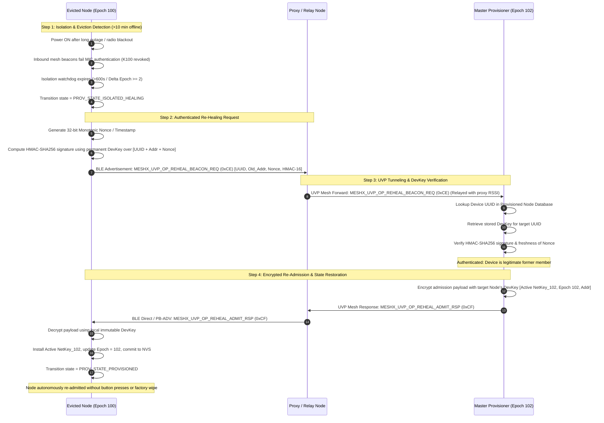
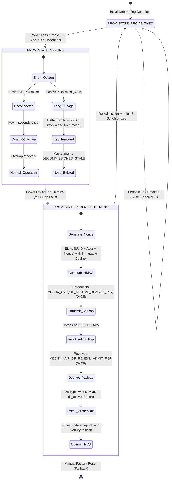

# TRD Page 6: Long-Term Inactivity Eviction & DevKey Re-Healing

**Module:** `TRD-PROV-06`  
**Parent Document:** [TRD Index](./README.md)  
**Related Requirements:** [requirements.md](../requirements.md) (REQ-F09)  

---

## Table of Contents
- [1. Eviction Horizon (>10 Minutes Inactivity)](#1-eviction-horizon-10-minutes-inactivity)
- [2. Re-Healing Protocol Sequence](#2-re-healing-protocol-sequence)
- [3. Node Lifecycle State Machine](#3-node-lifecycle-state-machine)
- [4. Re-Healing Payload Wire Layouts](#4-re-healing-payload-wire-layouts)
  - [Request Payload (MESHX_UVP_OP_REHEAL_BEACON_REQ = 0xCE)](#request-payload-meshx_uvp_op_reheal_beacon_req--0xce)
  - [Response Payload (MESHX_UVP_OP_REHEAL_ADMIT_RSP = 0xCF)](#response-payload-meshx_uvp_op_reheal_admit_rsp--0xcf)

---

## 1. Eviction Horizon (>10 Minutes Inactivity)

When a node remains offline for $>10\text{ minutes}$ across multiple Key Rotation cycles, it falls outside the active Dual-RX overlap window ($\Delta\text{Epoch} \ge 2$). Inbound mesh beacons fail MIC authentication because the old NetKey has been purged from the network.

---

## 2. Re-Healing Protocol Sequence

---

## 3. Node Lifecycle State Machine

---

## 4. Re-Healing Payload Wire Layouts

### Request Payload (`MESHX_UVP_OP_REHEAL_BEACON_REQ = 0xCE`)
- `target_uuid[16]`: 16-byte Device UUID.
- `previous_addr[2]`: Last assigned 16-bit unicast address.
- `timestamp_nonce[4]`: 32-bit monotonic timestamp / nonce to prevent replay attacks.
- `hmac_signature[16]`: HMAC-SHA256 truncated to 16 bytes computed with the node's permanent `DevKey` over `[target_uuid || previous_addr || timestamp_nonce]`.

### Response Payload (`MESHX_UVP_OP_REHEAL_ADMIT_RSP = 0xCF`)
- Encrypted with target node's `DevKey`.
- `active_netkey[16]`: Current active NetKey.
- `active_epoch[4]`: Current active epoch.
- `assigned_addr[2]`: Restored or newly allocated unicast address.
