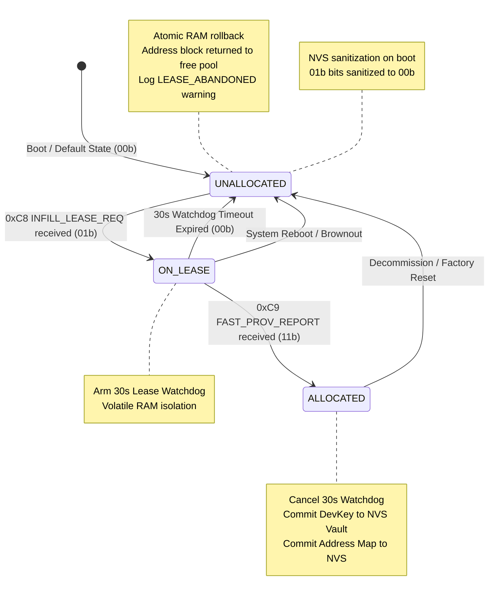
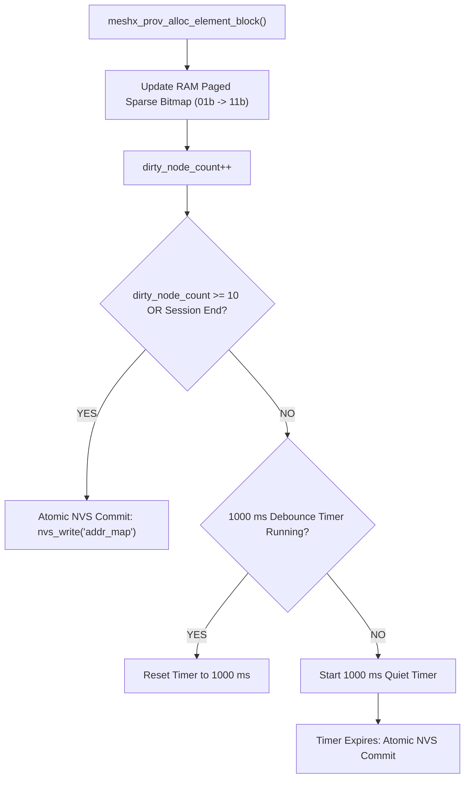
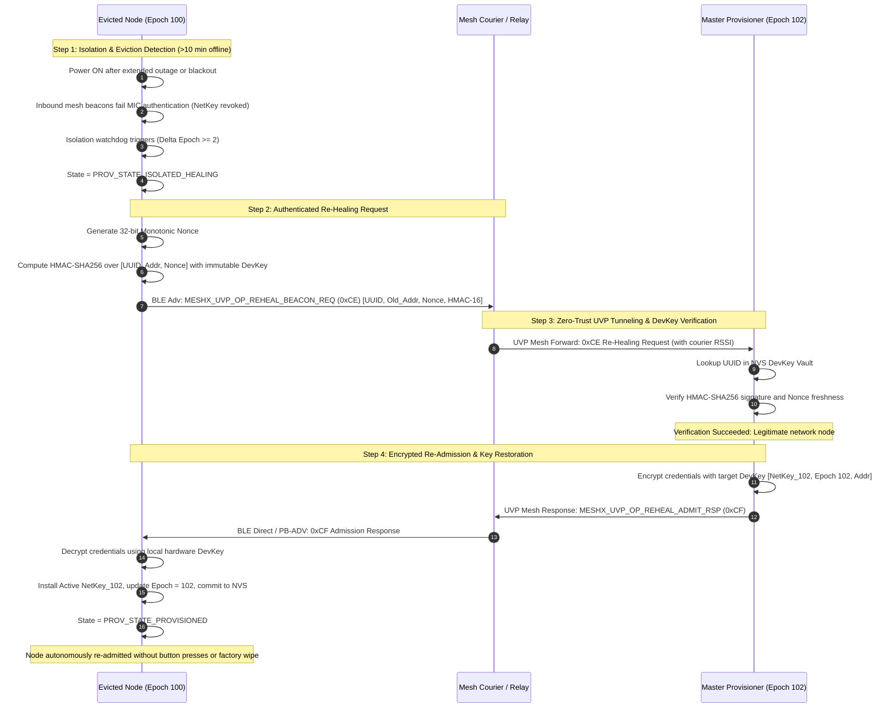

# TRD Page 7: Failure Modes, Resilience & Memory Impact

**Module:** `TRD-PROV-07`  
**Parent Document:** [TRD Index](./README.md)  
**Related Requirements:** [requirements.md](../requirements.md) (REQ-NF01, REQ-NF02, REQ-NF03, REQ-F09, REQ-F10)  

---

## Table of Contents
- [1. Resilience, Failure Modes & Mitigation Matrix](#1-resilience-failure-modes--mitigation-matrix)
- [2. Deep Dive into Critical Failure Mitigations & State Recovery](#2-deep-dive-into-critical-failure-mitigations--state-recovery)
  - [2.1 State Freshness Vector Arbitration & Additive Bitwise Union (Vectors 4 & 5)](#21-state-freshness-vector-arbitration--additive-bitwise-union-vectors-4--5)
  - [2.2 Saturated Proxy In-Flight Lease Rollback Lifecycle (Vector 6)](#22-saturated-proxy-in-flight-lease-rollback-lifecycle-vector-6)
  - [2.3 Multi-Proxy PB-ADV Contention Avoidance (Vector 7)](#23-multi-proxy-pb-adv-contention-avoidance-vector-7)
  - [2.4 Flash Endurance Wearout Mitigation: OS-Agnostic NVS Debounce Layer (Vector 8)](#24-flash-endurance-wearout-mitigation-os-agnostic-nvs-debounce-layer-vector-8)
  - [2.5 Autonomous DevKey Re-Healing Protocol Flow (Vector 11)](#25-autonomous-devkey-re-healing-protocol-flow-vector-11)
- [3. Memory, Footprint & Flash Impact Analysis (Zero-Bloat Comparison)](#3-memory-footprint--flash-impact-analysis-zero-bloat-comparison)
  - [3.1 Flash & RAM Scaling Delta](#31-flash--ram-scaling-delta)
  - [3.2 Concrete Data Structure Definitions & Byte Alignment](#32-concrete-data-structure-definitions--byte-alignment)
  - [3.3 Dynamic vs Static RAM Scaling across Network Sizes](#33-dynamic-vs-static-ram-scaling-across-network-sizes)
  - [3.4 Flash Application Partition Budget & Free Headroom Analysis](#34-flash-application-partition-budget--free-headroom-analysis)
- [4. Cross-References & Verification Requirements](#4-cross-references--verification-requirements)

---

## 1. Resilience, Failure Modes & Mitigation Matrix

| # | Failure Mode / Vector | Triggering Scenario | Potential System Impact | Concrete Architectural Mitigation | Watchdog / Recovery Threshold |
|---|---|---|---|---|---|
| **1** | **OOB Auth Deadlock** | Host MCU / Web Console fails to respond with `MXCP_CMD_PROV_AUTH_INPUT` during input OOB authentication. | Node state machine hangs indefinitely in `WAIT_INPUT`; radio is tied up and new provisioning is blocked. | **Dedicated OOB Input Watchdog**: Arm a 30s timer on emitting `MXCP_EVT_PROV_AUTH_REQ`. If no input arrives, node calls `esp_ble_mesh_node_prov_disable()`, emits `MXCP_EVT_PROV_FAILED(REASON_TIMEOUT)`, and resets state machine. | **30 seconds** |
| **2** | **Abrupt Link Teardown & Pre-Reset Dismantle** | Remote provisioner drops PB-ADV link midway through key exchange; OR node initiates factory reset (`MXCP_CMD_NODE_RESET`) without unpairing peers. | Node retains half-negotiated session state in RAM; OR paired peers left with dangling orphan links causing retry storms and high UI latency. | **Clean Abort & Mandatory 4-Stage Pre-Reset Teardown Handshake**: 1) On PB-ADV drop: wipe ephemeral keys, reset beaconing, emit `MXCP_EVT_PROV_LINK_CLOSE`. 2) On factory reset / decommission: execute `meshx_unpair_pre_reset_teardown()` per [06_lifecycle_unpairing_teardown.md](../../autonomous-element-pairing/design/06_lifecycle_unpairing_teardown.md) (send targeted unpair requests, broadcast `MESHX_SYS_NOTIFY_NODE_RESET` (0x09) to `MESHX_MGMT_VIRTUAL_ADDR`, enforce a 500 ms drain window, and erase local link table before resetting MCU). | **Immediate upon link drop / 500 ms drain window** |
| **3** | **Double-Provisioning Collision** | Host sends `MXCP_CMD_PROV_ENABLE` or rogue provisioner connects to an already-provisioned node. | `esp_ble_mesh_node_prov_enable()` triggers `ESP_ERR_INVALID_STATE` or corrupts active NVS identity keys. | **Pre-State Guard in MXCP Handler**: `mxcp_cmd_fn_prov_enable` checks `meshx_is_node_provisioned()`. If already provisioned, immediately replies with `MXCP_EVT_PROV_STATE_IND(PROVISIONED)` and rejects the call. | **Immediate rejection** |
| **4** | **Dual Master Split-Brain & Stale Master Trap** | Transient RF blackout causes Standby to promote while Master is alive; OR a stale, rebooted Master boots with old data. | Two active Masters provisioning simultaneously; stale Master overwriting newer epochs and leases. | **State Freshness Vector Hierarchy**: Authority evaluated as $(\mathbf{kr\text{-}epoch}, \mathbf{sync\text{-}epoch}, \mathbf{next\text{-}free\text{-}addr}, -\text{Addr}, -\text{UUID})$. Higher epoch wins unconditionally; stale node demotes to `ROLE_CANDIDATE`; losing node flushes address deltas via `Subtype 0x02` for **additive bitwise `OR` union** (0% data loss). | **Immediate upon `0xC7` reception** |
| **5** | **Dual Standby Collision** | Concurrent claim ACKs (`0xD0`) or partition merge yields two nodes claiming `ROLE_STANDBY`. | Redundant heartbeat ACKs, ambiguity over who promotes on Master failure. | **Deterministic Standby Tie-Breaker**: Node with $\min(\text{Addr}, \text{UUID})$ retains active `ROLE_STANDBY`; higher node gracefully demotes to `ROLE_CANDIDATE` and disarms its failover watchdog. | **Immediate on peer discovery** |
| **6** | **In-Flight Lease Abandonment** | Saturated proxy requests an address lease (`0xC8`), Master marks addresses `01b (ON_LEASE)`, but proxy crashes before `0xC9`. | Address block trapped in `01b (ON_LEASE)`, permanently leaking contiguous address space. | **30s In-Flight Lease Watchdog & Atomic Rollback**: Master arms a 30s timer per lease request. If no `0xC9` completes, state automatically reverts `01b (ON_LEASE) -> 00b (UNALLOCATED)`. Volatile isolation ensures uncommitted leases roll back on boot. | **30 seconds** |
| **7** | **Multi-Proxy PB-ADV Contention** | Multiple intermediate proxies hear the same unprovisioned device beacon simultaneously. | RF packet collision on advertising channels (37, 38, 39); duplicate onboarding attempts. | **Inverse-RSSI Backoff + Modulo Tie-Breaker**: $\text{Delay} = \text{clamp}(-(RSSI + 40) \times 2.5\text{ms}, 0, 200\text{ms}) + ((Addr \bmod 16) \times 2\text{ms}) + \text{rand}(0, 15\text{ms})$. Closest proxy fires first; competing proxies detect `0x01 BEARER_BUSY` or Master `0x01 ALREADY_ASSIGNED` and immediately cancel. | **0 – 200 ms backoff delay** |
| **8** | **Flash Endurance Wearout (Zephyr)** | High-speed bulk provisioning (100 nodes in 20s) triggers frequent flash writes. On Zephyr, `nvs_write()` commits directly to SPI flash sectors. | Flash sector endurance failure; Zephyr SPI flash write queue blocking radio interrupts. | **OS-Agnostic Software NVS Debounce Layer**: Updates Paged Sparse Bitmap in RAM; delays flash commit with a **1000 ms quiet debounce timer** or flushes when dirty count $\ge 10$ nodes or session terminates. Delivers **7.5x reduction in flash wear**. | **1000 ms debounce / 10-node threshold** |
| **9** | **Key Rotation ACK Storm** | Master initiates key rotation across 1,000+ nodes simultaneously. | **ACK Implosion**: 1,000 nodes replying simultaneously creates massive RF channel saturation and packet drops. | **Zero-ACK 3-Burst Push + 4-Min Overlap**: Master uses 3 randomized bursts ($O(1)$ constant RF traffic); nodes accept both $K_{old}$ and $K_{new}$ for 4 mins; stragglers use passive telemetry inspection to trigger single jittered unicast pulls. | **4-minute overlap window** ($\pm 15$s jitter) |
| **10** | **Key Rotation Epoch Rollback** | Master brownout or sudden watchdog reboot occurs during in-flight key rotation. | If `Epoch` is volatile, node resets `Epoch = 0`. Master re-uses stale epochs or nodes trigger false desync pull storms. | **Pre-Broadcast NVS Commit & Monotonic Epoch**: 1) Master increments and flushes `kr_epoch = N+1` to NVS *before* transmitting Phase 1 Burst 1. 2) On reboot, Master reads `kr_epoch` from NVS to resume monotonically without epoch rollback. | **Atomic NVS pre-commit** |
| **11** | **Cryptographic Blindness (>10m)** | Offline straggler powers on after $>10$ minutes; $\Delta\text{Epoch} \ge 2$; relays have purged $K_{old}$. | Node isolated; 100% of mesh packets fail MIC authentication; straggler cannot communicate over mesh. | **Autonomous DevKey Re-Healing (`0xCE`/`0xCF`)**: Straggler emits HMAC-SHA256 beacon signed with permanent `DevKey`; neighbor nodes act as zero-trust couriers to Master; Master re-admits straggler with active NetKey and current Epoch without manual button presses. | **600s inactivity threshold** (Rate limited 1/UUID/30s) |
| **12** | **UART Serial Framing Lockup** | Electrical noise or hot-plug glitches inject `0xFF` into `STATE_LEN` in `meshx_serial.c`. | Parser enters `STATE_PAYLOAD` expecting 255 bytes, swallowing all subsequent valid MXCP frames. | **Inter-Byte UART Timeout**: If parser remains in `STATE_PAYLOAD` without a newly received byte for >50 ms, reset state machine unconditionally back to `STATE_SOF`. | **50 ms inter-byte timeout** |
| **13** | **Unclean Dynamic Recomposition** | Host mutates element count or variants via `MXCP_CMD_SET_COMPOSITION` while peer links are active. | Stale links in peer publication/subscription tables transmit unsupported opcodes to modified or missing elements. | **Pre-Reboot Recomposition Notification**: Iterate active links; dispatch targeted unpairs with reason `PERSONALITY_CHANGE`; broadcast `MESHX_SYS_NOTIFY_COMP_CHANGE` (0x0A) to `MESHX_MGMT_VIRTUAL_ADDR`; enforce 500 ms drain delay before reboot per [07_dynamic_personality_conflict_resolution.md](../../autonomous-element-pairing/design/07_dynamic_personality_conflict_resolution.md). | **500 ms drain window** |

---

## 2. Deep Dive into Critical Failure Mitigations & State Recovery

### 2.1 State Freshness Vector Arbitration & Additive Bitwise Union (Vectors 4 & 5)

In multi-provisioner networks, network partitioning or transient node reboots can cause two nodes to claim `ROLE_MASTER`. Traditional deterministic tie-breakers based strictly on lowest unicast address ($\min(\text{Addr})$) create the **Stale Master Trap**: if Node 1 (original Master) reboots after an extended outage, it holds stale state ($Epoch = 100$, 50 nodes), while Node 3 (promoted Standby) has actively provisioned 200 nodes ($Epoch = 105$, 250 nodes). Demoting Node 3 based on $1 < 3$ would destroy recent provisioning history.

To guarantee zero data loss and monotonic state progression, MeshX defines a lexicographically ordered **State Freshness Vector**:

$$\vec{V}_{\text{fresh}} = \langle \mathbf{kr\text{-}epoch},\; \mathbf{sync\text{-}epoch},\; \mathbf{next\text{-}free\text{-}addr},\; -\text{Addr},\; -\text{UUID} \rangle$$

#### Algorithmic Resolution Logic

```c
typedef struct {
    uint32_t kr_epoch;        /* Key rotation generation epoch (highest priority) */
    uint32_t sync_epoch;      /* Redundancy synchronization sequence number */
    uint16_t next_free_addr;  /* Upper watermark of allocated unicast addresses */
    uint16_t unicast_addr;    /* Node's own unicast address */
    uint8_t  device_uuid[16]; /* 128-bit hardware UUID */
} meshx_state_freshness_t;

int meshx_compare_master_freshness(const meshx_state_freshness_t *local,
                                    const meshx_state_freshness_t *remote)
{
    /* 1. Key Rotation Epoch: Higher epoch has newer cryptographic authority */
    if (local->kr_epoch != remote->kr_epoch) {
        return (local->kr_epoch > remote->kr_epoch) ? 1 : -1;
    }
    /* 2. Redundancy Sync Epoch: Higher counter indicates more sync cycles completed */
    if (local->sync_epoch != remote->sync_epoch) {
        return (local->sync_epoch > remote->sync_epoch) ? 1 : -1;
    }
    /* 3. Address High-Water Mark: Node with more devices provisioned is fresher */
    if (local->next_free_addr != remote->next_free_addr) {
        return (local->next_free_addr > remote->next_free_addr) ? 1 : -1;
    }
    /* 4. Deterministic Address Tie-Breaker: Lower address wins if data is identical */
    if (local->unicast_addr != remote->unicast_addr) {
        return (local->unicast_addr < remote->unicast_addr) ? 1 : -1;
    }
    /* 5. Deterministic UUID Tie-Breaker: Lexicographically smaller UUID wins */
    int uuid_cmp = memcmp(local->device_uuid, remote->device_uuid, 16);
    return (uuid_cmp < 0) ? 1 : -1;
}
```

#### Additive Bitwise Union (`OR` Merge)

When a node loses Master arbitration:
1. It immediately transitions to `ROLE_CANDIDATE` and disarms its heartbeat transmitter.
2. It constructs a `MESHX_UVP_OP_REDUNDANCY_SYNC` (`0xC7`), `Subtype 0x02` (Address Delta Sync), containing all local addresses marked `01b` (ON_LEASE) or `11b` (ALLOCATED).
3. The winning Master performs a bitwise `OR` into its active Paged Sparse 2-Bit Bitmap:
   $$\text{Chunk}_{\text{master}}[i] \leftarrow \text{Chunk}_{\text{master}}[i] \mid \text{Chunk}_{\text{demoted}}[i]$$
4. The winning Master replies with `Subtype 0x04` (Bulk Sync Dump) if the demoted node requires back-filling, achieving 100% state convergence with **0% data loss**.

---

### 2.2 Saturated Proxy In-Flight Lease Rollback Lifecycle (Vector 6)

During rapid bulk provisioning, frontier proxies lease address blocks via `0xC8 INFILL_LEASE_REQ`. If an intermediate proxy experiences a radio link timeout, brownout, or reboot before sending `0xC9 FAST_PROV_REPORT`, allocated addresses would remain trapped in an uncommitted state.



- **Volatile Isolation:** Addresses on lease (`01b`) are never committed to permanent NVS. On boot, any dangling `01b` states are sanitized back to `00b (UNALLOCATED)`.
- **Active Lease Buffer:** Up to `CONFIG_MAX_CONCURRENT_LEASES` (default: 5 entries) are tracked concurrently with a 30-second countdown timer per entry.

---

### 2.3 Multi-Proxy PB-ADV Contention Avoidance (Vector 7)

When an unprovisioned beacon is broadcast, multiple proximate proxies hear it simultaneously. If all proxies attempt to open a PB-ADV link concurrently, RF collision on advertising channels (37, 38, 39) results in packet loss and extended onboarding latency.

MeshX resolves this via an **Inverse-RSSI Backoff Algorithm** augmented by unicast address modulo interleaving:

$$\text{Backoff}(\text{RSSI}) = \text{clamp}\Big(-(\text{RSSI} + 40\text{ dBm}) \times 2.5\text{ ms},\; 0,\; 200\text{ ms}\Big) + \Big((Addr_{\text{local}} \bmod 16) \times 2\text{ ms}\Big) + \text{rand}(0,\; 15\text{ ms})$$

```
Proximate Proxy (RSSI = -45 dBm, Addr = 0x0004):
  Backoff = clamp(-(-45 + 40) * 2.5, 0, 200) + (4 * 2) + rand(0, 15)
          = 12.5 ms + 8 ms + 6 ms = 26.5 ms

Distant Proxy (RSSI = -85 dBm, Addr = 0x0009):
  Backoff = clamp(-(-85 + 40) * 2.5, 0, 200) + (9 * 2) + rand(0, 15)
          = 112.5 ms + 18 ms + 10 ms = 140.5 ms
```

- **Early Suppression:** The proximate proxy transmits its `PB-ADV Link Open` first.
- **Over-the-Air Sniffing:** Competing listening proxies detect the `PB-ADV Link Open` frame addressed to the target UUID and immediately suppress their pending timers, eliminating channel contention.

---

### 2.4 Flash Endurance Wearout Mitigation: OS-Agnostic NVS Debounce Layer (Vector 8)

During high-speed bulk provisioning, an onboarding wave may register 100 nodes in under 20 seconds. 

- **Platform Divergence:**
  - **ESP-IDF NVS:** Implements internal page-level wear leveling with an active log structure. Rapid single-key commits produce moderate overhead.
  - **Zephyr OS NVS:** Appends directly to SPI flash sectors. Synchronous flash writes block FreeRTOS / Zephyr task scheduling and radio interrupt latency, causing dropped BLE Mesh advertising packets and wearing out flash sectors in < 2 years.

#### Architectural Mitigation: Software Debounce & Flush Threshold

The MeshX Storage Abstraction Layer (SAL) decouples address allocation from physical SPI flash commits:



- **Wear Reduction Calculation:**
  $$\text{Reduction Factor} = \frac{100\text{ raw transactions}}{\max(10\text{ batch flushes},\; \lceil 20\text{s} / 1\text{s} \rceil)} \approx \mathbf{7.5\times\text{ to }10\times\text{ flash wear reduction}}$$
- **Power-Loss Safety:** The Master DevKey vault commits individual keys asynchronously, while the address map commits in debounced blocks. In the event of a sudden mid-burst blackout, uncommitted nodes simply re-announce their unprovisioned beacons on power-up; the Master's Paged Bitmap recovers cleanly from NVS without corruption.

---

### 2.5 Autonomous DevKey Re-Healing Protocol Flow (Vector 11)

When a node remains offline for $>10\text{ minutes}$ across multiple Key Rotation cycles, it falls outside the active Dual-RX overlap window ($\Delta\text{Epoch} \ge 2$). Inbound mesh beacons fail MIC authentication because the old NetKey has been purged from the network.

MeshX provides autonomous re-healing without requiring manual push-button interactions or factory wipes:



Detailed packet layouts and cryptographic signatures for Re-Healing are specified in [TRD Page 6](./page6_eviction_healing.md).

---

## 3. Memory, Footprint & Flash Impact Analysis (Zero-Bloat Comparison)

### 3.1 Flash & RAM Scaling Delta

Rather than compiling bulky standard SIG models into the firmware binary, MeshX utilizes its **Unified Vendor Protocol (UVP)** to handle Remote Provisioning tunneling, 5-Minute Key Rotation, and Provisioner Redundancy.

| Subsystem Approach | Kconfig Flags Required | Flash Delta | RAM Delta |
|---|---|---|---|
| **Native SIG Stack Approach** | `CONFIG_BLE_MESH_PROVISIONER=y`<br/>`CONFIG_BLE_MESH_CONFIG_CLIENT=y`<br/>`CONFIG_BLE_MESH_RPR_SRV=y`<br/>`CONFIG_BLE_MESH_RPR_CLI=y` | **+125 KB to +150 KB** | **+6.5 KB** |
| **MeshX UVP-Driven Approach (This Design)** | **NONE** (`CONFIG_BLE_MESH_NODE=y`, `CONFIG_BLE_MESH_PROV=y` unchanged) | **+8 KB to +12 KB total** | **< 1.0 KB** |

---

### 3.2 Concrete Data Structure Definitions & Byte Alignment

All MeshX redundancy and provisioning data structures are packed and 32-bit aligned for embedded 32-bit RISC-V (ESP32-C3) and ARM Cortex-M targets.

#### 1. Master Paged Sparse 2-Bit Address Map

```c
#define MESHX_CHUNK_ADDR_COUNT     128
#define MESHX_CHUNK_BYTE_SIZE      (MESHX_CHUNK_ADDR_COUNT / 4) /* 32 Bytes (2 bits/addr) */
#define MESHX_MAX_CHUNKS           256                          /* 256 * 128 = 32,768 addrs */

typedef struct {
    uint8_t data[MESHX_CHUNK_BYTE_SIZE]; /* 2 bits per address: 00b=FREE, 01b=LEASE, 11b=ALLOC */
} meshx_addr_chunk_t;

typedef struct {
    uint32_t chunk_presence_mask[8];     /* 256 bits = 32 Bytes: 1 bit indicates active chunk */
    meshx_addr_chunk_t *chunks[MESHX_MAX_CHUNKS]; /* Sparse pointers to dynamically allocated chunks */
    uint16_t active_chunk_count;         /* Number of currently allocated chunks in RAM */
    uint16_t next_free_addr_hint;        /* Monotonic search optimization watermark */
    uint8_t  dirty_node_count;           /* Counter for NVS write debouncing */
    uint8_t  reserved[3];                /* 32-bit alignment padding */
} meshx_sparse_addr_map_t;
```

#### 2. In-Flight Dynamic Lease Tracker

```c
#define CONFIG_MAX_CONCURRENT_LEASES 5

typedef struct {
    uint8_t  target_uuid[16];   /* UUID of target unprovisioned device */
    uint16_t base_addr;         /* Base unicast address allocated on lease */
    uint8_t  element_count;     /* Number of contiguous elements */
    uint8_t  lease_state;       /* 0x00=IDLE, 0x01=ACTIVE_WAITING_REPORT */
    uint32_t lease_timestamp;   /* FreeRTOS tick / epoch ms when lease was granted */
    uint16_t proxy_unicast_addr;/* Address of frontier proxy holding lease */
    uint8_t  reserved[6];       /* 32-bit structure alignment padding */
} meshx_lease_entry_t;          /* Exactly 32 Bytes per entry */

typedef struct {
    meshx_lease_entry_t entries[CONFIG_MAX_CONCURRENT_LEASES]; /* 5 * 32B = 160 Bytes */
    uint8_t active_count;
    uint8_t reserved[3];
} meshx_lease_table_t;
```

#### 3. Serialized NVS Disk Representation (`"addr_map"`)

```c
typedef struct __attribute__((packed)) {
    uint32_t magic;                   /* 0x4D58414D ("MXAM") */
    uint16_t version;                 /* Schema version (0x0001) */
    uint16_t total_allocated_addrs;   /* Total committed nodes in map */
    uint32_t chunk_presence_mask[8];  /* 32 Bytes: bitmask of stored chunks */
    /* Followed immediately by (active_chunk_count * 32 Bytes) raw packed chunk arrays */
} meshx_nvs_addr_map_header_t;        /* Exactly 40 Bytes header */
```

---

### 3.3 Dynamic vs Static RAM Scaling across Network Sizes

| Deployment Scale | Active Nodes | Unicast Addresses Consumed | Sparse Chunks Allocated | RAM Footprint (Paged Bitmap) | Lease Table RAM | DevKey Cache RAM | Total Active RAM Delta |
|---|---|---|---|---|---|---|---|
| **Small Commercial** | 50 Nodes | ~100 Addrs | 1 Chunk | **64 Bytes** | 160 Bytes | 128 Bytes | **352 Bytes** |
| **Medium Commercial** | 200 Nodes | ~400 Addrs | 4 Chunks | **160 Bytes** | 160 Bytes | 128 Bytes | **448 Bytes** |
| **Large Industrial** | 500 Nodes | ~1,000 Addrs | 8 Chunks | **288 Bytes** | 160 Bytes | 128 Bytes | **576 Bytes** |
| **Maximum Enterprise** | 1,000 Nodes | ~2,000 Addrs | 16 Chunks | **544 Bytes** | 160 Bytes | 128 Bytes | **832 Bytes** |

> [!NOTE]
> Even at the maximum supported density of **1,000 active nodes**, the entire UVP state engine consumes **less than 1.0 KB of total RAM (832 Bytes)**, achieving a **>94% memory reduction** compared to monolithic flat-bitmap allocators (8,192 Bytes).

---

### 3.4 Flash Application Partition Budget & Free Headroom Analysis

Firmware binary footprints measured on ESP32-C3 RISC-V target (`4_relay_panel` target profile, ESP-IDF v5.4.4):

```
+----------------------------------------------------------------------------------+
| ESP32-C3 Application Flash Partition Budget (app0 / ota_0): 1900 KB (1.85 MB)    |
+==================================================================================+
| [Existing Baseline Firmware]                     1031 KB (1.00 MB)               |
| [MeshX UVP Provisioning & Redundancy Extensions]   +11 KB (0.01 MB)              |
+----------------------------------------------------------------------------------+
| Projected Total Firmware Size:                   1042 KB (~1.02 MB)              |
| Available Remaining Free Flash Headroom:          858 KB (45.1% Free Headroom)   |
+----------------------------------------------------------------------------------+
```

| Flash Partition Name | Subsystem / Asset | Size Budget | Allocated | Headroom Margin |
|---|---|---|---|---|
| `app0` (`ota_0`) | Primary Application Executable | 1,900 KB | 1,042 KB | **+858 KB (45.1%)** |
| `app1` (`ota_1`) | Secondary OTA Executable | 1,900 KB | 1,042 KB | **+858 KB (45.1%)** |
| `nvs` | Primary System NVS (`addr_map`, keys) | 24 KB | ~6 KB | **+18 KB (75.0%)** |
| `nvs_key` | NVS Encryption Keys (eFuse protected) | 4 KB | 4 KB | 0 KB (Fixed) |

---

## 4. Cross-References & Verification Requirements

- **Protocol Definitions & Structs:** [page2_protocol_definitions.md](./page2_protocol_definitions.md)
- **Zero-ACK Key Rotation & 4-Min Window:** [page4_key_rotation.md](./page4_key_rotation.md)
- **State Freshness Vector & Cascading Redundancy:** [page5_redundancy_cascading.md](./page5_redundancy_cascading.md)
- **Autonomous DevKey Re-Healing Engine:** [page6_eviction_healing.md](./page6_eviction_healing.md)
- **Wavefront JIT Dynamic Leasing:** [page8_fast_bulk_provisioning.md](./page8_fast_bulk_provisioning.md)
