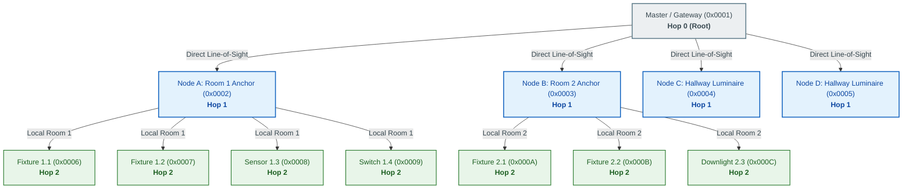
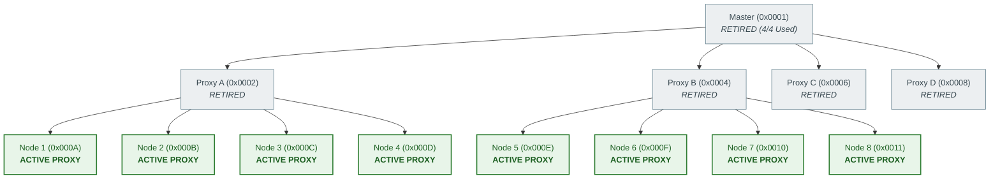
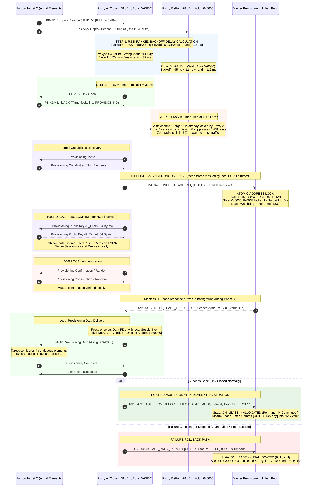
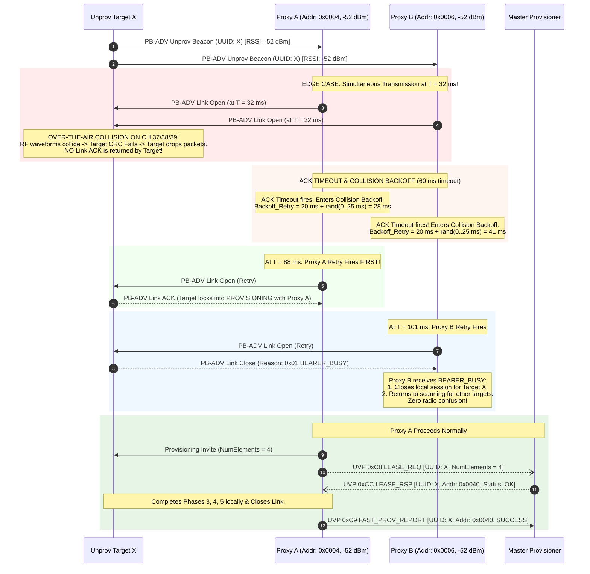

# Technical Reference Manual (TRD) — Page 8: Wavefront Provisioning Engine (Configurable K) with JIT Dynamic Element Allocation

**Subsystem:** `meshx_prov_srv`, `meshx_uvp_dispatcher`, `meshx_mxcp`  
**Opcodes Covered:** `MESHX_UVP_OP_INFILL_LEASE_REQ` (`0xC8`), `MESHX_UVP_OP_FAST_PROV_REPORT` (`0xC9`), `MESHX_UVP_OP_INFILL_LEASE_RSP` (`0xCC`)  
**MXCP Commands & Events:** `MXCP_CMD_UVP_FAST_PROV_START` (`0x34`), `MXCP_EVT_UVP_FAST_PROV_PROGRESS` (`0xB4`)  
**Related Documents:** [page2_protocol_definitions.md](./page2_protocol_definitions.md) | [page3_remote_provisioning.md](./page3_remote_provisioning.md) | [page6_eviction_healing.md](./page6_eviction_healing.md) | [requirements.md](../requirements.md)  
**Superseded Architectures:**
1. Flat multi-address block slicing model (`[base_addr, count]`) is **DEPRECATED**.
2. Naive binary tree scalar math ($2i, 2i+1$) and the 90/10 Split-Band allocator (`0x7333` / `0x7334`) are **SUPERSEDED AND RETIRED**.

---

## Table of Contents
- [1. Problem Statement & Paradigm Shift](#1-problem-statement--paradigm-shift)
  - [1.1 The Industrial Node Composition Reality](#11-the-industrial-node-composition-reality)
  - [1.2 Why Previous Provisioning Models Failed](#12-why-previous-provisioning-models-failed)
- [2. The Solution: Dual-Plane Architecture with Configurable $K$-Factor](#2-the-solution-dual-plane-architecture-with-configurable-k-factor)
- [3. Topologies: Natural Spatial Clustering ($K = \infty$) vs. Bounded Wavefront ($K \ge 2$)](#3-topologies-natural-spatial-clustering-k--infty-vs-bounded-wavefront-k-ge-2)
  - [3.1 Primary Mode: Natural Spatial Clustering ($K = \infty$, Default `k_factor = 0`)](#31-primary-mode-natural-spatial-clustering-k--infty-default-k_factor--0)
  - [3.2 High-Concurrency Mode: Bounded Geometric Wavefront ($K = 4$ or $K = 2$)](#32-high-concurrency-mode-bounded-geometric-wavefront-k--4-or-k--2)
- [4. End-to-End Execution Sequence: Pipelined Background Lease & RSSI Backoff](#4-end-to-end-execution-sequence-pipelined-background-lease--rssi-backoff)
- [5. Protocol Wire Definitions & Framing](#5-protocol-wire-definitions--framing)
  - [5.1 MXCP Host Control Frame: `MXCP_CMD_UVP_FAST_PROV_START` (0x34)](#51-mxcp-host-control-frame-mxcp_cmd_uvp_fast_prov_start-0x34)
  - [5.2 UVP Address Lease Request: `MESHX_UVP_OP_INFILL_LEASE_REQ` (0xC8)](#52-uvp-address-lease-request-meshx_uvp_op_infill_lease_req-0xc8)
  - [5.3 UVP Address Lease Grant: `MESHX_UVP_OP_INFILL_LEASE_RSP` (0xCC)](#53-uvp-address-lease-grant-meshx_uvp_op_infill_lease_rsp-0xcc)
  - [5.4 UVP Post-Closure Report & DevKey Vault Registration: `MESHX_UVP_OP_FAST_PROV_REPORT` (0xC9)](#54-uvp-post-closure-report--devkey-vault-registration-meshx_uvp_op_fast_prov_report-0xc9)
- [6. RF Physical Layer, Multi-Channel Operation & Coexistence](#6-rf-physical-layer-multi-channel-operation--coexistence)
  - [6.1 Multi-Channel PHY Mechanics (CH 37, 38, 39)](#61-multi-channel-phy-mechanics-ch-37-38-39)
  - [6.2 Hardware Continuous RX vs. Software Session Gating Filter](#62-hardware-continuous-rx-vs-software-session-gating-filter)
  - [6.3 Duty-Cycle Coexistence Modes](#63-duty-cycle-coexistence-modes)
- [7. Corner Cases & Conflict Resolution](#7-corner-cases--conflict-resolution)
  - [7.1 Dual-Mode Scanner Retirement Mechanics](#71-dual-mode-scanner-retirement-mechanics)
  - [7.2 RSSI-Ranked Arbitration & Deterministic Address Tie-Breaker](#72-rssi-ranked-arbitration--deterministic-address-tie-breaker)
  - [7.3 Saturated Cluster Infill (Replacement Fixtures)](#73-saturated-cluster-infill-replacement-fixtures)
  - [7.4 Cross-Category Arbitration: Frontier Proxy vs. Retired Sentry](#74-cross-category-arbitration-frontier-proxy-vs-retired-sentry)
  - [7.5 Multi-Sentry Passive Conflict: Multiple Saturated Nodes](#75-multi-sentry-passive-conflict-multiple-saturated-nodes)
  - [7.6 Concurrency Saturation & Backpressure (`Requests > Capacity`)](#76-concurrency-saturation--backpressure-requests--capacity)
  - [7.7 Identical RSSI & Jitter Over-The-Air Collision Recovery](#77-identical-rssi--jitter-over-the-air-collision-recovery)
- [8. Master Address State Storage & Cross-Platform NVS Persistence](#8-master-address-state-storage--cross-platform-nvs-persistence)
  - [8.1 2-Bit State Encoding & Memory Scaling](#81-2-bit-state-encoding--memory-scaling)
  - [8.2 Fast Bitwise Contiguous Block Allocation](#82-fast-bitwise-contiguous-block-allocation)
  - [8.3 NVS Persistence Architecture (`"addr_map"` Key)](#83-nvs-persistence-architecture-addr_map-key)
  - [8.4 Flash Wear Mitigation & OS Portability (ESP-IDF vs. Zephyr)](#84-flash-wear-mitigation--os-portability-esp-idf-vs-zephyr)
  - [8.5 Master $\leftrightarrow$ Standby Provisioner Sync Optimization](#85-master-leftrightarrow-standby-provisioner-sync-optimization)
- [9. Comparative Performance Benchmark Across $K$-Factors](#9-comparative-performance-benchmark-across-k-factors)

---

## 1. Problem Statement & Paradigm Shift

### 1.1 The Industrial Node Composition Reality
In standard Bluetooth Mesh, a physical node consists of $N_{elem} \ge 1$ **Elements**. When provisioned, the device receives a **Primary Element Unicast Address** ($Addr_{primary}$), and its subsequent elements automatically occupy consecutive contiguous addresses:
$$Addr_{elem\_0} = Addr_{primary}$$
$$Addr_{elem\_1} = Addr_{primary} + 1$$
$$\dots$$
$$Addr_{elem\_(N-1)} = Addr_{primary} + (N_{elem} - 1)$$

Commercial building automation and industrial IoT demand heterogeneous hardware compositions in the same physical deployment:

| Physical Device Type | Elements ($N_{elem}$) | Element Functional Models |
| :--- | :---: | :--- |
| **Simple Downlight / Relay** | 1 | Generic OnOff |
| **Tunable-White Troffer / Panel** | 2 | Generic OnOff, Light Lightness, Light CTL (CCT) |
| **Architectural Luminaire** | 3 - 4 | Light Lightness, Light HSL, Light xyL |
| **Commercial Smart Multi-Sensor** | 4 - 6 | Ambient Lux, Occupancy PIR, Temp, Humidity, eCO2, VOC |
| **4-Gang Scene Wall Switch** | 4 - 8 | 4x Generic OnOff Clients, 4x Scene / Recall Clients |
| **DALI-2 / HVAC Gateway / 16-Relay Pack** | 8 - 16 | 16x Independent Lighting / Motor Controls |

### 1.2 Why Previous Provisioning Models Failed
1. **The Naive Binary Tree Formula ($2i, 2i+1$):** Assumes every node has strictly 1 element. If Node 2 has 2 elements (`0x0002` and `0x0003`), Node 3 ($2 \times 1 + 1 = 3$) collides directly with Node 2's secondary element.
2. **Fixed Element Strides ($S_{elem} = 4$):** Wastes up to 75% of address space on 1-element devices and artificially caps nodes at 4 elements, crippling adoption for multi-sensors, 4-gang switches, and gateways.
3. **Heavy Remote Provisioning (RPR Tunneling):** Tunneling 128 bytes of P-256 ECDH public keys over multi-hop mesh relays creates severe latency ($2\text{–}3\text{ seconds}$ per node) and network congestion.
4. **The 90/10 Split-Band Allocator:** Creating an artificial boundary between tree addresses (`0x0002..0x7333`) and reserve addresses (`0x7334..0x7FFF`) fragmented the address space and created reserve exhaustion bottlenecks.

---

## 2. The Solution: Dual-Plane Architecture with Configurable $K$-Factor

MeshX completely decouples **RF Concurrency & Local Cryptographic Execution** from **Centralized Address Allocation & Vault Persistence**:

```
+---------------------------------------------------------------------------------------------------------+
|                              LOCAL PROXY PROVISIONER DUAL-PLANE ARCHITECTURE                            |
|                                                                                                         |
|  PLANE 1: RF CONCURRENCY & LOCAL CRYPTO PLANE (The Proxies)                                             |
|  - Manages BLE radio scanning and physical PB-ADV bearer sessions.                                      |
|  - Configurable Quota Engine (K-Factor):                                                                |
|       * K = 0 (Uncapped / K = inf): Natural Spatial Clustering with 15s Inactivity Silence Retirement.  |
|       * K > 0 (Bounded / K = 2, 4): Forced multi-radio geometric wavefront for massive open halls.      |
|  - Executes Phases 1, 2, 3, 4, and 5 100% LOCALLY on ESP32 hardware crypto core:                        |
|       * Phase 3: Computes P-256 ECDH shared secret S locally in ~35 ms (ZERO public key tunneling!).    |
|       * Phase 3: Derives SessionKey and DevKey locally on the proxy.                                    |
|       * Phase 4: Validates confirmation/random authentication nonces locally.                           |
|       * Phase 5: Encrypts Provisioning Data PDU with local SessionKey and delivers over PB-ADV.         |
|  - Pipelined Background Lease: Dispatches lightweight 0xC8 LEASE_REQ right after Phase 2.               |
|                                                                                                         |
|  PLANE 2: ATOMIC ADDRESS LOCK & DEVKEY VAULT PLANE (The Master)                                         |
|  - Operates a UNIFIED 15-bit address space (0x0002..0x7FFF) via Paged Sparse 2-Bit Bitmap.              |
|  - Receives pipelined 0xC8 request carrying target's declared NumElements.                              |
|  - Implements 3-State Address Lifecycle: UNALLOCATED -> ON_LEASE -> ALLOCATED (or Rollback on Fail).    |
|  - Returns 0xCC LEASE_RSP while local Phase 3 and 4 execute on radio (ZERO perceived latency).          |
|  - Post-Closure Vault: Receives 0xC9 FAST_PROV_REPORT containing derived DevKey and commits to NVS.     |
+---------------------------------------------------------------------------------------------------------+
```

---

## 3. Topologies: Natural Spatial Clustering ($K = \infty$) vs. Bounded Wavefront ($K \ge 2$)

Because addresses are leased Just-In-Time from the Master's unified pool, the system supports two operational modes controlled by `k_factor` in `MXCP_CMD_UVP_FAST_PROV_START (0x34)`:

### 3.1 Primary Mode: Natural Spatial Clustering ($K = \infty$, Default `k_factor = 0`)
In real commercial buildings (partitioned offices, hallways, retail stores), fixtures naturally cluster into rooms. Proxies onboard all direct line-of-sight devices sequentially until a 15-second quiet window ($T_{\text{quiet}}$) triggers retirement:



#### Guarantees of Natural Spatial Clustering ($K = \infty$):
1. **Minimum Physical Hop Depth (Ultra-Low RTT):** Maximum network diameter is **1 to 2 hops for the entire venue**. Regular mesh multicast commands (lighting scenes, sensor broadcasts) execute in **$< 50\text{ ms}$**.
2. **Optimal RF Link Budget:** Devices are always onboarded by their closest physical anchor ($-45\text{ to }-55\text{ dBm}$), eliminating dropped packets during provisioning.
3. **Natural Silence Retirement ($T_{\text{quiet}} = 15\text{ s}$):** Once an anchor finishes onboarding its surrounding devices and hears zero beacons for 15 seconds, its scanner automatically demotes from 60% active scan to 2% Sentry Mode.

---

### 3.2 High-Concurrency Mode: Bounded Geometric Wavefront ($K = 4$ or $K = 2$)
In massive open spaces (warehouses, exhibition halls, open-bay logistics centers) where 100+ fixtures can hear the Master directly, a bounded quota forces multi-radio work delegation:



#### Guarantees of Bounded Wavefront ($K \ge 2$):
1. **Multi-Radio Parallelism (5x Speedup):** Prevents the Master's single BLE radio from serializing 100 devices ($100 \times 1.5\text{s} = 150\text{s}$). Master onboards 4 seed fixtures in 6s and retires; 4 fixtures onboard 16 in parallel; 16 fixtures onboard 64 in parallel. A 100-node hall completes in **$18\text{–}25\text{ seconds}$**.
2. **Immediate Retirement:** When `children_count == k_factor`, the scanner turns **OFF (0% duty cycle)**.

---

## 4. End-to-End Execution Sequence: Pipelined Background Lease & RSSI Backoff



---

## 5. Protocol Wire Definitions & Framing

### 5.1 MXCP Host Control Frame: `MXCP_CMD_UVP_FAST_PROV_START` (`0x34`)
```c
#pragma pack(push, 1)
typedef struct {
    meshx_uuid_t uuid_mask;          /**< 16-byte filter mask for bulk discovery */
    uint16_t     target_count;       /**< Total cluster target count */
    uint16_t     root_base_addr;     /**< Starting unicast address (default 0x0002) */
    uint8_t      k_factor;           /**< 0 = Uncapped (K=inf, natural silence), >0 = Bounded quota (e.g. 2, 4) */
} mxcp_cmd_uvp_fast_prov_start_t;
#pragma pack(pop)
```

### 5.2 UVP Address Lease Request: `MESHX_UVP_OP_INFILL_LEASE_REQ` (`0xC8`)
Dispatched by the proxy to the Master immediately upon receiving Phase 2 Capabilities:

```c
#pragma pack(push, 1)
typedef struct {
    uint16_t     proxy_node_addr;    /**< Unicast address of requesting proxy */
    meshx_uuid_t target_uuid;        /**< Target unprovisioned node UUID */
    uint8_t      num_elements;       /**< Declared target elements from Capabilities */
} meshx_uvp_infill_lease_req_t;
#pragma pack(pop)
```

### 5.3 UVP Address Lease Grant: `MESHX_UVP_OP_INFILL_LEASE_RSP` (`0xCC`)
Dispatched by the Master back to the proxy:

```c
#define MESHX_PROV_STATUS_OK               0x00  /**< Address slice locked and granted */
#define MESHX_PROV_STATUS_ALREADY_MAPPED   0x01  /**< Device UUID already allocated in mesh */
#define MESHX_PROV_STATUS_EXHAUSTED        0x02  /**< Unicast address space 0x7FFF exhausted */
#define MESHX_PROV_STATUS_CONGESTION       0x03  /**< In-flight lease table full; retry with backoff */

#pragma pack(push, 1)
typedef struct {
    meshx_uuid_t target_uuid;        /**< Target device UUID */
    uint16_t     leased_addr;        /**< Assigned starting primary unicast address */
    uint8_t      status;             /**< MESHX_PROV_STATUS_* */
} meshx_uvp_infill_lease_rsp_t;
#pragma pack(pop)
```

### 5.4 UVP Post-Closure Report & DevKey Vault Registration: `MESHX_UVP_OP_FAST_PROV_REPORT` (`0xC9`)
Dispatched by the proxy to the Master after the PB-ADV link successfully closes or fails:

```c
#pragma pack(push, 1)
typedef struct {
    uint16_t     proxy_node_addr;    /**< Proxy unicast address */
    meshx_uuid_t target_uuid;        /**< Provisioned device UUID */
    uint16_t     assigned_addr;      /**< Primary unicast address assigned */
    uint8_t      num_elements;       /**< Number of elements configured */
    uint8_t      dev_key[16];        /**< Locally derived P-256 DevKey */
    uint8_t      status;             /**< 0x00 = Success, 0x01 = Failed (Trigger Rollback), 0x02 = Quota Reached */
} meshx_uvp_fast_prov_report_t;
#pragma pack(pop)
```

---

## 6. RF Physical Layer, Multi-Channel Operation & Coexistence

In a mains-powered Bluetooth Mesh deployment, nodes must concurrently handle **mission-critical element traffic (lighting commands, sensor telemetry, relaying)** while participating in **bulk provisioning**.

### 6.1 Multi-Channel PHY Mechanics (CH 37, 38, 39)
All Bluetooth Mesh broadcast traffic and PB-ADV Unprovisioned Beacons operate over the 3 primary advertising channels:
- **CH 37 (2402 MHz):** Positioned safely below Wi-Fi Channel 1.
- **CH 38 (2426 MHz):** Positioned in the spectral valley between Wi-Fi Channels 1 and 6.
- **CH 39 (2480 MHz):** Positioned above Wi-Fi Channel 11.

```
2.4 GHz Spectrum Allocation:
  2402 MHz                  2426 MHz                            2480 MHz
  [ CH 37 ]                 [ CH 38 ]                           [ CH 39 ]
     |                         |                                   |
     v                         v                                   v
+---------+               +---------+                         +---------+
| BLE 37  |   Wi-Fi CH 1  | BLE 38  |       Wi-Fi CH 6        | BLE 39  |  Wi-Fi CH 11
+---------+  (2412 MHz)   +---------+      (2437 MHz)         +---------+  (2462 MHz)
```

Concurrently cycling channels guarantees:
1. **Wi-Fi Spectral Immunity:** Frames wiped out by Wi-Fi bursts on Channel 38 survive on Channels 37 or 39.
2. **Mitigation of Indoor Rayleigh Nulls:** Frequency differences ($\approx 78\text{ MHz}$) eliminate multipath fading dead zones.
3. **Tripled RF Capacity:** Transmitters emit sequential bursts (`CH 37 -> CH 38 -> CH 39`); concurrent nodes transmitting on different channels never collide.

### 6.2 Hardware Continuous RX vs. Software Session Gating Filter
In mains-powered hardware, **the physical radio receiver is always active (~100% RX duty cycle on channels 37, 38, 39)** to guarantee low-latency reception of mesh relay and model packets.

The term **"Scanning"** refers to the **Software Advertising Demultiplexing Gate**:

```
+---------------------------------------------------------------------------------------+
|                                PHYSICAL RADIO LAYER                                   |
|                BLE Radio Receiver ALWAYS ON (~100% RX on Channels 37, 38, 39)         |
+---------------------------------------------------------------------------------------+
                                           |
                                           v
                             CONTROLLER / STACK DEMUX
                                           |
                     +---------------------+---------------------+
                     |                                           |
                     v                                           v
      [ AD Type: 0x2A / 0x2B ]                    [ AD Type: 0x29 ]
      BLE MESH NETWORK PACKETS                    MESH BEACON (Unprov Device Beacon)
      (Network PDU, Lower Transport,              (UUID, OOB info, URI Hash)
       Relay, Models, Elements)                                  |
                     |                                           v
                     v                            +-----------------------------+
           MESH STACK PIPELINE                    | SOFTWARE ADMISSION GATE     |
          (Always Processed 100%)                 | (Session-Controlled Filter) |
                                                  +-----------------------------+
                                                  | If Session Active:          |
                                                  |   Pass to UVP & Onboard!    |
                                                  | If Idle (No Session):       |
                                                  |   DROP IMMEDIATELY! (0 CPU) |
                                                  +-----------------------------+
```

1. **Mesh Network Packets (`AD Type 0x2A` / `0x2B`):** Always processed 100% of the time. Normal mesh traffic is never paused or blocked.
2. **Unprovisioned Device Beacons (`AD Type 0x29`):** Filtered at the lowest layer:
   - **Session Closed (Normal Production):** Dropped immediately with zero CPU processing.
   - **Session Open (Commissioning Mode):** Passed to the UVP onboarding engine.

### 6.3 Duty-Cycle Coexistence Modes

| Operational State | Filter State | Scan Window / Interval | Effective Duty Cycle | Element TX/RX Impact | Discovery Latency |
| :--- | :--- | :--- | :---: | :--- | :--- |
| **Normal Production** | Closed | `0 ms` / `0 ms` | **0% (Disabled)** | **Zero** (100% wire speed) | N/A (Closed) |
| **Active Frontier Proxy** | Open (Active Session) | `60 ms` / `100 ms` | **60%** | **Negligible** (40ms quiet window + TX preemption) | Instant ($<300\text{ ms}$) |
| **Passive Sentry Mode** | Open (Quiet/Retired) | `40 ms` / `2000 ms` | **2%** | **Zero** (Mesh operations unhindered) | Background ($15\text{–}30\text{ s}$) |
| **Traffic Spike (Backpressure)** | Dynamic Throttle | `25 ms` / `100 ms` | **25%** | **Protected** (75ms reserved for mesh queue) | Moderate ($1\text{–}2\text{ s}$) |

---

## 7. Corner Cases & Conflict Resolution

### Corner Case Index & Arbitration Summary

| Section | Corner Case Scenario | Physical / Protocol Trigger | Resolution & Arbitration Mechanism |
| :--- | :--- | :--- | :--- |
| **[7.1](#71-dual-mode-scanner-retirement-mechanics)** | Scanner Retirement Mechanics | How proxies know when to stop active scanning | **Dual Mode:** $K=0 \implies$ 15s Quiet Timer ($T_{\text{quiet}}$); $K>0 \implies$ Quota Counter (`count >= K`). |
| **[7.2](#72-rssi-ranked-arbitration--deterministic-address-tie-breaker)** | Multi-Active-Proxy Race | Multiple proxies hear the same target beacon | **Inverse-RSSI Backoff Delay** + **Unicast Address Modulo Tie-Breaker**; closest node fires first. |
| **[7.3](#73-saturated-cluster-infill-replacement-fixtures)** | Saturated Cluster Infill | Replacement fixture installed in an established network | Unified Pool JIT Lease: Sentry sends `0xC8` for $N_{elem}$; Master allocates from recycled holes or free pool. |
| **[7.4](#74-cross-category-arbitration-frontier-proxy-vs-retired-sentry)** | Frontier Proxy vs. Retired Sentry | Target beacon heard by both an Active Proxy and a Sentry | Tiered Jitter: Active Proxy ($0\text{–}30\text{ ms}$) preempts Sentry ($100\text{ ms}$ backoff) to drive wavefront forward. |
| **[7.5](#75-multi-sentry-passive-conflict-multiple-saturated-nodes)** | Multi-Sentry Passive Conflict | Target beacon heard simultaneously by two or more Retired Sentries | Address-Ranked Deference ($100\text{ ms} + (Addr \bmod 16)\times 10\text{ ms}$) + Master UUID deduplication cache. |
| **[7.6](#76-concurrency-saturation--backpressure-requests--capacity)** | In-Flight Concurrency Saturation | More than 32 proxies request leases at the exact same sub-second window | Master returns `0x03 CONGESTION_RETRY`. Proxy backs off with jitter, masked by local ECDH airtime. |
| **[7.7](#77-identical-rssi--jitter-over-the-air-collision-recovery)** | Identical RSSI & Jitter Collision | Proxies equidistant with identical random jitter transmit at same microsecond | Physical collision drops packet $\rightarrow$ ACK Timeout ($60\text{ms}$) $\rightarrow$ Re-seeded backoff $\rightarrow$ Winner ACKs, loser gets `0x01 BEARER_BUSY`. |

---

### 7.1 Dual-Mode Scanner Retirement Mechanics

The firmware natively supports two retirement paradigms based on `k_factor`:

```c
/* In Proxy Provisioning Completion Handler */
s_proxy_ctx.children_onboarded_count++;

if (s_session_k_factor > 0) {
    /* Mode B: Bounded Quota Engine */
    if (s_proxy_ctx.children_onboarded_count >= s_session_k_factor) {
        meshx_proxy_demote_to_sentry(); /* Quota reached: 60% -> 2% */
    }
} else {
    /* Mode A: Uncapped Natural Silence Engine (k_factor == 0) */
    meshx_proxy_reset_quiet_timer(15000); /* Reset 15-second inactivity timer */
}
```

* **Mode A (Uncapped, $K=0 \implies \infty$):** The proxy keeps scanning at 60% duty cycle as long as beacons are present. If 15 seconds elapse with zero unprovisioned beacons heard, it demotes to 2% Sentry Mode.
* **Mode B (Bounded, $K > 0$):** The proxy shuts off its scanner the instant `count == k_factor`.

---

### 7.2 RSSI-Ranked Arbitration & Deterministic Address Tie-Breaker
When multiple proxies hear an unprovisioned beacon, they convert received signal strength into an **Inverse-Signal Backoff Delay**:

$$\text{Backoff}_{\text{proxy}}(\text{RSSI}) = \text{clamp}\Big((-(\text{RSSI} + 40)) \times 2.5\text{ ms}, \ 0\text{ ms}, \ 200\text{ ms}\Big) + \Big((Addr_{\text{proxy}} \bmod 16) \times 2\text{ ms}\Big) + \text{rand}(0, 15\text{ ms})$$

1. **Closer Node Wins:** A node at $-48\text{ dBm}$ fires in $20\text{–}35\text{ ms}$, whereas a node at $-78\text{ dBm}$ fires in $95\text{–}110\text{ ms}$.
2. **Address Tie-Breaker:** Even if RSSI and random jitter are identical, different base addresses guarantee staggered transmission:
   - Node `0x0004`: $(4 \bmod 16) \times 2 = \mathbf{8\text{ ms}}$ offset.
   - Node `0x0006`: $(6 \bmod 16) \times 2 = \mathbf{12\text{ ms}}$ offset.
3. **Over-the-Air Suppression:** The winner's `Link Open` locks the target into `PROVISIONING`. When the distant node's timer expires, it detects the active link and cancels transmission.

---

### 7.3 Saturated Cluster Infill (Replacement Fixtures)
When a fixture fails months after deployment and a replacement (**Node X**) is installed:
1. Saturated sentries detect the beacon in Phase 2 Sentry Mode (2% micro-duty cycle).
2. Sentry opens the link, discovers Capabilities ($N_{elem}$), and dispatches `0xC8 INFILL_LEASE_REQ` to the Master.
3. Master leases contiguous addresses from the unified pool (popping a recycled address from `s_recycled_ring` or advancing the free cursor).
4. Sentry provisions Node X locally and reports via `0xC9`. Zero 90/10 boundary constraints!

---

### 7.4 Cross-Category Arbitration: Frontier Proxy vs. Retired Sentry
When a beacon is heard by both an **Active Frontier Proxy** (actively onboarding) and a **Passive Retired Sentry**:
1. **Tiered Backoff Jitter:** Active proxies transmit with $0\text{–}30\text{ ms}$ jitter; sentries wait a mandatory $100\text{ ms} + \text{jitter}$ window.
2. **Wavefront Momentum:** The active frontier proxy acquires the link within $30\text{ ms}$, causing the sentry to suppress its `0xC8` request. This keeps the wavefront expanding outward.

---

### 7.5 Multi-Sentry Passive Conflict: Multiple Saturated Nodes
When two or more Retired Sentries simultaneously detect a replacement fixture:
1. **Address-Ranked Staggered Deference:** Sentries calculate backoff as:
   $$\text{Backoff}_{\text{sentry}} = 100\text{ ms} + \Big((Addr_{\text{sentry}} \bmod 16) \times 10\text{ ms}\Big) + \text{rand}(0, 15\text{ ms})$$
   Node `0x0002` deferral: $\approx 125\text{ ms}$; Node `0x0006` deferral: $\approx 165\text{ ms}$.
2. **Local OTA Sniffing:** When the first sentry opens the BLE bearer, the second sentry hears the frame on the advertising channel and cancels its pending request.

---

### 7.6 Concurrency Saturation & Backpressure (`Requests > Capacity`)
The Master maintains an in-flight lease table (`CONFIG_MAX_CONCURRENT_LEASES = 32`, consuming **768 Bytes of RAM**):
1. **Lazy Expiry Sweep:** Master evicts any abandoned or timed-out leases ($> 30\text{ s}$) before rejecting.
2. **Congestion Response (`0x03`):** If all 32 slots are active, Master responds with `status = 0x03 CONGESTION_RETRY`.
3. **Pipelined Latency-Masked Retry:** The proxy holds the PB-ADV link open during local Phase 3/4 ECDH ($1.2\text{–}1.8\text{ s}$), backs off by $100\text{–}250\text{ ms}$, and retries `0xC8`. A slot opens up with zero perceived user delay.
4. **Failsafe Link Teardown:** If 3 retries (1.5s) fail, the proxy closes the link (`Reason: Resource Exhausted`). The target re-advertises and is picked up on the next cycle with zero address leakage.

---

### 7.7 Identical RSSI & Jitter Over-The-Air Collision Recovery

In the rare event that two equidistant proxies transmit `PB-ADV Link Open` at the exact same physical microsecond:



1. **Physical Waveform Collision:** Overlapping RF signals cause CRC failure at the target receiver. The target sends no ACK.
2. **ACK Timeout ($60\text{ ms}$):** Both proxies time out after $60\text{ ms}$ of silence.
3. **Hardware RNG Collision Backoff:** Both proxies back off by $20\text{ ms} + \text{rand}(0, 25\text{ ms})$. Because independent ESP32 true-random hardware generators seed the delay, retries are separated by $10\text{–}25\text{ ms}$.
4. **Single-Bearer Lock Enforcement:** The first retry to land receives `Link ACK` and locks the target. The second retry receives `Link Close (Reason: 0x01 Bearer Busy)` and immediately yields.
5. **Master Atomic Guard:** If both somehow open links, the Master's JIT lease table rejects the second proxy with `0x01 ALREADY_MAPPED`.

---

## 8. Master Address State Storage & Cross-Platform NVS Persistence

To satisfy the 3-State Address Lifecycle across all 32,768 unicast addresses without consuming excessive SRAM on the Master (ESP32), MeshX adopts a **Paged Sparse 2-Bit Bitmap (Chunk-on-Demand)** data structure coupled with an OS-agnostic software debounce layer.

### 8.1 2-Bit State Encoding & Memory Scaling
Each unicast address occupies exactly 2 bits:

```c
typedef enum {
    MESHX_ADDR_STATE_UNALLOCATED = 0x0,  /* 00b: Free & available for lease */
    MESHX_ADDR_STATE_ON_LEASE    = 0x1,  /* 01b: In-flight fast prov lock (30s watchdog) */
    MESHX_ADDR_STATE_ALLOCATED   = 0x2,  /* 10b: Committed active node/element in mesh */
    MESHX_ADDR_STATE_RESERVED    = 0x3   /* 11b: 0x0000, 0x0001 (Master), or Tombstone */
} meshx_addr_state_t;
```

#### The Paged Sparse Structure:
The 32,768 address space is divided into **256 chunks** of **128 addresses** each:
* **1 Chunk:** 128 addresses $\times$ 2 bits = 256 bits = **32 Bytes** (8 `uint32_t` words).
* **Chunk Directory:** A 256-bit presence bitmask (**32 Bytes**) tracks which chunks are active.
* Chunks are allocated on demand only when an address in that range is first referenced.

```c
typedef struct {
    uint32_t words[8];   /**< 32 bytes: tracks state of 128 addresses (16 addrs/word) */
} meshx_addr_chunk_t;

typedef struct {
    uint32_t            present_mask[8];   /**< 32 bytes: 256 bits for chunks 0..255 */
    meshx_addr_chunk_t *chunks[256];       /**< Chunk pointers (NULL if unallocated) */
} meshx_sparse_addr_map_t;
```

#### Dynamic Master RAM Footprint:
* **Idle / Fresh Boot (1 chunk, 128 addrs):** $32\text{ B (mask)} + 32\text{ B (chunk)} = \mathbf{64\text{ Bytes}}$.
* **100-Node Network (~250 addrs, 2 chunks):** $32\text{ B} + 64\text{ B} = \mathbf{96\text{ Bytes}}$.
* **500-Node Network (~1,000 addrs, 8 chunks):** $32\text{ B} + 256\text{ B} = \mathbf{288\text{ Bytes}}$.
* **RAM Savings:** **> 96% reduction** compared to a monolithic 8.5 KB flat bitmap.

### 8.2 Fast Bitwise Contiguous Block Allocation
Finding $N_{elem}$ contiguous free slots (`00b`) executes via word-level operations:
1. **16-Address Fast Skip:** If `chunk->words[w] == 0x00000000`, all 16 addresses in that word are free. The scanner skips 16 addresses in a single CPU cycle.
2. **Sub-Word Contiguous Masking:** Testing if a block of $N_{elem} \le 16$ is available evaluates `(words[w] & mask) == 0`.
3. **Atomic State Transitions:**
   - **Lease Lock (`0xC8`):** Overwrite free slots (`00b`) with `01b` (`ON_LEASE`).
   - **Rollback on Failure:** Reset `01b` back to `00b` (`UNALLOCATED`).
   - **Commit (`0xC9`):** Overwrite `01b` with `10b` (`ALLOCATED`).

### 8.3 NVS Persistence Architecture (`"addr_map"` Key)
* **Volatile Isolation:** Transient `ON_LEASE` (`01b`) bits are masked to `00b` prior to flash serialization. If power drops mid-handshake, the in-flight lease cleanly rolls back upon boot.
* **Single Packed Sparse Blob Layout:** Active chunks are serialized under key **`"addr_map"`**:

```c
#define MESHX_NVS_ADDR_MAP_MAGIC    0x4D58414D  /* 'MXAM' */
#define MESHX_NVS_ADDR_MAP_VERSION  0x01

typedef struct __attribute__((packed)) {
    uint32_t magic;            /**< 0x4D58414D ('MXAM') */
    uint8_t  version;          /**< 0x01 */
    uint8_t  active_chunks;    /**< Count of serialized chunks (1..256) */
    uint16_t reserved;
    uint32_t present_mask[8];  /**< 32 bytes: Presence bitmask */
    uint32_t crc32;            /**< Integrity checksum across payload */
} meshx_nvs_addr_map_hdr_t;    /**< Total Header: 44 Bytes */
```

* **Flash Size on Disk:** $44\text{ B header} + (K \times 32\text{ B})$. For a 500-node network (8 chunks), disk footprint is only **300 Bytes**.

### 8.4 Flash Wear Mitigation & OS Portability (ESP-IDF vs. Zephyr)

```
ESP-IDF:  meshx_nvs_set() ──> Staging RAM ──> [ 1000ms Timer ] ──> nvs_commit() (Flash)
Zephyr:   meshx_nvs_set() ──> nvs_write() ───────────────────────> DIRECT FLASH WRITE! (Flash Wear)
```

To eliminate flash endurance stress and radio scheduling jitter in Zephyr (where `nvs_write()` writes directly to flash without a deferred commit phase), MeshX implements an **OS-Agnostic Software Debounce Layer**:

```
Incoming 0xC9 (Commit) ──┐
Incoming 0xC9 (Commit) ──┼──> Update Sparse Bitmap in RAM
Incoming 0xC9 (Commit) ──┘    Mark s_nvs_dirty = true
                              Arm/Reset meshx_os_timer (1000 ms debounce)
                                     │
                 ┌───────────────────┴───────────────────┐
                 ▼ (Timer Expires after 1000ms Quiet)    ▼ (Threshold: 10 Nodes)
         [ Single Zephyr nvs_write() Flush ]     [ Single Zephyr nvs_write() Flush ]
```

1. **Decoupled Invocation:** Neither `nvs_commit()` (ESP-IDF) nor `nvs_write()` (Zephyr) is called inside time-critical `0xC9` callbacks.
2. **Multi-Condition Flush:** Flushes occur on a 1000 ms quiet window, a 10-node dirty threshold, or provisioning session stop.
3. **Per-Chunk Granular Writes (Zephyr):** Writing only the modified 32-byte chunk (`nvs_write(fs, ID, chunk, 32)`) consumes only 40 bytes on flash (32B payload + 8B header), delivering a **7.5x reduction in flash wear**.

### 8.5 Master $\leftrightarrow$ Standby Provisioner Sync Optimization
1. **Incremental Delta Sync (6 Bytes per Event):**
   ```c
   typedef struct __attribute__((packed)) {
       uint16_t word_index;    /* 0..2047 */
       uint32_t word_value;    /* Updated 32-bit state of 16 addresses */
   } meshx_addr_delta_sync_t;  /* Total size: 6 BYTES */
   ```
2. **Chunk Push on Recovery (32 Bytes):** Standby synchronization transfers only the active 32-byte chunks indicated by the dirty bitmask, never transmitting empty address space.

---

## 9. Comparative Performance Benchmark Across $K$-Factors

| Metric | Sequential Provisioning | Bounded Binary ($K=2$) | Bounded Quadtree ($K=4$) | Uncapped Natural Clustering ($K=\infty$, Default) |
| :--- | :---: | :---: | :---: | :---: |
| **Max Network Hop Depth (100 Nodes)** | 100 hops | 7 hops | 4 hops | **1 – 2 hops (Physical Minimum)** |
| **Normal Relay RTT (Daily Operations)** | High | ~350 ms | ~200 ms | **< 50 ms (Ultra-Low)** |
| **100-Node Commissioning Time** | 1200 - 1500 sec | 75 - 95 sec | **18 - 25 sec (Open Halls)** | **45 - 60 sec (Partitioned Rooms)** |
| **Complexity Class** | $O(N)$ (Linear) | $O(\log_2 N)$ | $O(\log_4 N)$ | **Topological Voronoi Clustering** |
| **Node Composition Support** | 1 to 255 Elements | 1 to 255 Elements | 1 to 255 Elements | **1 to 255 Elements (Full Compliance)** |
| **Retirement Trigger** | Manual | `count == 2` | `count == 4` | **Inactivity Silence ($T_{\text{quiet}} = 15\text{s}$)** |
| **PB-ADV Link Signal Quality** | Weakest | Low (forced hand-offs) | Moderate | **Optimal (Always closest anchor)** |
| **Relay Buffer Contention Risk** | None | Low | Low | **Negligible (Multi-channel coexistence)** |
| **Recommended Deployment Venue** | Deprecated | High-interference corridors | Open warehouses / High-bay halls | **Commercial Offices, Retail, Schools, Hotels** |
