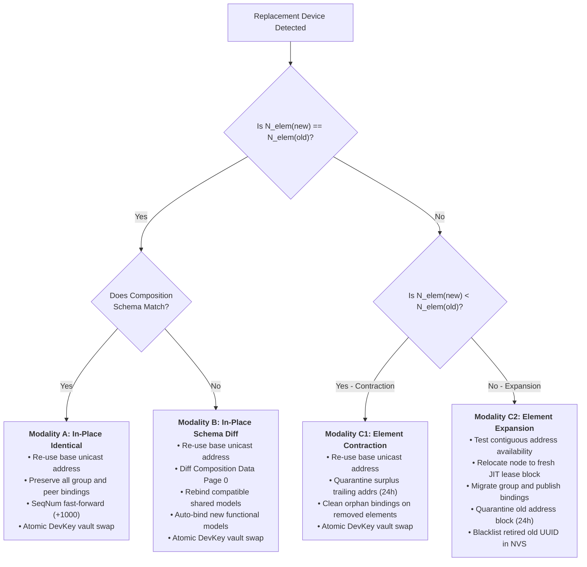
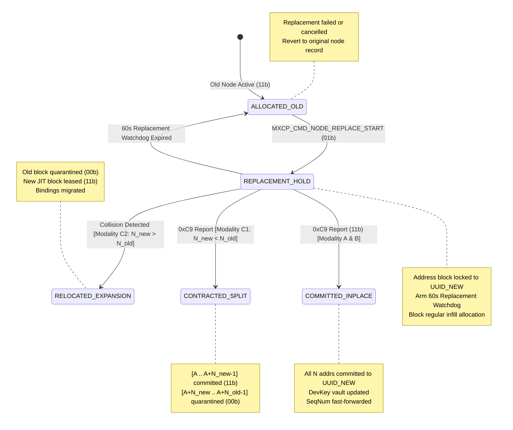
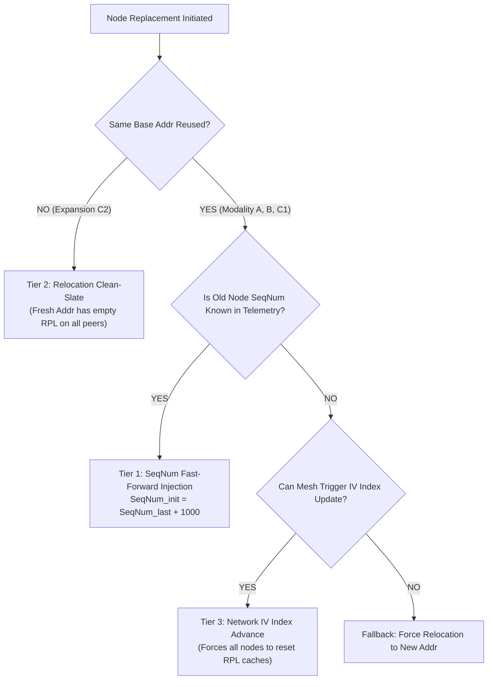
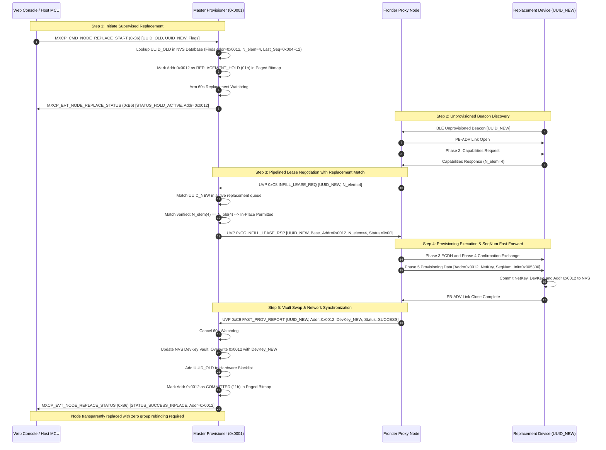
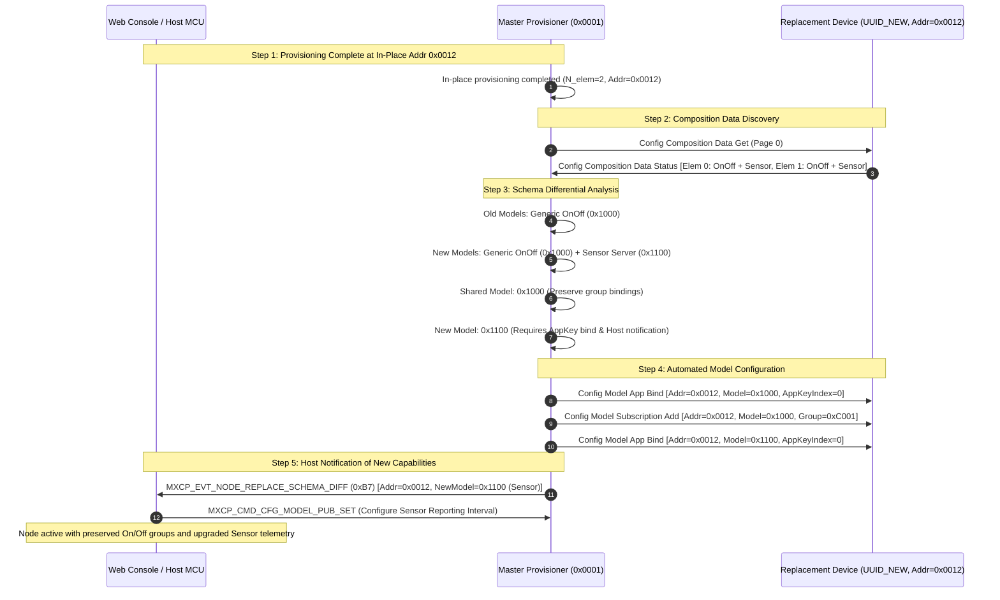
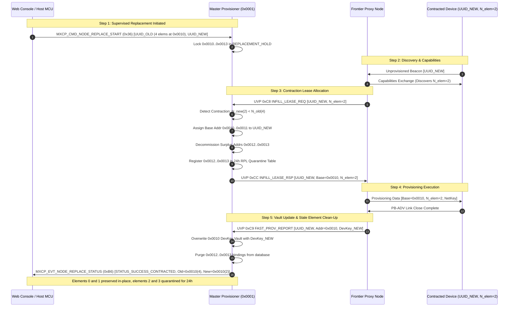
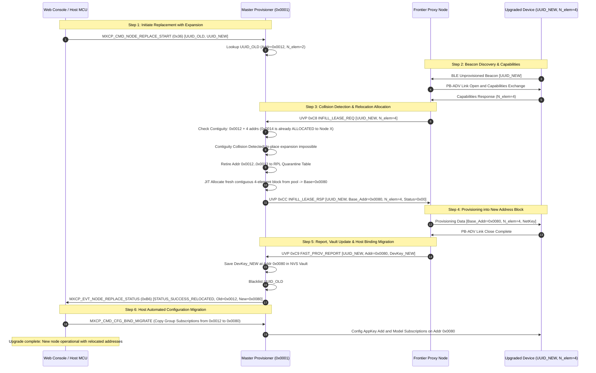

# Technical Reference Manual (TRD) — Page 9: Node Replacement & Unicast Lease Reallocation

**Subsystem:** `meshx_prov_srv`, `meshx_uvp_dispatcher`, `meshx_mxcp`  
**Opcodes & Host Interfaces:** `MXCP_CMD_NODE_REPLACE_START` (`0x36`), `MXCP_EVT_NODE_REPLACE_STATUS` (`0xB6`), `MXCP_EVT_NODE_REPLACE_SCHEMA_DIFF` (`0xB7`), `MESHX_UVP_OP_INFILL_LEASE_REQ` (`0xC8`), `MESHX_UVP_OP_FAST_PROV_REPORT` (`0xC9`)  
**Parent Document:** [TRD Index](./README.md)  
**Related Requirements:** [requirements.md](../requirements.md) (REQ-F01, REQ-F02, REQ-F08, REQ-F10)  
**Related Documents:**
- Architecture & Address Model: [page1_overview.md](./page1_overview.md)
- Wire Protocols & Structs: [page2_protocol_definitions.md](./page2_protocol_definitions.md)
- Key Rotation & Trust Vault: [page4_key_rotation.md](./page4_key_rotation.md)
- Cascading Redundancy: [page5_redundancy_cascading.md](./page5_redundancy_cascading.md)
- Autonomous Re-Healing: [page6_eviction_healing.md](./page6_eviction_healing.md)
- Resilience & Memory Analysis: [page7_resilience_memory.md](./page7_resilience_memory.md)
- Wavefront Provisioning & JIT Leasing: [page8_fast_bulk_provisioning.md](./page8_fast_bulk_provisioning.md)

---

## Table of Contents
- [1. Operational Problem Statement & Field Maintenance Reality](#1-operational-problem-statement--field-maintenance-reality)
- [2. Replacement Modalities & Decision Hierarchy](#2-replacement-modalities--decision-hierarchy)
  - [2.1 Modality A: Identical Composition & Identical Models ($N_{\text{elem}}^{\text{new}} = N_{\text{elem}}^{\text{old}}$, Schema Match)](#21-modality-a-identical-composition--identical-models-n_textelemtextnew--n_textelemtextold-schema-match)
  - [2.2 Modality B: Identical Element Count but Differing Models ($N_{\text{elem}}^{\text{new}} = N_{\text{elem}}^{\text{old}}$, Schema Divergence)](#22-modality-b-identical-element-count-but-differing-models-n_textelemtextnew--n_textelemtextold-schema-divergence)
  - [2.3 Modality C1: Element Contraction ($N_{\text{elem}}^{\text{new}} < N_{\text{elem}}^{\text{old}}$)](#23-modality-c1-element-contraction-n_textelemtextnew--n_textelemtextold)
  - [2.4 Modality C2: Element Expansion ($N_{\text{elem}}^{\text{new}} > N_{\text{elem}}^{\text{old}}$)](#24-modality-c2-element-expansion-n_textelemtextnew--n_textelemtextold)
- [3. Unicast Lease Lifecycle & Paged Sparse Bitmap Reallocation](#3-unicast-lease-lifecycle--paged-sparse-bitmap-reallocation)
  - [3.1 Address Contiguity Constraint in Bluetooth Mesh](#31-address-contiguity-constraint-in-bluetooth-mesh)
  - [3.2 2-Bit State Transitions for Node Replacement](#32-2-bit-state-transitions-for-node-replacement)
  - [3.3 Decommission Quarantine & Grace Period (RPL Decay Table)](#33-decommission-quarantine--grace-period-rpl-decay-table)
- [4. Replay Protection List (RPL) & Sequence Number Integrity](#4-replay-protection-list-rpl--sequence-number-integrity)
  - [4.1 The Stale SeqNum Replay Attack Hazard](#41-the-stale-seqnum-replay-attack-hazard)
  - [4.2 MeshX 3-Tier RPL Mitigation Architecture](#42-meshx-3-tier-rpl-mitigation-architecture)
- [5. Master DevKey Vault & Hardware Blacklist Lifecycle](#5-master-devkey-vault--hardware-blacklist-lifecycle)
  - [5.1 Atomic DevKey Vault Swap](#51-atomic-devkey-vault-swap)
  - [5.2 Permanent Hardware Blacklisting (Anti-Zombie Guard)](#52-permanent-hardware-blacklisting-anti-zombie-guard)
- [6. Protocol Wire Formats & Host Interfaces](#6-protocol-wire-formats--host-interfaces)
  - [6.1 MXCP Command: `MXCP_CMD_NODE_REPLACE_START` (0x36)](#61-mxcp-command-mxcp_cmd_node_replace_start-0x36)
  - [6.2 MXCP Event: `MXCP_EVT_NODE_REPLACE_STATUS` (0xB6)](#62-mxcp-event-mxcp_evt_node_replace_status-0xb6)
  - [6.3 MXCP Event: `MXCP_EVT_NODE_REPLACE_SCHEMA_DIFF` (0xB7)](#63-mxcp-event-mxcp_evt_node_replace_schema_diff-0xb7)
  - [6.4 UVP Lease Request Flag Extensions (0xC8)](#64-uvp-lease-request-flag-extensions-0xc8)
- [7. End-to-End Sequence Diagrams](#7-end-to-end-sequence-diagrams)
  - [7.1 Modality A: In-Place Identical Replacement ($N_{\text{elem}}^{\text{new}} = N_{\text{elem}}^{\text{old}}$, Schema Match)](#71-modality-a-in-place-identical-replacement-n_textelemtextnew--n_textelemtextold-schema-match)
  - [7.2 Modality B: In-Place Swap with Differing Models ($N_{\text{elem}}^{\text{new}} = N_{\text{elem}}^{\text{old}}$, Schema Divergence)](#72-modality-b-in-place-swap-with-differing-models-n_textelemtextnew--n_textelemtextold-schema-divergence)
  - [7.3 Modality C1: Element Contraction ($N_{\text{elem}}^{\text{new}} < N_{\text{elem}}^{\text{old}}$) with Trailing Surplus Quarantine](#73-modality-c1-element-contraction-n_textelemtextnew--n_textelemtextold-with-trailing-surplus-quarantine)
  - [7.4 Modality C2: Relocated Expansion Replacement ($N_{\text{elem}}^{\text{new}} > N_{\text{elem}}^{\text{old}}$)](#74-modality-c2-relocated-expansion-replacement-n_textelemtextnew--n_textelemtextold)

---

## 1. Operational Problem Statement & Field Maintenance Reality

In commercial lighting, industrial sensor meshes, and building automation, physical hardware replacement is an inevitable operational lifecycle event:
- A multi-channel relay module suffers a relay contact weld or power surge failure.
- A single-channel luminaire driver fails and is swapped out by a facilities technician.
- An older legacy fixture is upgraded to a newer luminaire model with emergency lighting and sensor elements.

Traditional Bluetooth Mesh stacks treat node replacement poorly:
1. **The Factory-Wipe Dilemma:** Replacing a node requires re-provisioning from scratch, changing unicast addresses, and manually re-binding dozens of group addresses, scenes, publication destinations, and application keys across multiple client controllers.
2. **The Replay Protection Hazard (RPL Collisions):** If a new physical node is simply provisioned with the failed node's previous unicast address, the replacement node boots with its internal sequence number initialized to `0x000000`. All neighbor nodes in the network already cached the old node's higher sequence number (e.g., `0x004F12`), causing the entire mesh to **silently discard 100% of the replacement node's outbound traffic** as replay attacks.
3. **The Contiguity Constraint:** In Bluetooth Mesh, a multi-element node must occupy a strictly contiguous block of unicast addresses (`[base_addr, base_addr + 1, ..., base_addr + N_elem - 1]`). If a failed 2-element node is replaced with a 4-element node, expanding into adjacent addresses is impossible if neighboring addresses are already allocated to other active network nodes.
4. **Composition Data Divergence:** Even when element counts match ($N_1 = N_2$), swapping a relay with a dimmer or sensor means that previously established group subscriptions and scene recalls will send unsupported opcodes (e.g. `Generic Level Set` to an on/off relay), triggering application silent failures.

MeshX provides a unified, deterministic **Node Replacement Engine** that transparently manages unicast leases, hardware DevKey vault swaps, RPL cache synchronization, and application-layer composition reconciliation.

---

## 2. Replacement Modalities & Decision Hierarchy

When an unprovisioned replacement device is introduced to replace an existing (failed or retired) node, MeshX classifies the transaction using the following decision tree:



---

### 2.1 Modality A: Identical Composition & Identical Models ($N_{\text{elem}}^{\text{new}} = N_{\text{elem}}^{\text{old}}$, Schema Match)

- **Scenario:** Direct 1-to-1 hardware replacement with identical device model (e.g., replacing a broken 4-channel relay panel `UUID_OLD` with an identical 4-channel relay panel `UUID_NEW`).
- **Address Strategy:** **In-Place Address Preservation**.
  $$\text{Addr}_{\text{base}}^{\text{new}} = \text{Addr}_{\text{base}}^{\text{old}}$$
- **Configuration Strategy:**
  - **Zero Network Reconfiguration:** Group subscription lists (`0xC000..0xFEFF`), publication parameters, scene entries, and direct peer-to-peer unicast bindings configured across switches, sensors, and gateways remain 100% intact.
  - **DevKey Vault Swap:** Master overwrites old DevKey with new DevKey in NVS Vault.
  - **SeqNum Fast-Forward:** Initial sequence number programmed to $\text{SeqNum}_{\text{last}}^{\text{old}} + 1000$.

> [!IMPORTANT]
> **Graceful Decommissioning & Pre-Reset Invariant:**
> If the retiring node is still communicable during replacement, it MUST execute `meshx_unpair_pre_reset_teardown()` per [06_lifecycle_unpairing_teardown.md](../../autonomous-element-pairing/design/06_lifecycle_unpairing_teardown.md) before erasing local keys or resetting MCU. This dispatches targeted unpair frames to paired peers, broadcasts `MESHX_SYS_NOTIFY_NODE_RESET` (`0x09`) to `MESHX_MGMT_VIRTUAL_ADDR`, waits the mandatory 500 ms drain window, and purges link records to eliminate orphan links across the mesh.

---

### 2.2 Modality B: Identical Element Count but Differing Models ($N_{\text{elem}}^{\text{new}} = N_{\text{elem}}^{\text{old}}$, Schema Divergence)

- **Scenario:** The replacement device has the exact same number of elements, but implements different SIG or Vendor Models:
  - *Example 1:* Replacing a 2-channel On/Off Relay with a 2-channel Phase-Cut Dimmer ($N_1 = N_2 = 2$).
  - *Example 2:* Replacing a 1-element Luminaire Driver (`Light Lightness Server` `0x1300`) with a 1-element Smart Luminaire with Sensor (`Light Lightness Server` `0x1300` + `Sensor Server` `0x1100`).
  - *Example 3:* Replacing an Actuator with a Sensor ($N_1 = N_2 = 1$).
- **Address Strategy:** **In-Place Address Preservation**.
  - Because $N_{\text{elem}}^{\text{new}} = N_{\text{elem}}^{\text{old}}$, the node occupies the exact same contiguous span $[\text{Addr}_{\text{base}} .. \text{Addr}_{\text{base}} + N - 1]$. No address space fragmentation or contiguity violation occurs.
- **Composition Reconciliation Strategy:**
  1. **Fetch Composition Data Page 0:** Master Config Client queries the replacement device's Composition Data.
  2. **Schema Differential Analysis:** Master categorizes all models across each element into three distinct groups:
     - **Category 1: Shared Intersecting Models:** Models present in both old and new compositions (e.g., `Generic OnOff Server` `0x1000`).
       - *Action:* Master immediately binds the active Network Application Key (`AppKey_Index 0`) and restores all previously configured group subscriptions and scene memberships.
     - **Category 2: Deprecated / Orphaned Models:** Models present on the old node but absent on the new node (e.g., `Light Lightness Server` `0x1300` replaced by relay).
       - *Action:* Master purges old model bindings from the database and suppresses subscription restoration to non-existent models.
     - **Category 3: Newly Introduced Models:** Models present on the new node that did not exist on the old node (e.g., `Sensor Server` `0x1100` or `Light CTL Server` `0x1303`).
       - *Action:* Master automatically binds the active AppKey so the model is functional, and emits `MXCP_EVT_NODE_REPLACE_SCHEMA_DIFF` (`0xB7`) to the host gateway/console. The host can then apply domain-specific group bindings or sensor publishing parameters.

---

### 2.3 Modality C1: Element Contraction ($N_{\text{elem}}^{\text{new}} < N_{\text{elem}}^{\text{old}}$)

- **Scenario:** A 4-element relay panel is replaced with a 2-element relay panel ($N_{\text{elem}}^{\text{new}} = 2$, $N_{\text{elem}}^{\text{old}} = 4$).
- **The Core Problem:**
  - Old node occupied 4 contiguous addresses: $[0x0010, 0x0011, 0x0012, 0x0013]$.
  - New node only needs 2 addresses: $[0x0010, 0x0011]$.
  - **What happens to the surplus addresses $[0x0012, 0x0013]$?**
    - If $[0x0012, 0x0013]$ are immediately returned to the free pool, an unrelated newly provisioned device might be assigned address $0x0012$.
    - Existing switches, sensors, or cloud gateways that still have $0x0012$ in their unicast publication lists or group controls would send commands meant for the old relay element to the new unrelated device!
    - Furthermore, neighbor nodes still have cached `SeqNum` records in their Replay Protection Lists (RPL) for $0x0012$.
- **Address & Quarantine Strategy:**
  1. **Partial In-Place Allocation:** The new node is provisioned at base address $[0x0010, 0x0011]$. In the Master Paged Sparse 2-Bit Bitmap, these two addresses transition to `11b (ALLOCATED)` bound to `UUID_NEW`.
  2. **Surplus Address Decommissioning & Quarantine:**
     - The surplus trailing addresses $[0x0012, 0x0013]$ transition to `00b (UNALLOCATED)` in the bitmap, but are **immediately registered in the RPL Quarantine Table**:
       ```c
       meshx_quarantine_register(0x0012, 2, /* 2 addresses */ MESHX_QUARANTINE_TIMEOUT_SEC /* 86400s */);
       ```
     - The Master JIT allocator's bitwise scanner skips quarantined addresses during subsequent provisioning runs.
  3. **Stale Binding Clean-Up:**
     - Master Config Client purges all stored model subscriptions, scene entries, and publication targets associated with the orphaned element addresses $[0x0012, 0x0013]$.
     - Emits `MXCP_EVT_NODE_REPLACE_STATUS` with flag `REPLACE_FLAG_ELEMENTS_CONTRACTED` informing the host controller to update UI controls and clear stale bindings.

---

### 2.4 Modality C2: Element Expansion ($N_{\text{elem}}^{\text{new}} > N_{\text{elem}}^{\text{old}}$)

- **Scenario:** A 2-element driver is upgraded to a 4-element multi-sensor fixture ($N_{\text{elem}}^{\text{new}} = 4$, $N_{\text{elem}}^{\text{old}} = 2$).
- **The Contiguity Constraint:**
  - Old base address was $0x0012$ (occupying $0x0012, 0x0013$).
  - New device requires 4 contiguous addresses: $[0x0012, 0x0013, 0x0014, 0x0015]$.
  - If address $0x0014$ is already allocated to another active node (Node X), in-place expansion is physically impossible without violating Bluetooth Mesh address contiguity.
- **Relocation Strategy:**
  1. **Contiguity Collision Check:** Master checks if $[0x0012 .. 0x0015]$ are 100% free or owned by `UUID_OLD`. If $0x0014$ is occupied, collision is flagged.
  2. **Old Block Quarantine:** Entire old address block $[0x0012, 0x0013]$ is retired and placed into the RPL Quarantine Table (`00b UNALLOCATED` with 24h hold).
  3. **JIT Contiguous Relocation:** Master JIT Dynamic Allocator leases a brand-new contiguous block of 4 elements from the unified pool (e.g. $[0x0080 .. 0x0083]$).
  4. **Host Binding Migration:** Host controller migrates group subscriptions and scene memberships from the old base address to the new base address.

---

## 3. Unicast Lease Lifecycle & Paged Sparse Bitmap Reallocation

### 3.1 Address Contiguity Constraint in Bluetooth Mesh

Under Section 3.4.2 of the Bluetooth Mesh Profile Specification v1.0.1:
> *"The elements of a node shall be assigned contiguous unicast addresses, starting with the primary element at the lowest address."*

$$\forall i \in [0, N_{\text{elem}} - 1]: \quad \text{Addr}(E_i) = \text{Addr}_{\text{primary}} + i$$

A node cannot possess split or fragmented unicast addresses across discontinuous address ranges.

### 3.2 2-Bit State Transitions for Node Replacement

In the Master's Paged Sparse 2-Bit Bitmap (`meshx_sparse_addr_map_t`), node replacement follows an atomic state progression that handles in-place reuse, contraction, and expansion:



### 3.3 Decommission Quarantine & Grace Period (RPL Decay Table)

When an address block or surplus element address is decommissioned (Modality C1 Contraction, Modality C2 Expansion, or manual node deletion), recycling the addresses immediately into the free pool creates severe risks:
1. **Ghost Inbound Traffic:** Neighboring switches and sensors continue transmitting unicast messages to the decommissioned address until their publication lists are updated.
2. **Replay Protection Collisions:** Neighboring relays have cached high sequence numbers for that address.

- **Quarantine Structure (`meshx_quarantine_table_t`):**
  ```c
  #define CONFIG_MAX_QUARANTINED_BLOCKS 16
  #define MESHX_QUARANTINE_TIMEOUT_SEC  86400 /* 24 Hours */

  typedef struct {
      uint16_t base_addr;
      uint8_t  element_count;
      uint32_t release_epoch_timestamp;
  } meshx_quarantine_entry_t;

  typedef struct {
      meshx_quarantine_entry_t entries[CONFIG_MAX_QUARANTINED_BLOCKS];
      uint8_t active_count;
  } meshx_quarantine_table_t;
  ```
- **JIT Allocator Integration:** During `meshx_prov_alloc_element_block()`, the allocator tests free candidate chunks against the quarantine table; any candidate overlapping an active quarantine range is skipped until its timeout expires.

---

## 4. Replay Protection List (RPL) & Sequence Number Integrity

### 4.1 The Stale SeqNum Replay Attack Hazard

In Bluetooth Mesh, every node maintains a **Replay Protection List (RPL)**:
$$\text{RPL Entry} = \langle \text{Unicast Source Addr},\; \text{Highest Received SeqNum},\; \text{IV Index} \rangle$$

When a node receives a message with source address $S$, it enforces:
$$\text{SeqNum}_{\text{rx}} > \text{RPL}[S].\text{SeqNum}$$

If the incoming sequence number is less than or equal to the cached value, the message is silently dropped.

```
+-----------------------------------------------------------------------------------------+
| SCENARIO: Unmanaged In-Place Node Replacement                                            |
+=========================================================================================+
| 1. Old Node (Addr 0x0012) operated for 6 months. Highest SeqNum transmitted: 0x004F12.  |
| 2. Old Node fails. Replacement Node is installed and given Addr 0x0012.                 |
| 3. Replacement Node boots with SeqNum = 0x000000.                                       |
| 4. Replacement Node transmits "Light ON" (SeqNum = 0x000001).                           |
| 5. Neighbor Relay checks RPL: 0x000001 <= 0x004F12 --> PACKET SILENTLY DROPPED!        |
| 6. RESULT: The replacement fixture appears completely "dead" to the mesh network!       |
+-----------------------------------------------------------------------------------------+
```

> [!NOTE]
> **Pre-Reset Peer Link Clean-Up:**
> In addition to SeqNum fast-forwarding, executing the 4-stage Pre-Reset Teardown Handshake (`meshx_unpair_pre_reset_teardown()`) ensures that neighbor nodes purge stale unicast bindings and subscription records, preventing ghost inbound transmissions to retired elements while RPL fast-forwarding restores outgoing command integrity.

### 4.2 MeshX 3-Tier RPL Mitigation Architecture

MeshX eliminates RPL collisions without requiring a network-wide factory reset:



#### Tier 1: Sequence Number Fast-Forward Injection (Default for Modality A, B, C1)
- Master periodically captures nodes' sequence numbers via telemetry (`MXCP_EVT_NODE_TELEMETRY_IND`).
- In Phase 5 of provisioning, Master configures the replacement node's initial sequence number:
  $$\text{SeqNum}_{\text{init}}^{\text{new}} = \text{SeqNum}_{\text{last}}^{\text{old}} + \text{SAFETY-MARGIN}\; (1000)$$
- **Result:** The replacement node immediately transmits above the neighbor RPL threshold, delivering packets seamlessly.

#### Tier 2: Relocation Clean-Slate (Automatic for Modality C2 Expansion)
- Because the replacement node receives a brand-new unicast base address, every peer node in the mesh has an empty RPL entry for that address.
- Zero collision occurs; sequence numbers start normally at `0x000000`.

#### Tier 3: Network IV Index Advance (Emergency Fallback)
- If sequence history is lost, Master coordinates an authorized Bluetooth Mesh **IV Index Update** (`IV_Index \leftarrow IV_Index + 1`), clearing replay caches across all mesh nodes.

---

## 5. Master DevKey Vault & Hardware Blacklist Lifecycle

### 5.1 Atomic DevKey Vault Swap

Every physical node has an immutable hardware-unique Device Key (`DevKey`). Under the Zero-Bloat UVP architecture, the Master Provisioner maintains the authoritative **DevKey NVS Vault**:

```
+-----------------------------------------------------------------------------------+
| BEFORE REPLACEMENT:                                                               |
|   Record [0x0012]: UUID = 7a8b...3f01, DevKey = a1c4...e902, Status = ACTIVE      |
+-----------------------------------------------------------------------------------+
                                         |
                       [Node Replacement Completed]
                                         v
+-----------------------------------------------------------------------------------+
| AFTER REPLACEMENT:                                                                |
|   Record [0x0012]: UUID = e6a2...8f42, DevKey = d83f...11a9, Status = ACTIVE      |
|   Blacklist Entry: UUID = 7a8b...3f01, Retired = 2026-10-26, Status = SUPERSEDED  |
+-----------------------------------------------------------------------------------+
```

- When the replacement report (`0xC9`) arrives at the Master:
  1. The new node's DevKey is written to the primary NVS slot for unicast address `0x0012`.
  2. The old node's DevKey is permanently wiped from active memory.
  3. The old node's 128-bit hardware UUID is placed into the **Hardware UUID Blacklist**.

### 5.2 Permanent Hardware Blacklisting (Anti-Zombie Guard)

If a decommissioned or replaced node is later powered on (e.g., repaired on a test bench or re-installed by mistake), it must never be permitted to disrupt the network or re-join automatically.

- **Re-Healing Block:** If a blacklisted UUID transmits a `MESHX_UVP_OP_REHEAL_BEACON_REQ` (`0xCE`), the Master inspects its Hardware Blacklist.
- **Immediate Rejection:** The Master drops the request and logs `MXCP_EVT_SECURITY_ALERT(ZOMBIE_REHEAL_REJECTED)`. The replaced hardware is permanently barred from cryptographic re-admission.

---

## 6. Protocol Wire Formats & Host Interfaces

### 6.1 MXCP Command: `MXCP_CMD_NODE_REPLACE_START` (0x36)

Dispatched by the host processor to initiate a supervised node replacement:

```
+--------------+--------------+------------------+------------------+-----------------+-----------------------+
| SOF (0xAA55) | LEN (0x23)   | CMD_ID (0x36)    | OLD_UUID (16 B)  | NEW_UUID (16 B) | FLAGS (1 B)           |
+--------------+--------------+------------------+------------------+-----------------+-----------------------+
| SEQ (1 B)    | CRC16 (2 B)  | TARGET_ADDR (2B) | SEQNUM_OFF (4 B) |                 |                       |
+--------------+--------------+------------------+------------------+-----------------+-----------------------+
```

| Field Name | Type | Size | Description |
|---|---|---|---|
| `cmd_id` | `uint8_t` | 1 B | `0x36` (`MXCP_CMD_NODE_REPLACE_START`) |
| `old_device_uuid` | `uint8_t[16]` | 16 B | 128-bit hardware UUID of failed node to be replaced |
| `new_device_uuid` | `uint8_t[16]` | 16 B | 128-bit hardware UUID of unprovisioned replacement device |
| `flags` | `uint8_t` | 1 B | Bit 0: `FORCE_RELOCATE` (ignore in-place reuse)<br/>Bit 1: `COPY_APP_BINDINGS` (auto-rebind groups)<br/>Bit 2: `USE_SEQNUM_OVERRIDE`<br/>Bit 3: `AUTO_RECONCILE_MODELS` |
| `target_addr_override`| `uint16_t` | 2 B | Explicit target unicast address (`0x0000` = auto-detect from old UUID) |
| `seqnum_offset` | `uint32_t` | 4 B | Manual SeqNum fast-forward override (used if telemetry unavailable) |

### 6.2 MXCP Event: `MXCP_EVT_NODE_REPLACE_STATUS` (0xB6)

Emitted by the Master to report real-time replacement progress and final assignment:

```
+--------------+--------------+------------------+------------------+-----------------+-----------------------+
| SOF (0xAA55) | LEN (0x0B)   | EVT_ID (0xB6)    | STATUS (1 B)     | OLD_ADDR (2 B)  | NEW_ADDR (2 B)        |
+--------------+--------------+------------------+------------------+-----------------+-----------------------+
| OLD_ELEM(1B) | NEW_ELEM(1B) | FLAGS (1 B)      | SEQ (1 B)        | CRC16 (2 B)     |                       |
+--------------+--------------+------------------+------------------+-----------------+-----------------------+
```

| Status Code | Value | Meaning |
|---|---|---|
| `REPLACE_STATUS_SUCCESS_INPLACE` | `0x00` | Successfully provisioned into exact original address block |
| `REPLACE_STATUS_SUCCESS_RELOCATED` | `0x01` | Successfully provisioned; relocated to new address due to expansion |
| `REPLACE_STATUS_SUCCESS_CONTRACTED`| `0x02` | Successfully provisioned; surplus elements decommissioned to quarantine |
| `REPLACE_STATUS_ERR_NOT_FOUND` | `0x03` | `old_device_uuid` not found in Master Provisioned Node Database |
| `REPLACE_STATUS_ERR_TIMEOUT` | `0x04` | 60-second replacement window expired without replacement beacon |
| `REPLACE_STATUS_ERR_COLLISION` | `0x05` | Replacement device composition collides and cannot be relocated |

### 6.3 MXCP Event: `MXCP_EVT_NODE_REPLACE_SCHEMA_DIFF` (0xB7)

Emitted when $N_{\text{elem}}^{\text{new}} = N_{\text{elem}}^{\text{old}}$ but composition models differ (Modality B):

```
+--------------+--------------+------------------+------------------+-----------------+-----------------------+
| SOF (0xAA55) | LEN (0x0E+N) | EVT_ID (0xB7)    | UNICAST_ADDR (2B)| ELEM_IDX (1 B)  | NUM_ORPHANED (1 B)    |
+--------------+--------------+------------------+------------------+-----------------+-----------------------+
| NUM_NEW (1 B)| ORPHAN_LIST  | NEW_LIST         | SEQ (1 B)        | CRC16 (2 B)     |                       |
+--------------+--------------+------------------+------------------+-----------------+-----------------------+
```

| Field Name | Type | Size | Description |
|---|---|---|---|
| `unicast_addr` | `uint16_t` | 2 B | Base unicast address of replaced node |
| `element_index`| `uint8_t` | 1 B | Element index where model divergence occurred |
| `num_orphaned` | `uint8_t` | 1 B | Number of deprecated models present in old node but absent in new node |
| `num_new` | `uint8_t` | 1 B | Number of newly introduced models requiring configuration |
| `orphaned_models` | `uint16_t[]` | $2 \times N$ B | List of 16-bit SIG Model IDs purged from bindings |
| `new_models` | `uint16_t[]` | $2 \times M$ B | List of 16-bit SIG Model IDs newly bound to AppKey |

### 6.4 UVP Lease Request Flag Extensions (0xC8)

When a frontier proxy requests an address lease via `MESHX_UVP_OP_INFILL_LEASE_REQ` (`0xC8`), the `flags` field is extended to support replacement awareness:

- **Bit 2 (`IS_REPLACEMENT_TARGET`):** Set if target UUID is currently registered in Master's active replacement queue.
- Master evaluates target UUID against `meshx_replacement_queue`:
  - If match: Master allocates the reserved original unicast address instead of assigning the next sequential free address from the pool.

---

## 7. End-to-End Sequence Diagrams

### 7.1 Modality A: In-Place Identical Replacement ($N_{\text{elem}}^{\text{new}} = N_{\text{elem}}^{\text{old}}$, Schema Match)



---

### 7.2 Modality B: In-Place Swap with Differing Models ($N_{\text{elem}}^{\text{new}} = N_{\text{elem}}^{\text{old}}$, Schema Divergence)



---

### 7.3 Modality C1: Element Contraction ($N_{\text{elem}}^{\text{new}} < N_{\text{elem}}^{\text{old}}$) with Trailing Surplus Quarantine



---

### 7.4 Modality C2: Relocated Expansion Replacement ($N_{\text{elem}}^{\text{new}} > N_{\text{elem}}^{\text{old}}$)


