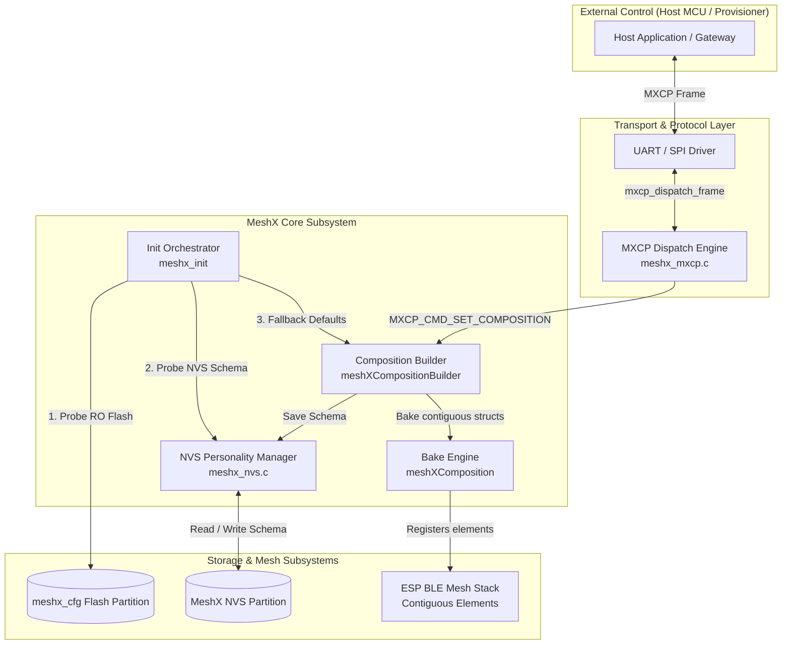
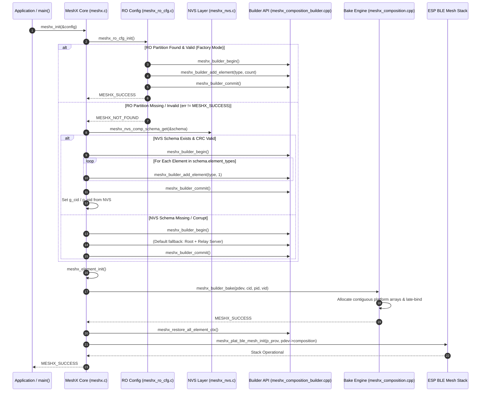
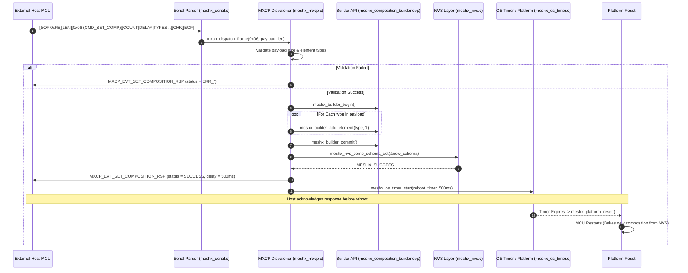
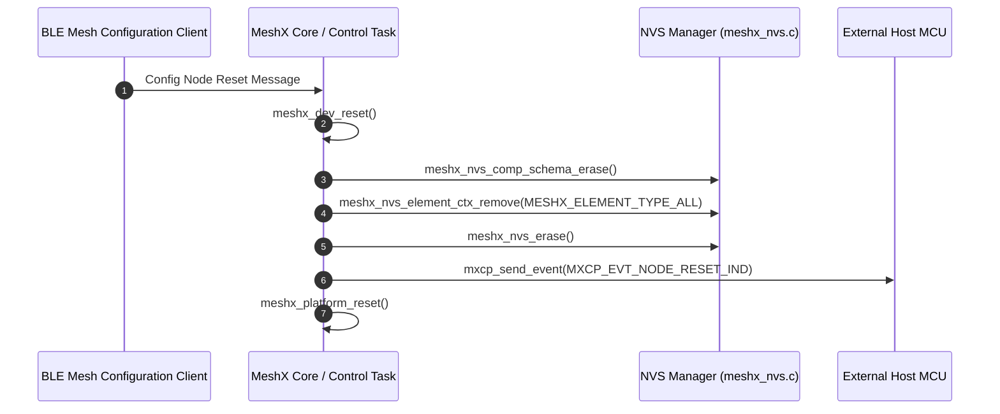

# Technical Design: Dynamic OOB Personality Management & Persistence

**Spec:** `oob-personality-management`  
**Target:** MeshX BLE Mesh Runtime Engine  
**Status:** Proposed / Draft  

---

## 1. Overview

### 1.1 Executive Summary
The MeshX dynamic composition engine enables devices to construct elements and BLE Mesh models at runtime using [meshXCompositionBuilder](file:///d:/MeshX/main/component/meshx/ble_mesh/elements/inc/meshx_composition_builder.hpp) and the runtime `bake()` lifecycle. However, as identified in [oob_readiness_report.md](file:///d:/MeshX/.agents/plans/oob_readiness_report.md) and [master_oob_phase_plan.md](file:///d:/MeshX/.agents/plans/master_oob_phase_plan.md), two architectural gaps prevent true Out-Of-The-Box (OOB) product versatility:

1. **Persistent Personality Gap:** Dynamic compositions built at runtime are ephemeral. Once the node undergoes a power cycle or reboot, runtime composition layout is lost unless backed by a read-only flash partition.
2. **Remote Builder Gap:** The MeshX Command Protocol (MXCP) provides commands to inspect the composition (`MXCP_CMD_GET_COMPOSITION`), but lacks the command set to reconfigure elements from an external Host MCU or remote link (`MXCP_CMD_SET_COMPOSITION`).

This document provides the technical design to bridge these gaps by introducing **NVS Personality Mirroring**, **MXCP Remote Composition Configuration**, and a controlled **Persist-and-Reset Lifecycle**.

---

## 2. Architecture & Design Principles

### 2.1 System Architecture Diagram



### 2.2 Core Design Principles & Constraints
1. **No Runtime Hot-Swapping:** The ESP-BLE-MESH stack initializes fixed element tables at boot time. Elements cannot be added or removed while the mesh stack is active. Reconfiguration must follow a **Configure $\rightarrow$ Persist to NVS $\rightarrow$ Graceful Reset $\rightarrow$ Re-bake** pattern.
2. **Deterministic Priority Hierarchy:** On boot, the device must resolve its personality through a well-defined fallback chain:
   $$\text{FAL RO Partition (Factory OTP)} \longrightarrow \text{NVS Dynamic Schema} \longrightarrow \text{Default Single Root Fallback}$$
3. **Contiguous Memory Safety:** Restored compositions must continue to leverage late-bound contiguous memory pools in [meshXComposition](file:///d:/MeshX/main/component/meshx/ble_mesh/elements/inc/meshx_composition.hpp) to avoid pointer fragmentation.
4. **Crash Resiliency & CRC16 Protection:** All schema records stored in NVS must be validated by CRC-16-CCITT to detect partial writes or flash corruption.

---

## 3. Data Structures & Storage Format

### 3.1 NVS Composition Schema (`meshx_nvs_comp_schema_t`)

A dedicated NVS schema structure records the element composition layout in the `MESHX_NVS_NAMESPACE_CID` or dedicated `MESHX_COMP` namespace:

```c
#define MESHX_NVS_NAMESPACE_COMP      "MESHX_COMP"
#define MESHX_NVS_KEY_COMP_SCHEMA     "comp_schema"
#define MESHX_NVS_COMP_MAGIC          0x4D584350  /* 'MXCP' */
#define MESHX_NVS_COMP_VERSION        0x01

#pragma pack(push, 1)
typedef struct {
    uint32_t magic;                                     /**< 0x4D584350 ('MXCP') */
    uint8_t  version;                                   /**< Format version (0x01) */
    uint8_t  element_count;                             /**< Total number of elements */
    uint16_t reserved;                                  /**< Alignment padding */
    uint16_t element_types[CONFIG_MAX_ELEMENT_COUNT];   /**< Array of meshx_element_type_t */
    uint16_t schema_crc;                                /**< CRC-16-CCITT over preceding fields */
} meshx_nvs_comp_schema_t;
#pragma pack(pop)
```

### 3.2 MXCP Protocol Extensions

In [meshx_mxcp.h](file:///d:/MeshX/main/component/meshx/ble_mesh/common/inc/meshx_mxcp.h), new command and event IDs are allocated:

```c
/* Command ID namespace (Host -> Engine, Bit 7 = 0) */
#define MXCP_CMD_SET_COMPOSITION        0x06

/* Event ID namespace (Engine -> Host, Bit 7 = 1) */
#define MXCP_EVT_SET_COMPOSITION_RSP    0x0B
```

#### Command Payload: `mxcp_cmd_set_composition_t`
```c
#pragma pack(push, 1)
typedef struct {
    uint8_t  element_count;     /**< Number of element entries in array */
    uint16_t reboot_delay_ms;   /**< Delay before reboot (e.g., 500 ms; 0 = no auto-reboot) */
    uint16_t element_types[0];  /**< Variable length array of meshx_element_type_t */
} mxcp_cmd_set_composition_t;
#pragma pack(pop)
```

#### Response Payload: `mxcp_evt_set_composition_rsp_t`
```c
typedef enum {
    MXCP_COMP_STATUS_SUCCESS            = 0x00,
    MXCP_COMP_STATUS_ERR_COUNT_EXCEEDED = 0x01,
    MXCP_COMP_STATUS_ERR_INVALID_TYPE   = 0x02,
    MXCP_COMP_STATUS_ERR_NVS_WRITE      = 0x03,
} mxcp_comp_status_t;

#pragma pack(push, 1)
typedef struct {
    uint8_t  status;            /**< mxcp_comp_status_t */
    uint8_t  element_count;     /**< Applied element count */
    uint16_t reboot_delay_ms;   /**< Scheduled reboot delay (0 if failed) */
} mxcp_evt_set_composition_rsp_t;
#pragma pack(pop)
```

---

## 4. Sequence Diagrams

### 4.1 Boot-Time Initialization & Personality Restoration Flow

This sequence demonstrates how [meshx_init()](file:///d:/MeshX/main/component/meshx/src/meshx.c#L256-L335) determines whether to load from Read-Only Flash, restore an NVS mirrored personality, or use defaults.



---

### 4.2 Remote Personality Configuration Flow via MXCP

This sequence illustrates a Host MCU reconfiguring the personality via UART and triggering the reboot lifecycle.



---

### 4.3 Node Reset & Factory Teardown Flow

When a node receives a remote BLE Mesh node reset or local factory reset command, all runtime elements and personality records must be pruned:



---

## 5. Detailed Component Changes

### 5.1 NVS Subsystem ([meshx_nvs.c](file:///d:/MeshX/main/component/meshx/src/meshx_nvs.c) & [meshx_nvs.h](file:///d:/MeshX/main/component/meshx/inc/meshx_nvs.h))
1. **New Schema API:**
   - `meshx_err_t meshx_nvs_comp_schema_set(const meshx_nvs_comp_schema_t *schema);`
   - `meshx_err_t meshx_nvs_comp_schema_get(meshx_nvs_comp_schema_t *schema);`
   - `meshx_err_t meshx_nvs_comp_schema_erase(void);`
2. **Implementation details:**
   - Write using `MESHX_NVS_AUTO_COMMIT` to ensure the schema is synchronously written to flash before a reset occurs.
   - CRC-16-CCITT computed over fields excluding the trailing `schema_crc`.

### 5.2 Dynamic Composition Builder ([meshx_composition_builder.cpp](file:///d:/MeshX/main/component/meshx/ble_mesh/elements/src/meshx_composition_builder.cpp))
1. **Auto-Persist Hook in `commit()`:**
   - On `meshXCompositionBuilder::commit()`, construct `meshx_nvs_comp_schema_t` by inspecting `comp.get_elements()`.
   - Save the schema to NVS automatically so any builder actions taken by user code or serial commands are retained across reboots.

### 5.3 MXCP Handler Subsystem ([meshx_mxcp.c](file:///d:/MeshX/main/component/meshx/ble_mesh/common/src/meshx_mxcp.c))
1. **Command Handler:**
   - Implement `mxcp_cmd_fn_set_composition(const uint8_t *payload, uint8_t len)`.
   - Add entry to `mxcp_cmd_table[]`:
     ```c
     MXCP_CMD_ENTRY(MXCP_CMD_SET_COMPOSITION, mxcp_cmd_fn_set_composition, 0, MXCP_EVT_SET_COMPOSITION_RSP, MXCP_EVT_NONE)
     ```
2. **Reboot Scheduler:**
   - Use a lightweight software timer to trigger `meshx_platform_reset()` after transmitting the response frame, ensuring UART buffers flush cleanly.

### 5.4 Application Telemetry Callback Expansion ([main.c](file:///d:/MeshX/main/src/main.c))
Expand `meshx_app_data_cb()` to handle all UVP catalog element types:
- `MESHX_ELEMENT_TYPE_SENSOR_SERVER` / `CLIENT`: Log and dispatch sensor telemetry values.
- `MESHX_ELEMENT_TYPE_LIGHT_HSL_SERVER` / `CLIENT`: Handle RGB and HSL lightness/hue/saturation events.

---

## 6. Verification & Test Strategy

| Test Case | Scenario | Expected Outcome |
| :--- | :--- | :--- |
| **TC-OOB-01** | Cold boot without RO flash partition. | Reads NVS schema, restores registered elements, bakes successfully. |
| **TC-OOB-02** | Remote reconfiguration via `MXCP_CMD_SET_COMPOSITION`. | Returns `SUCCESS` response, saves to NVS, reboots after delay, boots with updated element list. |
| **TC-OOB-03** | Overflow protection (`element_count > CONFIG_MAX_ELEMENT_COUNT`). | Rejects command with `ERR_COUNT_EXCEEDED`, NVS remains untouched, node does not reboot. |
| **TC-OOB-04** | Corrupt NVS Schema (CRC mismatch simulation). | Detects invalid CRC, discards NVS schema, falls back safely to default personality. |
| **TC-OOB-05** | Factory Node Reset. | Clears NVS schema blob; subsequent boot starts in pristine unprovisioned state. |
