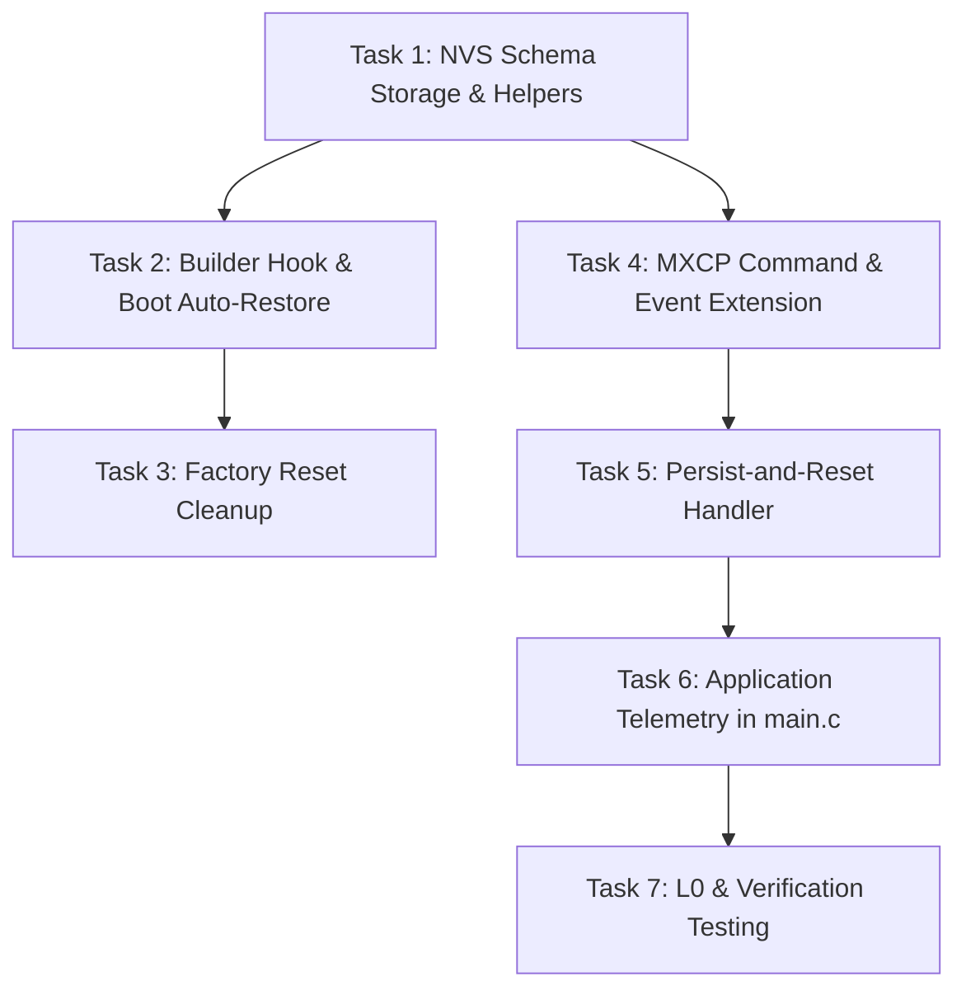

# Tasks: Dynamic OOB Personality Management

Implementation tasks for the `oob-personality-management` specification.

---

## Task Dependency Graph

---

## Detailed Task Breakdown

### Phase 1: NVS Personality Mirroring (Core Persistence)
- [x] **Task 1: Implement NVS Schema Storage in `meshx_nvs`**
  - Define `meshx_nvs_comp_schema_t` structure in `meshx_nvs.h`.
  - Implement `meshx_nvs_comp_schema_set()`, `meshx_nvs_comp_schema_get()`, and `meshx_nvs_comp_schema_erase()` in `meshx_nvs.c`.
  - Include CRC-16-CCITT validation on read/write.
- [x] **Task 2: Integrate Auto-Persist & Boot-time Reconstitution**
  - In `meshx_composition_builder.cpp`, implemented `meshx_builder_save_to_nvs(override_ro)`.
  - In `meshx.c` (`meshx_element_init()`), if NVS schema exists with override or if builder is inactive, query `meshx_nvs_comp_schema_get()`.
  - Auto-replay `meshx_builder_begin()` $\rightarrow$ `add_element()` $\rightarrow$ `commit()` before `meshx_builder_bake()`.
  - Safe fallback default personality if neither RO config nor NVS schema is present.
- [x] **Task 3: Node Reset & Lifecycle Teardown**
  - Updated `meshx_prov_node_reset_handler()` in `meshx_prov_srv.cpp` and `mxcp_cmd_fn_node_reset()` in `meshx_mxcp.c` to erase the NVS composition schema.

### Phase 2: Remote Configuration via MXCP (Hosted Mode)
- [x] **Task 4: Extend MXCP Protocol Definitions**
  - Added `MXCP_CMD_SET_COMPOSITION` (`0x06`) and `MXCP_EVT_SET_COMPOSITION_RSP` (`0x0B`) to `meshx_mxcp.h`.
  - Defined `mxcp_cmd_set_composition_t` and `mxcp_evt_set_composition_rsp_t`.
- [x] **Task 5: Implement MXCP Command Handler & Graceful Reboot**
  - Implemented `mxcp_cmd_fn_set_composition()` in `meshx_mxcp.c`.
  - Validated payload, written new schema directly to NVS with override flag.
  - Sent response frame, then scheduled `meshx_platform_reset()` via software timer (500 ms delay).
  - Registered in `mxcp_cmd_table[]`.

### Phase 3: Application Integration & Validation
- [x] **Task 6: Complete Application Data Callback in `main.c`**
  - Added switch cases for `MESHX_ELEMENT_TYPE_SENSOR_SERVER`, `MESHX_ELEMENT_TYPE_SENSOR_CLIENT`, `MESHX_ELEMENT_TYPE_LIGHT_HSL_SERVER`, and `MESHX_ELEMENT_TYPE_LIGHT_HSL_CLIENT`.
  - Logged received state changes and telemetry.
- [x] **Task 7: L0 & Functional Verification**
  - Added CLI L0 unit tests in `meshx_nvs.c` (`ut 3 7`, `ut 3 8`, `ut 3 9`, `ut 3 10`) for schema write, CRC-16 read, corruption rejection, and erasure.
  - Documented CLI test commands in `unit_test/README.md`.
  - Added `CompositionInterface` to `tools/scripts/autotest/framework/device.py` (`MXCP_CMD_SET_COMPOSITION`, `MXCP_EVT_SET_COMPOSITION_RSP`, `MXCP_CMD_NODE_RESET`).
  - Implemented end-to-end integration test case `tools/scripts/autotest/cases/test_oob_composition.py`.
  - Verified firmware compilation cleanliness on target platform.
