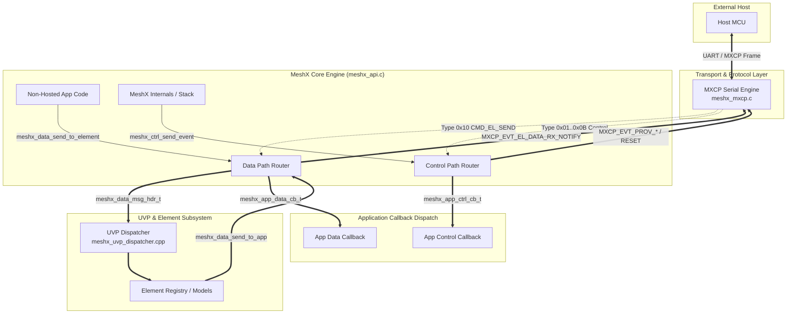

# Design Document: Unified MXCP and Application APIs

**Milestone:** Release v0.6  
**Issue:** #143  
**Status:** In Review  
**Target Subsystem:** `meshx_api`, `meshx_mxcp`, `meshx_control_task`, `meshx_uvp_dispatcher`

---

## 1. Overview & Architectural Goals

The goal of this design is to unify and harmonize the internal application API (`meshx_api.h` / `meshx_api.c`) and the external wire command protocol (`meshx_mxcp.h` / `meshx_mxcp.c`).

### Key Architectural Pillars
1. **Single Source of Truth Header Formats**:
   Eliminate structural drift between `meshx_app_element_msg_header_t` and `mxcp_cmd_el_send_t` / `mxcp_evt_el_data_rx_notify_t` by introducing a unified 8-byte `meshx_data_msg_hdr_t`.
2. **Dedicated, Decoupled Execution Paths**:
   Element data frames (telemetry and commands) flow strictly through the **Data Path**, whereas node lifecycle, provisioning, composition, and pairing management flow strictly through the **Control Path**.
3. **Dual Operation (Hosted and Non-Hosted)**:
   In Non-Hosted mode, user code invokes `meshx_data_send_to_element` directly. In Hosted mode, the Host MCU sends MXCP frames over UART which are routed into the exact same element execution pipeline.
4. **Compile-Time Production Sanitization**:
   Raw hardware pin manipulation commands over MXCP are conditionally compiled out in production builds using `CONFIG_MESHX_ENABLE_GPIO_TEST_API`.

---

## 2. Architecture Diagrams

### 2.1 Communication Topology & Path Separation



### 2.2 Interactive Bidirectional Packet Flow Diagram (Archify)

An interactive, animated sequence diagram validating end-to-end timing, queue boundaries, and packet transitions across all 4 gates (`validate`, `deliver`, `check`, `browser-check`) has been generated:
- **Interactive Artifact:** [bidirectional-packet-flow.html](file:///d:/MeshX/.archify/sequence-bidirectional-packet-flow-20261018-002905/bidirectional-packet-flow.html)
- **Candidate Specification:** [candidate.json](file:///d:/MeshX/.archify/sequence-bidirectional-packet-flow-20261018-002905/candidate.json)
- **Validation Receipt:** [review-2/bidirectional-packet-flow.finalize-summary.json](file:///d:/MeshX/.archify/sequence-bidirectional-packet-flow-20261018-002905/review-2/bidirectional-packet-flow.finalize-summary.json)


---

## 3. Data Structures & Contract Definitions

### 3.1 Unified Element Data Message Header (`meshx_data_msg_hdr_t`)

```c
#pragma pack(push, 1)

/**
 * @brief Canonical 8-byte Element Data Message Header
 * Used uniformly across meshx_api and MXCP wire payload (CMD_EL_SEND, EVT_EL_DATA_RX_NOTIFY).
 */
typedef struct meshx_data_msg_hdr {
    uint16_t element_id;    /**< Target or Source Element index (0 .. N-1) */
    uint16_t element_type;  /**< Logical element type (e.g. MESHX_ELEMENT_TYPE_RELAY_SERVER) */
    uint16_t func_id;       /**< Element Functionality ID (e.g. ON_OFF=0x00, CTL=0x01) */
    uint16_t msg_len;       /**< Length of payload following this header in bytes */
} meshx_data_msg_hdr_t;

#pragma pack(pop)
```

In `meshx_mxcp.h`:
```c
/* Unify MXCP element send and notify structs with meshx_data_msg_hdr_t */
typedef meshx_data_msg_hdr_t mxcp_cmd_el_send_t;
typedef meshx_data_msg_hdr_t mxcp_evt_el_data_rx_notify_t;
typedef meshx_data_msg_hdr_t mxcp_evt_el_data_tx_notify_t;
```

---

### 3.2 Unified Control Message Header & Event IDs

```c
/**
 * @brief System Control Event Enumeration
 */
typedef enum meshx_ctrl_evt_id {
    MESHX_CTRL_EVT_NONE                  = 0x00,
    MESHX_CTRL_EVT_PROV_START            = 0x01,
    MESHX_CTRL_EVT_PROV_COMP             = 0x02,
    MESHX_CTRL_EVT_PROV_FAILED           = 0x03,
    MESHX_CTRL_EVT_NODE_RESET            = 0x04,
    MESHX_CTRL_EVT_IDENTIFY_START        = 0x05,
    MESHX_CTRL_EVT_IDENTIFY_STOP         = 0x06,
    MESHX_CTRL_EVT_COMPOSITION_CHANGE    = 0x07,
    MESHX_CTRL_EVT_PAIRING_STATUS        = 0x08,
    MESHX_CTRL_EVT_LINK_TABLE_UPDATED    = 0x09,
    MESHX_CTRL_EVT_MAX
} meshx_ctrl_evt_id_t;

#pragma pack(push, 1)

/**
 * @brief Canonical Control Message Header
 */
typedef struct meshx_ctrl_msg_hdr {
    uint16_t evt_id;        /**< meshx_ctrl_evt_id_t */
    uint16_t status;        /**< Status / Result code (0 = SUCCESS) */
    uint16_t msg_len;       /**< Length of control payload following header */
} meshx_ctrl_msg_hdr_t;

#pragma pack(pop)
```

---

## 4. API Function Specifications

### 4.1 Data Path Public APIs (`meshx_api.h`)

```c
/**
 * @brief Application data callback prototype.
 *
 * @param[in] hdr      Pointer to the unified element data header.
 * @param[in] payload  Pointer to the element-specific data payload.
 * @return MESHX_SUCCESS on success, error code otherwise.
 */
typedef meshx_err_t (*meshx_app_data_cb_t)(
    const meshx_data_msg_hdr_t *hdr,
    const void *payload
);

/**
 * @brief Register callback for element data messages.
 */
meshx_err_t meshx_app_reg_data_callback(meshx_app_data_cb_t cb);

/**
 * @brief Send element data upwards to App and Host MCU.
 * Emits MXCP_EVT_EL_DATA_RX_NOTIFY if MXCP active and dispatches to app_data_cb.
 */
meshx_err_t meshx_data_send_to_app(
    const meshx_data_msg_hdr_t *hdr,
    const void *payload
);

/**
 * @brief Send element command downwards from App into MeshX Element Engine.
 */
meshx_err_t meshx_data_send_to_element(
    const meshx_data_msg_hdr_t *hdr,
    const void *payload
);
```

### 4.2 Control Path Public APIs (`meshx_api.h`)

```c
/**
 * @brief Application control callback prototype.
 *
 * @param[in] hdr      Pointer to the unified control header.
 * @param[in] payload  Pointer to the control payload data (or NULL if len == 0).
 * @return MESHX_SUCCESS on success, error code otherwise.
 */
typedef meshx_err_t (*meshx_app_ctrl_cb_t)(
    const meshx_ctrl_msg_hdr_t *hdr,
    const void *payload
);

/**
 * @brief Register callback for system control messages.
 */
meshx_err_t meshx_app_reg_ctrl_callback(meshx_app_ctrl_cb_t cb);

/**
 * @brief Dispatch a system control event to the registered app callback and MXCP.
 */
meshx_err_t meshx_ctrl_send_event(
    meshx_ctrl_evt_id_t evt_id,
    uint16_t status,
    const void *payload,
    uint16_t payload_len
);
```

### 4.3 Backward Compatibility Mapping

To preserve existing code and minimize disruption across tests and logical models:
```c
/* Deprecated wrappers pointing to new unified APIs */
static inline meshx_err_t meshx_send_msg_to_app(uint16_t el_id, uint16_t el_type, uint16_t func_id, uint16_t len, const void *data) {
    meshx_data_msg_hdr_t hdr = { .element_id = el_id, .element_type = el_type, .func_id = func_id, .msg_len = len };
    return meshx_data_send_to_app(&hdr, data);
}

static inline meshx_err_t meshx_send_msg_to_element(uint16_t el_id, uint16_t el_type, uint16_t func_id, uint16_t len, const void *data) {
    meshx_data_msg_hdr_t hdr = { .element_id = el_id, .element_type = el_type, .func_id = func_id, .msg_len = len };
    return meshx_data_send_to_element(&hdr, data);
}

static inline meshx_err_t meshx_app_reg_element_callback(meshx_app_data_cb_t cb) {
    return meshx_app_reg_data_callback(cb);
}

static inline meshx_err_t meshx_app_reg_system_events_callback(meshx_app_ctrl_cb_t cb) {
    return meshx_app_reg_ctrl_callback(cb);
}
```

---

## 5. GPIO Production Conditional Compilation Design

### 5.1 Build Configuration
- In `prod_profile.yml` / Kconfig:
  Define `CONFIG_MESHX_ENABLE_GPIO_TEST_API`:
  - `y` in debug/test configurations.
  - `n` in release profiles (`CONFIG_MESHX_PRODUCTION_BUILD=y`).

### 5.2 Conditional Inclusions in `meshx_mxcp.h` & `meshx_mxcp.c`
```c
#if CONFIG_MESHX_ENABLE_GPIO_TEST_API
    MXCP_CMD_ENTRY(MXCP_CMD_GPIO_SET_LEVEL,    mxcp_cmd_fn_gpio_set_level,    ...),
    MXCP_CMD_ENTRY(MXCP_CMD_GPIO_GET_LEVEL,    mxcp_cmd_fn_gpio_get_level,    ...),
    MXCP_CMD_ENTRY(MXCP_CMD_GPIO_TOGGLE,       mxcp_cmd_fn_gpio_toggle,       ...),
    ...
#endif
```
If a host MCU transmits a GPIO command ID (`0x21`..`0x29`) when this flag is disabled:
- The binary table scan fails to match the command ID.
- `mxcp_process_frame` returns `MXCP_STATUS_UNKNOWN_CMD`.
- Flash memory occupied by GPIO test handlers is completely omitted.
