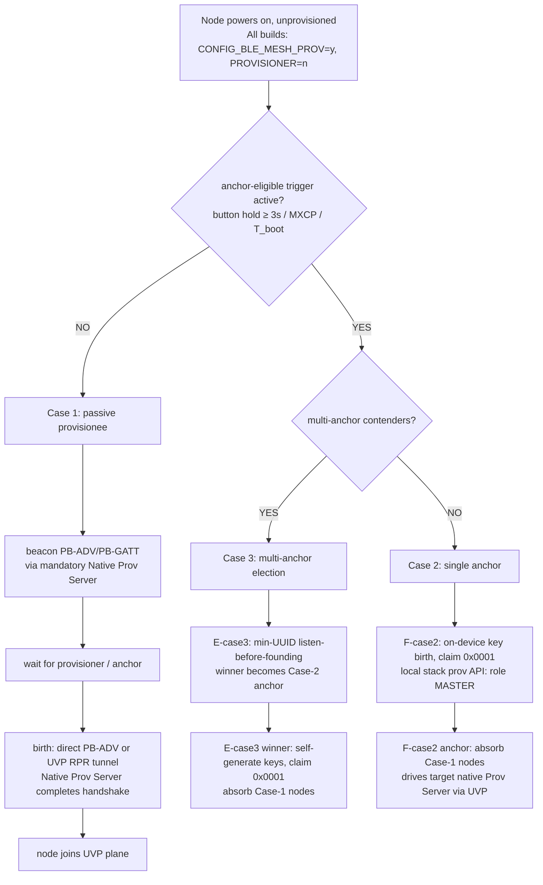
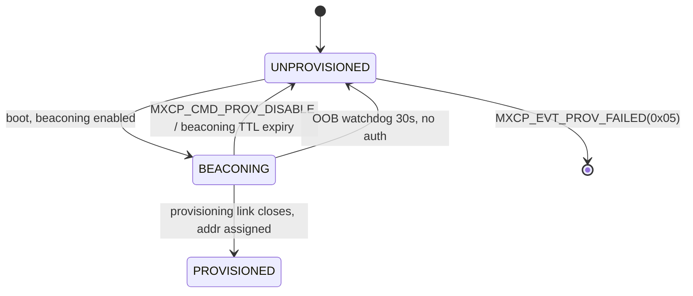
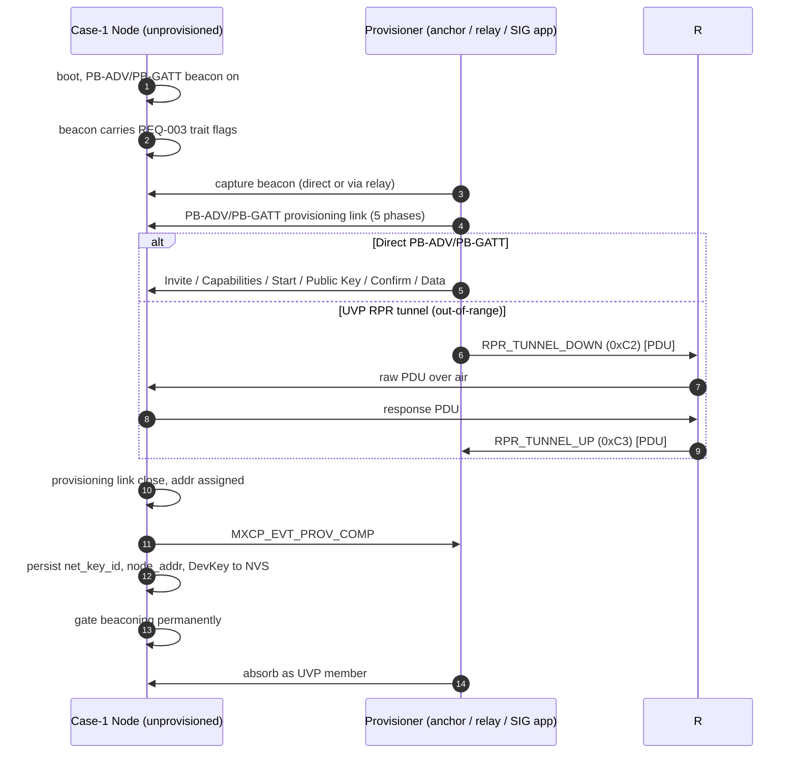
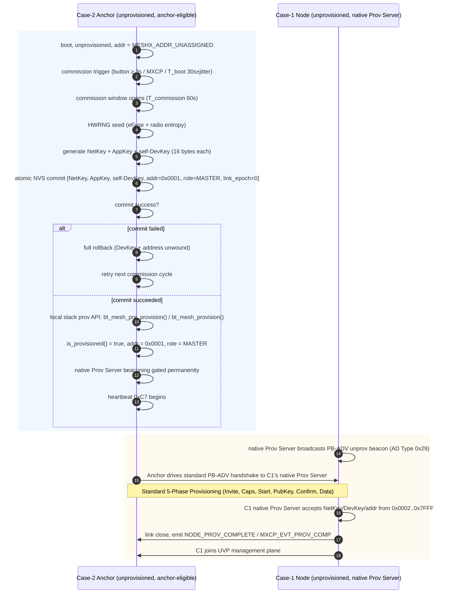
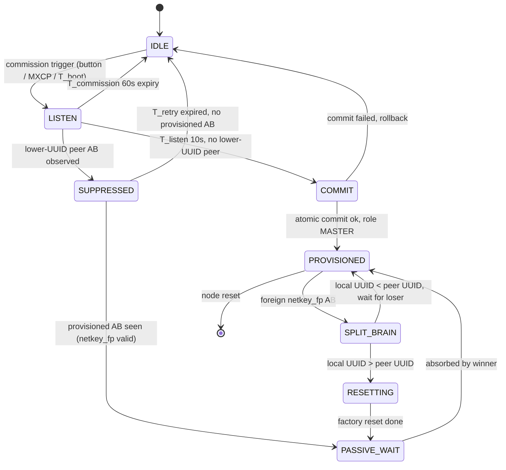
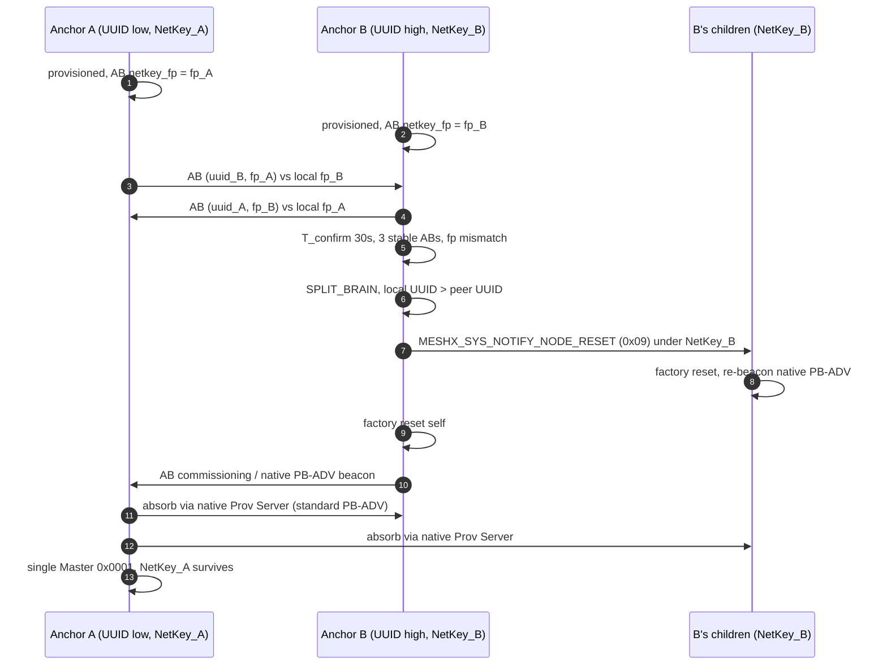
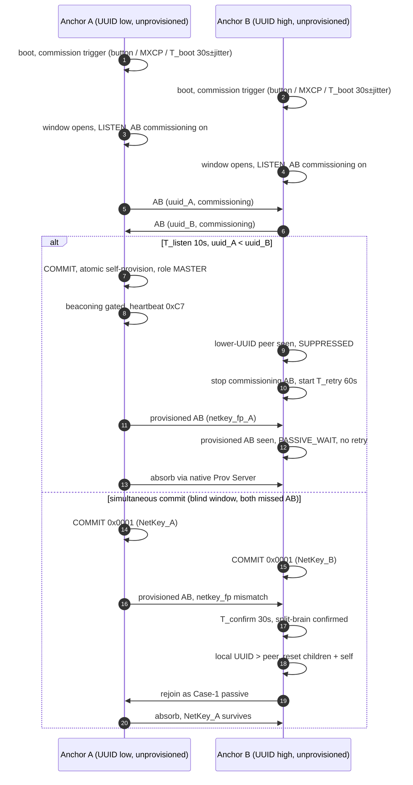

# Design — Zero-Gateway Bootstrap

**Module:** `ZGB`  
**Status:** Draft  
**Linked Issue:** https://github.com/pranjalchanda08/MeshX/issues/160

---

## 1. Decision Tree

## 2. Case 1 — Passive Provisionee (single node, no provisioner)

**States** (existing enum `meshx_mxcp.h:193-198`):

**Key behaviors:**
- Boot → native Prov Server enables PB-ADV/PB-GATT (`meshx.c:293`, `esp_prov_srv_model.c:95-108`).
- Beacon carries company ID + product trait mask. Trait mask lives in Device UUID bytes 10..11, big-endian (`uuid[10] << 8 | uuid[11]`). Today the mask is design-only injection; ZGB-005 adds validation, not signing.
- No key generation, no address assignment. NetKey/AppKey/DevKey arrive only from the provisioner.
- On provisioning close: persist net_key_id, node_addr, DevKey to NVS (`meshx_prov_srv.cpp:242-272`), emit `MXCP_EVT_PROV_COMP`, gate beaconing permanently (ZGB-010).

**Sequence — Case 1 birth:**

**Failure modes:**
- Provisioner never arrives → beaconing runs until kill-switch (MXCP disable or TTL).
- OOB failure → 30s watchdog disables bearers, `PROV_FAILED 0x05`, retry allowed.
- Capability spoofing → provisioner validates trait mask at link close; mismatch aborts.

## 3. Case 2 — Anchor (single node, anchor-eligible)

All nodes run the same binary without `CONFIG_BLE_MESH_PROVISIONER`. Anchor eligibility is activated by trigger, not a custom image.

**Triggers (any one suffices):**
1. GPIO button hold ≥ 3s
2. `MXCP_CMD_BOOTSTRAP_COMMISSION` over MXCP serial
3. Post-boot timer `T_boot = 30s ± jitter` when `is_provisioned() == false`

**Commission window:**
- Opens on trigger; closes on commit, abort (`MXCP_CMD_BOOTSTRAP_ABORT`), button double-tap, or `T_commission` expiry (default 60s).
- While open: anchor prepares for key birth and unprovisioned scanning; while closed: drops unprovisioned beacons (`page8:386-389` pattern).
- **Race note:** `meshx.c:431-436` starts UVP dispatcher before GPIO init; design mandates GPIO/button init completes before the commission window opens (task).

**Key birth, local self-provision & Prov Server absorption:**

**Key behaviors (Case 2):**
- Address `0x0001` is already `ASSIGNED` at bitmap init (`meshx_group_allocator.c:183, 186-188`); anchor claims it as self-provisioned node address using local stack provision calls without compiling the SIG Provisioner stack.
- Commit failure mid-key-birth → full rollback (ZGB-008); partial states forbidden.
- In-range Case-1 absorption: anchor drives standard PB-ADV packets to the target's native Prov Server directly.
- Out-of-range absorption: intermediate relay captures `0x29` unprovisioned beacon, tunnels `0xC0..0xC3` (existing RPR).
- Bulk growth: existing Wavefront `0xC8/0xCC` leases from unified pool `0x0002..0x7FFF`.
- **No new UVP opcodes; no SIG Provisioner stack required.**

## 4. Case 3 — Multi-Anchor Election (multiple anchor-eligible nodes)

**Pre-mesh problem:** no shared NetKey, no mesh, no UVP to carry votes. Election must happen before any anchor commits `0x0001`. Native PB-ADV unprovisioned beacons cannot carry the election: a passive Case-1 provisionee emits the same beacon, and a provisioned anchor stops emitting it. So Cases 1-3 define **one auxiliary advertisement**, used for both pre-commit election and post-commit island detection.

### 4.1 Arbitration substrate — ZGB Arbitration Beacon (ZGB-018)

The ZGB Arbitration Beacon (AB) is a standard BLE legacy advertisement. It is **not** a UVP opcode, **not** a mesh model, and **not** a replacement for the native Prov Server beacon.

| Field | Size | Meaning |
|-------|------|---------|
| `ver` | 1 | Frame version, `0x01` |
| `flags` | 1 | b0 anchor-eligible, b1 commissioning, b2 provisioned-network-present |
| `uuid` | 16 | Device UUID (same UUID used by the native Prov Server, not a hash) |
| `netkey_fp` | 4 | First 4 bytes of `SHA-256(NetKey)`; all zero when unprovisioned |

Wire form: AD structure type `0xFF` (Manufacturer Specific Data), Company ID `0x02E5`, then 22 payload bytes. Manufacturer data is 24 bytes; with the AD length/type and a 3-byte Flags AD the PDU is 29 bytes, within the 31-byte legacy advertising limit. The 4-byte fingerprint exposes 32 bits of `SHA-256(NetKey)`; the NetKey itself must stay 128-bit HWRNG output.

**Advertising policy:**

| Node state | AB behavior |
|------------|-------------|
| Unprovisioned, not commissioning | none (native PB-ADV only) |
| Unprovisioned, commission window open | `flags = anchor_eligible \| commissioning`, 100 ms interval |
| Provisioned anchor / Master | `flags = anchor_eligible \| provisioned`, `netkey_fp` set; 5 s interval for 60 s after boot, then 60 s keepalive |
| Provisioned non-anchor | none (no need to expose fingerprint) |

**Scanning policy:**
- Passive scan at 100% duty while the commission window is open, and for 60 s after boot.
- Deduplicate peers by full UUID; keep at most 8 peers; age out a peer after 15 s without an AB.
- Ignore self (same UUID). Ignore ABs with `ver != 0x01` or wrong Company ID.

### 4.2 Election — min-UUID listen-before-founding (ZGB-013)

1. Commission trigger opens the window. Enter `LISTEN`; advertise AB with `commissioning`.
2. `T_listen = 10 s` inside the 60 s `T_commission` window. During `LISTEN`, collect ABs with `commissioning=1` and `anchor_eligible=1`.
3. At `T_listen` end:
   - No peer, or every peer UUID > local UUID → `COMMIT`: run atomic self-provision and become `0x0001`.
   - Any peer UUID < local UUID → `SUPPRESSED`: stop advertising the commissioning AB, cancel pending self-provisioning.
   - Peer UUID == local UUID (cloned hardware) → hard stop, log `ZGB_DUPLICATE_UUID`, require operator action. No commit.
4. Commit is attempted at `T_listen` end, not at window end, so the winner does not wait the full 60 s. Window closes on commit success.
5. Commit failure → rollback (ZGB-008) and re-enter `LISTEN` on the next cycle.

**Suppression and retry (ZGB-014):**
- `SUPPRESSED` keeps scanning. If a provisioned AB with a valid `netkey_fp` appears, the node stops retrying and becomes a Case-1 passive provisionee waiting for the winner to absorb it.
- Otherwise, after `T_retry` the node re-enters `LISTEN`. Backoff grows per consecutive suppression: 60 s, 120 s, 240 s, 600 s cap, ±10% jitter. Not a permanent latch.
- Operator button/MXCP trigger resets the backoff and forces a fresh `LISTEN`.

### 4.3 Election state machine

### 4.4 Split-brain detection (ZGB-015, revised)

The earlier draft claimed "detect NetKey mismatch at first UVP contact". That is not implementable: two islands have different NetKeys, so each side's mesh layer drops the other side's frames on MIC failure. No frame ever reaches the UVP dispatcher, and a MIC failure is indistinguishable from corruption.

Detection therefore uses the AB `netkey_fp` field:

1. Both islands are provisioned; each anchor advertises AB with `provisioned` and its 4-byte `netkey_fp`.
2. An anchor receives a provisioned AB whose `netkey_fp` differs from its own.
3. Confirm over `T_confirm = 30 s`: require at least 3 ABs from the same UUID with the same stable fingerprint before raising `SPLIT_BRAIN`. This filters random corruption and single-packet spoofing.
4. If fingerprints match, the islands are already one network; no action.

The fingerprint is a **hint**, not authentication. Residual risk: a spoofed AB can force an unnecessary reset (denial of service, no key exposure). Mitigations: `T_confirm` window, RSSI floor, stable-UUID requirement, operator override, and an event log entry.

### 4.5 Split-brain healing

- Loser is the **higher** UUID anchor. Winner keeps its NetKey and its address space.
- Loser broadcasts the existing `MESHX_SYS_NOTIFY_NODE_RESET` notice (`0x09`) under its own NetKey to its children, waits 2 s, then factory-resets itself through the existing node-reset path. Children reset and re-beacon as Case-1 provisionees; the winner absorbs them.
- Children that miss the 2 s notice stay on the loser NetKey and remain stranded. Documented limitation: operator re-provisions them physically. No automatic destructive action beyond the single reset notice.
- Winner then continues as Master. DevKey records from the loser are not trusted: the winner has no DevKey for children it did not provision, so absorption runs standard provisioning and creates fresh records.
- Equal UUIDs (clone) → neither side resets; log and require operator.

### 4.6 Role state machine (ZGB-020)

`meshx_prov_role_t` today has `STANDALONE/MASTER/STANDBY`. Cases 1-3 need two more **volatile** states:

| Role | Value | Persisted? | Meaning |
|------|-------|-----------|---------|
| `STANDALONE` | 0 | no | unprovisioned, default |
| `MASTER` | 1 | yes in `meshx_store.prov_role` | committed anchor `0x0001` |
| `STANDBY` | 2 | yes | reserved for redundancy spec; unused by Cases 1-3 |
| `CANDIDATE` | 3 | no | in `LISTEN`, not yet committed |
| `STALE` | 4 | no | suppressed or lost split-brain, pending retry/reset |

Only `MASTER`/`STANDBY` are written to NVS. `CANDIDATE`/`STALE` are runtime labels and must never survive reboot.

**Sequence — Case 3 election:**

**Collision surface (unauthenticated radio):**
- Spoofed low-UUID AB suppresses a real anchor: temporary DoS only. Retry backoff means the real anchor returns; operator can force via button/MXCP.
- Spoofed `netkey_fp` forces a reset: DoS only, confirmed over 30 s. No key exposure.
- Timer jitter (`T_boot = 30 s ± 5 s`) and random `T_retry` jitter reduce simultaneous commits at scale.

**External app mid-commission:**
- If a SIG app provisions the anchor mid-commission, `is_provisioned()` guard aborts self-generation; adopted credentials are kept (ZGB-011). The AB commissioning flag stops.

**DevKey vault consistency:**
- A failed anchor's orphan DevKey stays in the vault only if the hardware was replaced. The blacklist applies to replaced hardware UUIDs, not reset-and-rejoin anchors. A reset-and-rejoin anchor is re-adopted through standard provisioning and receives a fresh DevKey record (ZGB-016).

## 5. Trigger Matrix

| Trigger | Case 1 node | Case 2 anchor | Case 3 anchors |
|---------|-------------|---------------|----------------|
| Boot, unprovisioned | beacon (native Prov Server) | enter commission if triggered | enter commission if triggered |
| Button hold ≥ 3s | (no effect) | commission | commission |
| `MXCP_CMD_BOOTSTRAP_COMMISSION` | (rejected) | commission | commission |
| Post-boot timer 30s ± jitter | (no effect) | commission | commission |
| External PB-ADV provisioning | birth (native Prov Server) | abort commission, keep credentials | abort commission, keep credentials |
| Lower-UUID peer AB during `LISTEN` | N/A | N/A | suppress + retry |
| Provisioned AB with foreign `netkey_fp` | N/A | N/A | confirm 30 s, then split-brain heal |

## 6. Failure Modes & Mitigations

| Failure | Detection | Resolution |
|---------|-----------|------------|
| HWRNG entropy starvation at anchor boot | entropy check fails | Abort commission, retry next cycle |
| Atomic NVS commit failure mid-key-birth | per-key write error | Rollback both DevKey and address (ZGB-008) |
| Split-brain two `0x0001` | NetKey mismatch at first UVP contact | Higher-UUID anchor resets, joins winner |
| Suppressed anchor latched forever | — | Retry window `T_retry` prevents latch |
| External app + self-generation race | `is_provisioned()` pre-commit | Adopt external credentials, abort self-gen |
| Beaconing never ends (no provisioner) | — | MXCP disable + beaconing TTL (ZGB-004) |
| Flash budget breach on anchor | measured flash delta | Single binary with `CONFIG_BLE_MESH_PROVISIONER=n` stays ≤ 15 KB |

## 7. Interaction with Existing Specs

- `.specs/meshx-prov-srv-mxcp/trd/page5_redundancy_cascading.md`: Master `0x0001`, Standby `0x0002`, heartbeat `0xC7` — all unchanged; Case 2 produces the first Master.
- `.specs/meshx-prov-srv-mxcp/trd/page8_fast_bulk_provisioning.md`: Wavefront leases grow network after Case 2 birth; unified pool `0x0002..0x7FFF` starts at anchor's `next_free_addr_hint = 0x0002`.
- `.specs/autonomous-element-pairing/requirements.md` §3: deferred "Zero-Gateway Out-of-the-Box Provisioning" assumption is now replaced by this spec's Case 1 (passive) + Case 2 (anchor) paths.

