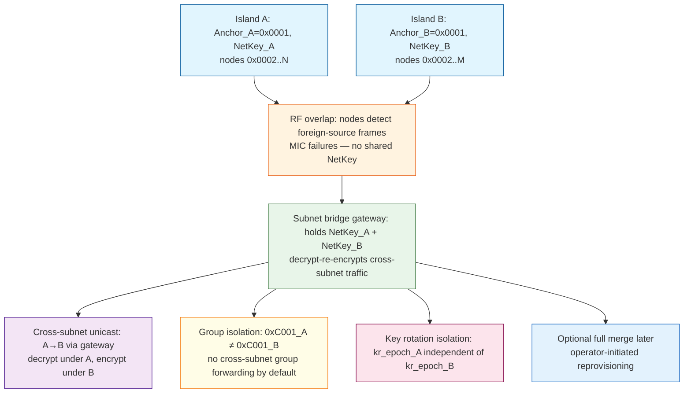
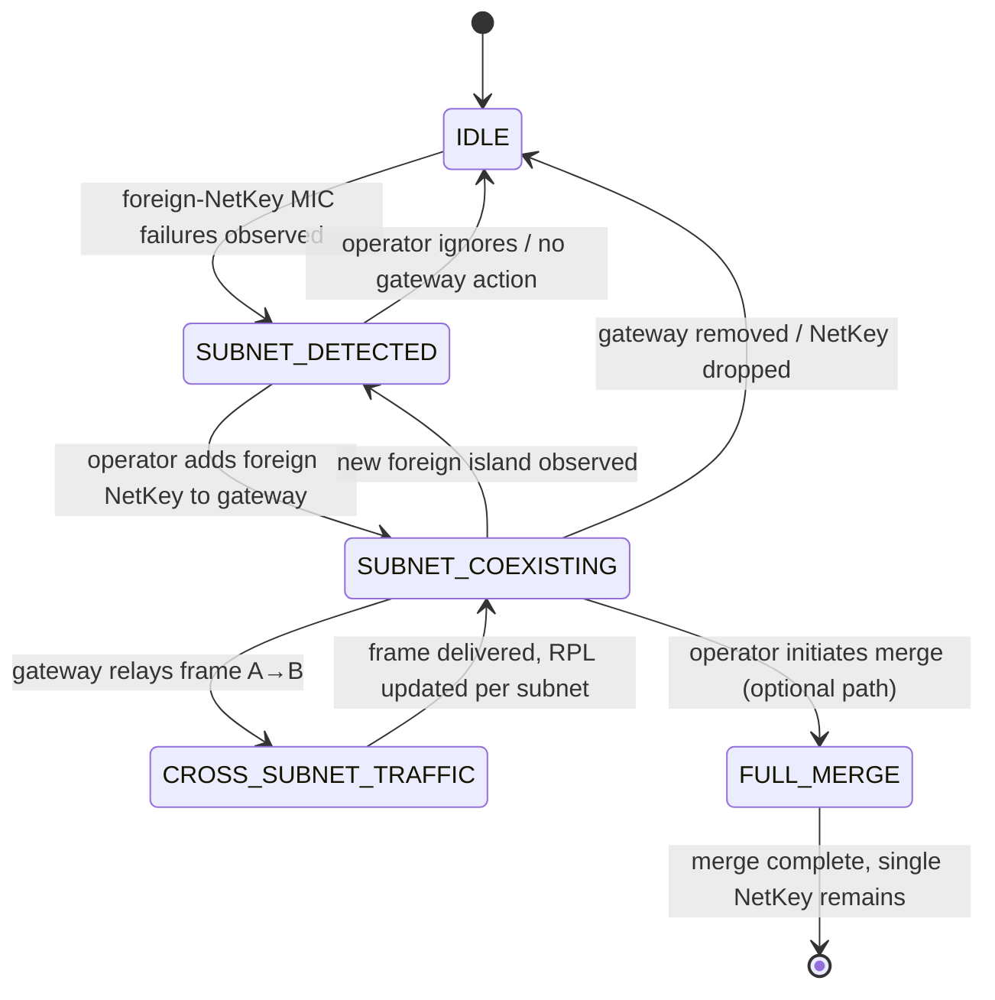

# Feature — Case 4: Network Coexistence / Subnet Routing (Deferred)

**Module:** `ZGB-Case4`  
**Status:** Deferred to future spec  
**Linked Issue:** https://github.com/pranjalchanda08/MeshX/issues/160  
**Relation to ZGB:** Case 4 is out of scope for the initial bootstrap spec (Cases 1-3). Documented here as a future feature.

---

## Problem Statement

Two provisioned mesh islands bootstrap out of RF proximity; each has its own Master `0x0001`, NetKey, address population (`0x0001..0x7FFF`), groups, scenes, and bindings. When they later come into RF overlap, UVP is NetKey-encrypted so islands cannot decrypt each other's traffic. Re-provisioning one island under the other's NetKey is destructive — it wipes groups, scenes, subscriptions, bindings, and element configs.

This feature specifies **non-destructive coexistence via subnet routing**: both NetKeys are preserved, a dual-key gateway routes cross-subnet traffic, no node is re-provisioned.

---

## Architecture

**Subnet coexistence state machine:**

---

## Key Mechanisms

### Dual-key gateway
- Gateway node holds NetKey_A and NetKey_B simultaneously (multi-NetKey support precedented in Zephyr `bt_mesh_subnet_add` / ESP-IDF local net key add).
- Gateway decrypts cross-subnet frame with source subnet NetKey, re-encrypts with destination subnet NetKey, forwards at mesh network layer.
- Application-layer AppKey payloads remain opaque to gateway (gateway never sees plaintext AppKey data).
- Gateway role is operator-approved; gateway key material stored in secure element/eFuse.
- Gateway is a trust concentration point — compromise exposes all bridged subnets.

### Address collision handling
- Both islands independently use `0x0001..0x7FFF`. No re-addressing.
- Gateway disambiguates by **ingress NetKey**: the NetKey that successfully decrypted the frame identifies the origin subnet.
- Destination `0x0001` under NetKey_A routes to Island A's Master; under NetKey_B routes to Island B's Master.
- Routing table maps `{ingress_net_key, dst_range}` → egress subnet. Colliding ranges resolved per-ingress-key, not globally.

### Group address isolation
- Group `0xC001` on Island A and group `0xC001` on Island B are unrelated subscription sets (same value, different NetKey context → different members).
- Group frames are **not** forwarded across subnet boundary by default.
- Operator may configure explicit group translation mapping `0xC001_A → 0xC007_B` if intentional cross-subnet group control is desired.

### Independent key rotation
- Each subnet rotates its own `kr_epoch` and IV index independently via `0xC4/0xC5/0xC6` bursts scoped to its NetKey.
- Gateway forwards only frames valid under the destination NetKey; stale or mismatched phases are dropped per-subnet.
- Rotation on Island A never disrupts Island B.

### Subnet discovery
- Island A learns of Island B when a node receives MIC-failed frames from a foreign source (unrecognized NetKey).
- Beacons may optionally carry NetKey index hint.
- Operator queries `SUBNET_LIST` via MXCP to view detected foreign subnets and their anchor UUIDs.
- Bridging decision remains operator-initiated (no automatic self-merge across NetKey boundaries).

---

## Optional Full Merge Path

Subnet coexistence is the default and sufficient end state. Full merge (single NetKey, operator-initiated reprovisioning of one island under the other's key) remains available later via existing MXCP node-replace path if operator wants one unified network. Not required for interoperation.

Full merge would re-provision loser island nodes under winner NetKey — destructive to groups/scenes/bindings — and requires operator consent.

---

## Security Boundary

| Threat | Severity | Mitigation |
|--------|----------|------------|
| Gateway compromise exposes all bridged subnets | High | Secure element/eFuse key storage; operator-approved gateway role |
| Foreign-NetKey detection is heuristic (MIC failure indistinguishable from corruption) | Medium | No auto-bridge; operator initiates bridging after detection |
| Cross-subnet replay via gateway | Medium | RPL tracked per subnet per NetKey |
| Rogue third island with own NetKey | High | Unprovisioned beacons unauthenticated; whitelist known subnet keys on gateway |

---

## BT Mesh Precedent

- BT Mesh spec v1.1: subnet = partition of a mesh network by NetKey; node may hold multiple NetKeys and belong to multiple subnets.
- Max 4,096 subnets per network (12-bit NetKey index).
- Subnet bridging: bridge node decrypts with source NetKey, re-encrypts with destination NetKey; Bridging Table entry holds Directions, NetKeyIndex1/2, Addr1/Addr2.
- Zephyr: `bt_mesh_subnet_add()`, subnet bridge (`BT_MESH_BRG_CFG_SRV`), bridging table max 255 items.
- ESP-IDF: multiple NetKeys via `esp_ble_mesh_provisioner_add_local_net_key`, message context carries `net_idx`.

---

## Minimal Change for MeshX Anchor

1. Anchor adds NetKey_B as second subnet (config NetKey Add / `bt_mesh_subnet_add`).
2. Enable Subnet Bridge on anchor.
3. Add Bridging Table entry (Directions, NetKeyIndex1/2, Address1/Address2).
4. No re-provisioning of any node required.

---

## References

- `.specs/zero-gateway-bootstrapping/requirements.md` (Cases 1-3 only; Case 4 explicitly out of scope)
- `.specs/meshx-prov-srv-mxcp/trd/page5_redundancy_cascading.md` (Master `0x0001`, freshness vector)
- `.specs/meshx-prov-srv-mxcp/trd/page8_fast_bulk_provisioning.md` (Wavefront `0xC8/0xCC`)
- `.specs/meshx-prov-srv-mxcp/trd/page9_node_replacement.md` (quarantine, zombie blacklist)
- Bluetooth Mesh spec v1.1 §2.2.1, §3.10 (subnet bridging)
