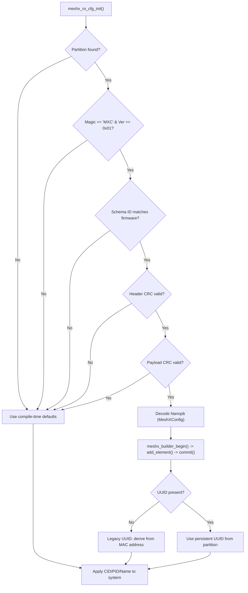

# Page 11 — Read-Only Persistent Configuration

> **[← MXCP Protocol](./10_mxcp_protocol.md)** | **[← Index](../README.md)** | **[Next: Hardware Platform →](./12_hardware_platform.md)**

---

## 12. Read-Only Persistent Configuration

### 12.1 Purpose

The `meshx_cfg` flash partition stores a serialized, CRC-validated binary container (`meshx_cfg.mxc`) containing product identity, element composition, and GPIO bindings. This enables OEM field provisioning and dynamic element baking without firmware recompilation.

### 12.2 Partition Layout (`.mxc` Container)

```
┌────────────────────────────────────────────────────────────┐
│  meshx_cfg partition (FAL-managed, 4 KB)                   │
├─────────────────┬──────────────────────────────────────────┤
│  Header (15B)   │ meshx_cfg_header_t:                      │
│                 │  - magic (4B): 0x0043584D ('MXC\0')      │
│                 │  - version (1B): 0x01                    │
│                 │  - schema_id (4B): CRC32 of proto+opts   │
│                 │  - total_len (2B): 15 + payload_len      │
│                 │  - header_crc (2B): CRC-16 of first 11B  │
│                 │  - payload_crc (2B): CRC-16 of payload   │
├─────────────────┼──────────────────────────────────────────┤
│  Payload (NB)   │ Nanopb-encoded MeshXConfig protobuf:     │
│                 │  - product: CID, PID, name, UUID (16B)   │
│                 │  - elements: repeated ElementConfig      │
│                 │  - gpio: repeated GpioConfig             │
│                 │  - bindings: repeated IoBinding          │
└─────────────────┴──────────────────────────────────────────┘
```

### 12.3 Load Sequence & Fallback



### 12.4 API

```c
meshx_err_t meshx_ro_cfg_init(
    uint16_t *cid,          // out: Company ID
    uint16_t *pid,          // out: Product ID
    char     *product_name, // out: Product name string
    size_t    name_max_len, // in:  Buffer size
    uint8_t  *uuid          // out: 16-byte UUID (zeros if not set)
);
```

### 12.5 Code Generation

Product binaries for the `meshx_cfg` partition are generated by `tools/scripts/code_gen.py` from `prod_profile.yml`:

```bash
# Generate binary config for a product profile
python3 tools/scripts/code_gen.py \
    --profile port/bsp/weact_c3/prod_profile.yml \
    --product CTL_light_strip \
    --output build/meshx_cfg.bin
```

The binary is flashed separately using `esptool.py`:

```bash
esptool.py write_flash 0x3F0000 build/meshx_cfg.bin
```

---

> **[← Hosted Mode](./10_mxcp_protocol.md)** | **[← Index](../README.md)** | **[Next: Hardware Platform →](./12_hardware_platform.md)**
